# P4OS

An iPhone-style operating system for the
[**Waveshare ESP32-P4-WIFI6-Touch-LCD-5**](https://www.waveshare.com/esp32-p4-wifi6-touch-lcd-5.htm)
([wiki](https://docs.waveshare.com/ESP32-P4-WIFI6-Touch-LCD-5)). It is a 5"
720×1280 touch board with an ESP32-P4 (two RISC-V cores at 400 MHz and
32 MB of PSRAM) and an ESP32-C6 that does the Wi-Fi.

It has a home screen with pages, folders and a dock, a control centre and
notifications, and a lock screen with an optional code, and it runs in
portrait or landscape. There are twenty-three built-in apps and forty-six more on
the microSD, loaded as shared objects:

- **Games:** twenty-four, among them Mila (a Sokoban with a black cat in
  Blender 3D), Monster Hop, a racing game, golf, a robot RPG, a 3D pinball
  with six tables, a pipes game with six liquids, Doom at 35 fps and Duke
  Nukem 3D; and an emulator of
  fourteen consoles, the Game Boy Advance and the Neo Geo at full speed.
- **Tools:** notes with task lists, a street map with offline zones,
  internet radio, IP cameras, video, a 3D viewer, a tuner, a drawing app,
  a VNC viewer for a computer's screen, every 3D printer in the house
  (OctoPrint, PrusaLink, Bambu Lab, Klipper, Duet, Elegoo, FlashForge,
  Creality) with its camera, a computer algebra system with
  graphs, geometry and statistics, a data logger for the header's sensors,
  Lua, and Python (MicroPython).
- **A web portal** for files, updates, the log and the network sweeps, and a
  page for every app that wants one, which the app brings from the card.
- **Bluetooth with the phone:** the iPhone's notifications on the board, in
  colour emoji, its music, and its calls answered or rejected from the
  board; and the board as a computer's wireless keyboard and mouse.
- **USB:** the port becomes a keyboard, mouse, gamepad, MIDI device, network
  or disk for a computer; and the board is a USB host on its 40-pin header,
  two ports at once: pendrives, keyboards, mice, gamepads, webcams, sound
  cards, MIDI and serial devices.
- **A Wi-Fi network of its own,** joined with a QR code.
- **The workshop:** I2C, SPI, 1-Wire and GPIO on the 40-pin header, with
  112 kinds of sensor read by themselves (temperature, pressure, air
  quality, light, motion, current, distance...), addressable LED strips on
  any free pin (WLED's way), a serial terminal, an ESP32, Arduino and SWD programmer,
  Modbus, a bench supply and scope, an EEPROM reader and writer, a PWM and
  servo generator with an analog level (and sixteen more servos on a
  PCA9685), a learning
  infrared remote with SmartIR's codes, and a CAN bus analyser. Each one
  was tried on the bench with real parts, wiring diagrams and photos
  included.
- **A software radio:** an RTL-SDR stick on the USB host gives a live
  spectrum and waterfall, broadcast FM in stereo, AM for the airband and
  narrow FM for hams and PMR, and the 433/868 MHz remotes and weather
  sensors decoded, with recordings of all of it and a page in the portal.

A desktop simulator runs the same UI code, so most of it can be built and
tried without the board.

It descends from [AmoledOS](https://github.com/charliejgallo/ESP32S3_AmoledOS),
a smartwatch firmware for a 1.8" board. The app model, the portal and many
of the apps came from there, redrawn for a screen five times larger.

  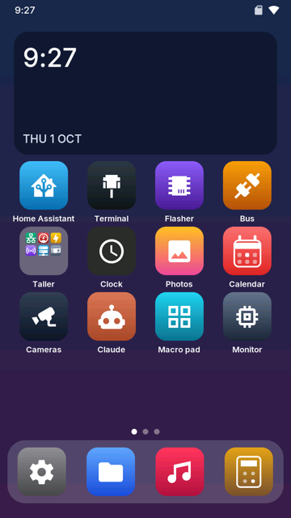
  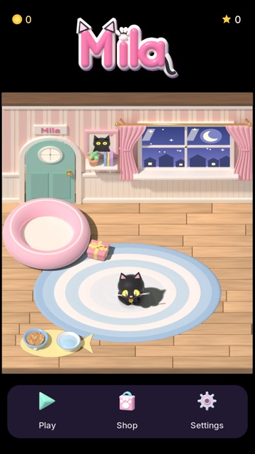
  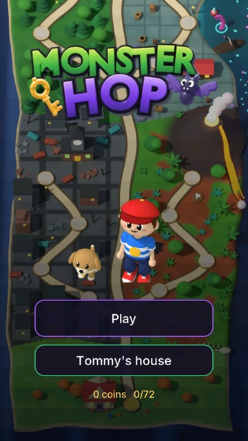

  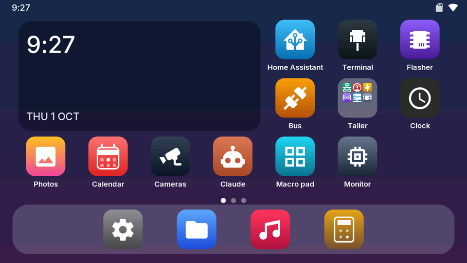

<em>The captures come from the simulator, which draws the
same pixels as the board.</em>

  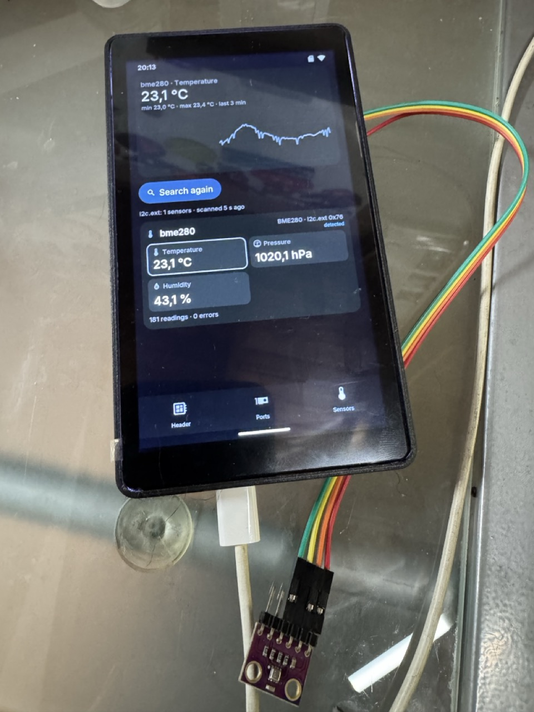
  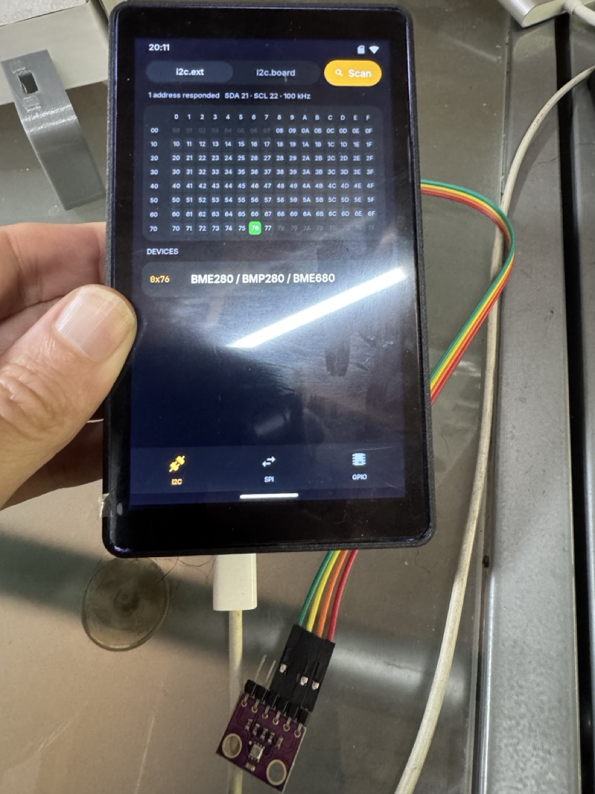
  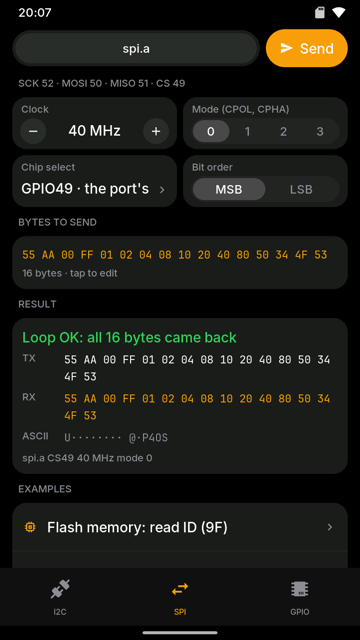

<em>And on the board: a BME280 on the rear header, found by
itself in Modules and by the scan in Bus, and the SPI loopback at 40 MHz
(that one is a capture from the panel, over HTTP).</em>

  
  

<em>A MAX6675 with a type K thermocouple on the SPI port:
Bus's example reads it, and Modules logs it every second; the curve is the
tip heated with a lighter.</em>

  
  

<em>A Pimoroni BME688 on i2c.ext: Bus lists what may live at
0x76, and Modules recognises it by itself as a BME688 (not a BME680), with
its gas resistance, which fell to half with alcohol near it and came back.</em>

  

<em>An SCD41 found by itself at 0x62: the chart is the CO2
of a breath on it, from 3000 ppm back to the room's 600.</em>

  
  

<em>The Programmer reading the whole flash of an AmoledOS
watch (an ESP32-S3 on its own USB) to the card, and writing it back: the
watch came back with every setting it had.</em>

  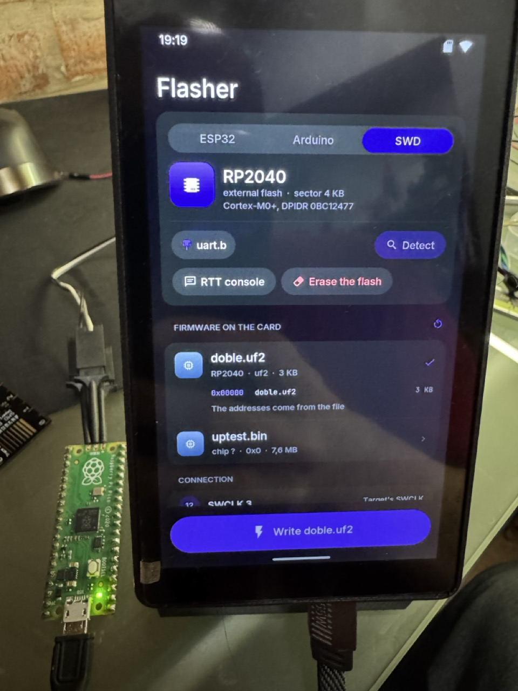
  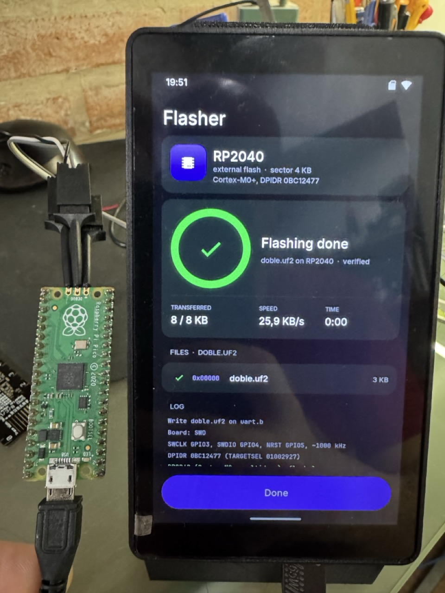

<em>And by SWD, three wires to a Pico's debug header: the
RP2040 found behind its multidrop port and a new firmware written and
verified in under half a second.</em>

---

## What it does

### The shell

The home screen has icon pages, folders, a dock and widgets.

- **Arranging it** is as on an iPhone. A long press starts edit mode, where
  a swipe still turns the page and an icon held still for a moment drags:
  - onto another page;
  - onto another app, to make a folder;
  - into a folder;
  - in or out of the dock, where the icons drag the same way.

  Folders show twelve apps a page, and a swipe turns one whole page. The
  portal's `#inicio` page does the same from a computer.

- **Widgets** (on the board since 0.22.0): edit mode's **+ Widget** adds
  the clock, the sensors, Home Assistant, the system monitor or Claude's
  usage; a tap on a widget opens its sheet, with its size (2×2, 4×2, 4×4),
  what it shows and a way to take it off, and one held still for a moment
  drags like an icon. The **sensors widget** shows up to six of the sensor
  service's values (on its own CO₂, temperature, humidity, pressure and the
  like; CO₂ and particles coloured by their level), the **Home Assistant**
  one up to eight entities, the favourites or the ones picked.

- **Swiping down** from the top opens the control centre (Wi-Fi, Bluetooth,
  do not disturb, the system sounds, orientation, brightness, volume, the
  music playing on the board or on the iPhone, the screen recording) and the
  notifications, with the phone's own actions.
- **System sounds:** a few notes of the speaker's bell when locking and
  unlocking, for notifications and calls, screenshots and recordings, and an
  optional keyboard click. The control centre's bell turns them all off.
- **Recording the screen** (since 0.21.5): the control centre's Grabar
  button records what the panel shows to an MP4 on the card (`/videos`),
  games and cameras included, with a red dot in the status bar while it
  runs. The P4's own engines do the work: the PPA turns each frame into
  the encoder's YUV, the hardware H.264 encoder compresses it (70 ms a
  frame between them, 15 fps on a quiet screen and 7-9 while apps move),
  and the CPU mostly waits. It plays on a Mac or a phone as it is.
- **The status bar** shows the Wi-Fi or the board's own network, the card
  and the USB.
- **The orientation** is chosen in Settings or the control centre, because
  the board has no accelerometer. Apps that only make sense one way turn the
  screen while they are open.
- **The BOOT button** goes home with a tap and takes a screenshot with a long
  press; screenshots go to an album in Photos. Held during the boot screen,
  it starts in safe mode, without the card's apps.

| Settings in landscape | Macro pad | Photos |
|---|---|---|
| 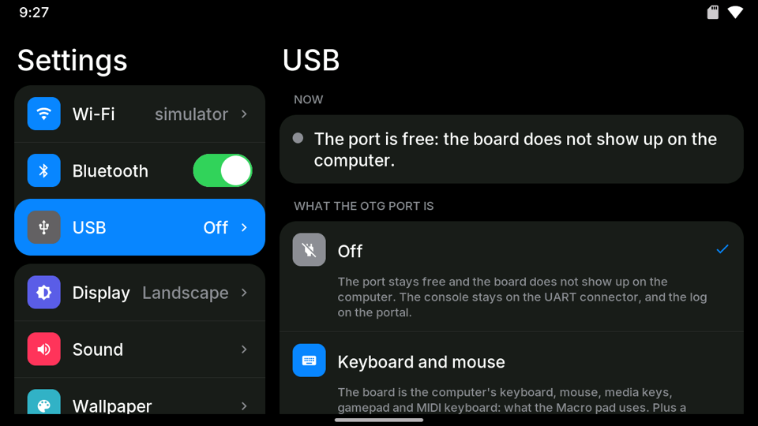 | 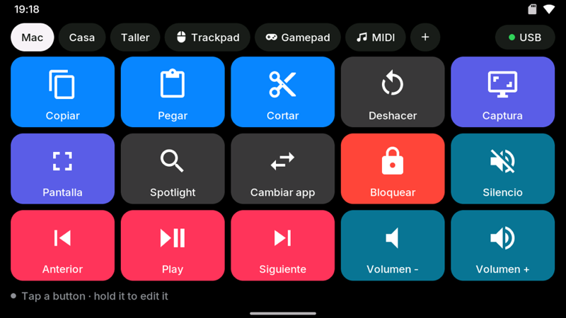 | 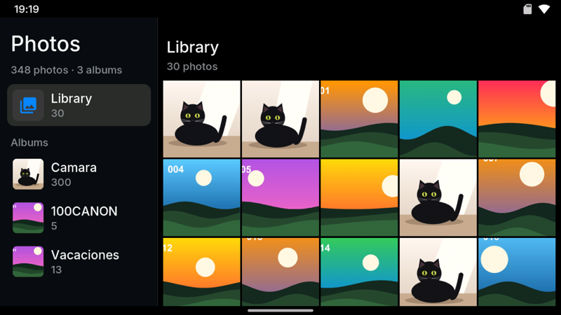 |

  

<em>Recorded by the board itself with its control
centre's button: the home screen, a folder, Photos.</em>

### The lock screen

It shows the time and date large, the messages that came in, and the music
playing with its buttons, over the wallpaper. To unlock, swipe up from
anywhere: the screen follows the finger.

- **When it locks:** at boot, and when the screen has been off for the time
  chosen in Settings (as soon as it goes off, or 1, 5, 15 or 60 minutes
  later). It is checked while the screen is still dark, so waking never
  shows a frame of what was under it.
- **An optional code** of 4 or 6 digits. It is kept as a salted SHA-256,
  never as itself. After 5 wrong tries the pad waits 30 s, and twice as long
  every 3 more; the count survives a restart.
- **A forgotten code:** in the BOOT button's safe mode the lock screen
  does not ask for it, and Settings can remove it.
- **Messages:** today the apps' notifications; the phone's over Bluetooth and
  Home Assistant's will arrive in the same list. With a code, their text can
  stay hidden until unlocked.

| Locked | The code | Settings, Wi-Fi: its own network |
|---|---|---|
| 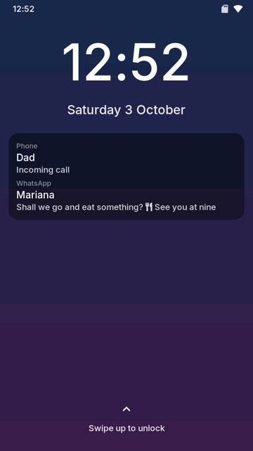 | 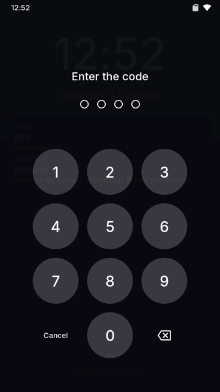 | 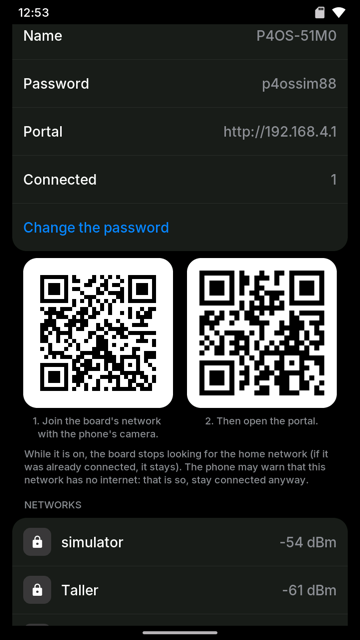 |

### Wallpapers

Eight gradients and a ninth that follows the time of day (night, dawn, day,
dusk, a little different every minute), and over them a photo from the card for the home screen
and another for the lock screen, chosen from Photos (the palette at the top
right of a photo). Each is cropped to the screen, kept in PSRAM (1.8 MB a
screen, nothing in internal RAM) and darkened as much as its own
brightness asks, once, while it is decoded, so the white names read on it
with no translucent layer to blend each frame. Turning the screen crops it
again; Settings, Wallpaper shows which photo each has and removes it.
The lock screen can take a whole folder instead (since 0.22.0): another of
its photos, at random, every time the board locks. The home screen's photo
stays in PSRAM with an app in front, so going home shows it at once; the
lock screen's is let go and decoded again as the screen goes dark.

| Home, over a photo | Locked, over another |
|---|---|
|  |  |

<em>Both on the board, both of Mila.</em>

The same page picks the **accent colour** (switches, selections, the active
buttons), one of iOS's nine system colours. The lock screen's clock is
large or medium, at the top or in the middle, and white, the accent, or the
lock photo's own colour lightened (Settings, Lock screen).

The gesture is a free swipe up, as phones do it today, and not a control
dragged along a track: Apple's 2005 patent on the latter
([US 7,657,849](https://patents.google.com/patent/US7657849B2)) expired in
2025, but that is not the reason this one was chosen.

### Built-in apps

Every day:

| Files | Photos | Music | Clock | Calendar |
|---|---|---|---|---|
| 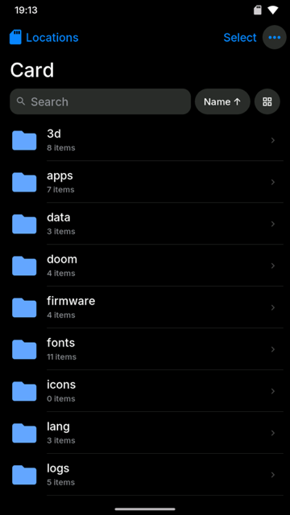 | 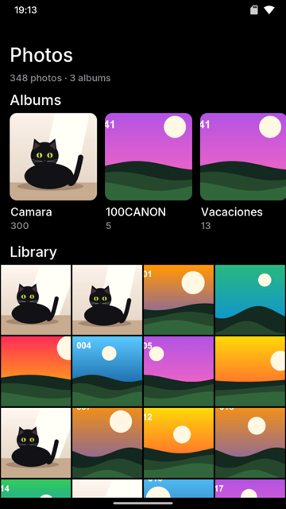 | 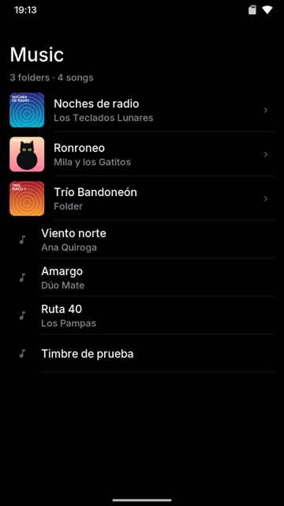 | 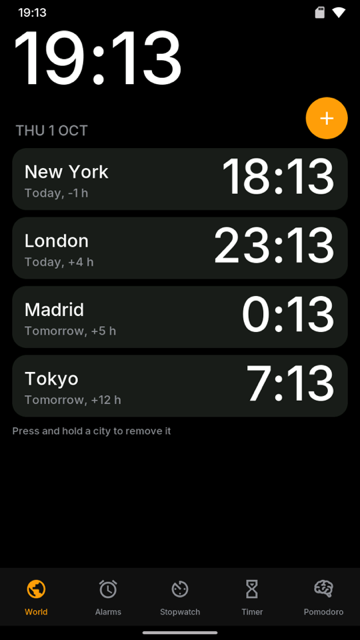 | 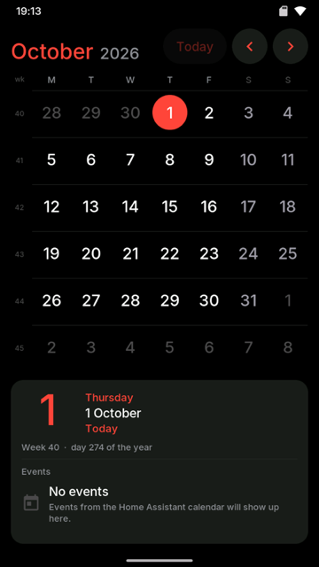 |

| Calculator | Converter | Home Assistant | Claude | Monitor |
|---|---|---|---|---|
| 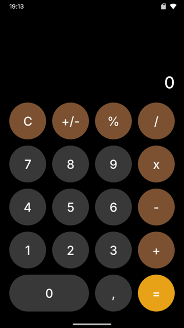 | 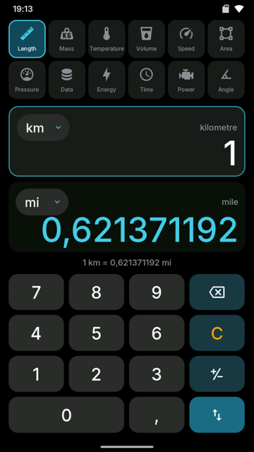 | 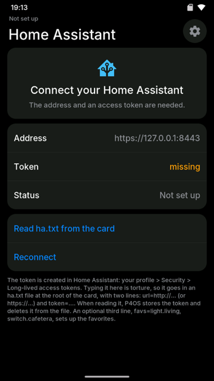 | 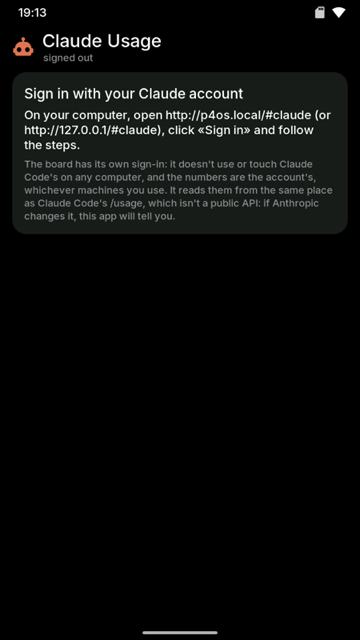 | 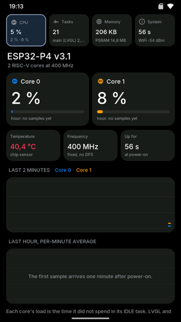 |

- **Files:** the card's explorer, with search, copy, move and folders, and
  firmware opened straight in the Programmer.
- **Photos:** albums, the screenshots among them.
- **Music:** MP3, gapless, with the covers.
- **Clock:** world clock, alarms, stopwatch, timer and pomodoro.
- **Home Assistant:** favourites and the calendar, over its WebSocket API.
- **Claude:** the usage of your own Claude plan, the numbers Claude Code's
  `/usage` shows. It is unofficial; see [CLAUDE-APP.md](docs/CLAUDE-APP.md).
- **Monitor:** CPU per core, the tasks, memory, temperature and the network.
- **Also built in:** MQTT, network tools (ping, a host and port scan with
  every MAC and its maker, mDNS, Wi-Fi; each sweep is saved, and the portal
  compares it with the one before) and Conway's Life.

### The workshop

The 40-pin rear header is described in `modules.txt`: which pins make each
port (`i2c.ext`, `spi.a`, `uart.*`, GPIO) and which modules hang from them.
While an app uses a port it owns it, and Settings, Expansion draws the
header with who holds each pin.

| Bus (I2C scan) | Modules | Terminal | Programmer | Modbus | Electronics |
|---|---|---|---|---|---|
| 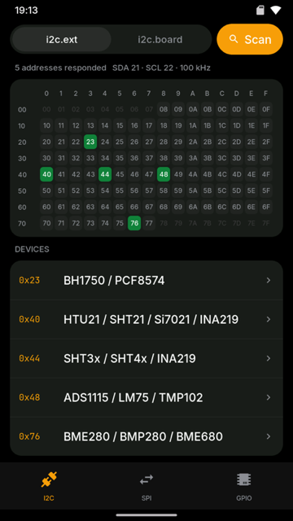 | 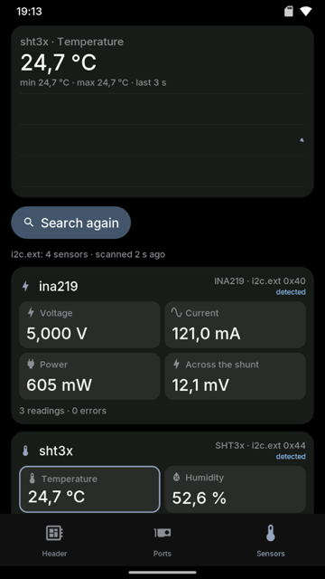 | 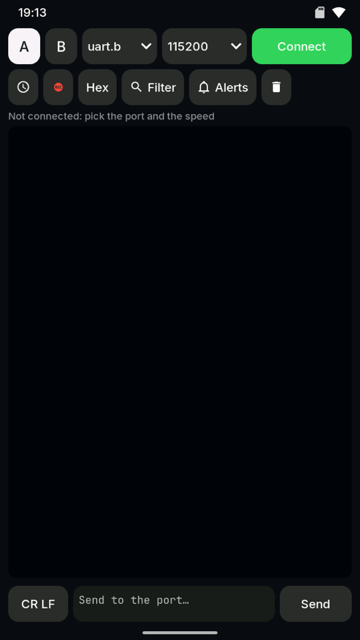 | 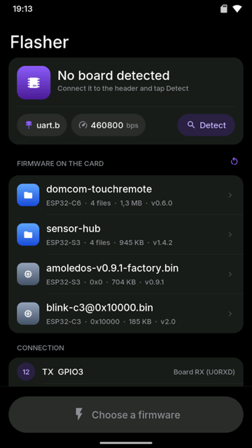 | 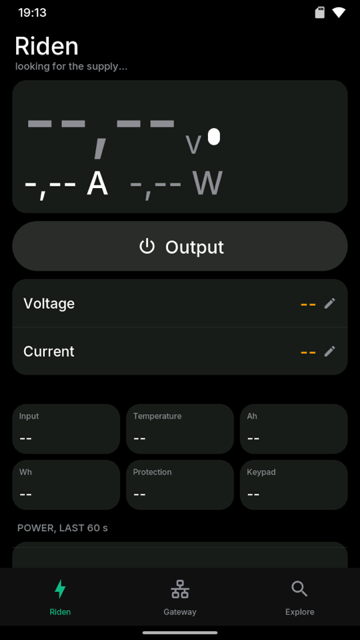 | 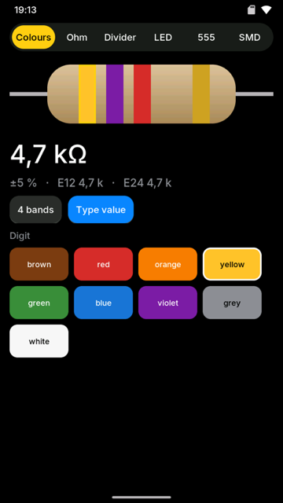 |

- **Bus:** scans I2C and names what answers, talks to SPI chips with presets
  (flash memories, the MAX31855 and MAX6675 thermocouples, the MCP3008, the
  RC522 RFID reader, a loopback), finds the DS18B20s on a 1-Wire bus and reads them live with
  their resolution, and reads and drives GPIO.
- **LED Strips:** an addressable strip (WS2812B, WS2811, SK6812, SK6812 RGBW)
  on any free pin of the header, with the colour order and the number of
  LEDs. It has 13 effects with speed, intensity and two colours. The power
  tab estimates what the strip draws, WLED's way, and dims the whole frame to
  stay within the supply's budget. The strip keeps running with the app
  closed and comes back after a restart.
- **Modules:** live readings from 112 kinds of sensor, every second with
  five minutes of history (since 0.20): temperature and humidity, pressure,
  air quality (CO2, VOC, particles), light and colour, motion and compass,
  voltage and current, distance and presence. The I2C ones that can tell
  who they are are found by themselves (BME280/680, SHT, AHT, SCD4x, SGP30,
  VEML7700, TSL2561, TCS34725, MPU-9250, BNO055, INA219/226/260, ADS1115,
  VL53L0X...); the rest are added from a form: thermocouples and PT100s on
  SPI, DS18B20s on 1-Wire, DHT22, HC-SR04, HX711 scales, flow meters and
  PIRs on plain pins, MH-Z19, PMS5003, PZEM-004T and LD2410 radars on a
  serial port. Every app reads them by name (`aos_sensors.h`); the
  catalogue is [docs/SENSORS.md](docs/SENSORS.md).
- **Terminal:** two serial ports, hex, filters and alerts.
- **Programmer:** flashes another ESP32 from firmware on the card
  (esp-serial-flasher), wired to the header or plugged into the USB host
  (a dev board goes into its bootloader by itself, through RTS and DTR);
  reads its flash to the card, to keep or to clone, and erases it. The
  same for an AVR Arduino through the bootloader it already has (Uno,
  Nano, Pro Mini, Mega, Leonardo, Micro), from the `.hex` the Arduino IDE
  exports. And by SWD, on the same pins: an nRF52, an RP2040, an RP2350
  or an STM32F0/F1 written and verified, and the RTT console of the firmware
  running on it. Or an STM32 through its own serial bootloader, with
  BOOT0 and NRST on the same lines an ESP32 uses. And it lends its port to
  the computer: esptool over `rfc2217://p4os.local:4000`, avrdude over
  `net:p4os.local:4001`.
- **Modbus:** a Riden RD60xx supply over RTU, and a gateway.
- **Bench:** a Rigol scope over the LAN, the Riden, a UNI-T generator over
  USB, and a logger to CSV.
- **Electronics:** resistor colours, Ohm's law, dividers, LEDs, the 555 and
  SMD codes.

The simulator has fake chips and fake servers for all of it: every one of
the 112 sensors has an emulated twin that speaks its protocol
([docs/SENSORS.md](docs/SENSORS.md), [docs/MODULES.md](docs/MODULES.md)).

| LED Strips: effects | The strip | Power | Bus: 1-Wire |
|---|---|---|---|
| 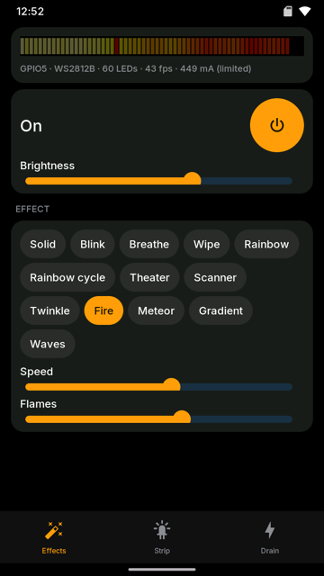 | 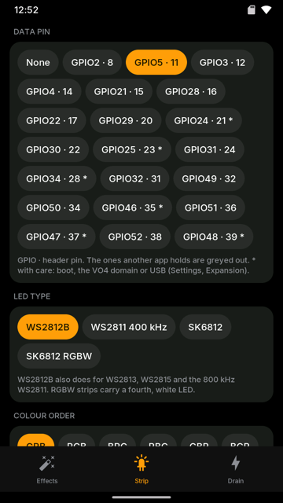 | 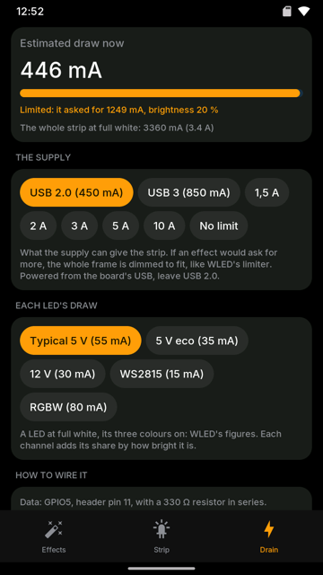 | 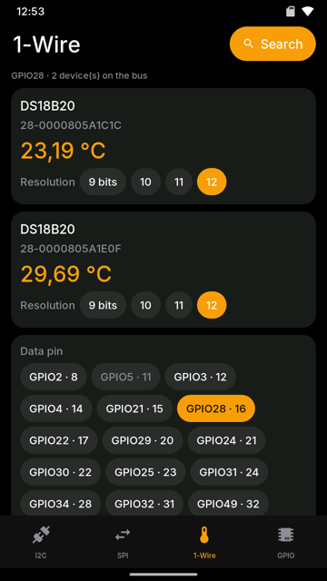 |

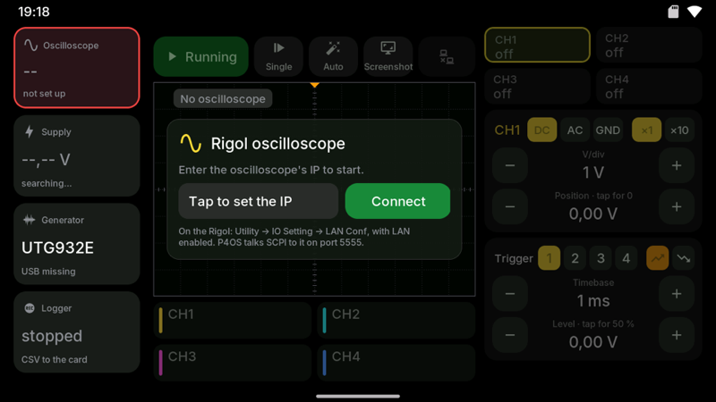

**From the card, for the bench** (since 0.10). Each one owns the header
pins it uses, has a wiring drawing on the board and a page in the portal.

| EEPROM | PWM | Infrared | CAN |
|---|---|---|---|
| 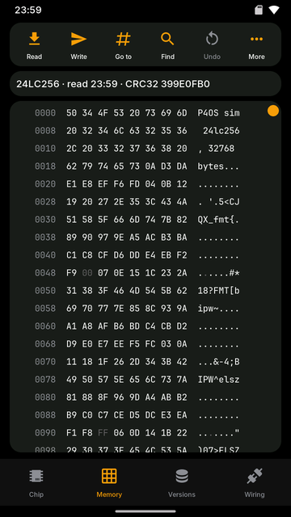 | 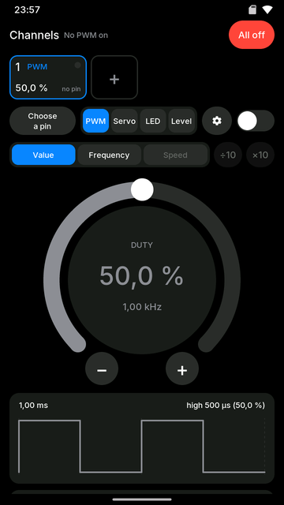 | 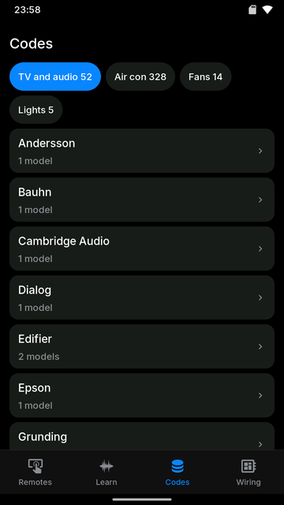 | 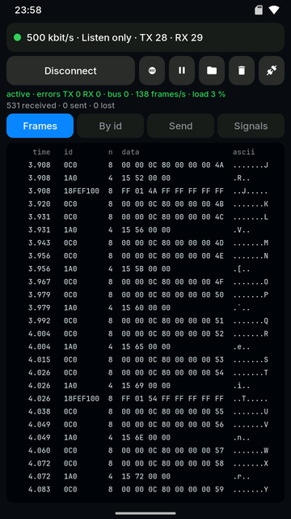 |

- **EEPROM:** reads, writes and edits serial memories: 24xx on I2C, 25xx
  and 25Qxx flash on SPI, 93xx Microwire. It finds the chip and measures
  its size, has a hex editor with find and undo, keeps versions with CRC32
  and MD5, compares them, and draws the wiring for the chosen chip.
- **PWM:** seven channels on any free pins, from 1 Hz to 20 MHz, with a
  knob, patterns (ramp, breathing, strobe, sine), servo pulses in
  microseconds, and an analog level through an RC filter (the P4 has no
  DAC). Since 0.20, sixteen more on each PCA9685 module over I2C, for
  servos and LEDs.
- **Infrared:** learns a remote's buttons (NEC, Samsung, Sony, JVC,
  Panasonic, RC5, RC6, or raw) and sends them back; air conditioners, TVs, fans and lights
  from [SmartIR](https://github.com/litinoveweedle/SmartIR)'s code library.
- **CAN:** a bus analyser on the P4's TWAI controller: frames live, by id,
  sending, decoding signals, and recording to the card. It needs a 3.3 V
  transceiver (SN65HVD230); its self test needs none.

Tried on the bench on 2026-10-05: PWM at three frequencies at once with a
servo and the analog level checked with a meter (1.34 V asked, 1.313 V
measured), a WS2812B strip straight from 3.3 V, a monitor's remote learned
and sent back, and a 24LC256 read, edited, written and restored with its
checksums matching on a computer. The wiring drawings and the numbers are
in [docs/MODULES.md](docs/MODULES.md).

  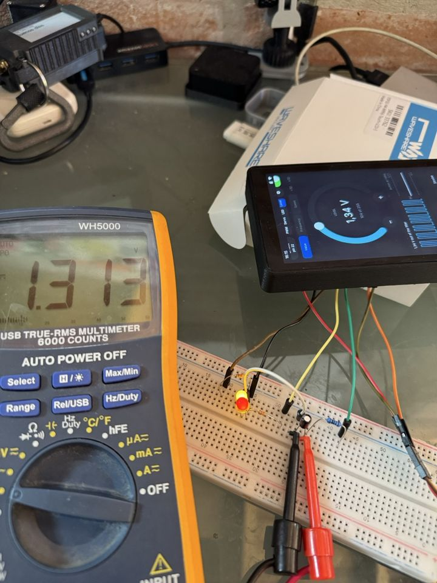
  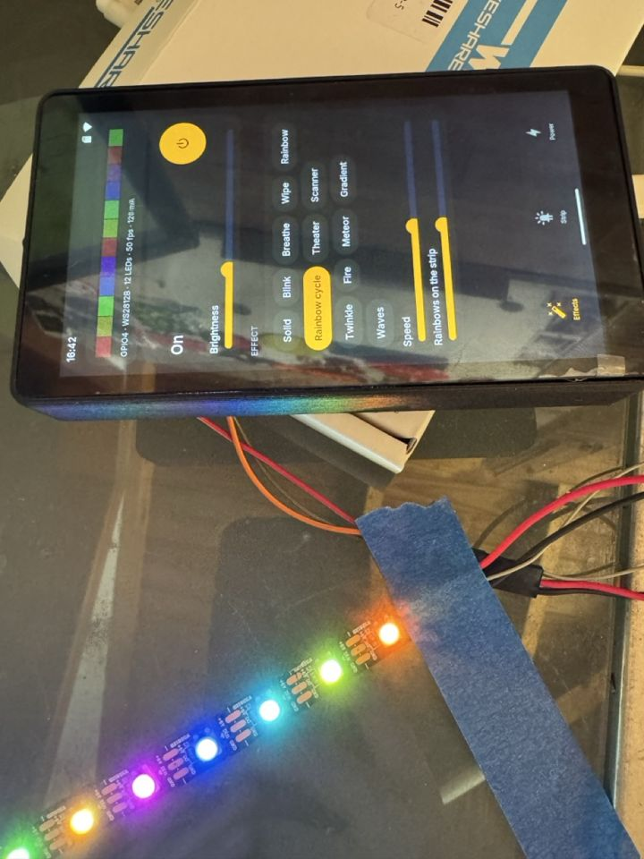
  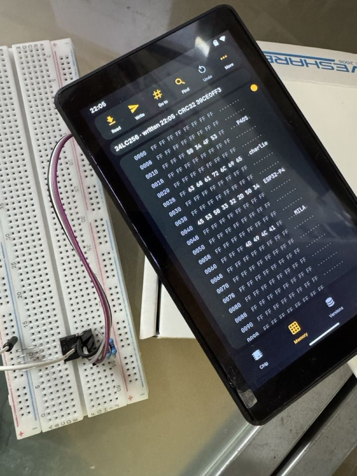

  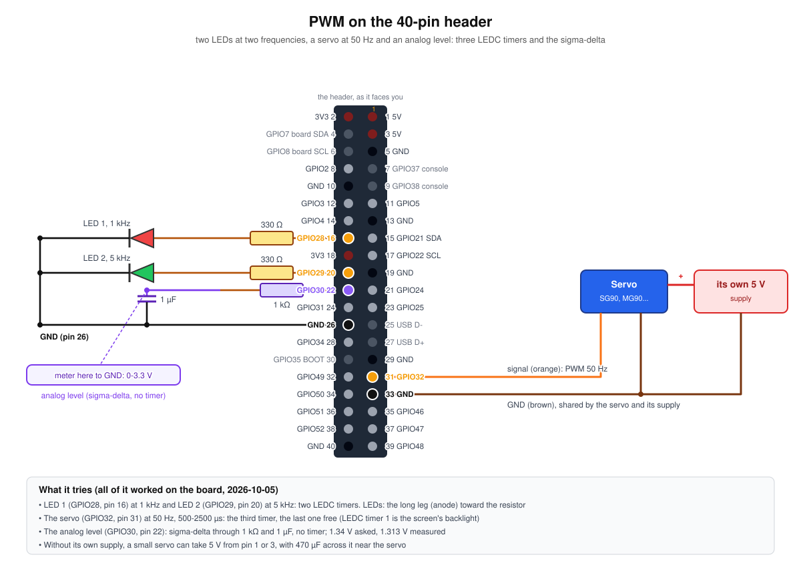

Since 0.20 the PWM app also drives the outputs of a PCA9685 over I2C. On
the board, five servos on one module, fed from their own 5 V supply: each
one moved alone first, then all five in a sine wave, each a fifth of a
turn behind the last ([video](docs/media/pca9685-servos.mp4)).

  
  
  

### Datalog

A data logger for the header's sensors (from the card, since 0.19). Each
line is a value written with its date and time to a CSV of its own in
`/datalog`, every N seconds, minutes or hours or at set times: any value
of a sensor of Modules (I2C, SPI, 1-Wire, on pins or serial), a GPIO with
its pull-up or pull-down, an
ADS1115 input in volts or scaled into a unit of your own, or the board's own
Wi-Fi and memory. Low and high alarms, with hysteresis, sound and show over
any app, or only leave a note in the CSV, and can drive a GPIO (a relay).

| The lines | One line's chart | A new line |
|---|---|---|
|  |  |  |

While it logs it works hidden, shows a red dot in the status bar, and
starts by itself with the board, so a power cut or an update does not stop
it; paused, it does not. Its page in the portal (`#datalog`) shows the live
values and the charts and downloads the files. On the board, a MAX6675 and
a DS18B20 logged every 10 s (the captures above);
[apps/datalog/README.md](apps/datalog/README.md) has the rest.

### RF, a software radio

An [RTL-SDR](https://www.rtl-sdr.com/about-rtl-sdr/) stick (an RTL2832U with
any of the tuners osmocom's library knows, the RTL-SDR Blog V4 included)
plugged into the USB host, with the driver inside the app: the firmware only lends
it raw USB access, so another receiver is another source file in the app
and no firmware ([apps/rf/README.md](apps/rf/README.md)). From the card,
since 0.11.

| FM, listening | 433 MHz, Data mode | A sensor's details |
|---|---|---|
| 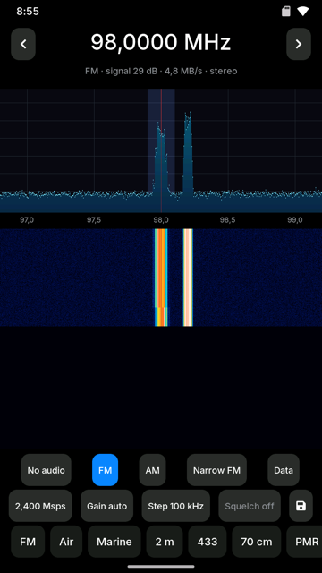 | 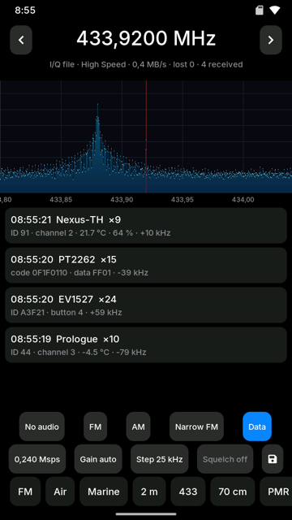 | 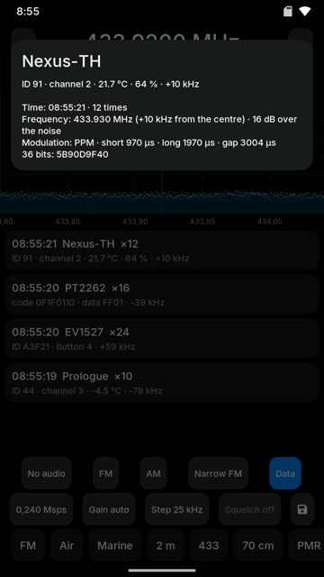 |

- **Spectrum and waterfall,** up to 2.4 Msps with none lost, drawn
  straight to the panel. Drag to tune, tap a frequency to centre it, or
  type one; a row of bands (FM, airband, marine, 2 m, 433, 70 cm, PMR).
- **Listening:** broadcast FM (mono, with the stereo pilot shown), AM for the
  airband, narrow FM for hams and PMR, with squelch over the measured
  noise floor. The filters are 16-bit fixed point on the P4's SIMD
  (esp-dsp), at about a third of one core.
- **Data:** the on-off keyed signals of 433/868 MHz remotes and sensors
  found in the band, their pulses analysed (PWM, PPM, Manchester) and
  decoded: EV1527 and PT2262 remotes, Nexus and Prologue thermometers;
  anything else shows its timings and bits.
- **Keeping it:** a screenshot, the audio as WAV,
  the raw signal as I/Q (and played back later as if live), what was
  received as CSV, and over MQTT.
- **Its page in the portal:** the spectrum and waterfall live, tuning and
  every control, the received list, the spectrum as PNG, and the
  recordings to download.

On the board, 2026-10-07: two gate remotes, a copier and a factory one,
in Data mode with every button on its line; and the back of the board,
with the two USB host sockets on the header in a 3D-printed cover: "2.0"
is pins 25/27 (High Speed, the RTL-SDR's), "1.1" pins 21/23 (Full Speed).

  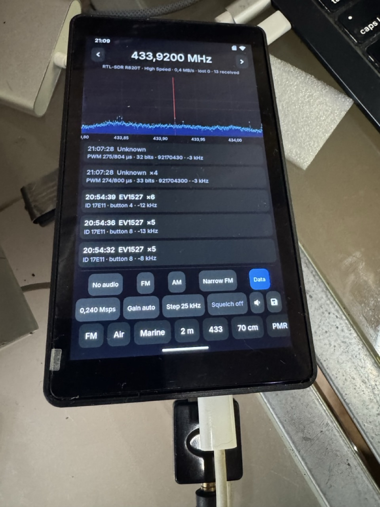
  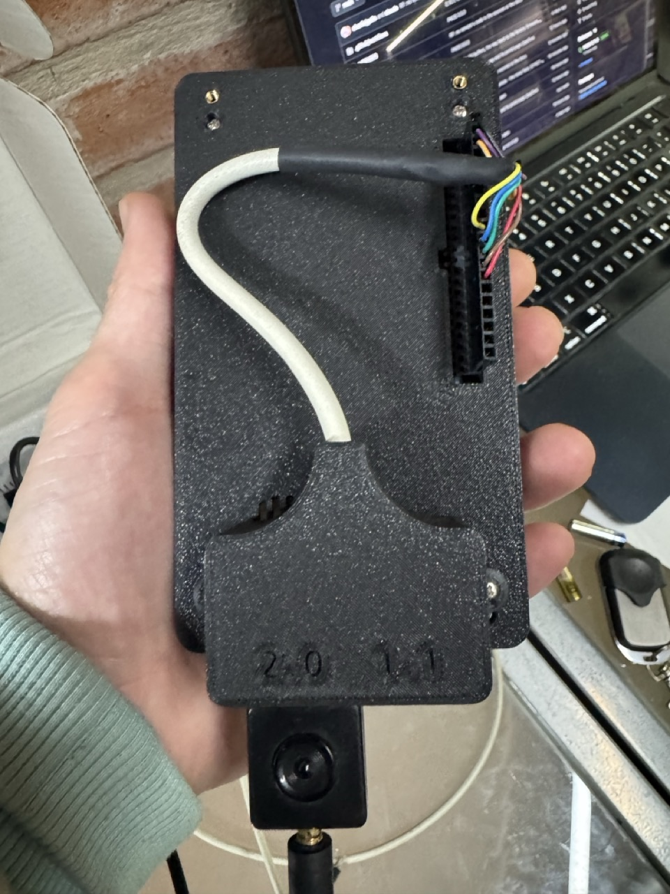

`librtlsdr` is GPL v2, so `rf.so` is too; the firmware stays MIT
([THIRD-PARTY.md](THIRD-PARTY.md)).

### BLE, a Bluetooth LE scanner

Everything the devices around advertise over Bluetooth LE, heard by the
C6's radio and explained ([apps/ble/README.md](apps/ble/README.md)). The
firmware lends the apps a raw scanner and a GATT client
(`aos_hal_ble_*`, [docs/BLUETOOTH.md](docs/BLUETOOTH.md)); what the bytes
mean is the app's. From the card, since 0.12.

| Nearby | Radar | Sensors | Airwaves |
|---|---|---|---|
| 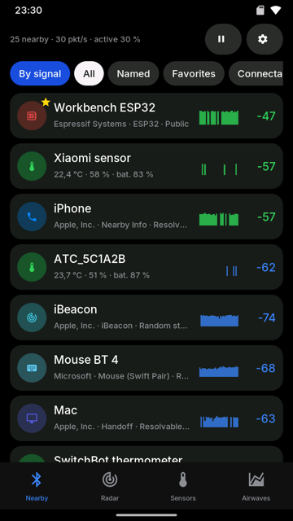 |  |  |  |

- **Nearby:** each device with what it seems to be (phone, earbuds, watch,
  tracker, thermometer, mouse...), its company, the kind of address, the
  last 30 seconds of signal, and a sensor's readings; sorted and filtered.
- **Radar** by estimated distance, and a **finder** for one device: its
  signal in big numbers, whether it is getting closer, and a beep that
  comes faster as you walk towards it.
- **Sensors:** the readings thermometers and the like broadcast (BTHome,
  pvvx/ATC, Xiaomi's MiBeacon, Govee, Ruuvi, SwitchBot, Qingping, Inkbird,
  Eddystone TLM), with their last two hours, to CSV and MQTT. The ones
  that **encrypt** (a stock Xiaomi, BTHome with a key) are read with the
  device's key.
- **Airwaves:** packets a second, devices, companies, kinds of address and
  of advertisement, the spread of the signal.
- **A device's detail:** every AD structure of its advertisement and scan
  response explained (Apple's Continuity, Microsoft's Swift Pair, Google's
  Fast Pair, beacons, companies, UUIDs), with the raw bytes; and for the
  ones that connect, a **GATT explorer** to read, write and listen to
  their characteristics.
- **Its page in the portal:** the table live (search, sort, CSV and JSON),
  the sensors, a device's packets, and the keys.
- If the phone, the computer or the Wi-Fi goes down while scanning (the C6
  has one radio for all three), it says so under the scan's buttons.

On the board, 2026-10-07: a stock Xiaomi e-ink clock thermometer, its
readings encrypted (MiBeacon v5), read with the key made for it, next to
its own screen.

  

### CAS, a computer algebra system

[Giac](https://www-fourier.univ-grenoble-alpes.fr/~parisse/giac.html), the
engine of Xcas, as its author ported it to calculators (KhiCAS), built as
an app for the board: exact arithmetic, algebra, calculus, equations,
matrices, behind a touch interface of six views
([apps/cas/README.md](apps/cas/README.md)). From the card, since 0.14.

| Calculate | Graph | Geometry |
|---|---|---|
|  |  |  |

| Statistics | Finance | Sciences |
|---|---|---|
|  |  |  |

- **Calculate:** results drawn as a book prints them (fractions, roots,
  integrals, matrices), a two-dimensional editor with a keypad of
  templates, and a USB or Bluetooth keyboard typing too. Factor, expand,
  solve, differentiate, integrate, limits, series, Laplace, ODEs...
- **Graph:** six functions on the whole screen; one finger pans, two zoom,
  a long press traces. A regression from Statistics goes there with a tap.
- **Geometry:** points, lines, circles, polygons, intersections,
  perpendiculars, bisectors; drag a point and everything built on it
  follows, with lengths, angles, areas and equations exact when they can be
  (4√2, 25/4, 16π).
- **Statistics:** four lists, histogram, box plots, scatter, six
  regressions, seven distributions, t and z tests.
- **Finance:** TVM, French, German and bullet loans with their table,
  rates (TNA, TEA, TEM), NPV and IRR.
- **Sciences:** the periodic table, molar mass, equations balanced (ions
  too) with their stoichiometry, gases, solutions and pH; 41 physics
  formulas that solve for whichever variable is missing; Punnett squares,
  Hardy-Weinberg, a DNA sequence translated.
- **Its page in the portal:** type from the computer, edit the functions,
  bring lists in from a CSV, save the plot as a PNG.

`cas.so` is GPL-3.0-or-later (Giac); the firmware stays MIT
([THIRD-PARTY.md](THIRD-PARTY.md)).

### Python

MicroPython 1.29 as an app ([apps/python/README.md](apps/python/README.md)),
from the card: a console, the card as its filesystem, the network, libraries
with `mip`, and apps of its own in the launcher. From the card, since 0.15.

| The console | An app: Mila | A game | `framebuf`, lying down |
|---|---|---|---|
|  |  |  |  |

- **The console:** a REPL with a keyboard made for Python (a bar of the
  words typed most, a page of signs, history, auto-indent), or a USB or
  Bluetooth keyboard. Double floats, integers of any size, complex numbers;
  `json`, `re`, `time` with the board's clock, `hashlib`, `deflate`...
- **Files:** the card is `/` and you start in `/python`; `open()`, `os` and
  `import` as on any MicroPython board, precompiled `.mpy` too.
- **Network:** `socket` and `tls` over the board's connection (https:// with
  the system's certificates), and micropython-lib's `requests` and `mip`
  inside: `mip.install("umqtt.simple")` brings a library and what it needs.
- **Apps:** every `.py` in `/python/apps` is an app of its own in the
  launcher. It draws with the `aos` module, Lua's names, written as
  functions the app calls or as a loop of its own around `aos.frame()`;
  MicroPython's `framebuf` works on the same canvas. An error is a message
  with its line, never a reboot; saving the file runs it again. Seven
  samples come with it.
- **Its page in the portal:** the board's console from the browser, an
  editor for the programs, apps and libraries, and `mip` by name.

The heap starts at 2 MB and grows to 12 MB as a program asks, and goes back
when it ends. On the board: `fib(24)` in 481 ms, a megabyte downloaded and
written to the card in 2 s, an app at 50 fps when only part of its canvas
changes.

### Emulador

Fourteen consoles from the card ([apps/emulador/README.md](apps/emulador/README.md)):
the NES, Game Boy and Game Boy Color, Game Boy Advance, Super Nintendo,
Mega Drive, Master System, Game Gear, ColecoVision, PC Engine, Neo Geo, and
the Atari 2600, 7800 and Lynx. Each console's core is a module of its own on
the card, loaded only while one of its games plays.

| The library | Super Nintendo | The menu | Game Boy Color | Mega Drive, lying down |
|---|---|---|---|---|
|  |  |  |  |  |

- **The games** go in the card's `emulador/<console>/`, zipped or not, by
  copying them, over USB disk mode or from the app's page in the portal,
  which also takes the BIOS files and moves battery saves to and from other
  emulators. None comes with it.
- **Playing:** upright or lying down, turned while the game runs; each
  console's own pad on the screen, up to five fingers at once; USB gamepads,
  and a second player on a USB keyboard.
- **The library** opens with the last game, on the picture it was left on.
  Four save states and an automatic one, each with its picture; battery
  saves as the usual `.sav`; fast forward; frame skip; the panel at the
  console's own rate (60 Hz with its 80 MHz clock).
- **On the board:** the Game Boy Advance at 59.7 fps with gpSP's recompiler
  for RISC-V, and the Neo Geo's Metal Slug at 59 fps with a sprite cache in
  PSRAM.

The cores are other people's (nofrendo, gnuboy, gpSP, Snes9x, SMS Plus,
pce-go, Gwenesis, gngeo, Stella, ProSystem, Handy), each with its licence in
its module; Snes9x's and the Mega Drive's Z80 forbid commercial use
([THIRD-PARTY.md](THIRD-PARTY.md)). The screenshots are of free homebrew
games in the simulator.

### Apps from the card

These are `.so` files that the firmware loads at boot. Their code runs
straight from PSRAM (on the P4, data and instructions share its addresses),
and their art comes in packs.

| Mila | Monster Hop | Turbo | Golf | Chatarra | Arkanos |
|---|---|---|---|---|---|
|  |  |  |  |  |  |

| Bubbles | Gems | 2043 | Claude Jump | Neon Snakes | Whack-a-Mole |
|---|---|---|---|---|---|
|  |  |  |  |  |  |

| Truco | Blackjack | Minesweeper | Simon | Traffic Jam | Claudito |
|---|---|---|---|---|---|
|  |  |  |  |  |  |

| Flappy | Dice | Doom | Duke Nukem 3D |
|---|---|---|---|
|  |  |  |  |

Doom is doomgeneric, with OPL2 music, and Duke Nukem 3D is Chocolate Duke3D,
with the Sound Blaster's FM music; both on the board, from the shareware
episodes. Doom needs a WAD of your own and Duke a GRP (the shareware one
works); neither is included.

### Pinball 3D

Six tables, chosen in a carousel ([apps/pinball/README.md](apps/pinball/README.md)):
Noche de Zombis, Robots en Órbita, El Templo de la Jungla, El Gran Circo,
Casino Real and La Isla Pirata. Upright, a touch on either half of the
screen moves that side's flippers, and the launch button comes up when a
ball waits.

| The carousel | Noche de Zombis | El Gran Circo | Casino Real | La Isla Pirata |
|---|---|---|---|---|
|  |  |  |  |  |

- **Each table its own:** its layout and ramp (a loop, a rope bridge, the
  big top's two ramps, a straight one up to a slot machine, a spiral into a
  whirlpool), its toys after the machines of the eighties and nineties (a
  zombie to beat, a robot that swallows the ball, a rolling boulder, a
  human cannonball and a merry-go-round, a roulette and a slot machine, a
  ghost ship and the Kraken), a video mode on the DMD, and its own buttons,
  sounds and music.
- **The rules:** missions, locks and multiball, skill shot, kickback, ball
  save, bonus multiplier, tilt, extra balls; a USB gamepad plays it too.
- **How it is made:** each table is a Python module, rendered in Blender
  through the game's own camera (the picture, its depth, the lamps, the
  toys' frames), so the ball goes behind ramps and toys; a new table is a
  module and a pack, no new code. 60-70 fps on the board.

### Caños

Join the plant's tank to its drain before the liquid runs
([apps/canos/README.md](apps/canos/README.md)). **Turn** fills the board
with pipes turned any way, and a tap turns one; **Complete** leaves gaps,
and a tray offers the missing pieces as they come, with a few decoys. In
Easy you open the valve yourself; in Normal and Hard it opens when the
countdown ends, and you go on fixing ahead of the liquid. Six plants, ten
generated levels each: water, fuel, acid, crude oil, lava and liquid
nitrogen.

| The menu | Water | Acid, in glass | Lava leaking | A leak of water |
|---|---|---|---|---|
|  |  |  |  |  |

- **Each liquid its own:** how fast it runs and how round its front is
  (crude and lava slow and round, nitrogen quick and flat), and how it
  looks: water's caustics and foam, fuel's rainbow film, acid glowing and
  fizzing in glass tubes, lava's drifting crust, nitrogen boiling. Each
  plant has its own pipes (painted steel, hazard bands, glass, old iron,
  refractory, frosted chrome) and floor.
- **Drawn per pixel:** every pipe shape keeps a list of its channel's
  pixels, so the liquid is a few table reads and adds a pixel; the front is
  measured along the whole run and leads in the middle of a pipe, streaks
  of noise ride the flow, bubbles ride in slots along it. A leak throws
  drops into a height field that spreads as a puddle lit by its own slope,
  with fumes, sparks or mist.
- **On the board** 23-30 fps while the liquid runs. A full cell costs 4-8 ms
  to draw, so the full ones take turns (down to one frame in six) and the
  front, the turning pipes and the leak are drawn every frame. A gamepad
  plays it, and the liquid has its own sound.

### Impresoras 3D

Every 3D printer in the house, followed and driven from the board
(since 0.22.1, [apps/impresoras/README.md](apps/impresoras/README.md)).
The list shows each one's state, nozzle and bed, progress, time left and
the hour it ends; a printer opens into its status (the job's picture,
pause and cancel, heaters set with a tap, preheat by material, twenty
minutes of temperature, a Bambu's AMS), its controls (jog, home, extrude,
fan, speed, flow, light, emergency stop), its files, its camera and a
G-code console. It keeps watching in the background, and says when a
print ends, fails or pauses on its own.

| Three MK3S on OctoPrint | One printing | Its camera, 15 fps | Eight protocols (the simulator) |
|---|---|---|---|
|  |  |  |  |

- **Eight protocols, all on the LAN:** OctoPrint; PrusaLink (MK4, MK3.9,
  MINI, XL, CORE One: the printers of Prusa Connect, whose own API is not
  published); Bambu Lab in LAN mode (MQTT over TLS, verified against
  Bambu's own authority and the printer's serial number); Klipper through
  Moonraker; Duet (RepRapFirmware 3); Elegoo's SDCP; FlashForge (the
  Adventurer 5M's API and the older ones' G-code port); and Creality's
  WebSocket (K1, K2, Ender-3 V3).
- **Cameras:** MJPEG streams, snapshots and the P1/A1's own stream, decoded
  by the JPEG block. A MK3S's USB webcam at 640x480 runs at 15 fps; the
  tab says a camera's size and what it sends, and suggests 640x480 when a
  big picture over Wi-Fi keeps the rate down.
- **Its page in the portal** (`#impresoras`): every printer live, with
  pause, cancel, preheat, the light, G-code and the camera, and the list
  of printers edited by fields.
- One thread per printer, so one that does not answer only slows itself;
  `apps/impresoras/tools/fake_printers.py` serves a fake printer of each
  kind to try it without any.

### Cartero

An API client in the manner of Postman, on the board and in the portal
(since 0.22.2, [apps/cartero/README.md](apps/cartero/README.md)).
Requests by hand with params, headers, body and auth; the response
looked at in detail (status, the four times, headers, the body as a JSON
tree); tests written in JavaScript with Postman's `pm`; collections and
folders that run in sequence; environments whose `{{variables}}` move a
whole collection from development to staging to production. The files are
Postman's own, so a collection exported from Postman opens here and back.

| A request | Its response | A collection's run | Environments |
|---|---|---|---|
|  |  |  |  |

- **On the board:** its own HTTP/1.1 client (keep-alive, chunked,
  redirects, the times of each part) and its own small JavaScript
  interpreter for the scripts, in a thread with everything in PSRAM. The
  demo collection (18 requests, 36 tests) runs in under a second.
- **Its page in the portal** (`#cartero`): the same editor, runner and
  environments with a mouse and a keyboard, import of a Postman collection
  or a cURL command. It sends straight from the browser or through the
  board, which has no CORS and is on the board's network.
- HTTPS is always verified, and a refused connection says whether it was
  the certificate, the clock or the handshake.

| Maps | Radio | Video | 3D Viewer | Pixel Art | Tuner |
|---|---|---|---|---|---|
|  |  |  |  |  |  |

- **Maps:** OpenFreeMap vector tiles, drawn on the board, with offline zones
  made in the portal and place search.
- **Radio:** MP3, AAC and HLS stations, with a dial.
- **Video:** MJPEG + WAV from the card, up to 1280×720.
- **3D Viewer:** STL and the games' models, with up to 100 000 triangles.
- **Notes:** rich text (sizes, styles, colours, headings, bullets) and task
  lists with priorities and subtasks, one Markdown file per note.
- **Drawing:** layers, brushes, shapes, text, fill and selections, by
  finger or USB mouse, saved as PNG.
- **VNC:** a computer's screen on the board (a Mac's Screen Sharing with
  the VNC password, or any VNC server), driven by touch, as a trackpad, or
  with a USB mouse and keyboard; a keyboard bubble that floats over the
  remote screen, and one monitor of several marked with a finger.
- **Cameras:** RTSP H.264 and MJPEG, a mosaic and a full-screen viewer.
  The viewer opens a camera's second stream (SD) and a button switches to
  its main one (HD); another turns the picture a quarter, not the screen.
  H.264 is decoded in software (the P4 has a hardware encoder, not a
  decoder), and the viewer converts each picture straight into the panel's
  framebuffer, with no copy through LVGL: a 704x576 doorbell at 7-9 fps,
  its 1920x1080 stream at about one.
- **Also from the card:** Recorder, Weather, Quotes, Lua, where a script on
  the card is an app, and Python, where a `.py` is.

| Drawing | VNC, in landscape |
|---|---|
|  |  |

| Golf | Monster Hop | Maps | Turbo |
|---|---|---|---|
|  |  |  |  |

Frame rates measured on the board:

| App | Portrait | Landscape |
|---|---|---|
| Doom | – | 35 fps |
| Video | 640×360 at 30 fps; 720×1280 at 24 fps | 1280×720 at 20 fps |
| Visor 3D | ~28 fps with ~16 000 triangles | same |
| Monster Hop | 22 fps | ~20 fps |
| Turbo | 18–19 fps | ~15.7 fps |
| Lua (24 cubes) | 34 fps | |

[docs/APPS-P4.md](docs/APPS-P4.md) has them all, and explains how to write
an app.

### Connected

| | |
|---|---|
| **Web portal** | at `p4os.local`: a file explorer, the firmware (updates, both slots, the last crash dump), the log (including the tail of the previous boot), and the network sweeps (each device with its MAC and maker, what changed since the last one, the Wi-Fi channels). The apps bring their own pages from the card, with no firmware: Notes, Radio, RF, Cameras, Recorder, Weather, Quotes, Maps, Lua, Python, CAS, Pixel Art, the 3D viewer and 3D Printers have one, and an app can stream live data to its page ([docs/PORTAL-PAGES.md](docs/PORTAL-PAGES.md)) |
| **Updates over the air** | two slots: an update is written into the idle one and boots on trial. If the board restarts in the first 30 s, the bootloader goes back by itself. Settings, Update can go back on purpose |
| **USB** | the OTG port is high speed (480 Mbit/s). **Keyboard and mouse:** keyboard, media keys, mouse, a gamepad, a MIDI keyboard, and a network over the cable (the portal at `192.168.7.1`, 6.7 MB/s). **Disk:** the microSD as a USB drive. The mode is kept across restarts. **Host:** devices on the 40-pin header (5 V from pin 1, data on pins 21/23, 25/27 or both at once, through P4OS's own copy of ESP-IDF's host library): pendrives at `/usb` (7.4 MB/s), keyboards that type into any text field, a mouse pointer, gamepads that play every game ([docs/GAMEPAD.md](docs/GAMEPAD.md)), webcams in Cameras, sound cards for all the board's sound and recording, USB serial ports in the Terminal (CH340, CP210x, FTDI, CDC-ACM), MIDI, and raw devices for apps that bring their own driver (an RTL-SDR in RF); a Raspberry Pi Pico is programmed by copying its `.uf2` ([docs/USB.md](docs/USB.md)) |
| **Its own Wi-Fi** | an access point, `P4OS-XXXX`, next to the home network or alone. Two QR codes: one joins the phone, the other opens the portal at `192.168.4.1`. A phone downloaded from it at ~3 MB/s |
| **Bluetooth** | through the C6. **The phone:** pairs from the iPhone's own Settings, Bluetooth; its notifications, battery and time come to the board, its music shows and is driven from the control centre and the lock screen, and a call can be answered or rejected on the board. **Keyboard mode:** the board is a Mac's or PC's keyboard, mouse and media keys at the same time; the Macro pad's keys and trackpad go over Bluetooth when there is no cable. [docs/BLUETOOTH.md](docs/BLUETOOTH.md) |
| **The C6's firmware** | updated from the P4, with no cable: Settings, Update, or `tools/install_c6.sh`. It runs esp_hosted 3.0.9, the same as the P4, and going back to the factory firmware works the same way. [docs/C6.md](docs/C6.md) |
| **Home** | Home Assistant over WebSocket, MQTT, Wi-Fi at 2.4 GHz through the C6 |

### Settings

The pages are Wi-Fi (with the access point), Bluetooth, USB (each mode
explained), Web portal (trusted networks, the password), Display, Lock screen, Sound, Wallpaper, Expansion, Storage,
Language, Date and time, Update, Diagnostics, About and Developer.

- **Lock screen:** when it locks, the code (none, 4 or 6 digits, changed or
  removed with the current one), what it shows, and the clock's size, place
  and colour.
- **Sound:** the volume, the system sounds and the keyboard click.
- **Wallpaper:** the gradients, the photos and the accent colour.
- **Storage:** what fills the card by kind of file, and eject.
- **Update:** both slots, and going back.
- **Diagnostics:** chip temperature, CPU, memory, the reset reason, safe mode,
  the hang watchdog's restarts, the C6's firmware, and the crash dump.
- **About:** the portal's addresses, with a QR code for the phone.
- **Web portal:** which networks are trusted, and a password for the
  others (or for all of them); HTTPS with the board's own certificate; the
  token for scripts ([docs/SECURITY.md](docs/SECURITY.md)).
- **Developer:** touches and frames per second over everything, the log's
  level, the drawing preferences with their factory values, and restarting
  into safe mode without the BOOT button.

| Update | Diagnostics |
|---|---|
|  |  |

| Bluetooth | A notification with emoji |
|---|---|
|  |  |

**Emoji.** Every emoji of Unicode, in colour, in any text the phone sends:
Google's Noto set, 4012 of them with skin tones, flags and ZWJ sequences,
from a pack on the card ([docs/EMOJI.md](docs/EMOJI.md)).

**Languages.** The interface is written in Spanish. English and German are
complete. The system's texts travel twice: inside the firmware, so they
work with no card, and as packs on the card. The two are joined string by
string with the card's first, so a fix copied to the card wins, and a card
older than the firmware still gets the new screens translated. An app's
texts travel only with the app, in `lang.zip` (since 0.20.2: carrying them
in the firmware too cost 438 KB). A pseudo-locale is used to
test layouts. The web portal and the apps' pages follow the same language
(since 0.15.1): their catalogs live only on the card and only the browser
reads them.

## What was tested, and what not yet

**On the board, working:**

- Boot in ~4 s with the card's apps.
- Wi-Fi as a station, and as an access point with a phone on it.
- The portal, and OTA with rollback, tested with an image that panicked on
  purpose.
- The crash dump.
- USB against a Mac: keyboard, mouse, media keys, the gamepad, MIDI, the
  network over the cable, and disk mode. Reads at 8.2 MB/s and writes at
  4.8 MB/s.
- USB host, on both ports at once: a pendrive, a keyboard, a mouse, a
  gamepad, a hub, a webcam (Logitech C270), a sound card (output and
  microphone), CH340, CP2102, FTDI and an Arduino Leonardo and a Pico as
  serial ports.
- A generic USB gamepad in every game: the 22 games and Atrapa (Lua)
  played with it on the board.
- The emulator's consoles, with games of the user's own: the GBA at
  59.7 fps (5-7 ms a frame) and Metal Slug at 59 fps (13-17 ms), and its
  pad with the d-pad and two buttons held at once, which needed the touch
  to read more than two fingers.
- The microSD, music and the speaker.
- The games and most of the tools, in both orientations.
- The BOOT button and safe mode.
- Two IP cameras on the network: a doorbell's H.264 (its 704x576 stream
  straight to the panel at 7-9 fps, its 1920x1080 one at about a frame a
  second) and an MJPEG one.
- The screen recording, played back on a Mac.
- I2C with a real BME280 on the header: found by itself, read once a second
  without errors. SPI with MOSI looped to MISO at 1, 10 and 40 MHz, the port's top speed.
- Sensors (0.20), each found by itself or declared from the form and read
  every second in Modules: an AHT10, SGP30, INA219, TSL2561, TCS34725,
  ADS1115, BME688, MPU-9250 (with its compass) and SCD41 on I2C, a
  PCF8574A and a PCF8591 declared, a MAX6675
  thermocouple on SPI and a DS18B20 on 1-Wire. The last two logged by
  Datalog in the background through restarts, updates and a change of
  language, with five more apps opened over it.
- A PCA9685 with five servos on its own 5 V, driven from the PWM app: one
  by one, then all five in a wave, while the sensor service went on reading
  the same I2C port.
- Settings' Storage page and the QR codes.
- The lock screen with its code, and the languages with no card.
- The C6 updated from the P4 to esp_hosted 3.0.9, and back to its factory
  firmware, with no cable; its flash backed up first through J7.
- Bluetooth with an iPhone 15 Pro Max: listed in its Settings, paired, its
  notifications (with emoji) on the banner and the lock screen, its battery
  and time. At the same time, the keyboard mode with a MacBook Air: text,
  media keys and the Macro pad's trackpad. Its music driven from the
  board, a call answered and one rejected, and a message cleared on the
  phone from the notification centre.
- The network sweep with every host's MAC and maker, saved and compared in
  the portal.
- Settings, Developer: touches and fps over the games, and the safe mode
  asked for from there.
- Scanning for Wi-Fi with the saved network out of reach (as away from
  home), and staying up without a network instead of restarting.
- The Programmer flashing an ESP32 on a CP2102 (6.6 s), an ESP32-C3 on
  its own USB (1.5 s) and an ESP32-P4-Nano v3.1 with ESPHome, plugged into
  the USB host.
- The panel's refresh under a game that uses all of core 0: Duke Nukem 3D
  at 640x400 and 640x480 for minutes, no frame lost (`/api/sysmon`,
  `system.panel`).
- The workshop on the bench: PWM at three frequencies at once, a servo and
  the analog level; a WS2812B strip; infrared learned and sent; a 24LC256
  read, written and restored; CAN's self test with no transceiver.
- Drawing on the board, by finger and with a USB mouse.
- VNC against a MacBook Air with two monitors: the login typed with the
  on-screen keyboard, then the mouse and keyboard.
- RF with an RTL-SDR (R820T tuner) on the USB host: 2.4 Msps with no
  samples lost, unplugged and plugged back while running, and broadcast FM
  heard on the speaker (the stereo pilot 36 to 43 dB over its neighbours).
  Two real 433 MHz gate remotes (EV1527), every button decoded.
- BLE scanning at 100 % for five minutes with the iPhone and the MacBook
  connected and a download going: no link dropped, none of 3300 packets
  lost. A stock Xiaomi thermometer's encrypted readings decrypted with its
  key, the same as its screen. The GATT explorer with that thermometer
  (10 connections out of 10, its 86 attributes listed) and with an
  HLK-LD2410 presence radar, whose UART bridge reported once given the
  permission command, also from the portal. That thermometer activated
  from the board (a new bind key in ~5 s, its readings decrypted with it
  right after).

**Waiting for hardware on the bench:**

- More I2C and SPI chips: the RC522 RFID reader (its example is in Bus).
  The TCS34725's fix for a change of range, again on a tidy bench. The
  MPU-9250's heading through a whole turn (the bench's wires did not let it
  turn flat).
- Sensors on plain pins (DHT22, HC-SR04, HX711) and on a serial port
  (MH-Z19, PMS5003, PZEM-004T, LD2410): they run against their emulated
  twins in the simulator.
- A PCA9685's real oscillator against a scope, for `osc=`.
- CAN on a real bus, with two SN65HVD230 transceivers and an ESP32-C3 as
  the other node.
- A 25xx SPI EEPROM in the EEPROM app.
- The Riden over TTL, the Rigol over the LAN, and the terminal at 460800.
- The microphone's gain, and the speaker's latency and heating.
- The real-time clock with a cell.
- RF with a 433 MHz weather sensor (its decoders are tested with synthetic
  signals), and AM and narrow FM with real traffic: indoors, the airband
  and marine channel 16 gave next to nothing.

**Not done yet:**

- **RF:** FSK signals, a CC1101 module on the header as a second receiver
  and transmitter, and ADS-B.
- **ESP-NOW:** esp_hosted does not carry it (3.0.9 neither), so the two-device games of
  AmoledOS run alone here.
- **USB host:** MIDI is written but not tried with a device; Xbox pads
  (not HID) are not taken.
- **The network dying during an OTA:** seen twice on 0.6. The link to the
  C6 is now watched and the board restarts by itself in under 30 s, and the
  C6 runs a newer esp_hosted; the cause itself is not found
  ([docs/BUILDING.md](docs/BUILDING.md)).

The board-side checklist is in
[docs/plan/PRUEBAS-PLACA.md](docs/plan/PRUEBAS-PLACA.md) (Spanish).

## The hardware

| | |
|---|---|
| Board | [Waveshare ESP32-P4-WIFI6-Touch-LCD-5](https://www.waveshare.com/esp32-p4-wifi6-touch-lcd-5.htm), the model without a camera ([schematic and docs](https://docs.waveshare.com/ESP32-P4-WIFI6-Touch-LCD-5)) |
| SoC | ESP32-P4, chip rev 1.3 here. Rev 3.x builds as a separate profile, and a binary for one does not boot on the other |
| Display | 720×1280 MIPI-DSI (HX8394) with three frame buffers, and GT911 touch with five fingers |
| Memory | 768 KB internal RAM, 32 MB PSRAM, 32 MB flash |
| Radio | ESP32-C6 over SDIO (esp_hosted 3.0.9): Wi-Fi 6 at 2.4 GHz |
| Audio | ES8311 (speaker) + ES7210 (two microphones), full duplex |
| Other | microSD (4-bit), CH340 serial, RS485, USB 2.0 OTG, the 40-pin header, BOOT, RESET and POWER |

## Building

You need ESP-IDF **v5.5** (the C6 link runs esp_hosted 3.0.9 on it).
[docs/BUILDING.md](docs/BUILDING.md) has the details, and
[docs/C6.md](docs/C6.md) the C6's own firmware.

    tools/build_fw.sh rev1_3                 # the firmware (or rev3_x)
    tools/build_apps.sh                      # every app in apps/, checked against that firmware
    cd sim && cmake -B build && cmake --build build -j8 && ./build/p4os_sim

The first flash goes over the CH340 port:

    tools/build_fw.sh rev1_3 -p /dev/cu.wchusbserial<id> flash

After that, updates go over the air:

    tools/ota.sh p4os.local

The simulator needs SDL2, mbedtls and ffmpeg (`brew install sdl2 mbedtls
ffmpeg`) and LVGL 9.5.0 in `sim/lvgl`. The firmware build has to have
run once first, because it fetches the components whose headers the
simulator shares.

Each push builds both firmware profiles, every app, the C6's firmware and
the emoji and Notes packs on GitHub Actions. The releases carry all of it
with a full-flash bundle, the apps' portal pages and the language packs;
only the games' art packs are attached by hand.

### The card

    /apps/        <app>.so and <app>_p4.pak (the art packs, Notes' fonts)
    /web/         <app>.js — the apps' own pages in the portal
    /lang/        en/, de/ — the language packs
    /fonts/       emoji.pak — the colour emoji
    /firmware/    c6.bin — a firmware for the C6, to install from Settings
    /music/ /photos/ /videos/ /maps/ /notas/
    /redes/       the network sweeps (and oui.txt, the makers' register, if put there)
    menu.txt      the home screen's order and folders
    modules.txt   what is wired to the header

## A note on what is written down

Most comments in this repository explain *why*, not *what*, and many of them
record something that was measured on the board. A few examples:

- **USB descriptors.** The Mac never configured the device until the
  network's notification interval changed from 50 to 9: at high speed that
  field is an exponent, not a count of frames. A MIDI OUT endpoint of 512
  bytes stalled `SET_CONFIGURATION` because esp_tinyusb's receive buffer is a
  fixed 64. And macOS does not list a gamepad that rides inside the keyboard's
  HID interface ([docs/USB.md](docs/USB.md)).
- **Internal RAM.** The free internal RAM went from 112 KB to ~300 KB: code
  out of IRAM, and statics, LVGL's buffers and the USB buffers moved to
  PSRAM. One thing cannot move: a task's control block in PSRAM panics at
  boot ([docs/MEMORY.md](docs/MEMORY.md)).
- **PSRAM bandwidth.** The panel's refresh reads PSRAM at ~100 MB/s, and a
  large `memcpy` there competes with it and flashes the screen. The games'
  bands stay in internal RAM: in PSRAM, Mila's frames took 22–27 ms against
  8–12.
- **Wi-Fi.** Modem sleep put the ping at ~200 ms and TCP at 170 KB/s, so on
  a wall plug the radio stays awake. With the board's own access point up,
  the station stops looking for the home network, because each search scans
  every channel and drops the phone.
- **The C6.** An RPC to the C6 made under LVGL's lock timed out once, froze
  the screen, and panicked inside esp_hosted. Since then the signal strength
  is a cached reading.
- **Listing a folder.** On FAT, a `stat()` per file is O(n²), tens of seconds
  for a few thousand files. Folders are read in one pass of FatFs's own
  records.
- **The build.** A fresh checkout used to build a firmware that had never
  been on the board, because four Wi-Fi settings lived only in the local
  build's `sdkconfig`. They are in `sdkconfig.defaults` now, and a clean build
  matches the board byte for byte in size.

Where something is a guess, it says so.

## Documentation

| | |
|---|---|
| [BUILDING.md](docs/BUILDING.md) | building, flashing, OTA, crash dumps, the watchdogs |
| [MEMORY.md](docs/MEMORY.md) | internal RAM vs PSRAM, the panel's three frame buffers, PSRAM bandwidth, the audit |
| [APPS-P4.md](docs/APPS-P4.md) | writing and installing `.so` apps, drawing a frame, measured fps |
| [USB.md](docs/USB.md) | the OTG port's modes, descriptors and measurements |
| [BLUETOOTH.md](docs/BLUETOOTH.md) | the phone (ANCS), the keyboard mode (HID over GATT), the portal's API |
| [C6.md](docs/C6.md) | the ESP32-C6's firmware: versions, updating it from the P4, throughput, recovery through J7 |
| [EMOJI.md](docs/EMOJI.md) | the colour emoji pack and how a text gets them |
| [MODULES.md](docs/MODULES.md) | the 40-pin header, `modules.txt`, I2C, SPI and GPIO from apps |
| [apps/emulador/README.md](apps/emulador/README.md) | the emulator: the consoles, the card's folders, the modules, what was measured |
| [apps/pinball/README.md](apps/pinball/README.md) | the pinball: the tables, the rules, adding a table, rendering and packing, what was measured |
| [apps/canos/README.md](apps/canos/README.md) | Caños: the modes, the generator, the six liquids and how they are drawn, what was measured |
| [apps/datalog/README.md](apps/datalog/README.md) | the data logger: a line's choices, the CSV, the alarms, logging in the background |
| [apps/rf/README.md](apps/rf/README.md) | the software radio: receivers, the signal chain, what was measured, the decoders and their tests |
| [PORTAL-PAGES.md](docs/PORTAL-PAGES.md) | an app's own page in the web portal, from the card, with no firmware |
| [SECURITY.md](docs/SECURITY.md) | who may use the portal: trusted networks, the password, the token, and what is not covered |
| [GAMEPAD.md](docs/GAMEPAD.md) | a USB gamepad in the games: the buttons, game by game, and `aos_pad.h` |
| [MACROPAD.md](docs/MACROPAD.md) | the macro pad: pages, buttons, the gamepad and MIDI faces |
| [CAMERAS.md](docs/CAMERAS.md) | RTSP and MJPEG cameras on this board |
| [HOME-ASSISTANT.md](docs/HOME-ASSISTANT.md), [MQTT.md](docs/MQTT.md), [CLAUDE-APP.md](docs/CLAUDE-APP.md) | the home and service apps |
| [BENCH.md](docs/BENCH.md), [RETRO.md](docs/RETRO.md) | the hardware bench and the retro canvas |
| [docs/plan/](docs/plan) | the plan, the hardware survey, the UI and the expansion header (Spanish) |
| [CHANGELOG.md](CHANGELOG.md) | what each version brought |

## Names and marks

Claude and the Claude Code character belong to Anthropic. The Claude app,
Claudito and Claude Jump are an unofficial homage, made with affection for
the character, and are not affiliated with or endorsed by Anthropic. Doom is
id Software's, Duke Nukem is Gearbox Software's (the Duke Nukem 3D app is
unofficial), and Home Assistant is its owners'. The consoles the Emulador
plays are their makers' (Nintendo, Sega, SNK, NEC, Atari, Coleco), and the
app is not affiliated with any of them. 3D Pinball Space Cadet is
Microsoft's, and the machines the Pinball 3D tables take ideas from are
their makers'; its tables, art and sounds are all its own. The other
products named in the apps belong to their owners too.

Python® is a registered trademark of the Python Software Foundation; the
Python app uses the name to say what it runs, and is not affiliated with or
endorsed by the PSF. MicroPython is Damien George's project, MIT-licensed.

## Licence

MIT, see [LICENSE](LICENSE). Third-party code, fonts, icons and data keep
their own licences; [THIRD-PARTY.md](THIRD-PARTY.md) lists each one and what
it asks for. `apps/doom/` is Chocolate Doom through doomgeneric, under the
GNU GPL v2, and no WAD is included. `apps/duke3d/` is Chocolate Duke3D, under
the GNU GPL v2 and, for its Build engine, Ken Silverman's Build licence; no
GRP is included. `apps/emulador/` keeps each console's core in its own
module under that core's licence (GPL, AGPL, and two non-commercial:
Snes9x and the Mega Drive's Z80), listed in
[apps/emulador/README.md](apps/emulador/README.md); no game or official
BIOS is included.

## En castellano

P4OS es un sistema tipo iPhone para la
[placa de 5" de Waveshare con ESP32-P4](https://www.waveshare.com/esp32-p4-wifi6-touch-lcd-5.htm).
La interfaz está escrita en castellano y se traduce con los paquetes de
idioma de la tarjeta, la de la placa y la del portal web. Los documentos del plan y de las pruebas en la placa
(`docs/plan/`) están en castellano; el resto, en inglés.

| | |
|---|---|
| Qué hace | inicio con carpetas, pantalla de bloqueo con código, fotos de fondo para el inicio y el bloqueo, grabación de pantalla en MP4, 23 apps propias y 46 de la tarjeta (juegos, un pinball 3D de seis mesas, un juego de caños con seis líquidos, Doom y Duke Nukem 3D, un emulador de catorce consolas, notas, mapas, radio, video, Lua, Python (MicroPython, con consola, red y apps propias), una calculadora algebraica con gráficos y geometría, un registrador de datos de los sensores del header, una radio definida por software con RTL-SDR, un analizador de Bluetooth LE), portal web con las páginas que trae cada app, USB como teclado, mouse, joystick, MIDI, red o disco, red Wi-Fi propia con QR, Bluetooth con el iPhone (notificaciones con emojis en color, su música y atender o rechazar llamadas) y como teclado y mouse inalámbrico de una computadora, el firmware del C6 actualizable desde la placa, y taller con I2C, SPI, 1-Wire, GPIO y tiras LED direccionables |
| Qué se probó | Wi-Fi y red propia, portal, OTA con vuelta atrás, USB contra una Mac, tarjeta, sonido, juegos y casi todas las herramientas, el emulador (GBA y Neo Geo a 60 cuadros, el táctil con varios dedos a la vez), el botón BOOT, un BME280 por I2C, SPI en lazo a 40 MHz, una termocupla MAX6675 y un DS18B20 registrados por Datalog en segundo plano, el C6 actualizado a esp_hosted 3.0.9 y vuelta al de fábrica sin cables, Bluetooth con un iPhone y una MacBook a la vez (notificaciones, música y llamadas), los barridos de red con las MAC, y el host USB con pendrive, teclado, mouse, joystick en los juegos, webcam, placa de sonido y adaptadores serie, RF con una RTL-SDR (2,4 Msps sin pérdidas, FM escuchada en el parlante), BLE escuchando con el iPhone y la Mac conectados y leyendo un termómetro Xiaomi cifrado con su clave, dos cámaras IP (un timbre H.264 directo a la pantalla y una MJPEG) y la grabación de pantalla en MP4 por el codificador H.264 del P4 |
| Qué falta | probar en la placa el RC522, RF con un sensor de 433 MHz y con tráfico real de AM y FM angosta, y encontrar por qué se cortó la red durante dos OTA |
| Cómo se compila | ESP-IDF 5.5, `tools/build_fw.sh rev1_3`, `tools/build_apps.sh` |
| Cómo se instala | la primera vez por el CH340; después `tools/ota.sh p4os.local` o el portal |
