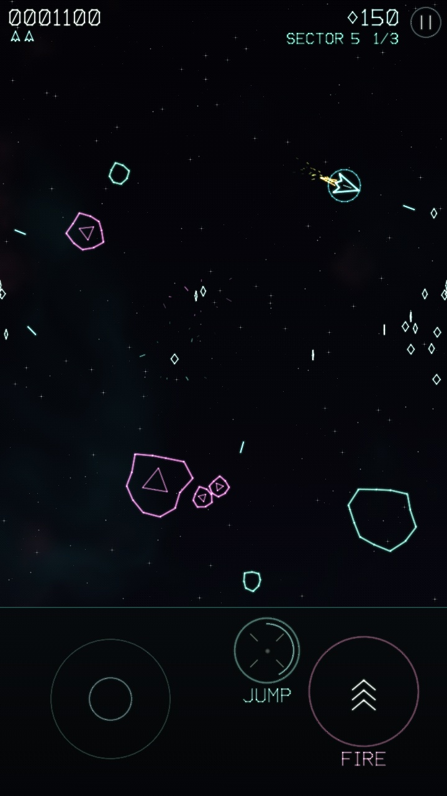

# Deriva

Rocks in space, in neon: a ship that turns, thrusts with inertia and
shoots, on a field that wraps at its edges. Its own game, not a copy of
any other: its rocks, enemies, bosses, rules and sounds are its own. The
directory and the id keep the working name (`apps/asteroides`,
`demo.asteroides`); the game is called Deriva, for the drift that makes
it what it is.



## The game

- **The ship** turns, thrusts and shoots; nothing slows it but a little
  drag, so to stop you turn round and thrust. The **jump** takes it to the
  clearest spot of the field and recharges in 5 s (2.8 s with upgrades).
- **Rocks of five kinds:** plain ones split in two down to the small
  ones; violet ones (the trio) split in three; metal ones take several
  shots, spark and break into plain ones; orange ones blow up and take what
  is near (other orange ones go off a moment later, in a chain); green
  ones (the lapa) drift towards the ship and stick to the hull: each one
  slows it, three crush it, and a jump or a shield gets them off.
- **Enemies:** the seeker (a dart that chases), the layer (a hexagon that
  crosses the field dropping mines), the lancer (aims with a dashed line,
  then charges) and the weaver (rides a wave and shoots three slow orbs).
- **Bosses** every fourth sector of the campaign and every sixth wave of
  the arcade: the Colossus (a rock in six armour plates: shoot a plate off
  to reach the core; it throws rocks), the Hive (three turrets and a
  hangar of seekers; with the turrets down its shell opens) and the
  Serpent (fourteen rings to shoot off before the head can be hurt).
- **Powers** fall from enemies and big rocks: triple shot, shield, beam
  (a ray to the field's edge that cuts through) and magnet, and now and
  then a ship.
- **Crystals** fall from everything; in the campaign they buy upgrades in
  the workshop between sectors: engine, gun, armour (a shield at the start
  of each sector), jump and magnet, or an extra ship.
- **Modes:** the campaign (twelve sectors, three waves each, every sector
  with its sky and colours; a lost sector is tried again from its start
  with the crystals and upgrades kept; the campaign goes on from the
  title) and the arcade (endless waves, five records), alone or two at
  once. Three difficulties.

## Controls

The screen is a field and a deck for the thumbs: under the field upright,
a column on each side lying down. On the stick's side a thumb that lands
anywhere becomes a stick with its base there: the ship turns to where it
points, and pushed past half way it also thrusts, harder the further. In
Settings the stick can be three buttons instead (turn left, turn right,
thrust; a thumb between two presses both), and the sides can swap. On the
other side the round button is the jump and anything else fires. The
small round button in the corner pauses (so do the board's BOOT button,
going back and the gamepad's START).

A USB gamepad (`aos_pad.h` roles): an analog stick is the touch stick, the
d-pad turns and thrusts (up), A or L fires, B or R jumps, START pauses;
the menus and panels follow `aos_pad_menu`. Two players: with two
gamepads each has one; with one gamepad it is player 2's and player 1
plays on the screen.

## How it is made

- `main/ast_game.c`: the rules, in fixed steps of 1/120 s, with no screen
  (so `tools/harness.c` plays it on the Mac).
- `main/ast_gfx.c`: the picture. Bastion's and Metegol's compositor
  (16 x 16 tiles whose things are hashed, only the changed ones drawn
  again, half on each core, straight into the panel's free buffer, then a
  flip), with a neon stroke: a capsule whose light falls off with the
  distance (a white-hot core and a coloured halo), added to what is under
  it, so crossings glow. Long strokes go in pieces that meet flat. Lying
  down each row of tiles is drawn into a strip and written into the
  upright panel turned (Metegol's way), so nothing goes through the PPA.
  Things in the field are clipped to it and drawn again across the edge
  they are crossing.
- `main/ast_font.c`: a vector font (capitals on a 4 x 6 grid, digits,
  signs and the Latin accents), so banners and the score are light too,
  in any of the languages.
- `main/ast_scene.c`: a frame: rocks, ships, enemies, bosses, sparks,
  shards and rings from the game's events, trails, the shake, banners,
  the score and the deck. `main/ast_bg.c`: each sector's sky (a nebula of
  value noise, stars, sometimes a planet), dithered into RGB565.
- `main/ast_audio.c`: everything synthesised when the app opens, no pack:
  the effects, the engine's hum, and two pieces of music (a filtered saw
  bass, a square arpeggio, soft drums) for the sectors and the bosses.
- No packs at all: the app is the `.so` alone (124 KB).

## Measuring

`tools/harness.sh` plays with no screen:

```bash
apps/asteroides/tools/harness.sh -m campaign -n 16        # a person, normal
apps/asteroides/tools/harness.sh -m campaign -d 2 -v      # hard, a line a sector
apps/asteroides/tools/harness.sh -m arcade -n 16 -d 0     # the arcade, easy
apps/asteroides/tools/harness.sh -m campaign -S 12 -g     # the last sector, the good bot
```

The player is a person with a thumb on the stick, as near as a few lines
get (`main/ast_bot.c`): they decide every 150 ms what they saw 220 ms
ago, aim a little off, miss one danger in five, jump only half the times
they should and keep fire down most of the time. A lost sector is tried
again with fresh lives, and the workshop buys the cheapest upgrade. The
harness prints per sector the tries, the lives lost and what took them.

Tuned against that person (2026-11-23, 16 campaigns each): at normal they
lose 0.6 to 2 lives a sector, need 1 to 1.7 tries for most and 3 for the
last boss, and finish the campaign in about 23 minutes; at easy all
finish (21 min); at hard 10 of 16 do. In the arcade they reach wave 11
at easy (7 min), 7.6 at normal (4 min) and 5 at hard (3 min). The first
tuning made the Hive unbeatable (its open shell stopped every shot short
of the core) and the Serpent too (only its last ring could be hurt); the
third sector was a wall, and is lighter now.

The log says every 5 s:
`asteroides: 51.8 fps, a frame 0.32 ms (sim 0.00, list 0.01, draw 0.30), 124 tiles, 577 things, flip 0, 5325 KB held, campaign sector 2 wave 3, 0 rocks`
(the simulator: no page flipping there). About 5.2 MB of PSRAM held; when
the app closes the log says what its own allocator still holds (it must
be 0 KB).

Simulator switches: `AST_PLAY=campaign|arcade|two` starts at once,
`AST_DEMO=1` lets the bot play, `AST_SECTOR=<n>`, `AST_WAVE=<n>` (the last
wave of a boss sector is the boss), `AST_DIFF=<0..2>`, `AST_CONTROLS=1`
(buttons), `AST_SHOP=1` (the workshop even with the bot),
`AST_SIM_TAP=<file.wav>` (what the speaker would play, in real time).

## Pending

- The board: the frames a second with page flipping, upright and lying
  down (the neon stroke works every pixel of its halo; if it falls short
  of 60, the halo's reach and the pieces' length are the knobs), and both
  thumbs at once by hand (the portal's touches do not reach
  `aos_touch_points_n`).
- The sound on the real speaker: levels were set from the tap.
