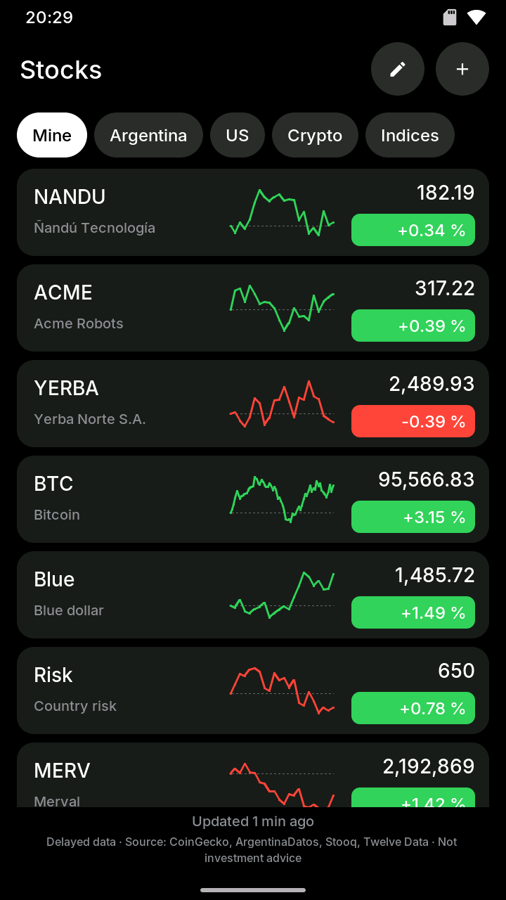
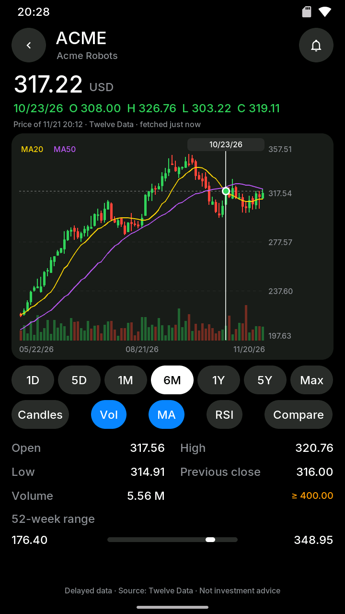
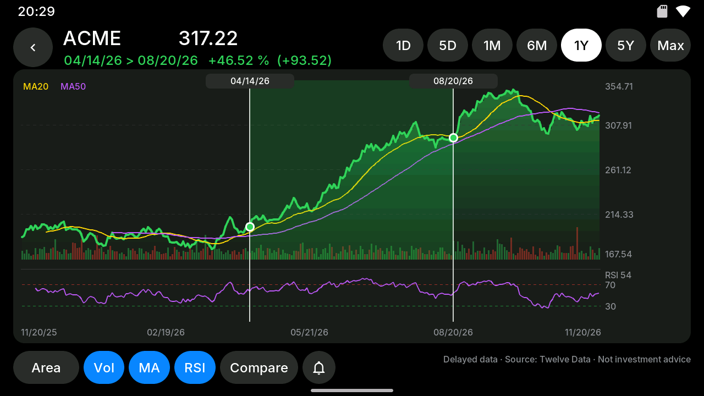

# Bolsa (`aos.bolsa`)

Shares, indices, the Argentine dollar, currencies and crypto, with charts.
Delayed data, the source always on screen, and no investment advice.

 



## What it does

- **Lists** as tabs (mine, Argentina, US, crypto, indices; up to eight): each
  row has the price, the day's change in green or red (tap it for money
  instead of percent) and a sparkline of the day, or of the last month when
  the provider has no intraday data. The pencil reorders and removes; the +
  searches: the built-in catalog filters as you type, and the keyboard's ✓
  asks the share provider's search and CoinGecko's.
- **One symbol:** line, area or candles; 1D, 5D, 1M, 6M, 1Y, 5Y and all;
  volume, the 20 and 50 moving averages and RSI 14. One finger reads a point
  (a cross with the date and the value, or open/high/low/close); two fingers
  mark two dates and give the change between them. Compare with up to two
  more symbols in percent from the start of the range. The day's open, high,
  low, previous close, volume and the 52-week range. Lying down, the chart
  takes the screen.
- **Price alerts:** "if it rises to" / "if it falls to", from the bell or
  the portal. A toast and a beep when the price crosses, while the app is
  alive, in front or not (it runs with `AOS_APP_FLAG_BACKGROUND`; hidden, it
  only asks for the symbols with an alert, every ten minutes at most). An
  alert fires once and stays as "alerted" until it is re-armed on the page.
- **Offline:** every series and the last quotes are kept in
  `<data>/bolsa/` (`c/<symbol>.<res>`, `quotes.bin`), so the app opens at
  once and shows the latest it saw.

## Data sources

One layer per provider in `main/bs_prov.c` (the URL of what is wanted, the
parser of what comes back) and one queue in `main/bs_net.c` that keeps each
free plan's pace. Checked against their documentation on 2026-11-21; tested
only against `tools/fake_quotes.py`.

| Provider | Key | What the app takes from it |
|---|---|---|
| ArgentinaDatos | no | the dollar's houses, euro/real/Chilean and Uruguayan peso in pesos, the country risk: the whole daily history in one request |
| CoinGecko (keyless API) | no | crypto: prices of several coins at once, 1 day every 5 min, 5 days hourly, a year daily (the keyless limit). Attribution required: the footer names it. ~5 requests a minute, so one every 13 s |
| Twelve Data | free | quotes with the 52 weeks (eight symbols a request), 5-min and 30-min intraday, daily. 8 credits a minute, 800 a day |
| Stooq | free | daily open/high/low/close/volume, a year or all of it; indices. Since 2026 its CSV wants an `apikey` |
| Alpha Vantage | free | quotes, the last 100 days, weekly for the long ranges. 25 requests a day |
| Finnhub | free | quotes only (its candles are a paid plan) |

Shares and indices need at least one key. The user types the keys on the
portal page; they live only in `<data>/bolsa/bolsa.txt` on the card. With
several keys the page picks the preferred one for shares; indices go to
Stooq first. What has not been checked against the live services (they want
keys): how Stooq and Twelve Data spell Buenos Aires symbols and indices
(`remote_sym()` in `bs_prov.c`).

No company is named in the code: the factory lists hold indices, coins, the
dollar and currencies. Shares come from the provider's search, which brings
their names (remembered in `names.txt`), or are typed as a symbol: `NANDU`
in the US, `YERBA.BA` in Buenos Aires, `^MERV` an index, `cg:bitcoin` a coin.

## The portal page

`web/bolsa.js` (`#bolsa`): the lists (rename, reorder, add, remove), the
providers' keys with where to get a free one, the preferred provider and the
refresh period, and the alerts. It reads and writes `bolsa.txt`, which the
app looks at every three seconds, and shows the prices the app left in
`quotes.txt`.

## Testing

```
python3 apps/bolsa/tools/fake_quotes.py            # port 8248; --strict for the real limits
cd sim && cmake -B build-bolsa -DCMAKE_BUILD_TYPE=Release -DP4OS_SIM_APPS="hello_app;bolsa" \
  && cmake --build build-bolsa -j8
BOLSA_FAKE=http://127.0.0.1:8248 P4_SIM_PREFS=<scratch>/prefs.txt P4_SIM_PORTAL_PORT=8148 \
  ./build-bolsa/p4os_sim
```

`BOLSA_FAKE` sends every provider to the fake server (each under its own
prefix) and divides the pace by ten. The fake server invents a random walk
per symbol, invented companies (Ñandú Tecnología, Yerba Norte...), and
answers like each provider when the key is wrong (`bad`), the limit is past
(`--strict`), Stooq wants a key (`--no-key-stooq`) or the symbol is
`ERR500`, `SLOW`, `BAD` or `EMPTY`. Any key but `bad` works there.

## Files

| | |
|---|---|
| `main/bolsa.c` | life cycle, the symbols in memory and when each is refreshed, alerts, navigation, small widgets |
| `main/bs_sym.c` | what a symbol is and which provider serves it; the catalog |
| `main/bs_cfg.c` | `bolsa.txt` and `names.txt` |
| `main/bs_series.c` | series, the cache, moving averages and RSI, numbers and dates |
| `main/bs_prov.c` | the providers |
| `main/bs_net.c` | the request queue |
| `main/bs_chart.c` | the charts and the sparkline, drawn in the draw event |
| `main/bs_list.c` | the lists and the search |
| `main/bs_detail.c` | one symbol, comparing, alerts |
| `main/bs_i18n.c` | the app's own catalog (alerts speak while it is hidden) |
