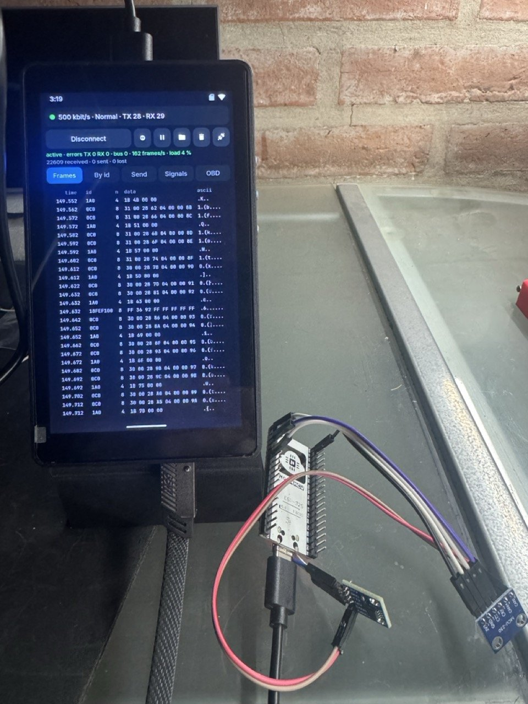
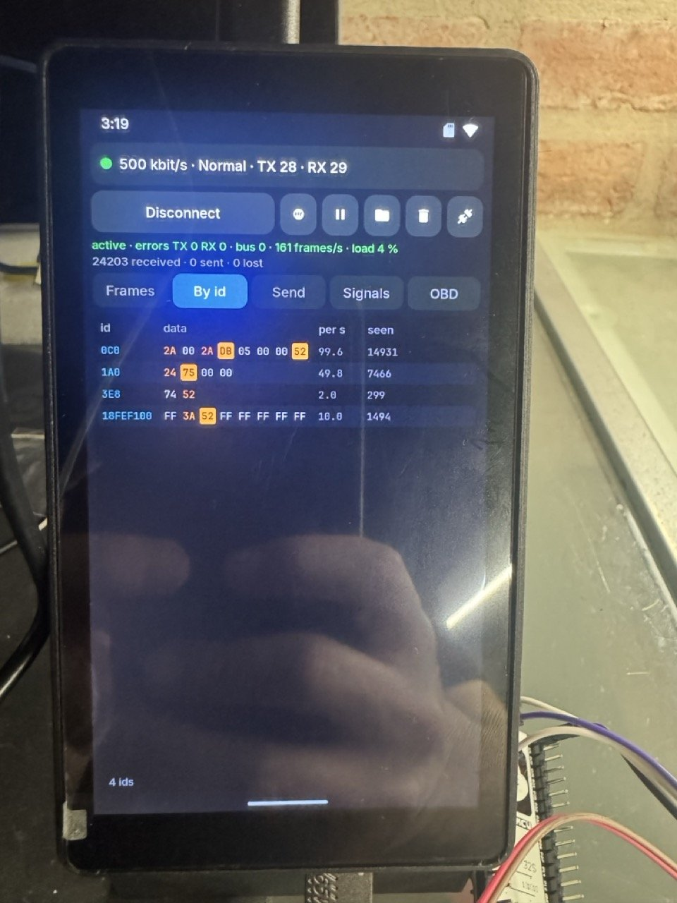
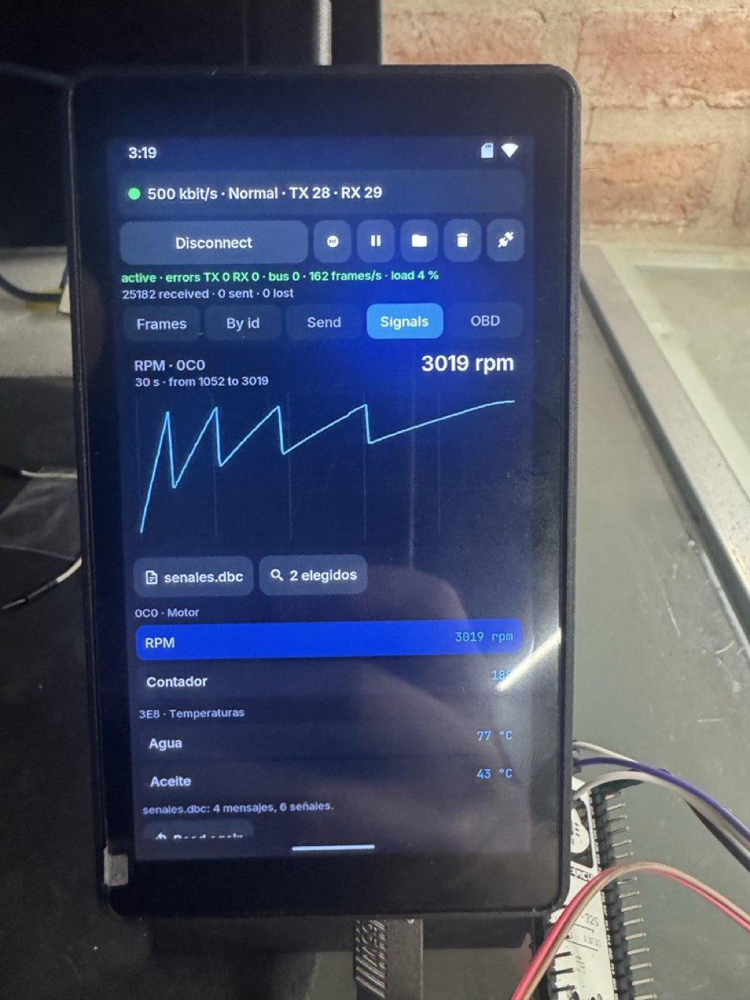
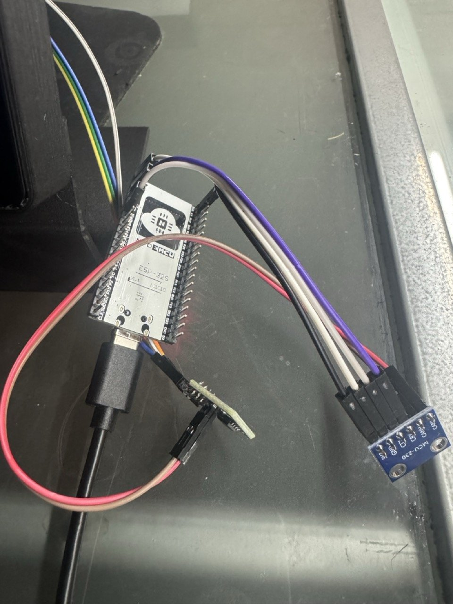

# CAN

A CAN bus analyser for P4OS, on the P4's TWAI controllers and any two
GPIOs of the header. Id `aos.can`. Classic CAN 2.0 (11- and 29-bit ids, up
to 8 bytes), 25 kbit/s to 1 Mbit/s, through `aos_io_can_*`
(`components/aos_io/include/aos_io.h`, `docs/MODULES.md`, "PWM, an analog
level, infrared and CAN").

- **Connection:** TX and RX pins (the header's usable GPIOs, with the owner
  of the taken ones), speed (125k, 250k, 500k, 1M or any other in kbit/s,
  83.3 say), mode and the controller's filter (id and mask, 11 or 29 bits).
  The state of the controller (active, warning, passive, bus off), its
  error counters, frames a second and the bus load are always in view; bus
  off shows a "Recuperar" button.
- **Modes:** *Solo escucha* (never acknowledges nor sends: a car's bus),
  *Normal*, and *Autoprueba* (sends and hears itself, no transceiver; with
  TX and RX on the same pin nothing needs wiring). **The app opens in Solo
  escucha every time**, whatever was used last.
- **Tramas:** every frame with its time since the connection, id, length,
  data and ASCII (lying down). Drag it to pause and read back; "Seguir"
  catches up. The BOOT button pauses and resumes.
- **Por id:** one row per id, sorted: last data, frames a second, count;
  each byte lit amber for a third of a second after it changes and in amber
  letters for three seconds. Tap an id for its 64 bits (those that ever
  moved in orange, those that just did in yellow), to show only it or hide
  it, take it to Enviar, or chart a byte or two (Motorola or Intel).
- **Enviar:** a frame on a hex pad (id, 29 bits, remote, length, eight
  bytes), sent at once or saved; saved ones go out with a tap or every
  10 ms to 1 s with ▶ (eight at once). Five sends in a row that nobody
  acknowledges stop the periodic ones and the replay.
- **Grabar:** to `<card>/can/can-AAAAMMDD-HHMMSS.csv` (or `can-NNN.csv`
  before the clock is set) in SavvyCAN's GVRET CSV, so SavvyCAN opens it.
  The recordings sheet replays one with its timing, once or in a loop
  (Normal or Autoprueba), and deletes them.
- **Señales:** the signals of a `.dbc` (below, "The .dbc library"), each
  with its value under its message's name (a value with a name in the file
  shows the name: a gear "D"), and one charted over 30 s. The file and the
  messages shown are chosen on the tab or on the portal page. The first run
  writes `<card>/can/senales.dbc`, an example with the simulator car's
  signals.
- **OBD:** the OBD-II scanner (below, "OBD-II").
- **Cableado:** the SN65HVD230 drawn between the header and the bus with
  the pins chosen, the 120 Ω ends, the OBD-II pins, and what not to do on a
  car.

## The .dbc library

A `.dbc` (Vector's format, which SavvyCAN, cantools and opendbc use) says
what the bytes of each message mean. The app reads `<card>/can/senales.dbc`
and every `.dbc` in **`<card>/can/dbc/`**, a folder the app makes and the
user fills; in git there is none (the repo's rule).

**Where to get them**, both MIT:

- **opendbc**, by comma.ai: <https://github.com/commaai/opendbc>, folder
  `opendbc/dbc`. Some sixty files of real cars (Volkswagen MQB/PQ/MLB, Tesla,
  Hyundai, Mazda, Ford, GM, Chrysler, Volvo, BMW E9x, Toyota...), mostly the
  makes openpilot drives. The `generator/` folder (Toyota, Honda, Subaru,
  Nissan, Hyundai and others) is not ready-made: its files import common
  parts (`CM_ "IMPORT ..."`), and its generator, run on the computer from
  the repository's root (`PYTHONPATH=. python3
  opendbc/dbc/generator/generator.py`), writes them out whole as
  `opendbc/dbc/*_generated.dbc`; copy those.
- **nberlette/canbus**: <https://github.com/nberlette/canbus>, folder
  `dbc`: `OBD2.dbc` (every PID of modes 01 and 02, multiplexed on 7E8: on
  the Signals tab it decodes what the OBD tab asks), `j1939.dbc` (trucks,
  tractors, generators), `bmw-e39.dbc`, `bmw-e90.dbc`.

**How to set up the folder:** copy the files into `can/dbc` of the card
(from the computer, or "Subir .dbc" on the portal's CAN page), one level,
with names up to 59 characters. Then the file button on the Señales tab (or
the portal's list) picks one. A car's `.dbc` only means something for the
bus it was written for: the right car, and behind its gateway if it has
one (OBD-II below).

**What is read:** `BO_` (the message; bit 31 of the id says 29-bit), `SG_`
(start bit, length up to 32 bits, Intel `@1` or Motorola `@0`, sign, scale,
offset, unit), the multiplexing (`M`, `m3`, and the extended `m3M` with its
`SG_MUL_VAL_`), and `VAL_` (names for values). The comments, attributes,
value tables and float signals (`SIG_VALTYPE_`) are skipped, and signals
over 32 bits are counted and skipped (the firmware's table has no 64-bit
shifts). The file is read whole into PSRAM, up to 4 MB, and parsed into
tables of the size it needs (up to 2048 messages and 16384 signals); lines
have no length limit. vw_mqb.dbc (124 KB, 113 messages, 1348 signals, 641
value names) is read in one go.

**What the tab shows:** a car's file has hundreds of messages, so the tab
lists the signals of the messages **seen on the bus** since the connection
(the default; a small file with nothing on the bus yet is shown whole), or
of up to 64 **chosen by hand** in the "Mensajes" sheet (the ones on the bus
first) or on the portal page, which has the whole list and a search. At
most 160 signals are listed; the rest are counted.

The choice is `<data>/can_dbc.txt`, which the app and the page both write:

    file dbc/vw_mqb.dbc
    show bus                  or: show 0A7 0AD 18FEF100

**Multiplexed messages** carry a different set of signals in each frame
(an OBD answer for one PID of the dozen asked in turn). The table of ids
keeps a message's last frame only, so the bus thread also keeps, for the
messages the `.dbc` multiplexes, the last frame for each value of their
multiplexors (256 frames, PSRAM), and a multiplexed signal is read from the
latest one that carries it.

## OBD-II

The one thing every car has in common: the emissions diagnostics of SAE
J1979 (ISO 15031-5) on ISO 15765-4, in OBD-II, EOBD, OBDBr and the rest
(on CAN since about 2008). The OBD tab asks mode 01, "current data":

- A question goes to **0x7DF** (every unit; with "29 bits", to
  **18DB33F1**) as a single frame `02 01 <PID> 00 00 00 00 00`; each unit
  that knows the PID answers from **0x7E8-0x7EF** (18DAF1xx) with
  `<length> 41 <PID> A B C D`. 7E8 is usually the engine, 7E9 the gearbox.
- First **PID 00**, a map of the PIDs 01-20 the unit knows (bit 7 of A is
  01); if 20 is there, PID 20 maps 21-40, and so on to E0. Then it goes
  round those, one question at a time: the next when the answer came (and
  15 ms more, for a second unit) or after 150 ms, never sooner than 40 ms
  after the last, so about 20 questions a second at most.
- The values with the J1979 formulas for some fifty PIDs (`DEFS` in
  `main/can_obd.c`, written by hand from the public formulas, no PID
  database copied): load, coolant, fuel trims, pressures, engine speed,
  speed, timing, intake air, MAF, throttle, O2 sensors, OBD standard, run
  time, distances and times with the light on and since clearing, fuel
  level, catalysts, module voltage, lambda, ambient, pedals, fuel type,
  ethanol, oil, injection, fuel rate, torques, odometer. PID 01 shows the
  check-engine light and how many codes are stored. A PID the car knows and
  the table does not shows its bytes.
- **It only asks in Normal mode**: the board has to send and acknowledge.
  The app opens in Solo escucha every time, and the tab says so in orange
  with a button to the connection. In Solo escucha it still decodes the
  answers to another scanner plugged into the same connector.
- **The gateway:** on many modern cars the OBD connector is only for
  diagnostics; a gateway keeps the inner buses (powertrain, body,
  dashboard) apart, so on the connector the other tabs show little or
  nothing but these answers, and a car's `.dbc` is of use wired behind the
  gateway. The tab explains it.
- Cars almost always use 500 kbit/s (some 250), with the ignition on or
  the engine running. A filter on the controller that does not let 7E8-7EF
  through is warned about.

Not done: reading and clearing trouble codes (modes 03 and 04), the VIN
(mode 09, which needs ISO-TP's multi-frame answers and flow control), and
modes 02 and 06.

## Portal page

`web/can.js`, the page `#can`: the state, the table by id with the bytes
that change, the signals (pick the `.dbc` of `can/dbc`, upload or delete
one, choose its messages with a search, and their values live), the OBD-II
scanner (start it at 11 or 29 bits, stop it, the PIDs decoded), the last
frames, send (by hand or a saved one), start and stop a recording, download
and delete recordings, and edit `enviar.txt` and `senales.dbc`. The page
reads the `.dbc` itself, with the same rules as the app, and decodes the
app's snapshot (the multiplexed frames and the OBD answers come in it). It
talks to the app through two files of `/data`, so the app has to be open on
the board (in front or not):

- `/data/can_cmd.txt`, written by the page: `watch`, `send 123#1122`,
  `rec on`, `rec off`, `clear`, `reload` (a `.dbc` or `can_dbc.txt`
  changed), `obd on`, `obd on29`, `obd off`. The app's file thread reads it
  every second and deletes it; the page writes the next batch once it is
  gone.
- `/data/can_live.json`, written by the app once a second for 15 s after
  each `watch` (the page repeats it every 5 s), through a `.part` and a
  rename.

## Files

| File | What |
|---|---|
| `main/can.c` | the app, the bar, the state, the tabs |
| `main/can_bus.c` | the bus thread (the only one on the handle) and the file thread (recording, replay, the portal) |
| `main/can_frame.c` | candump text forms, the saved frames |
| `main/can_dbc.c` | the `.dbc` files: the folder, the choice, the reader, decoding |
| `main/can_obd.c` | the OBD-II scanner (run by the bus thread) and its tab |
| `main/can_spy.c` | "Tramas" and "Por id", the id's sheet |
| `main/can_send.c` | "Enviar" |
| `main/can_sheets.c` | connection, wiring, recordings |
| `main/can_sig.c` | "Señales", the chart, the file and message sheets |

The ring of the last 4096 frames, the table of 192 ids, the multiplexed
frames, the `.dbc` (the file while it is read, and its tables) and the
pause's copy are in PSRAM; the two threads' stacks too
(`aos_hal_thread_start`); the statics are the `.so`'s, which the loader
puts in PSRAM. The
app's `CMakeLists.txt` adds `components/aos_io/include`, which
`apps/common.cmake` does not give.

## Trying it

In the simulator every CAN node shares a bus with a car (0x0C0 engine
speed, 0x1A0 vehicle speed, 0x3E8 temperatures, 0x18FEF100 extended); a
node in the self test hears only itself. The car answers OBD-II mode 01
(`sim/io_signal_sim.c`): the engine on 7E8 / 18DAF110 with 19 PIDs (65 has
no formula on purpose, to show the bytes), the gearbox on 7E9 / 18DAF118
with 01 and 0D. To try the scanner: Conexión, Normal, Conectar, then OBD,
Preguntar. The ESP32 car of `tools/can_test/auto_esp32` answers 00, 05, 0C,
0D and 11 on the real bus.

Tried in the simulator on 2026-11-07: opendbc's vw_mqb.dbc and tesla_can.dbc
and nberlette's OBD2.dbc read with the counts a separate parser gives;
`VAL_` names and plain and extended multiplexing decoded on the tab and on
the page; the scanner at 11 and 29 bits, both units; the choice made on the
page taken by the board.

On the board, with no transceiver, Autoprueba on one pin. The real bus, the
P4 and an ESP32 each with an SN65HVD230, is wired as in
`docs/img/bench-can.svg`.

### On a real bus (2026-11-07)

The P4 and the ESP32 car of `tools/can_test/auto_esp32`, each with its
SN65HVD230 (an MCU-230 board), at 500 kbit/s in Normal mode: about 162
frames a second, 4 % of the bus, no errors and nothing lost after 25000
frames. Por id shows each id at the rate the ESP32 sends it (0x0C0 every
10 ms, 99.6 a second; 0x1A0 every 20 ms, 49.8; 0x3E8 every 500 ms; the
extended 0x18FEF100 every 100 ms), and Señales, with two messages of
`senales.dbc` chosen, charts the engine speed climbing through the gears,
1052 to 3019 rpm, and the coolant warming up.

  
  
  

  

What the board has still to confirm: the bus-off recovery and the error
counters with faults on the bus, the load estimate against a scope, a busy
bus (this one is 4 %; the driver's queue is 64 frames), how long a big
`.dbc` takes to read from the card, and the OBD tab against the ESP32 car
(which answers 00, 05, 0C, 0D and 11) and a real one.
