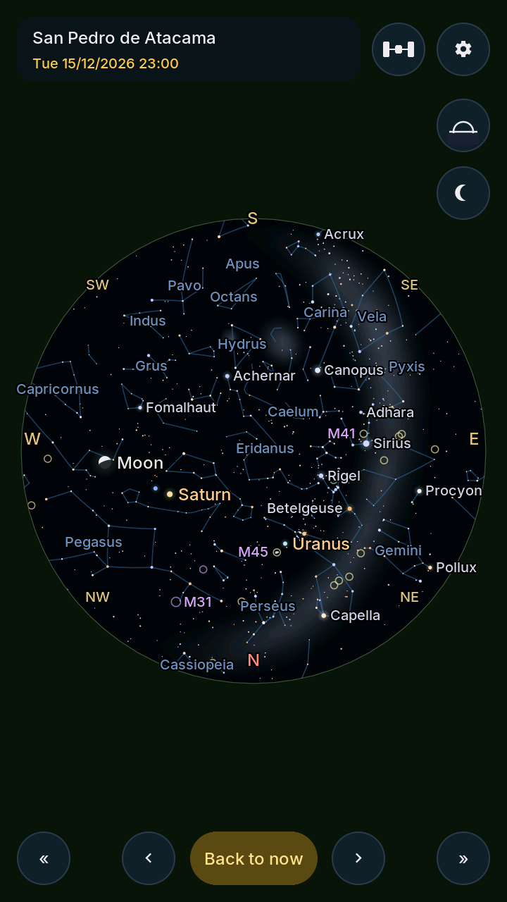
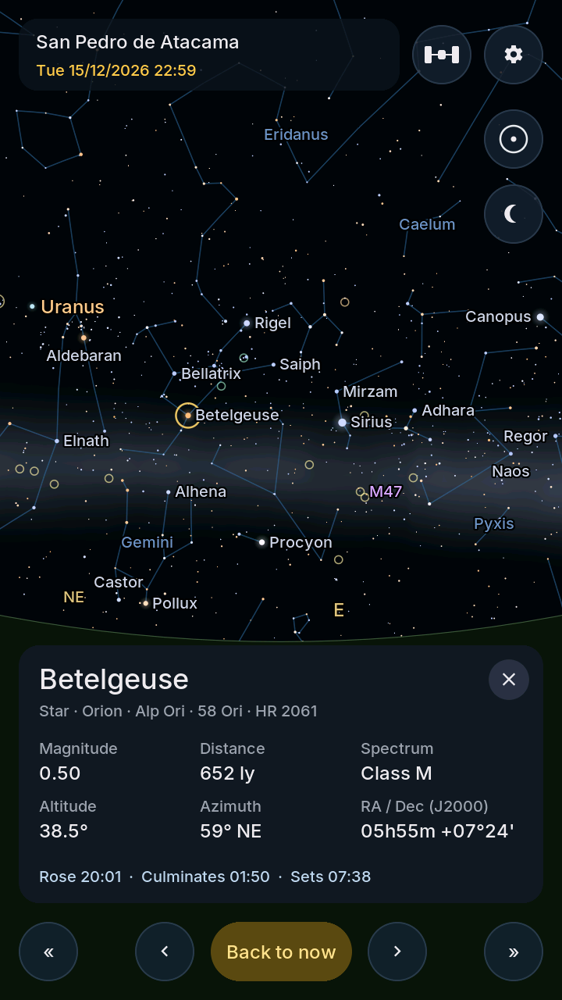
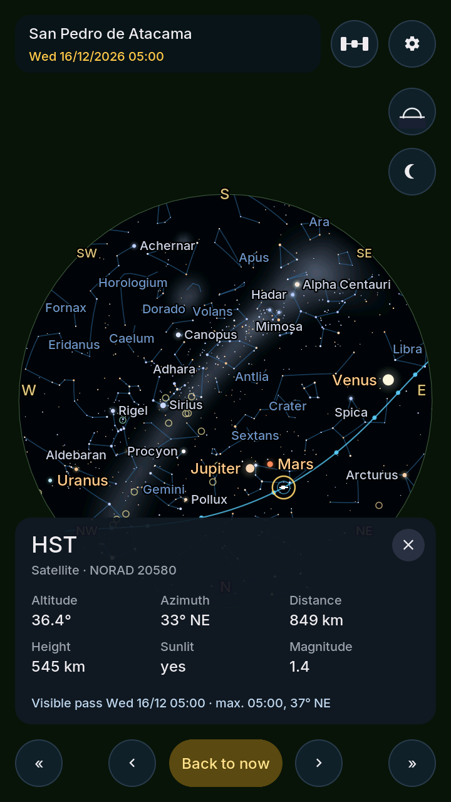
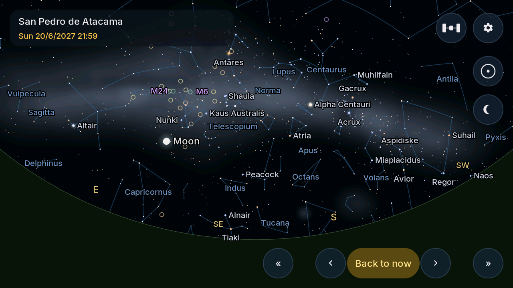

# Cielo (Sky)

Tonight's sky from where the board is: some nine thousand stars in their
colours, the figures and names of the 88 constellations, the Milky Way, the
planets, the Sun, the Moon with its phase, the Messier objects, and the
satellites you follow with their passes. Id `aos.cielo`, directory
`apps/cielo`.







## Using it

- **The view.** The whole dome (the zenith in the middle, the horizon a
  circle; south on top in the southern hemisphere, north in the northern)
  or a view of the horizon, with the button under the satellites'. One
  finger drags it (on the whole dome it turns about the zenith), a flick
  keeps it going, two fingers zoom from 200 degrees down to half a degree,
  a double tap zooms into a point. The sky turns with the Earth in real time.
- **A tap on an object** opens its card: the name, what it is, the
  magnitude, the distance, the altitude and azimuth, the coordinates, and
  when it rises, culminates and sets (or that it never sets or never
  rises). A satellite's card says whether it is lit and its next visible
  pass, and its track is drawn across the sky.
- **Time travel**, along the bottom: the arrows move an hour (held down, a
  day), « and » set how fast time runs (paused, real, 60, 600 or 3600 times,
  forwards or backwards), the middle goes back to now. The date in the top
  bar opens a panel for another date and time, or tonight at 22:00.
- **Night mode** (the moon button): everything red.
- **Settings** (the cog): what is shown (figures, names, Milky Way, Messier,
  planets, satellites, an altitude-azimuth grid, the ground, the daylight
  sky), how many stars, the alerts, the place.
- **Satellites** (the station button): the coming passes over 10 degrees
  for three days, a tap on one goes to it; the orbits' age and a button to
  fetch them again; and the list of the satellites in the file, to choose up
  to 12. The default ones are the ISS, China's station (Tianhe) and Hubble.
- **The place** is Clima's when there is one (its preferences, as Vuelos
  does); otherwise Buenos Aires until another is chosen, by coordinates in
  the place panel or by name in the portal's Sky page.

## The portal page

`web/cielo.js`, the page **Cielo** of the portal: the sky of now over the
board's place, drawn in the browser from the same pack (the stars and the
figures) and the app's `/data/cielo_ahora.json` (the bodies, the satellites
and the sidereal time, written every 30 s while the app is open); the
table of the coming passes from `/data/cielo_pasadas.json` (visible ones
only, or all); and the place, searched by name (Open-Meteo's free geocoding,
asked from the browser, as the Clima page does) or typed as coordinates. It
writes the `place=` line of `/data/cielo.txt`, and the app takes it within
two seconds.

## The data, where it comes from, and its terms

| What | Source | Terms | Where |
|---|---|---|---|
| Stars (9 096, to magnitude 7.96, J2000, B-V, parallax, designations) | Yale Bright Star Catalogue, 5th revised edition (Hoffleit and Warren, 1991), as NASA's HEASARC distributes it (table `bsc5p`) | public domain | the pack |
| Messier objects (109; M102 is left out, as HEASARC does) | NASA HEASARC, table `messier` | public domain (US government work) | the pack |
| Constellation figures (573 lines) | drawn for this app from the catalogue's stars, `tools/lines.txt` | the app's own, Apache-2.0 like the repo; no planetarium's line set (Stellarium's are CC BY-SA or GPL) was used | the pack |
| Star names (134) | `tools/names.txt`: the IAU's names, in their Spanish forms | facts | the pack |
| Constellation names | IAU; the Spanish, English (Latin) and German names in the catalogues | facts | the app |
| Milky Way | a model made by the app (`cl_cat.c`): a band along the galactic plane, brighter and wider at the centre, the star clouds, the Great Rift and the Coalsack, the two Magellanic Clouds, a fractal mottle. Not a survey: no free all-sky image could be shipped | the app's own | made at start |
| Messier distances (44 of them) | rounded published values, written as facts in `cl_names.c` | facts | the app |
| Satellite orbits | CelesTrak's GP data, `GROUP=visual` in TLE form, fetched by the board once a day at most and never twice in two hours (their usage policy), kept with its date in `/data/cielo_tle.txt` | free to use; the URL is a setting (`tle_url=` in `cielo.txt`) | the card |
| Place search (portal) | Open-Meteo geocoding, from the browser | free, no key | - |

The pack, `cielo_p4.pak` (342 KB), is not in git: it is built from the two
catalogues with `tools/gen_pack.py`, whose docstring has the two `curl`
lines for HEASARC's TAP service. It goes to `/apps/` on the card next to
`cielo.so`; without it the app opens with only the planets and says so.

```
python3 apps/cielo/tools/gen_pack.py bsc5p.txt messier.txt -o cielo_p4.pak
```

## How it works

| File | What |
|---|---|
| `cl_dmath.c` | double-precision sin, cos, atan2, sqrt and cube root of its own: the firmware lends the apps libgcc's soft double arithmetic but none of libm's double functions |
| `cl_astro.c` | time (Julian dates, delta T, sidereal time), precession and nutation, the Sun, the Moon, the planets, the topocentric parallax, refraction, rise/culmination/set |
| `cl_sgp4.c` | TLE parsing and SGP4, where a satellite stands in the sky, whether it is lit, its passes |
| `cl_cat.c` | the pack, the B-V colours, the Milky Way model |
| `cl_draw.c` | discs, glows, lines, spans, round boxes, the Moon's phase and text from glyph masks, into an RGB565 buffer addressed through two strides |
| `cl_view.c` | a frame: the projection, the Milky Way, the figures, the stars, the bodies, the satellites, the ground, the labels, the buttons and the card |
| `cielo.c` | life cycle, the worker that draws, the time, the touch, the cards |
| `cl_sat.c` | the TLE file and its download, the passes thread, the alerts, the portal's files |
| `cl_conf.c`, `cl_ui.c`, `cl_names.c` | the settings file, the LVGL panels, the names |

**The formulas.**

- The **Sun**: Meeus, *Astronomical Algorithms* (2nd ed.), chapter 25, the
  low-precision theory, with aberration and nutation.
- The **Moon**: Meeus chapter 47, the main terms of ELP-2000/82: 60 in
  longitude and distance, 45 in latitude, and the additive terms; then the
  observer's parallax (up to a degree for the Moon).
- The **planets**: orbital elements with linear rates in the ecliptic and
  equinox of date and the main mutual perturbations of Jupiter, Saturn and
  Uranus (the "great inequality"), after Paul Schlyter's method, with one
  step of light time; magnitudes after Meeus chapter 41 (Saturn with its
  rings' tilt).
- The **stars**: the catalogue's J2000 positions precessed to the date
  (Meeus 21.2) with the four main terms of the nutation (Meeus 22) and the
  apparent sidereal time; proper motions are left out (under an arcminute
  for nearly every star until 2050).
- **Rise, culmination and set**: the altitude searched every 10 minutes and
  bisected to a second, against -0.5667 degrees (refraction) for stars and
  planets and -0.8333 for the Sun and the Moon's upper limb; the
  culmination where the hour angle changes sign.
- **Satellites**: SGP4 as in Spacetrack Report #3 (a US government work),
  written from its equations with the corrections of Vallado, Crawford,
  Hujsak and Kelso (2006), WGS-72; near-Earth only (an orbit of 225 minutes
  or more is refused: no deep-space SDP4). TEME to the Earth with the
  IAU-82 sidereal time; the observer on WGS-84. Lit means outside the
  Earth's cylinder of shadow; visible, lit with the Sun 6 degrees under the
  observer's horizon. The magnitude is a diffuse sphere scaled from a
  standard one (the ISS -1.8, Tianhe -0.8, Hubble 2.2, the rest 4).

**The frame.** The worker (core 0) draws each frame from a copy of the
scene the LVGL thread fills: first the preparation (the sky of the moment,
every star and object projected, the Milky Way sampled on a grid of 8 px,
the labels placed once so the two halves agree, and where each object
landed for the taps), then the drawing split in two halves on the two cores
(`aos_hal_worker_split`). On the board it draws straight into the panel's
free buffer (`aos_hal_display_back`) and flips; **lying down it draws there
too, turned**, because `cl_draw.c` addresses the buffer through two strides,
so there is neither a PPA pass nor a copy. In the simulator it draws into
one of two frames shown through an LVGL canvas. The projection is
stereographic; the ground is found per row as the roots of a quadratic (the
horizon of a stereographic projection is a circle), and filled as spans.
Frames go up at 30 a second while something moves or time runs fast, ten
while a satellite is up, and once a second otherwise.

## The accuracy, measured

`tests/run.sh` builds `tests/test_astro.c` on the computer and compares the
engine with published ephemerides (69 checks, all passing):

| What | Against | Worst error |
|---|---|---|
| Sun, RA/Dec | JPL Horizons, 2000, 2015, 2026, 2035 | 0.26' |
| Moon, RA/Dec (geocentric) | JPL Horizons, the same dates | 0.06' |
| Moon, 1992-04-12 | Meeus example 47.a | 0.14", 15 m |
| Mercury, Venus, Mars | JPL Horizons | 0.68', 0.58', 0.34' |
| Jupiter, Saturn | JPL Horizons | 0.81', 1.59' |
| Uranus, Neptune | JPL Horizons | 1.43', 0.45' |
| Sidereal time | Meeus 12.a, 12.b | < 0.01 s |
| Precession | Meeus 21.b | < 1" |
| Rise, culmination, set of the Sun, the Moon, Jupiter in Buenos Aires | JPL Horizons' rise/transit/set table, 2026-11-27 | < 1 min (Horizons gives whole minutes) |
| SGP4, satellite 00005 at 0, 360, 720 and 1080 min | Vallado et al.'s verification output | < 1 m, < 1 µm/s |
| SGP4, the ISS on 2019-12-09 | the python-sgp4 documentation's example | 0.13 m |

The Moon is under the 0.5' a planetarium needs by a wide margin; the
planets' worst, Saturn's 1.6', is a twentieth of the Moon's diameter. The
fake TLE server (below) is what the passes were tried against.

## Testing

- **The engine:** `apps/cielo/tests/run.sh`.
- **The satellites, against a fake server:** `apps/cielo/tools/fake_tle.py`
  answers any GET with made-up elements for seven satellites (ISS-like,
  Tianhe-like, Hubble-like...) whose epoch is now or `--epoch`; `--fail N`
  answers 503 first, `--html` an error page. Put
  `tle_url=http://127.0.0.1:8738/...` in `sim/sim_fs/data/cielo.txt`.
- **Development switches** (the simulator; `getenv()` is NULL on the board):
  `CIELO_JD` starts at that Julian date, `CIELO_VIEW="az alt fov"`,
  `CIELO_PICK=<body>` or `h<HR>`, `CIELO_SCREEN=settings|place|date|sats`,
  `CIELO_ALERT_MIN=<minutes>` to see an alert without waiting for one.
- The fps and the frame's time are logged every five seconds
  (`cielo: 24.5 fps, a frame 2.7 ms (max 5.8) ...`), and the PSRAM taken at
  opening.

## Measured

In the simulator (a Mac): a frame takes 2.7 to 5.7 ms with the whole
catalogue and the Milky Way, the passes of three satellites for three days
20-35 ms. The PSRAM taken at opening is 5.4 MB there, 3.6 of it the
simulator's two frames, which the board does not allocate (it draws into the
panel's buffer): about 1.9 MB on the board. **On the board: not measured
yet** (the fps, the frame's time and the PSRAM come out in the log).

## What is missing

- Measuring it on the board: the fps upright and lying down, the PSRAM, the
  passes' time with SGP4 in soft double.
- Choosing the place on a map (it is by coordinates on the board and by
  name in the portal).
- Deep-space satellites (SDP4), and the satellites' standard magnitudes for
  more than three of them.
- The LVGL panels do not go red in night mode (only the sky does).
- Proper motions of the stars.
