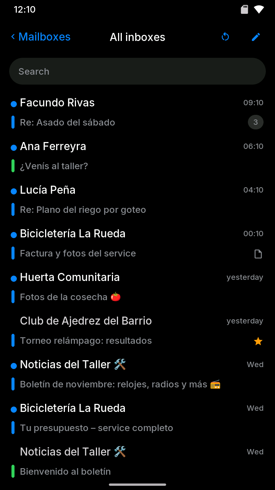
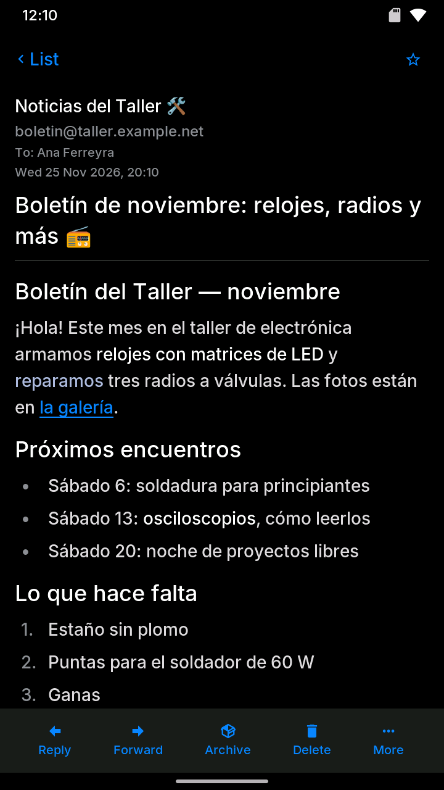
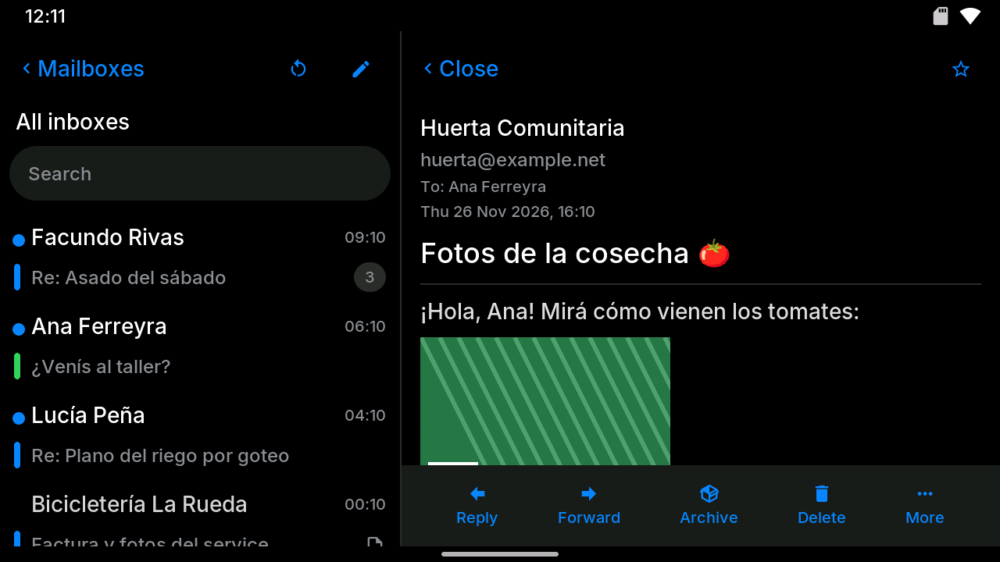
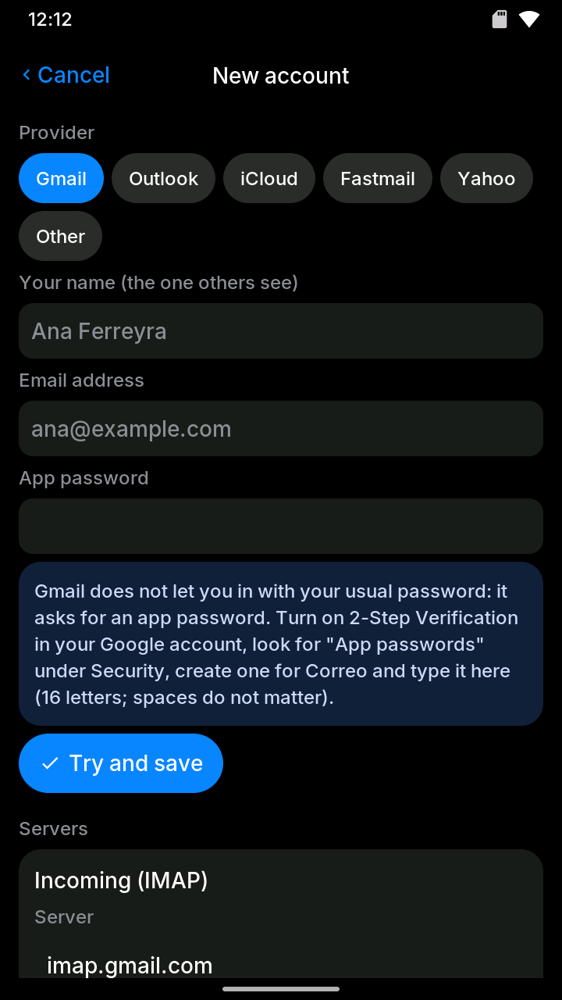

# Correo

A mail client for P4OS over IMAP and SMTP (`aos.correo`): several accounts,
one inbox for all of them, conversations, folders, flags, server search,
HTML read as formatted text, pictures and attachments, replies, forwards,
drafts and signatures, contacts learnt from what is sent and received, a
notice when mail arrives with the app in the background, a cache on the
card, and a page in the portal to read and write from the phone.

## Using it

- **Accounts:** Settings, "Add an account". Pick the provider (Gmail,
  Outlook, iCloud, Fastmail, Yahoo) and its servers are filled in, with a
  note on the *app password* each one asks for (none of them lets a mail
  client in with the account's usual password once two-step verification
  is on). "Other" guesses `imap.<domain>` and `smtp.<domain>` over SSL/TLS;
  every field can be changed by hand. "Try and save" logs in to both
  servers before keeping anything and says which one failed and why; the
  account can be kept anyway.
- **The inbox** opens first: every account's INBOX together, newest
  first, a conversation per row (the number says how many messages; a tap
  shows them, with the answers that are in Sent). The colour bar says
  which account. "Mailboxes" goes to the folders of each account.
- **Search:** typing filters what is on the board at once; the magnifier
  (or the keyboard's Enter) asks the server (`UID SEARCH TEXT`).
- **A long press on a row:** read/unread, star, archive, move, delete.
- **A message:** reply, reply all, forward, archive, delete, and "More"
  (unread, star, move, the links, save the `.eml`). A touch on a link
  shows it as a QR code: the board has no browser, the phone opens it.
- **Attachments:** saved to `Correo/` on the card; documents open with
  Oficina when it is installed, pictures in a viewer.
- **Writing:** the addresses suggest contacts as you type; "Attach" picks
  a file of the card. Leaving with something written offers to keep it as
  a draft (it goes to the account's Drafts folder); a draft opened there
  has "Go on writing".
- **Landscape:** the list on the left and the message on the right.
- **Options:** group by conversation, notices in the background (on by
  default), open with the board, and the cache's limit.

## How it is made

| File | What |
|---|---|
| `cr_util.c` | PSRAM, text, base64, quoted-printable, charsets to UTF-8, RFC 2047 words, dates, addresses, modified UTF-7 |
| `cr_mime.c` | the MIME walk (multipart, alternative, related, message/rfc822), text/plain with quotes and format=flowed, attachments with their IMAP section, and the message put together to send |
| `cr_html.c` | HTML to formatted blocks, with no web engine |
| `cr_net.c` | the connection over the HAL's `aos_tls_*`, and SMTP |
| `cr_sync.c` | the network thread: IMAP, IDLE, sync, the jobs |
| `cr_store.c` | accounts, options, passwords, the cache, contacts, providers |
| `cr_ui*.c` | the screens |
| `cr_portal.c`, `web/correo.js` | the portal's page, over the live channel |

**Threads.** One network thread for every account. Each account has one
IMAP connection that sits in IDLE on its INBOX; the thread polls them in
turn for a few tens of milliseconds each. A job from a screen (open, flag,
move, search, send...) takes the account out of IDLE, does its part and
the loop puts IDLE back. The screens never touch the network and the
thread never touches LVGL: they share the model behind a mutex and two
queues. Every wait of the connection is sliced in 250 ms, so `destroy()`
can wait for the thread before the loader unloads the `.so`.

**IMAP.** Capabilities read at the greeting and after login; `AUTHENTICATE
PLAIN` (with SASL-IR when offered) or `LOGIN`; `LIST` with SPECIAL-USE
flags (and the usual names when a server has none); `STATUS` for the
unread counts. Sync is by UID: the first time, the newest 300 headers by
sequence number; then only what is above the highest UID known, the flags
that changed (`CHANGEDSINCE` with CONDSTORE, else the flags of the known
range) and the UIDs that went (`UID SEARCH`), and UIDVALIDITY changing
throws the folder's copy away. `UID MOVE` when there is MOVE, else
`COPY` + `\Deleted` + `UID EXPUNGE` (UIDPLUS) or `EXPUNGE`. Delete moves to
Trash, and in Trash expunges. Archive moves to `\Archive` (or `\All`).
Sending appends to Sent (not for Gmail, which does it itself), marks the
original `\Answered` or `$Forwarded`, and removes the draft it came from.

**Messages.** A body is fetched once (`BODY.PEEK[]<0.1048576>`), kept on
the card, and parsed into blocks with spans. A message larger than 1 MB is
fetched in part: its text shows, and an attachment that was cut short is
streamed from the server straight to the card, decoded, with
`BODY.PEEK[<section>]` (up to 24 MB). Charsets: UTF-8, US-ASCII,
ISO-8859-1 (read as Windows-1252, as browsers do), ISO-8859-15,
Windows-1252; anything else as Latin-1. Every text goes through
`aos_text_safe`, so emoji are drawn in colour.

**HTML** becomes paragraphs, headings, lists, quotes, preformatted text,
rules and table rows; bold, italics, underline, code and links become
spans. The theme fonts have no bold or italic cut, so bold is drawn in the
brightest white over a softer grey and italics in a cooler grey. Pictures
named by `cid:` come from the message's own parts; pictures from the
network are never fetched (they tell the sender the mail was opened), and
their alt text stands in.

**The card.** `<data>/correo/`: `cuentas.txt` (the accounts, no
passwords), `opciones.txt`, `contactos.txt`, and `cache/<account>/` with
each folder's list (`carpetas.txt`), its headers (`<folder>.idx`) and the
bodies opened (`<folder>/<uid>.eml`). The bodies are kept under the cap
the options say (100 MB by default), the oldest dropped first. The lists
show at once from the card, also without a network.

**The password** of each account is the preference `cr_pass_<id>`: "pass"
in the name keeps it out of a backup made without a passphrase
(`docs/BACKUP.md`). It is never written to a file, the log or the portal.

**TLS** is the HAL's, which verifies the certificate always and says why it
refused one. There is no way to accept any certificate. "None" as security
exists for a server on one's own network, with a warning.

## The portal's page

`web/correo.js`, `#correo`: the accounts and folders, the list with search,
the message with its formatting (drawn with DOM nodes, never the message's
own HTML), attachments to download, and writing, replying and forwarding,
with attachments from the computer. The browser cannot speak IMAP, so the
page asks the board over the live channel (`cr_portal.c` has the lines it
understands); a message to send is written to `/data/correo/salida/` as
JSON with `fsPut`, and the board sends it. The app has to be open on the
board (the page offers to open it). Emoji arrive as the board's own code
points and show as `◌` there.

## Testing: `tools/fake_mail.py`

A fake IMAP (IDLE, UIDPLUS, MOVE, CONDSTORE, SPECIAL-USE) and SMTP server
with a made-up mailbox: about thirty messages in UTF-8, ISO-8859-1 and
Windows-1252, encoded headers, quoted-printable and base64, HTML with
lists, links, quotes and a table, inline pictures, attachments (PDF, JPEG,
a text file with an RFC 2231 name), conversations and sub-folders. Two
accounts, with RFC 2606 domains:

    tools/fake_mail.py --certs <scratch>/certs --base 20000 [--drip 30]

| Port | |
|---|---|
| 20143 / 20587 | IMAP / SMTP in the clear (STARTTLS offered) |
| 20993 / 20465 | IMAP / SMTP over TLS |

The users are `ana@example.com` / `prueba-ana` and `bruno@example.net` /
`prueba-bruno`. A message sent to either lands in its INBOX, so a session
in IDLE sees it arrive; `--drip N` delivers one to Ana every N seconds.
The simulator trusts the throwaway authority with
`P4_SIM_EXTRA_CA=<scratch>/certs/ca.pem`, and the account's server is
`127.0.0.1` (mbedtls compares names as text, so the certificate carries
the address as a DNS name too).

What was tried in the simulator against it (2026-11-27): both accounts
online (TLS and clear), the unified inbox and conversations, HTML, inline
pictures and attachments, replying (sent over SMTP/TLS, appended to Sent,
`\Answered`), new mail arriving by IDLE with the app in the background,
landscape, and the portal's page (reading, and forwarding with SMTP). The
`.so` builds for the board (152 KB) and passes `build_apps.sh`'s checks.
**Not tried on the board yet**, nor against a real provider: that is the
user's, with an account of their own.

## What it does not do yet

- **STARTTLS** (IMAP on 143, SMTP on 587): the HAL has no call to start TLS
  on a connection that already spoke in the clear. The protocol side is
  written (`cr_net.c`, `CR_HAVE_STARTTLS`); until the firmware has
  `aos_tls_starttls()`, such an account is refused with an explanation and
  never falls back to the clear. **This matters:** Outlook and iCloud only
  take SMTP on 587, so sending from them waits for it.
- **OAuth2.** Google and Microsoft would rather have it, and Microsoft is
  turning passwords off for its consumer accounts. What it needs: a client
  id registered with each provider (in the app, not secret for a public
  client), the device-code flow (the board shows a URL and a code as a QR
  code; the person consents on the phone), the tokens kept like the
  passwords (`cr_token_<id>`) and refreshed before they expire, and SASL
  `XOAUTH2` in the IMAP login and SMTP `AUTH`.
- **A notification in the system's centre**: an app can only show a toast,
  sound and set the icon's number; the notification centre holds the
  phone's. A call to post one is a request to the firmware.
- An outbox: a message that cannot be sent stays on the compose screen
  with the reason, rather than queued for later.
- QRESYNC (VANISHED), server-side threading (THREAD), push for more folders
  than the INBOX, S/MIME and PGP.

## Memory

PSRAM: about 1,2 MB with two accounts and their INBOX and Sent loaded (the
system's count on leaving the app, in the simulator): the 256 KB line
buffer of the network thread, the folders' tables, the headers (352 bytes
each), the open message (its raw bytes, up to 1 MB, and its blocks) and
the decoded pictures. Nothing of the app's in internal RAM; the thread's
stack (24 KB) is in PSRAM, which TLS is fine with.
