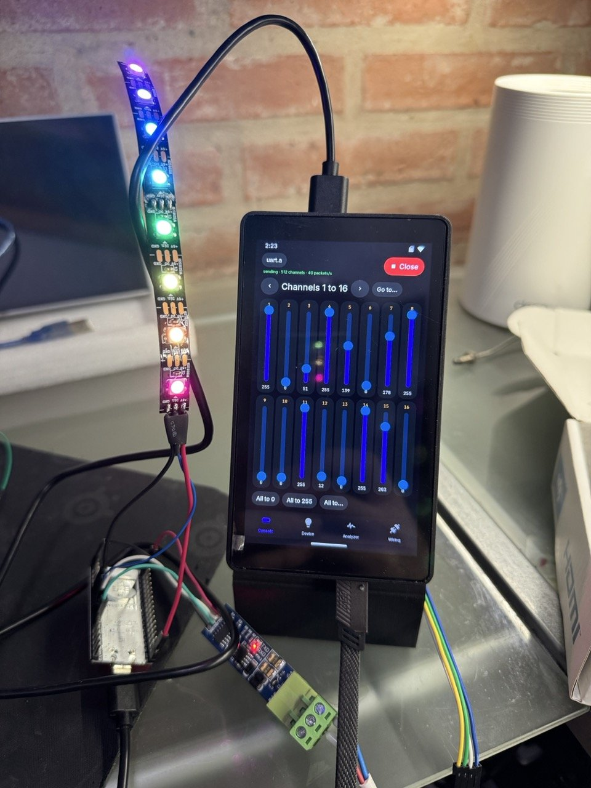

# DMX

A bench tool for DMX512, the lighting bus, on an RS485 port of the header.
Id `aos.dmx`. Sending, receiving, the BREAK and its timing are the
firmware's (`aos_io_dmx_*`, `docs/MODULES.md` "DMX512"); the app has no
thread of its own.

DMX in a few lines: a console sends, over and over (~44 times a second), a
**universe** of up to **512 channels**, a byte each (0-255); fixtures only
listen. It is RS485 at 250000 baud 8N2. Each packet starts with a
**BREAK** (the line low, at least 88 µs), a **MARK AFTER BREAK** (high, at
least 8 µs), a **start code** (0 for levels) and the channels. Each fixture
has a **start address** and uses as many channels as its mode says (a
7-channel PAR at address 10 takes 10-16). Daisy-chained with XLR (3 or 5
pins: 1 ground, 2 D−, 3 D+), 120 Ω at the far end, no Y cables.

- **Consola:** the app sends. 512 faders, 16 to a page, all to a level,
  and patterns: a **chase** that lights one channel at a time (to find
  which channel moves what), a ramp on all of them, a rainbow on eight RGB
  pixels (channels 1-24). The packet's shape can be changed to test what a
  fixture puts up with: 512, 96 or 24 slots, BREAK 88/176/1000 µs, MAB
  8/16/100 µs, 40/30/10 packets a second. It goes on sending with the app
  in the background.
- **Aparato:** the app is a fixture. A kind (dimmer, RGB, RGBW, a 7-channel
  PAR with its strobe, a 6-channel moving head, a bar of 8 pixels) and an
  address, and what it would do drawn live, with its channels and values.
  To see whether a console sends, and what on each channel.
- **Analizador:** the app listens: signal or not, packets a second, slots,
  start code (0 levels, 0xCC RDM, 0x17 text), the **BREAK and MAB as
  measured on the pin** (red when under the standard), packets, bad ones,
  other start codes, short BREAKs, and the 512 channels as a map, the ones
  moving lit orange; a tap on the map shows those 32 as numbers.
- **Red** (2026-11-09): the board as a **network node**. What a console, a
  PC program or Luces on another board sends over the network for one
  universe goes out of the RS485 port as DMX: **Art-Net** (UDP 6454, the
  port-address; an ArtPoll gets an ArtPollReply, so a console lists the
  board among its nodes) or **sACN / E1.31** (multicast 239.255.x.y, port
  5568; preview and stream-ending packets skipped). Packets a second, the
  source, how long since the last one, packets for other universes, the
  first 32 channels as they go out. If the network stops, the output holds
  the last levels; with the node on it keeps going in the background
  (`main/dx_net.c`, a thread of its own).
- **RDM** (2026-11-09): the fixtures on the line that speak RDM (ANSI
  E1.20). **Buscar aparatos** finds them by their UIDs with the standard's
  binary search (un-mute everyone, DISC_UNIQUE_BRANCH over a range, split
  it when answers collide, mute each one found), then reads DEVICE_INFO
  (address, footprint, model) and the labels. For each: **Identificar**
  (on and off), a new **Dirección**, a new **Nombre** (DEVICE_LABEL).
  Counts of requests, answers, collisions and bad answers. The firmware
  sends each request between two DMX packets and reads the answer
  (`aos_io_dmx_rdm`); the app runs the jobs in a thread (`main/dx_rdm.c`).
  A plain DMX splitter does not pass the answers back.
- **Cableado:** the XLR pins and what to know (termination, no Y, cable,
  D+/D− swapped by some makers, automatic modules at 250 kbaud).

**The link** opens closed every time and follows the tab: Consola, Red and
RDM send, Aparato and Analizador receive (Cableado keeps whatever it had).
Port: any UART port of `modules.txt` (`uart.a`: TX 30, RX 31, DE 29).

## In the simulator

The simulator's DMX bus has a console playing (`sim/io_dmx_sim.c`): a
rainbow on channels 1-24, a 7-channel PAR on 25-31, a fog machine on 32,
40 packets a second, BREAK 176 µs, MAB 12 µs, and one short BREAK every
15 s. While the app sends, what it sends is what a receiver gets.
`P4_SIM_DMX=0` takes the console off (no signal).

Tried there on 2026-11-09: the analyzer showed 40 packets a second, 512
slots, BREAK 176 µs and MAB 12 µs; the fixture drew the PAR and the bar;
the console sent its patterns.

Two make-believe RDM fixtures answer on the simulator's bus (the bench
ESP32's responder, `tools/rs485_test/esp32/main/rdm_resp.c`): a PAR at 25
and a pixel bar at 1, UIDs 7FF0:00000101 and 7FF0:00000102; when both
answer a discovery branch their answers collide. Tried there: both found
(47 collisions on the way: their UIDs differ in the last bit), their
labels and channels read, identify on, the PAR moved to 40. The node, with
Luces in the same simulator sending Art-Net to 127.0.0.1 (universe 3, the
pixels in green) and a Python sACN sender (universe 3, channel i = 7i): the
levels came through, the ArtPolls were answered.

## On the bench (2026-11-09)

`tools/rs485_test/esp32` has a DMX console and a DMX light with a strip of
8 WS2812B pixels (its README). With the two automatic "RS485 to TTL"
modules of the Modbus bench, at 250000 baud, the first time:

- **ESP32 console → Analizador:** 40.0 packets a second, 512 slots, start
  code 0, BREAK measured 176 µs (it sends 176), MAB 50 µs, no bad packet.
- **Consola (rainbow) → ESP32 light:** 40 packets a second, 512 slots,
  BREAK 177 µs as the ESP32 measures it (176 sent), MAB 33 µs, no bad
  packet in hundreds, channels 1-3 following the rainbow, and the strip
  showing it (the strip on IO18 is in `docs/img/bench-rs485.svg`):

The next morning, with the new firmware and the ESP32 answering RDM:

- **RDM:** Buscar aparatos found the ESP32 (UID 7FF0:E90AEBA8, "Tira del
  banco", 24 channels at 1) through the automatic modules with no bad
  answer; identify on and off; its address moved to 25 and back to 1 (the
  ESP32 read 25-27 meanwhile). DMX went on at 40 packets a second with no
  bad packet while it happened.
- **Red, Art-Net:** a rainbow sent from the Mac to the board's IP over
  Wi-Fi (universe 0, 35 packets a second) came out on RS485 and reached the
  ESP32's strip.

The MAB on the wire is longer than asked (16 µs asked, 33 and 50 µs
measured): the time from letting the line go to the UART's first start
bit. Still within the standard (8 µs at least, no upper limit worth
minding); the BREAK is exact.

## Files

- `main/dx.h` what the files share
- `main/dmx.c` the app: the bar, the link, the tabs, the keypad, a text field, settings
- `main/dx_tabs.c` the six tabs
- `main/dx_net.c` the network node: Art-Net and sACN in, ArtPollReply out
- `main/dx_rdm.c` RDM: requests, answers, discovery, the actions
