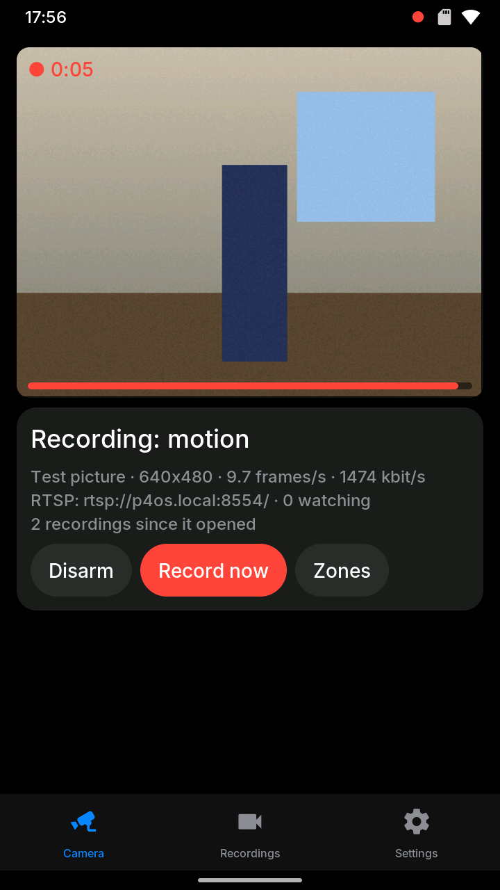

# Grabador

A USB webcam as a security camera (the G19 request, 2026-11-27): it watches
the picture, records an H.264 MP4 to the card when something moves (with the
seconds before), keeps its first moving picture beside it, tells the
Telegram bot, and is an IP camera over RTSP for Frigate, VLC or Cámaras.



## How it works

| File | What |
|---|---|
| `gr_engine.c` | the camera's thread: the webcam's MJPEG decoded, motion, the preview, H.264, the ring of the seconds before, the clips |
| `gr_motion.c` | motion: a 32 x 24 grid of brightness against a background that follows slowly; the whole picture's change (exposure, a light) taken out; only the zones on count |
| `gr_mp4.c` | the MP4 writer (the screen recording's, `aos_screenrec_p4.c`, with each frame's own time) |
| `gr_rtsp.c` | the RTSP server: RTP over the RTSP connection (interleaved, channels 0-1), single NAL or FU-A, SPS and PPS in the SDP and with every key frame; two viewers |
| `gr_cfg.c` | the settings (`<card>/grabador/grabador.txt`), the clips on the card, the space |
| `gr_ui.c` | Cámara, Grabaciones, Ajustes |
| `gr_live.c` | the portal's page (`web/grabador.js`) through `aos_hal_live_*` |

- **The encoder** is the board's (`aos_hal_h264_enc_*`, firmware 0.35):
  constrained baseline, one key frame a second (the GOP is the frame rate),
  so a clip starts at the last key frame at least "before" seconds back. It
  runs only while armed, recording by hand or watched by RTSP, and closes
  five seconds after; the screen recording and Grabador take turns with it.
- **The ring** keeps the coded frames of the last seconds (7 s at 8 Mbit/s
  at most, in PSRAM); a clip is written from it and then frame by frame.
- **A clip** closes "after" seconds past the last motion; at the length
  asked it is cut and goes on in a new one from the next key frame. The
  oldest clips go when the folder passes its space.
- **Playing them**: the Video app, which plays MP4 with H.264 since the same
  day (`apps/video/main/vd_mp4.c`). The board decodes H.264 in software:
  640 x 480 plays at full speed, 1280 x 720 at about 8 frames a second.
- **The Telegram bot**: `aos_bot_send()` when a clip starts by motion, with
  "Avisar por el bot" on and the bot on.
- **Armed, it starts with the board** (`aos_ui_boot_start_set`).

## Files

- `<card>/grabador/AAAAMMDD-HHMMSS.mp4` and `.jpg`: the clips and their first
  moving picture.
- `<card>/grabador/grabador.txt`: the settings, `key=value`.
- `<data>/grabador.jpg`: the newest picture, for the portal while its page
  looks.

## In the simulator

No webcam there: without one the app draws a test picture of a room where
somebody crosses every half minute, which arms, records and plays like the
real thing. The simulator's encoder is libx264. The RTSP server listens on
port 8554 of the Mac:

```
ffprobe -rtsp_transport tcp rtsp://127.0.0.1:8554/
```

Tried in the simulator (2026-11-27): arming, a clip on each crossing with
its picture, the zones, the list and Video playing a clip, the portal's page
(live, settings, clips), ffmpeg taking 3 s by RTSP. Not tried yet: a real
webcam on the board, Frigate.
