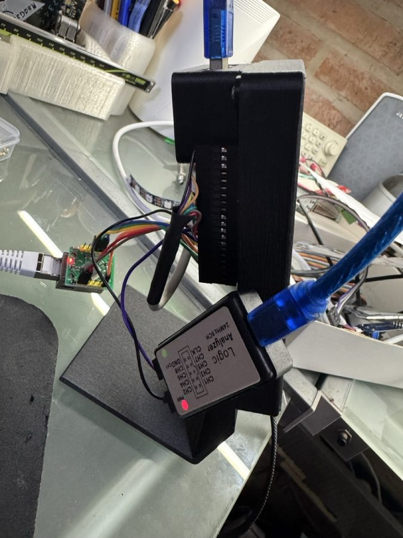
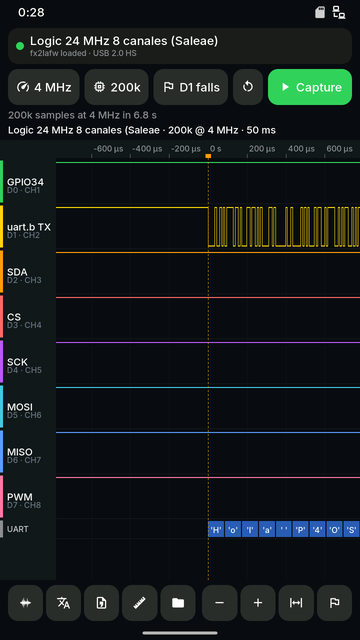
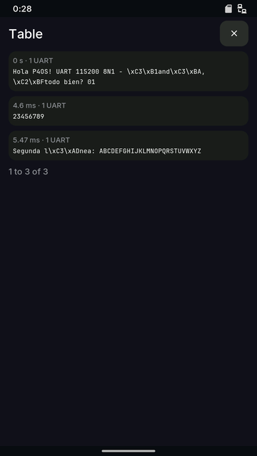
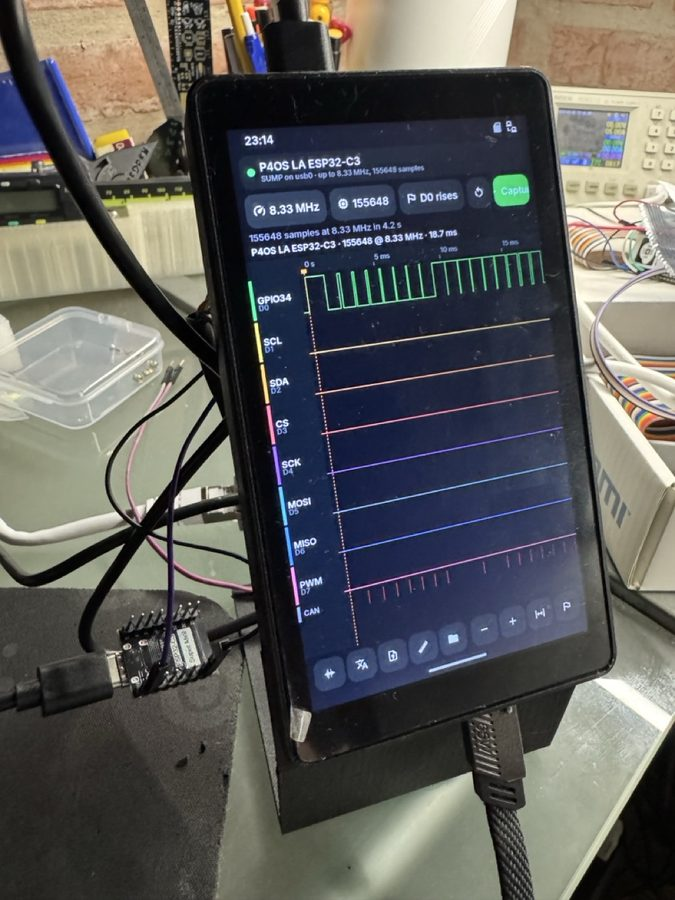
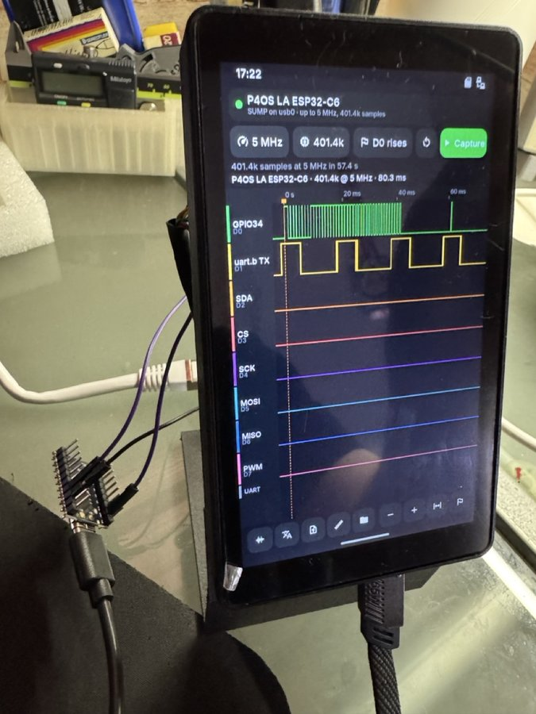

# Lógica

A logic analyser for P4OS, id `aos.logica`: eight channels, captures of up
to millions of samples in PSRAM, ten protocol decoders, sigrok sessions on
the card, and a page in the portal with a big view of it all. The board
does not sample by itself (that is a firmware request, below): it drives
an analyser plugged into it.

## What samples

| Analyser | How it reaches the board | Rate | Depth |
|---|---|---|---|
| **"Logic Analyzer 24MHz 8CH"** boxes (a Cypress FX2LP, sold as Saleae Logic clones, `0925:3881`) and the other FX2 boards sigrok knows (`04b4:8613`, `1d50:608c/608d/608f`, the USBee family, the USB-LPS) | the USB host, through `aos_hal_usb_raw_*` | 20 kHz to 24 MHz on pins 25/27 (High Speed); up to 1 MHz on 21/23 (Full Speed) | the board's PSRAM: the box streams |
| **The app's own firmware** for an ESP32-S3, C3 or C6 (`firmware/`) | its own USB (`usb0`) or a header UART | what its capture loop reaches, measured at boot: **5 MHz on a C3 and on a C6** (firmware 0.3; checked against a known signal and a UART line) | the chip's internal RAM: 155648 samples on a C3, 401408 on a C6 |
| Anything else that speaks **SUMP / Open Bench Logic Sniffer** | a USB serial port or a header UART | the device's | the device's |
| **Demo**: three scenes made up in memory (serial, I2C, SPI, PWM; 1-Wire, CAN, WS2812, NEC, DMX512, Modbus RTU; pulses and a parallel bus), each with its decoders set | - | any | up to 8M samples |

### The FX2 boxes and fx2lafw

The FX2 has no program of its own: whoever drives it loads one into its
RAM at every plug-in. The app loads **fx2lafw**, sigrok's open firmware
(GPL-2.0), the same PulseView loads, so the box behaves as it does there.
The firmware is not in the app nor in git (it is someone else's program,
under its own licence): it goes on the card, in `logica/fx2lafw/`.

- Download `sigrok-firmware-fx2lafw-bin-<version>.tar.gz` from
  <https://sigrok.org/download/binary/sigrok-firmware-fx2lafw/> (the wiki:
  <https://sigrok.org/wiki/Fx2lafw>).
- Upload it **as it is** on the portal's Lógica page ("Subir el .tar.gz o
  los .fw"): the page unpacks it in the browser and writes the `.fw` files
  to the card. Or copy `fx2lafw-saleae-logic.fw` (the one for the common
  boxes) to `logica/fx2lafw/` by hand. Intel HEX (`.ihx`) works too.

What the app does with it (`main/la_fx2.c`, written anew from the
protocol, not sigrok's code): vendor request 0xA0 holds the 8051 in reset
(CPUCS, 0xE600), writes the image from address 0 and lets it run; the
chip drops off the bus and comes back with the same ids, named "sigrok
fx2lafw", at a new address, which the app waits for (up to 15 s, as a
Mac may ask its user first). Then 0xB0 asks the version (1.x), 0xB1
starts it (the 48 or 30 MHz clock and the delay between samples), and the
samples come on bulk endpoint 0x82, a byte each, into a ring of the host
(2 MB from 8 MHz up, 1 MB below) and from there straight into the
capture, never a sample past its end. The trigger is found in software as the bytes come, with the
samples before it kept in a ring the size of the capture.

The box's case says CH1..CH8; the app, like PulseView, calls them D0..D7
(CH1 is D0), and with an FX2 the view shows both under each name.

**Trying it on a Mac** with the simulator (`P4_SIM_USB=1`, fx2lafw in
`sim/sim_fs/logica/fx2lafw`): macOS asks to allow every new USB accessory,
and the box is a new one each time fx2lafw is loaded into it (it drops off
the bus and comes back as "sigrok fx2lafw"). Until the dialog is answered
it is not on the bus at all and the app waits up to 15 s for it. A box
that was left half-started may stay off the bus until it is unplugged.

<p align="center"></p>

<p align="center"> </p>

The bench on 2026-11-14: the analyser on the board's back cover, plugged
into the High-Speed host socket, its CH1 on GPIO34 (header pin 28) and its
ground on the header, for the self test below.

**Measured on the board** (2026-11-14, the user's clone on pins 25/27, a
short cable): 1, 4, 8, 12, 16 and 24 MHz, six captures in a row, with no
sample lost and no transfer error; 6 transfers of 16 KB in flight are
enough. A capture is about 6M samples (0.25 s at 24 MHz): what PSRAM has
free with the app open, less 3 MB for the system and the 2 MB ring. What
the board taught (all in `main/la_fx2.c`):

- **Never ask the bare chip fx2lafw's version.** It does not answer, and
  the board's host keeps that control transfer out: the device cannot be
  opened again until it is plugged anew. On the board the USB names say
  whether fx2lafw runs; only the simulator asks.
- **The endpoint's data toggle.** The chip stays powered, with fx2lafw,
  across a restart of the board, and keeps its toggle; the host's new pipe
  starts at DATA0, the first packet fails and the host halts the pipe
  (`Enqueue URB error: ESP_ERR_INVALID_STATE`). A `CLEAR_FEATURE
  (ENDPOINT_HALT)` right after the claim puts the chip back at DATA0.
- **A halted pipe stays halted** once no transfer is in flight, so a
  restart opens the device anew (new pipes) instead of starting the stream
  again on it.
- **A box that came back with the host running** (it dropped off the bus,
  or fx2lafw was just loaded into it) got every bulk transfer refused at
  once, on new pipes too, until the host was started again. The app does
  that by itself, once a capture, when the box is the only device on the
  host (a firmware request says why it should not have to).

### The app's firmware for an ESP32

`firmware/` is an ESP-IDF 5.5 project. Eight GPIOs are a dedicated-GPIO
bundle the CPU reads in one instruction; the capture loop runs from IRAM
with the interrupts off, paced by the cycle counter (exact on average, a
few cycles of jitter). It speaks SUMP on the chip's USB-Serial-JTAG (or
UART0, `idf.py menuconfig`, "P4OS logic analyser"), so PulseView and
sigrok-cli use it too ("Openbench Logic Sniffer & SUMP compatibles"). On
the S3 the capture runs on the second core and the first keeps the USB;
on the C3/C6 a byte from the host stops a wait for a trigger.

**How fast:** at boot the firmware runs the capture loop itself, unpaced,
on its slowest path (waiting for a trigger, checked on every sample), and
offers that rate less 10 % as its top: **5 MHz on a C3** (firmware 0.3).
Up to 0.2 it timed a lighter copy of the loop and said 8.33 MHz: a steady
PWM read right, but the real loop fell behind its pace while it waited
for the trigger and then ran to catch up, so the first 15 characters of a
UART line came out of time (and the first period of a PWM long, 1061 µs
of 1001). Should a wait fall behind anyway, the pace now starts again at
the trigger instead of catching up. After the trigger the loop is lighter
(some 13 instructions a sample), but the top is the slower path's. An S3
at 240 MHz should go further; it builds, not tried yet. None reaches
24 MHz: that is the FX2's, or would need a peripheral that samples by DMA
(the S3's LCD_CAM, the C3's GPSPI in quad mode for 4 channels), a later
version.

| Chip | Channels 0-7 (default) |
|---|---|
| ESP32-S3 | GPIO 4, 5, 6, 7, 15, 16, 17, 18 |
| ESP32-C3 | GPIO 0, 1, 3, 4, 5, 6, 7, 10 |
| ESP32-C6 | GPIO 0, 1, 2, 3, 18, 19, 20, 21 |

```bash
cd apps/logica/firmware && idf.py set-target esp32s3 && idf.py build flash
```

The board's Programador flashes it too: copy the build folder (the one
with `flasher_args.json`) to the card's `firmware/` folder, as
`firmware/logica-esp32c3/`, and flash it on `usb0`. Since 0.28 its list
takes 160 entries, sorts by name, by the last added or by the last
flashed, has a search, and says "versión nueva" when what is on the card
is not what was last flashed under that name (by its content). In
Lógica: Analizador, "Buscar SUMP en USB". Inputs are 3.3 V only and have
no pull resistors.

<p align="center"></p>

**Measured** (2026-11-14, an ESP32-C3 Super Mini flashed from the board's
Programador, on `usb0`): the firmware measured its own top at **8.33 MHz**
(100 MHz / 12) and offered 155648 samples, twice what the compiled loop
had been counted at. Against the header's self test PWM on GPIO34 (its
GPIO0, D0), the periods came out at 1001.59 µs = 998.41 Hz (the FX2 read
998.1 Hz, the board says 998), with one sample of jitter (0.12 µs): the
rate is real. Its other inputs float (no pulls, so as not to load what is
measured): an unconnected channel shows stray pulses. From 0.2 the trigger
also takes "either edge" (a third mask in command 0xF0).

**A real UART line** (2026-11-15, firmware 0.3 at 5 MHz, 155648 samples
= 31 ms): the board's `uart.b` TX (header pin 12, GPIO3) on the C3's
GPIO1 (D1), the trigger on D1 falling, the Terminal's channel sending two
lines at 115200 8N1 with accents in UTF-8. All 107 characters decoded
from the first one, no framing error, 86.80 µs each (86.81 at 115200).
The same line on the FX2's CH2 at 4 MHz decoded the same.

**The C6 against the C3** (2026-11-16, an ESP32-C6 board with firmware
0.3 flashed from the Programador, wired as the C3 was): the same top,
5 MHz, as both run a RISC-V core at 160 MHz and the loop comes out at
28-29 cycles a sample on each (the rate is rounded to SUMP's 100 MHz /
20, so a cycle more or less does not show). What the C6 has is room:
**401408 samples**, 80 ms at 5 MHz, against the C3's 155648 (31 ms). The
self test's PWM read 998.38 Hz (1001.6 µs, one sample of jitter; the C3
read 998.41), and three UART lines at 115200, 318 characters over 27 ms,
decoded from the first with no framing error, which the C3 could not
hold in one capture.

<p align="center"></p>

`tools/fake_sump.py` is a SUMP device on a pseudo-terminal, to try the
driver in the simulator: `P4_SIM_UART_A=<its pty>`, then Analizador,
"uart.a 921600".

## On the screen

A bar (the analyser, the rate, the depth, the trigger, repeat, Capturar /
Detener; the BOOT button too), a status line (what the job does, the
capture, the cursors' A-B time and frequency) and the view:

- **The view:** a row per channel and per decoder, a ruler with times from
  the trigger, the trigger as an orange dashed line. Drag to move, pinch to
  zoom, double tap to zoom in, tap to place cursors A and B (then the
  nearest moves), hold to remove them; drag on the ruler moves a cursor. A
  tap on a channel's name opens it (name, shown, trigger, measure), on a
  decoder's name its settings, on an annotation its packet.
- **Muestreo:** the analyser's rates, the depth (what the analyser or the
  PSRAM allow) with the length it makes, and how much goes before the
  trigger.
- **Disparo:** per channel X, 0, 1, rises, falls, changes, all at once.
  Plain SUMP devices understand levels only; the app's firmware also edges
  (command 0xF0).
- **Decodificar:** six decoders at a time, each on its channels:
  **UART** (5-9 bits, parity, stop bits, inverted, the speed guessed from
  the shortest pulse), **I2C** (S, Sr, P, address R/W, ACK/NACK), **SPI**
  (modes 0-3, 4-16 bits, MSB/LSB, CS optional and active low or high),
  **1-Wire** (reset, presence, ROM and DS18B20 commands, the temperature
  and the CRC of a scratchpad), **CAN** (11/29-bit ids, RTR, DLC, data, CRC
  checked, ACK, destuffing and stuff errors), **WS2812** (the colour of
  each LED), **NEC IR** (address, command, repeats, extended), **DMX512**
  (break, start code, slots), **Modbus RTU** (frames by silence, CRC,
  functions and register values), **parallel** (up to 8 lines, with a
  clock or on change). Values in hex, decimal, ASCII or binary.
- **Tabla:** the packets (a line of serial text, an I2C transfer, a CS
  frame, a CAN frame, a Modbus request or answer), filtered by decoder; a
  tap shows it in the view.
- **Medir:** a channel between the cursors (or what is in view):
  frequency, period, duty cycle, high and low times (min, average, max),
  edges.
- **Archivos:** save the capture as a sigrok session (`.sr`, with the
  table as `.csv` beside it), open one (also those PulseView saves,
  deflated), delete.

It keeps going in the background (`AOS_APP_FLAG_KEEP`): a capture waiting
for its trigger, or repeating, goes on while another app is in front.

## The portal

`web/logica.js`, page `#logica`: everything above on the computer's
screen, through the live channel (`main/la_live.c` says what goes where).
The view has the wheel, dragging, pinching and cursors, a readout of the
time and levels under the mouse; the decoders are edited there and run on
the board; the table can be searched and downloaded as CSV; it exports
`.sr` (for PulseView), VCD and CSV, opens `.sr` files from the card or the
computer by itself, and takes fx2lafw (the `.tar.gz` unpacked in the
browser).

The capture travels in pieces of runs of samples (a byte of value and a
length), so a million samples of a slow signal are one request.

## Memory

Everything big is PSRAM (`la_big_alloc`): the capture and its summaries
(1/32 of it), the next capture while the last one stays in view (when two
fit), 2 MB of annotations, 768 KB of packets, the view's canvas, the
host's ring. Internal RAM: the host's own transfer buffers while an FX2
streams (4-6 of 16 KB, the USB host's rule: `docs/USB.md`, "Webcams").

## Not done, and why

- **Sampling with the P4 itself.** The P4's PARLIO RX could take 8 or 16
  header pins at tens of MHz into PSRAM with no analyser at all; it needs a
  firmware API (`aos_io_la_*`), asked for in
  `docs/internal/HANDOFF-NUEVAS-APPS.md`. The app would take it as one
  more driver.
- **16 channels** of the 16-bit FX2 boards: the app captures 8.
- **Tested** in the simulator: the demo, every decoder, saving and opening
  sessions (stored and deflated), the portal's page, SUMP against
  `tools/fake_sump.py`, and **a real FX2 clone plugged into the Mac**
  (`P4_SIM_USB=1`, 2026-11-14): fx2lafw 1.4 loaded from the card, 8M
  samples at 1, 12, 16 and 24 MHz with no gap (16 transfers of up to
  64 KB in flight), a trigger waited for. That Mac also showed the box's
  weak point: now and then a transfer failed or the box dropped off the
  bus and came back, and fx2lafw stops for good when its FIFO overflows;
  the driver starts it again before the trigger (and finds it again at
  its new address). **On the board** (the same day): every rate up to
  24 MHz, level triggers, six captures in a row (above), and an edge
  trigger fired by hand (CH1 let go of ground: one clean rising edge at
  the trigger, 25 % of the capture before it). Touching the wire by hand
  disturbed the box's USB (a failed transfer, and once a reset a second
  later); the loop rode over both. And real signals from the board's
  header self test on GPIO34 (`POST /api/expansion/selftest?gpio=34`,
  wired to CH1): its PWM measured at 998.1 Hz (the board says 998) with
  the fade's high time growing evenly from 2 to 100 µs, the IR frame's
  carrier at 37.995 kHz, 33 %, and its four CAN frames decoded exactly
  (0x100-0x102 `CA FE 00 n`, 0x18FEF100 `01..08`, CRC good, no ACK as there
  is no other node). And a real UART line (2026-11-15, above), on the FX2
  and on the C3: two fixes came out of it. A character whose start bit
  falls a sample before the end the decoder gives the last one's stop bit
  stays in its packet (the gap was unsigned and wrapped; Modbus had the
  same), and the FX2 no longer reads past the end of a capture (those
  samples went round the ring onto the oldest ones kept, the start of
  the line: 16320 flat samples, a whole transfer). The ESP32 firmware on a
  C3: the self test's PWM and the UART line (above). **Not tested:** the
  other decoders on real buses, the firmware on an S3.

## Licences

The app is MIT like P4OS. `main/la_tinfl.c` is miniz's inflate (MIT,
vendored from the VNC app). fx2lafw (GPL-2.0+) is not shipped: the user
puts it on the card.
