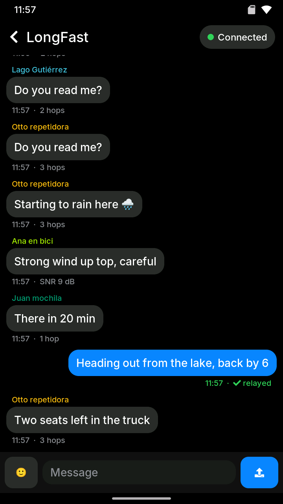
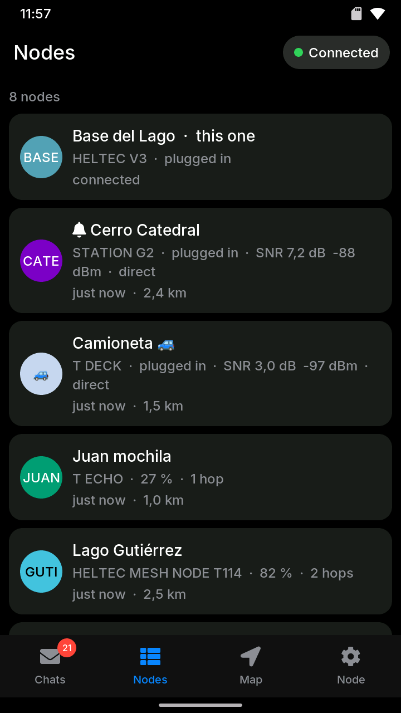
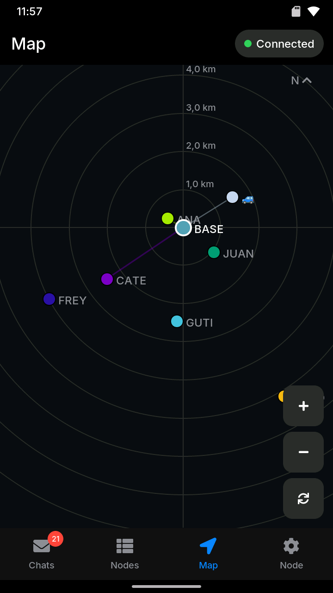
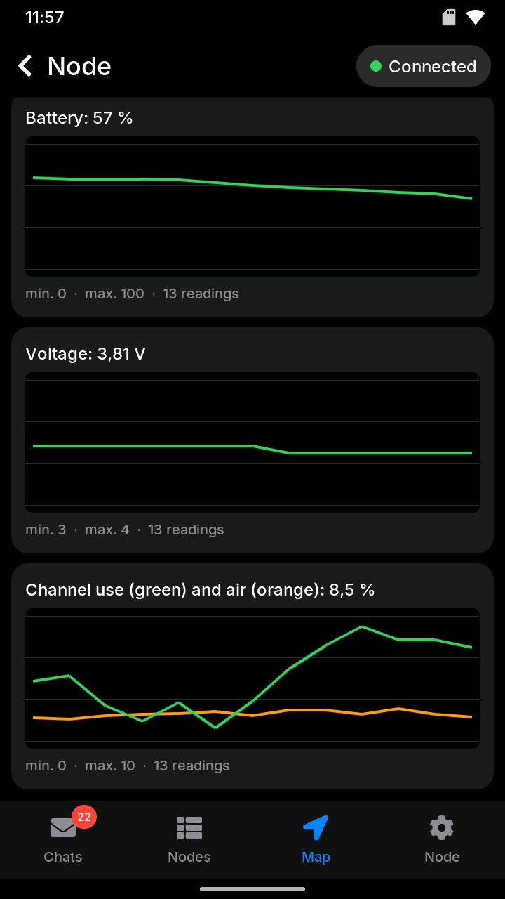

# Malla (`aos.malla`)

A client for Meshtastic nodes: the board talks to a node the way the phone
app does, and shows the mesh. "Malla" is a working name; "Meshtastic" is
named only to say which nodes it talks to, and its logo is not used.

 
 

## Licence

**This app is GPL-3.0-or-later** ([LICENSE](LICENSE)); the rest of P4OS is
MIT. It compiles Meshtastic's protobuf definitions (`meshtastic/protobufs`,
GPL-3.0) into its code, so `malla.so` as a whole is GPL. The `.proto` and
`.options` files it was generated from are in [proto/](proto) with their
licence, nanopb's runtime (zlib) is in `main/pb/` with its own, and
`tools/gen_malla_pb.sh` makes `main/pb/` again from them. The repository at
a release's tag is the source of that release's `malla.so`
([THIRD-PARTY.md](../../THIRD-PARTY.md)). The firmware that loads it stays
MIT, as with Doom, RF or CAS.

## What it does

- **Chats** by channel (every channel the node has) and **direct messages**
  (encrypted end to end by the firmware when both nodes have a public key).
  Each of our messages says how far it got: *en cola* (still in the node's
  queue), *enviado* (on the air), *recibido* (the other node acknowledged a
  DM) or *repetido* (a neighbour was heard relaying a broadcast, the most a
  channel can know), or *falló* with the routing error. Emoji from a picker,
  and reactions (hold a message): an emoji sent with `reply_id` and the
  `emoji` flag, as the phone apps do.
- **Nodes:** long and short name, hardware, role, battery, SNR and RSSI
  (heard directly), hops, when it was heard, distance and bearing from ours.
  Each node's page: everything known, Message, Traceroute (both ways, with
  each hop's SNR), Telemetry and Position requests, favourite, and its
  telemetry over time as charts (battery, voltage, channel use and air time,
  temperature, humidity, pressure: 96 samples a node, 64 nodes).
- **Map:** drawn here, no tiles: rings of distance around our node, north
  up, every node with a position in its colour and short name, dimmer the
  longer ago it was heard, lines to the ones heard directly. Drag, zoom,
  fit, and a tap opens a node.
- **The node:** the connection (and the node's own log, the last lines),
  owner (long and short name), LoRa region, preset and hop limit, the
  channels (rename, add with a random AES-256 key, delete), and the channel
  set as a `https://meshtastic.org/e/#...` link, shown as a QR or taken
  from a pasted URL (inside one begin/commit edit, so the node restarts
  once).
- **In the background:** while connected the app tells the system it is
  busy (`aos_ui_set_busy`) so it is kept; new messages become notifications
  (`aos_notif_push`, a DM marked important). In front, a DM from another
  conversation is a toast; channel messages only move the badge.
- **The portal's page** (`web/malla.js`): the conversations, the messages
  with their state, sending from the phone, the node table, and taking a
  channel URL. Live data (`aos_hal_live_*`), only while a page looks.
- **Kept on the card:** `<data>/malla/<node number>.bin`, the nodes,
  messages (800) and telemetry, one file for each node the board talked to;
  the link in the preference `malla_link`.

## The protocol

Meshtastic's client API is the same over every link: the client writes
`ToRadio` protobufs and reads `FromRadio` ones (`mesh.proto`).

1. Connect, and write `ToRadio{want_config_id = nonce}`.
2. The node sends `my_info`, `metadata`, a `node_info` for every node in its
   database, its `config` (device, LoRa, Bluetooth...), `moduleConfig`, its
   eight `channel`s, and `config_complete_id = nonce`. Only that nonce makes
   the session ready; the rest is applied as it comes.
3. Then every packet it hears for us or for one of its channels, as
   `FromRadio{packet}` with `decoded` (text, position, nodeinfo, telemetry,
   routing, traceroute...), `queueStatus` for what we sent, `log_record`,
   `clientNotification`, and `rebooted` (asked for the config again).
4. The client sends a `heartbeat` every minute (a serial node uses it to
   know a client is there) and `disconnect` when it leaves a stream.

Sending a text: a `MeshPacket` to the node or to `0xFFFFFFFF` on a channel,
our own random `id`, `want_ack`, `hop_limit` from the LoRa config, and
`decoded{TEXT_MESSAGE_APP, payload}`. The node answers with `QueueStatus`
(that id left its queue) and a `Routing` packet whose `request_id` is that
id: `NONE` from the destination is the ACK, `NONE` from our own node the
implicit ACK, any other error a failure. Admin (`ADMIN_APP`) goes to our own
node, which takes it from the client API without a session key.

The links (`main/msh_link_*.c`):

- **Serial** (`usb0`/`usb1` of the USB host, CDC-ACM, CH34x, CP210x, FTDI;
  or a header UART) and **TCP 4403**: a byte stream with each protobuf
  framed as `0x94 0xC3 <len hi> <len lo> <bytes>` (512 at most). What
  comes between frames is the node's debug log, kept as lines. Before the
  first frame on serial, 32 bytes of `0xC3`, as the official clients do,
  to take a port out of its text console.
- **BLE:** service `6ba1b218-15a8-461f-9fa8-5dcae273eafd`; write `ToRadio`
  (`f75c76d2-...`), read `FromRadio` (`2c55e69e-...`) until a read comes
  back empty, again after every `FromNum` notification (`ed9da18b-...`).
  The node keeps those behind an encrypted link: right after discovery the
  link asks for pairing (`aos_hal_ble_gatt_pair`, firmware 0.35); a node
  bonded before only encrypts again, a new one shows a PIN and the app asks
  for it (`AOS_BLE_EV_PASSKEY`, then `aos_hal_ble_gatt_passkey`). "Emparejar
  de nuevo" forgets the bond. The build sets `MSH_BLE_PAIR` when `aos_hal.h`
  has the API; without it, only a node in no-PIN mode works.

The chosen link is remembered, and the session goes back to it by itself:
when the link drops it tries again after 2, 5, 10, 20 and then every 30 s,
which also rides through the restart a LoRa or channel change causes.

## How it is made

Three layers, each one ignorant of the one above:

| | | |
|---|---|---|
| `msh_link.h`, `msh_link_stream.c`, `msh_link_ble.c` | the way to the node | whole protobufs up and down; serial, TCP, BLE |
| `msh_sess.c` | the client API | a thread of its own (stack in PSRAM): handshake, heartbeat, the queue of ToRadio frames the UI encodes, reconnecting |
| `msh_model.c`, `msh_store.c`, `msh_url.c` | what is known | nodes, messages, telemetry, config and channels, behind one mutex; the card; channel URLs |
| `msh_ui_*.c`, `msh_emoji.c`, `msh_portal.c`, `malla.c` | the screens, the page, the app's life | read the model, call `msh_send_*` / `msh_set_*` |

Memory: the model is in PSRAM (300 nodes, 800 messages, telemetry of 64
nodes × 96 samples: 475 KB), and so are the session's queue (12 KB), the
portal's buffer (60 KB, only while a page looks) and the thread's stack;
nothing in internal RAM. The `.so` is 140 KB.

## Phase 2: the board as a node of its own

The plan is an SX1262 on `spi.a` with DIO1/BUSY/RST on 46/47/48
(`docs/plan/EXPANSION.md`). For the app it is one more link: a
`msh_link_ops_t` whose `recv` hands up `FromRadio` and whose `send` takes
`ToRadio`, exactly as a node on a cable would. What that link would have to
be is a small Meshtastic node in the board:

- a driver for the SX1262 (`aos_io` SPI, the DIO1 interrupt, BUSY, TX/RX
  switching), and the LoRa parameters of each region and preset (the
  frequency slot is the djb2 hash of the channel name, as `apps/rf` already
  computes for listening);
- the over-the-air header (16 bytes: to, from, id, flags with hop limit and
  want_ack, channel hash, next hop, relay node) and AES-CTR with the channel
  key (nonce from the packet id and the sender), which `apps/rf/main/aes.c`
  has; PKI (Curve25519 + AES-CCM) for direct messages;
- the flooding router: duplicate detection by (from, id), rebroadcast with a
  random delay scaled by SNR, hop limit, implicit ACKs and retransmission,
  and the routing ACK/NAK;
- the node database, our own NodeInfo and Position broadcasts, telemetry,
  and the admin messages the app already sends (owner, LoRa, channels),
  kept in preferences;
- answering `want_config_id` with all of it, so the session above does not
  change.

A pin or two more may be needed (the RF switch of some modules), and the
duty-cycle limits of the region. The app's own code (`msh_sess.c` and up)
should not need to change; the connection sheet would get a fourth choice.

## Trying it

`tools/fake_meshtastic.py` is a node with a made-up mesh around it (seven
nodes near a mountain town, positions, device and environment telemetry,
chat on two channels). It answers the handshake, ACKs (and fails the node
that is out of reach), traceroute, telemetry and position requests, takes
the admin messages, and "restarts" (closes the connection) after a LoRa or
channel change, as an ESP32 node does. No dependencies; it listens on
127.0.0.1.

```
tools/fake_meshtastic.py --port 14403                 # TCP
tools/fake_meshtastic.py --pty --no-tcp --log         # a pty, log text between frames
cd sim && cmake -B build-malla -DCMAKE_BUILD_TYPE=Release -DP4OS_SIM_APPS="hello_app;malla" && cmake --build build-malla -j8
printf 'malla_link=tcp|127.0.0.1|14403\n' > /tmp/p.txt
P4_SIM_PREFS=/tmp/p.txt P4_SIM_PORTAL_PORT=8195 ./build-malla/p4os_sim
P4_SIM_UART_A=/dev/ttysNNN ...   # with malla_link=ser|uart.a|115200, for serial
```

`--en` makes the mesh talk in English (the store's screenshots), `--every`
sets how often it talks.

**Tried in the simulator** (2026-11-27), against the fake node:

- TCP and serial (a pty on `uart.a`, with log text between frames): the
  handshake, 8 nodes, both channels; reconnecting after the node closed the
  connection (2 s, then 5 s) and after the fake was restarted.
- Sending on a channel: *enviado*, then *repetido*; a DM: *enviado*, then
  *recibido*, and the answer; an unreachable node fails with "nadie lo
  confirmó"; reactions; emoji both ways.
- Traceroute both ways with SNR; telemetry charts; the map; the node list;
  owner, channels and LoRa; a channel URL made with Meshtastic's own Python
  protobuf classes, taken from the portal page: channels, preset and hops
  set, one restart, back by itself.
- BLE pairing against the simulator's GATT stubs (a device that is not a
  Meshtastic node, with the service check bypassed for the test only): the
  PIN sheet comes up, 123456 is taken, the link is encrypted.
- The portal page, wide and as a phone, light and dark: sending, the state
  of each message, unread counts.
- Both orientations; the history kept on the card and loaded at the next
  start.

**Not tried yet:**

- **On the board.** Not installed: the user tries it with their EkoBadge
  (nRF52840, Meshtastic 2.8.0, native USB CDC) when he says. To check
  there: `usb0` with the badge (CDC-ACM; DTR up on open), BLE with its PIN
  (needs firmware 0.35, with the pairing API), the notifications with the
  app hidden, PSRAM and the `.so` loading on a card it never was on.
- A real node over TCP (an ESP32 node with Wi-Fi), and a node behind a
  CH34x/CP210x adapter.
- Nodes that send `log_record` instead of text on the serial port (with
  `debug_log_api_enabled`), and the module config (only the device, LoRa
  and Bluetooth config are read).

**Missing on purpose, for later:** waypoints, store & forward, canned
messages, MQTT proxying through the board, admin of remote nodes (session
keys), position from the board to the node (the board has no GPS), key
verification, and map tiles (Mapas draws vector tiles with its own engine;
sharing it would be a firmware service).
