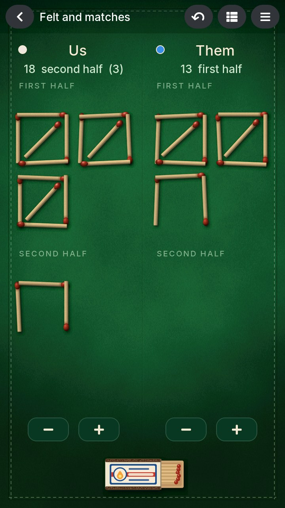
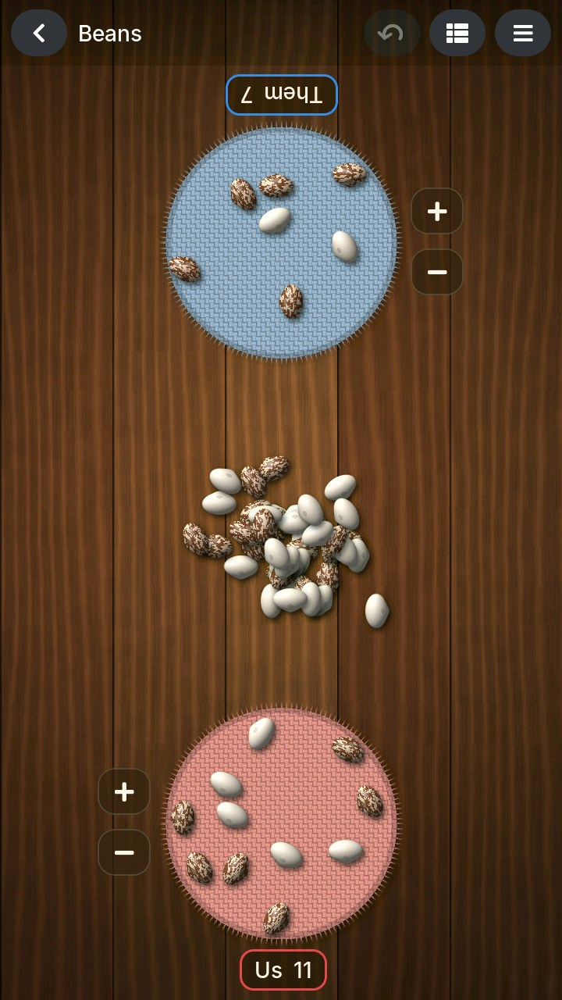
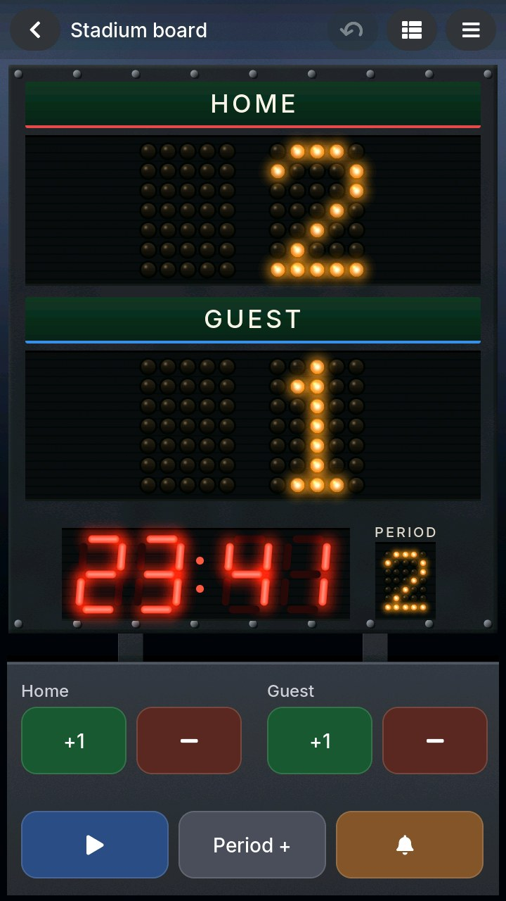
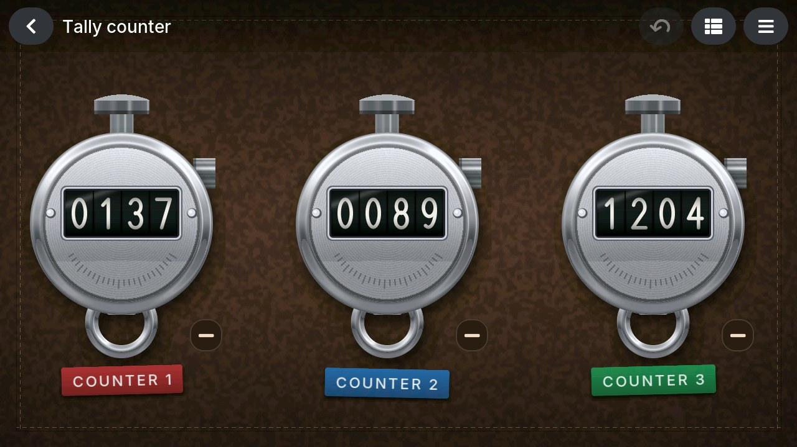
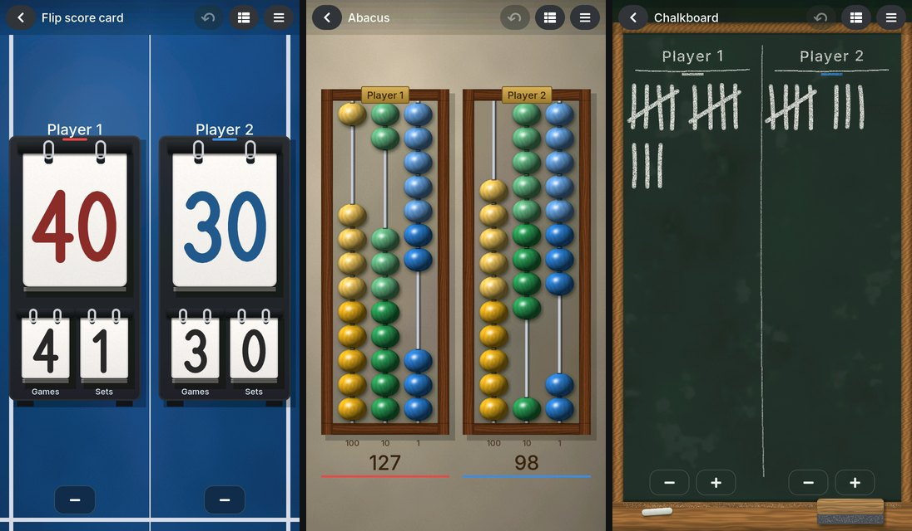

# Marcador (`apps/marcador`, `aos.marcador`)

A scorekeeper for table games and sports, with seven ways of keeping the
score, each drawn and played like the real object: how it looks, how it is
touched, how it sounds and how it moves. Everything is drawn and
synthesised by the app when it opens: **no packs**, no pictures or sounds
from anywhere.









## The seven scorekeepers

| Kind | What it is | Fingers |
|---|---|---|
| **Paño y fósforos** | Green felt with its nap and a stitched seam. Every point is a match: it leaves a box with its drawer open (which rattles), flies in an arc turning to its place while its shadow falls behind, and lands with a soft tick. Five make a square (left, top, right, bottom, the diagonal across), heads going round. To 15 or 30 in **malas and buenas**, or to any number. 2 to 4 players. | tap a side: one more; hold: one back; the buttons too |
| **Porotos** | A wooden table (planks, rings, knots, a lamp over the middle), a heap of white, pinto, black or mixed beans, and a woven mat per player. Beans are dragged with a finger each: they rise, fall with a tick, slide on and knock the others. The score is the beans on each mat. 2 to 4 players. | drag beans; tap a mat: one from the heap; hold: one back |
| **Cuentaganado** | The chrome hand tally counter on a leather pad: four number wheels on springs (the carry kicks the next one a moment later), the plunger that rides the finger, a click going down and another coming up, and the knurled knob that whirrs the wheels to nought. 1 to 4 counters, each with its owner's name on embossed label tape. | press the counter; hold the knob to reset; minus |
| **Tablero de estadio** | A steel cabinet against the night: painted name plates, goals in 5 × 7 incandescent lamps (they glow across from one number to the next, then blink, and the relays clack), the game clock in red seven-segment LEDs, the period in lamps, the horn. Football, basketball (+2, +3, three digits), handball, hockey or another sport, the clock counting up or down; the scorer's console below. | tap a number: +1; tap the clock: start/stop; hold it: back to the start of the period |
| **Cartel de mesa** | The A-frame flip card by a table-tennis table: the top card is lifted over the rings, shows its back and falls behind. Table tennis (to 11 by 2, games), padel and tennis (15, 30, 40, deuce, advantage, games, sets, tie-break) or plain numbers. | tap a big card: a point; minus |
| **Ábaco** | A walnut frame per player, a rod per digit (hundreds, tens, units), ten lacquered beads each. Beads push one another; let go, they run to the nearer end with the clack of wood. Ten on the units are carried to the tens. Rods stand when the screen does. 1 to 4 players. | drag or tap beads; tap the frame: +1; hold: −1 |
| **Pizarrón** | A slate in an oak frame, with a stick of chalk and the felt eraser on the ledge and the ghosts of old games. Tally marks (four and one across) or running totals with the previous one struck through, adding or counting down from 501 (a bust does not count). Chalk is written stroke by stroke with its squeak; undo is the eraser rubbing it out, which leaves a haze. 2 to 5 players. | tap a column: a mark, or the keypad; hold: rub the last out |

Common to all: players with name and colour, add and subtract, the keypad
for any number (menu), **undo** (the bar), the **history** of the game with
the time of play of each change, a target and the **winner's call** with
confetti, a **rematch** that keeps the count of games won, several **saved
games** (the list), and the sound on or off. The scenes read the touch
panel raw (`aos_touch_points_n`), so where it makes sense **several people
score at once**, a finger each, buttons included.

## How it is put together

| File | What |
|---|---|
| `marcador.c` | life cycle, the icon (AIC), the list of games, the form, the bar, the panels (history, menu, keypad, the winner), the raw fingers and the buttons inside scenes (`mr_rbtn`) |
| `mr_model.c` | the game: rules (padel and table-tennis scoring), history with a picture of every score before each change (undo restores it), the winner, the files |
| `mr_px.c` | pixels: ARGB sprites and RGB565 backdrops, value noise on a coarse grid (`mr_field_t`) plus a hash per pixel, AA shapes, blur and drop shadows, the digits as strokes (`mr_glyph`) |
| `mr_snd.c` | the sounds, synthesised into buffers when the app opens (modes of hard objects, filtered noise, the horn's two reeds, chalk's stick-slip) and mixed in ten voices on the streaming speaker |
| `mr_thumb.c` | the little picture of each kind |
| `mr_pano.c` … `mr_tiza.c` | one scene each (`mr_scene_ops_t`: build, sync, frame, down, move, up) |

A scene never changes a score by itself: it asks the model (`mr_add`,
`mr_point`, `mr_move`), and the model calls the scene's `sync()`, which
moves the pieces to match. So undo, the keypad and a game loaded from the
card look the same to every scene. The beans are the exception that
proves it: a bean dragged to a mat is already there, so the scene tells
the model with `mr_move()` once everything is still.

Each scene draws its backdrop once into a full-screen RGB565 canvas (felt,
wood, leather, the board, the table, the desk, the slate) and its pieces as
LVGL images sharing a few sprites. The stadium lamps and the chalk are
written into that canvas and only the changed rectangle is invalidated
(screen coordinates: the trap in `HANDOFF-APPS.md`). Building a scene
takes 20 to 30 ms in the simulator; memory is PSRAM (a scene holds 2 to 6 MB
while it is open).

## Files

A game is `marcador/g<id>.txt` in the data folder (`/data/marcador` from
the portal), one thing per line, written to a `.tmp` and renamed. The game
that was open when the app closed opens again. Preferences: `mr_sound`,
`mr_open`, `mr_seq` (the list's order), `mr_lastid`.

## The portal page

`web/marcador.js` (`#marcador`): the saved games with their players and
scores, and for the one chosen its whole history (time, player, change,
score after), downloadable as CSV; delete a game, open the app on the
board. It reads the same files and looks again every 15 s while visible.

## In the simulator

```
cd sim && cmake -B build-marcador -DCMAKE_BUILD_TYPE=Release -DP4OS_SIM_APPS="hello_app;marcador" \
  && cmake --build build-marcador -j8
MR_DEMO=0 MR_SCORES=18,12 P4_SIM_PREFS=<scratch>/prefs.txt P4_SIM_PORTAL_PORT=80xx ./build-marcador/p4os_sim
```

`MR_DEMO=<kind>` (0 felt … 6 chalkboard) opens a new game of that kind,
with `MR_NP`, `MR_SCORES=a,b`, `MR_AUX=games:sets,...`, `MR_OPT=i=v,...`,
`MR_TARGET`, `MR_CLOCK`, `MR_PERIOD`, `MR_RUN` (only in the simulator:
`getenv()` is NULL on the board). The simulator's speaker is silent
(`HANDOFF-APPS.md`, section 8).

## Not measured yet on the board

- The time to build each scene (logged: `marcador: <kind> built in N ms`)
  and that the sounds are built in a reasonable time (`sounds in N ms`).
- The frame rate while matches fly, beans slide and the stadium lamps fade
  (LVGL rotates and scales the flying match and the flip card in software).
- Two fingers at once on the board's panel (the counters, the beans).
- How the sounds come out of the board's speaker.
