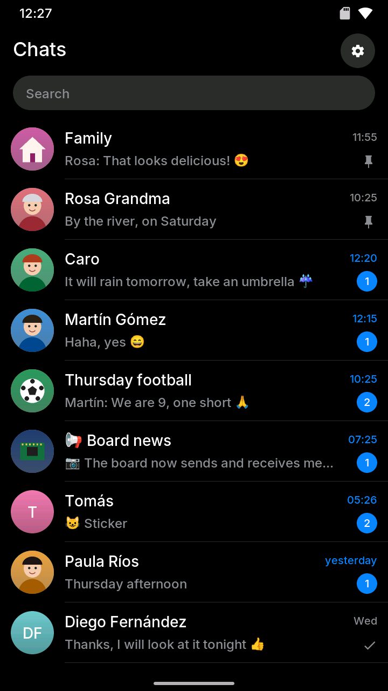
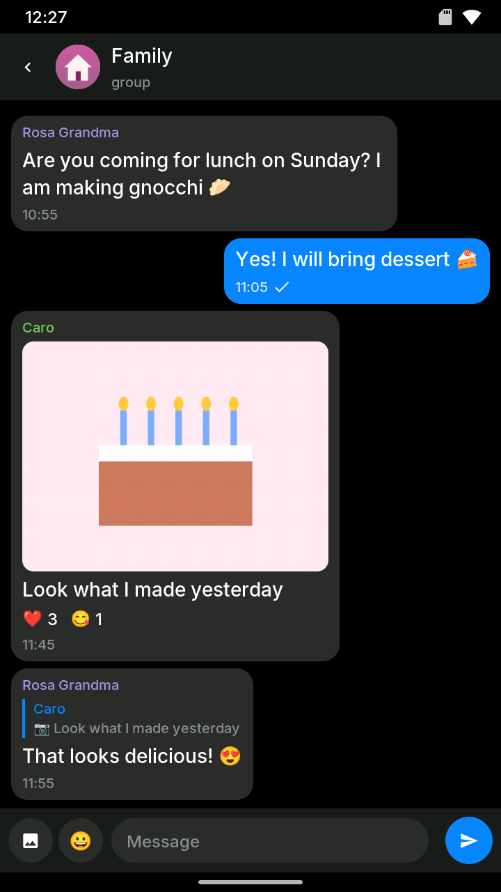
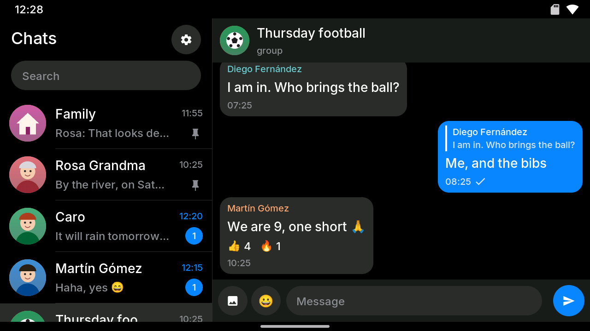
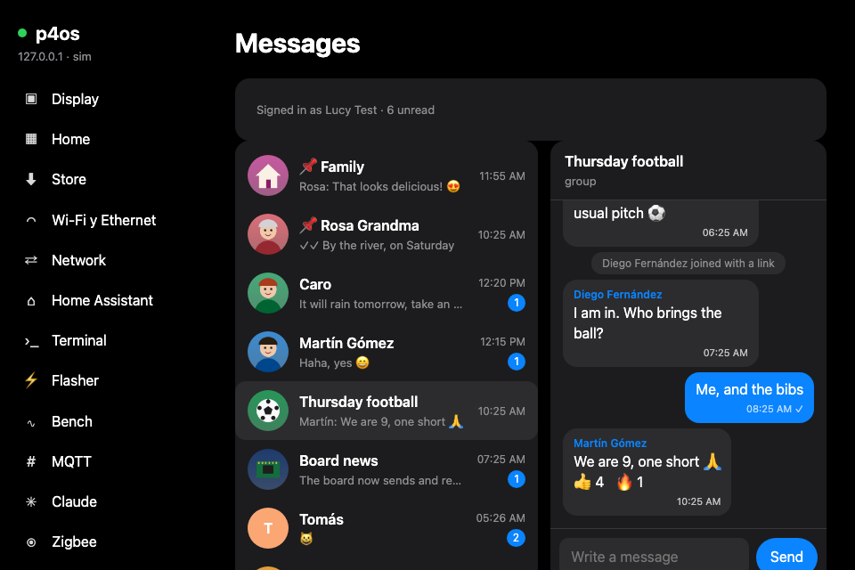

# Mensajes (`aos.mensajes`)

An unofficial client for Telegram with the person's own account: the chat
list, the conversations, photos, reactions and notifications of new
messages, on the board and from the phone through the portal. It speaks
Telegram's own protocol, **MTProto 2.0, written in C** for the P4: no TDLib
(it does not fit), no server in the middle.

"Mensajes" is a working name. Telegram's API terms ask that an unofficial
client use neither its logo nor the name "Telegram" alone: the icon and the
name are the app's own, and "for Telegram" is said in the description.

 





(The people, chats and photos in the pictures are made up by the fake server,
`tools/fake_telegram.py`.)

## What it does

- **Signing in:** the app's keys first (an `api_id` and an `api_hash` of
  the person's own, free at my.telegram.org, "API development tools";
  typed on the board or on the portal's page), then the number, the code
  (to the Telegram app or by SMS, call or e-mail) and the two-step
  password when the account has one. A session closed from another
  device (`AUTH_KEY_UNREGISTERED`, `SESSION_REVOKED`) goes back to signing
  in. A number with no account is told to create it in the official app.
- **The chats:** private chats, groups and channels with their photo, the
  last message ("Ana: ...", ✓/✓✓ for ours), the unread count, pins and
  muted chats; more as the list scrolls; a search by name as you type, and
  ✓ on the keyboard searches the messages and contacts on Telegram.
- **A chat:** bubbles with the sender's name in groups, the day's labels,
  replies (the quoted message), forwards ("Forwarded from"), edited marks,
  reactions, the views of a channel's posts, read ticks, "typing…", service
  messages ("Diego joined with a link"). Older messages load when the list
  reaches the top. A long press opens the message's sheet: the reactions
  (the same one again takes it away), reply, forward (to any chat),
  copy, edit (our own text) and delete (for everyone when it is ours).
- **Writing:** the system keyboard or a USB/Bluetooth one, an emoji panel,
  "typing…" sent while writing, and a photo from the card (the JPEGs of the
  photos folder, with what is typed as its caption).
- **Media:** photos in the bubble and big in the viewer (decoded by the
  HAL, the P4's JPEG engine on the board); documents, voice messages and
  videos are downloaded to `<card>/Mensajes` with their progress; stickers
  show as their thumbnail when it is a JPEG and as their emoji otherwise.
  Voice messages are kept, not played: see "Not done yet".
- **In the background:** the app stays alive when left
  (`AOS_APP_FLAG_BACKGROUND`), its connection open, and a new message
  arrives as a notification (the phone's banner and centre,
  `aos_notif_push`; not for muted chats, nor for the chat open in front)
  and as the unread count on the icon. It can start with the board
  (Settings).
- **Settings:** the account, notifications on/off, start with the board,
  the photo cache (count, size, empty it), the memory it holds, the server,
  log out.
- **The portal's page** (`web/mensajes.js`): the list and a chat side by
  side (one after the other on a phone), with photos and reactions, and a
  box to answer; opening a chat there opens it on the board too. The app's
  keys can be typed there instead of on the board. It works over the live
  channel (`aos_hal_live_*`) while the app is open: the messages never touch
  the card on their way to the browser.

## The protocol

| Layer | Where | What |
|---|---|---|
| Transport | `mj_mtp.c` | TCP (`aos_hal_tcp_*`), the "intermediate" framing; a 4-byte negative packet is the server's transport error (-404: unknown key, a new one is made) |
| Auth key | `mj_mtp.c`, `make_key` | `req_pq_multi`, pq split by Pollard-Brent, `p_q_inner_data_dc` under RSA_PAD with Telegram's key (fingerprint `d09d1d85de64fd85`), `req_DH_params`, the answer checked (SHA-1, nonces, the known 2048-bit safe prime, g and g_a ranges), `set_client_DH_params`, `new_nonce_hash1`. ~150 ms on the computer |
| Messages | `mj_mtp.c` | AES-256-IGE with msg_key from SHA-256 (MTProto 2.0), 12-1024 bytes of padding, msg_id from the server's clock (learnt in the handshake and from `bad_msg_notification` 16/17), seqno, acks within a second or with the next request, containers both ways, `gzip_packed` anywhere, salts (`bad_server_salt`, `new_session_created`), pings with `ping_delay_disconnect` |
| Requests | `mj_mtp.c` | each waits for its `rpc_result`; sent again after a new salt, a clock fix, a lost connection (up to four times), `FLOOD_WAIT_X` up to a minute and 5xx errors; every request goes in `invokeWithLayer(initConnection(...))` until the server has answered one of the session |
| Data centres | `mj_api.c` | starts at DC 2, `PHONE_MIGRATE_X` / `USER_MIGRATE_X` move the home; a photo on another DC is fetched there after `auth.exportAuthorization` / `importAuthorization`, and `FILE_MIGRATE_X` is followed. A second connection closes after a minute idle (the HAL has four TCP slots for the whole system) |
| Updates | `mj_api.c` | `updateShort*`, `updates`, `updatesCombined` with pts and seq checked; a gap asks `updates.getDifference` (slices followed), `updates.getState` at start and every ten minutes (the way a session closed elsewhere is noticed) |
| Two-step password | `mj_crypto.c`, `mj_srp` | `account.getPassword`, SRP as core.telegram.org/api/srp (PBKDF2-HMAC-SHA512 with 100 000 rounds, Monocypher's SHA-512), `auth.checkPassword`; a fresh `srp_B` for every try |

**TL without TL by hand.** `tools/tl_subset.py` cuts from the published
schema (Telegram Desktop's `api.tl` and `mtproto.tl`, **layer 234**) the
functions of `tools/wanted.txt` and every constructor their arguments and
answers can carry: 1064 combinators in `tools/schema/layer234.tl`.
`tools/tl_gen.py` turns that into C tables (`main/tl_schema.c`, ~80 KB) and
constants (`TLC_message`, `TLN_id`), and `main/mj_tl.c` reads and writes
any of them by walking the tables: fields are asked for by name
(`tl_i(msg, TLN_id)`), flags are worked out from the optional fields set.
The fake server and the tests read the same subset with
`tools/tl_schema.py`. A newer layer is `tl_subset.py` on a newer `api.tl`
and `tl_gen.py` again.

**The cryptography is the app's own** (`mj_crypto.c`): the firmware lends
the apps SHA-256 and Monocypher, but none of mbedTLS (no AES, SHA-1 nor
bignum in the symbol table). So SHA-1, AES-256 with T-tables and IGE, a
bignum with Montgomery's exponentiation (window of four bits), pq, PBKDF2
and SRP are here in plain C. 2048-bit exponentiation: 34 ms on the Mac;
on the board, untried (estimated 0.3-0.6 s; a handshake does three).

**What is kept** (`mj_api.h`): preferences `msj_apiid`, `sec_msj_hash`,
`msj_dc`, `sec_msj_ak1..5` (the auth keys), `msj_dcok`, `msj_self`,
`msj_logged`, `msj_notif`; the secrets start with `sec_`, so a backup
without a passphrase leaves them out (docs/BACKUP.md). Files:
`<data>/mensajes/cache/` (avatars, photos, thumbnails; 48 MB at most, the
oldest go first), `<data>/mensajes/state.txt` (pts, qts, date, seq),
`<card>/Mensajes/` (what the person downloads), and
`<data>/mensajes/servidor.txt` only for a test server.

## Memory

Everything is PSRAM: the app's allocations go through `mj_malloc`
(`heap_caps_malloc(MALLOC_CAP_SPIRAM)` on the board), which also counts
them; Settings shows the count.

Measured in the simulator against the fake server, after signing in and
opening four chats with photos: **156 KB** held by the protocol and the
store (**peak 286 KB**, while the chat list's answer is read), **710 KB**
of decoded pictures (avatars and the photos of the bubbles; up to 6 MB, the
least recently used one that nothing shows goes first), and the system
counted **1047 KB** of PSRAM for the app when it was left. The code is the
.so's **216 KB**. A real account with hundreds of chats holds more in the
store (a few hundred bytes a chat, ~1 KB a message of the open chat); the
board's number is still to be measured.

## Testing

Nothing here was tried against Telegram's servers, production or test:
everything ran against the fake.

```
make -C apps/mensajes/tests OUT=<scratch>/t test   # crypto and TL against vectors
tools/fake_telegram.py --port 19443 --control 19450 \
    --client-config <data>/mensajes/servidor.txt --state <scratch>/fake.json
make -C apps/mensajes/tests OUT=<scratch>/t cli
MJ_PREFS=<scratch>/p.txt <scratch>/t/mj_cli <data>/mensajes app 12345 00112233445566778899aabbccddeeff \
    phone +5491155550100 code 12345 password pescado dialogs open c 3001 fetch-photos
```

- **Vectors** (`tests/vectors.py` makes `tests/vectors.h`, from the
  standards and the Python reference `tools/mtproto_ref.py`, never from the
  C): SHA-1 (FIPS 180), AES-256 (FIPS 197), IGE, msg_key and the AES
  key/iv both ways, auth_key_id, the handshake's temporary key and
  `new_nonce_hash1`, RSA_PAD with Telegram's key, DH, pq (core.telegram.org's
  example and two more), PBKDF2-HMAC-SHA512, SRP (A and M1), gzip, TL read
  and written byte for byte as Python does. 37 checks, all pass.
- **The fake server** (`tools/fake_telegram.py`) speaks the protocol for
  real with its own RSA key (its public half goes into `servidor.txt`, the
  only way the app trusts another key): three data centres, the account on
  DC 1 and some photos on DC 3; the code 12345 and the password
  "pescado"; chats with text, a photo, reactions, a reply, a forward, an
  edit, a voice message, a sticker, a document, a service message; a
  contact who answers (typing first, then reading); `--chatter N` for
  someone writing every N seconds, and a control port (`say`, `gap`,
  `revoke`). `--lang en` for the screenshots.
- **Tried with `mj_cli` and in the simulator:** the whole sign-in with
  `PHONE_MIGRATE_1`, a wrong code, the two-step password; a restart with the
  keys kept (no handshake; the first request meets `bad_server_salt`);
  the fake restarted without the keys (-404, a new key, back to signing
  in); a clock 15 minutes off (`bad_msg_notification` 17, fixed); dialogs,
  history, sending and the answer arriving live, reply, edit, delete,
  reaction (and taking it away), forward, a photo uploaded and shown,
  photos from DC 3 (export/import, `FILE_MIGRATE_3`), avatars, a voice
  message and a document to the card, a channel (read-only composer),
  search, a pts gap (getDifference), the session revoked elsewhere (back to
  signing in), the notification with the app in the background, both
  orientations, the portal's page in dark, light and phone width.
  `mj_cli` ends every run with 0 bytes held.

## Not done yet

- **Tried against Telegram itself:** only the person can, with their
  account, on the board. What only the real server can say: that layer 234
  and our `initConnection` are accepted, that the production key and DC
  addresses are the right ones, a real `PHONE_MIGRATE`, the code's
  delivery, SRP with the real `p` and `g`, `FILE_MIGRATE` to the media DCs,
  `gzip_packed` answers of real size, the update flow of a busy account,
  and how long the handshake and SRP take on the P4.
- **Voice messages are not played:** the firmware lends no Opus decoder
  (nor an OGG demuxer) to the apps, and the player does MP3/AAC. They are
  downloaded to the card. A request to the firmware.
- **Stickers** that are WebP (most), animated (TGS) or video (WebM) show
  their emoji: no decoder for those either. A JPEG thumbnail is shown.
- **Not handled:** creating an account, the QR login, secret chats, calls,
  sending documents or voice, polls (shown as their question), forum
  topics, folders, the "obfuscated" transport (for networks that block
  MTProto) and proxies, message formatting (bold, links: shown as plain
  text), editing captions, the online status sent by us, a channel's own
  pts gaps (`updates.getChannelDifference` is in the subset but not called).
- **One chat at a time** is kept in memory; the chat list and the cache of
  pictures survive, the messages are asked again on opening.
- **Notifications** use `aos_notif_push`, which the firmware exports but
  declares for its own providers: tapping one does not open the chat.
