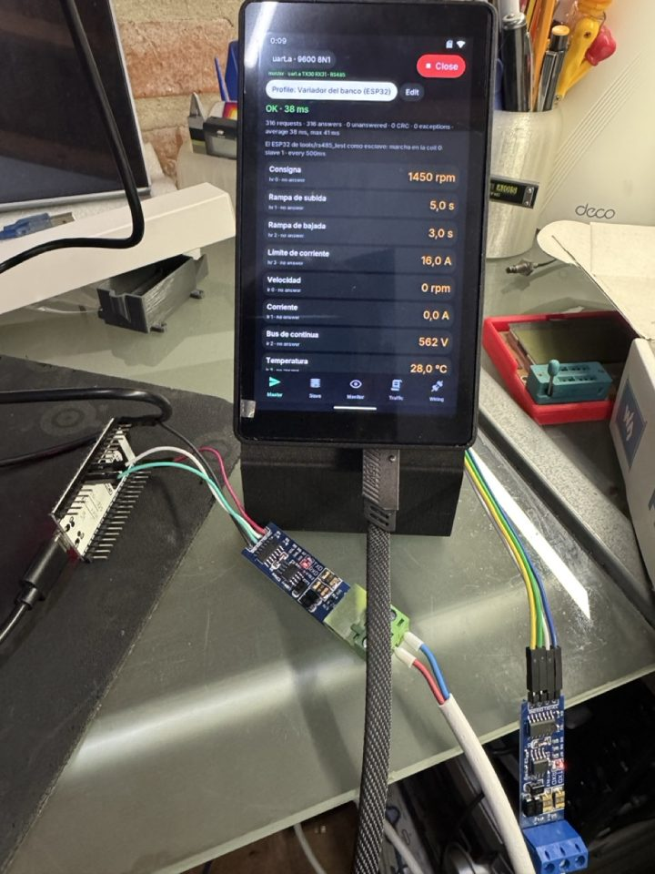

# Modbus

A bench tool for Modbus RTU on RS485 (and RTU on any serial port, and the
master side of Modbus TCP). Id `aos.modbus`. It takes the place of the
firmware's old Modbus app (until 0.24), whose Riden and DOMCOM gateway
panels went to their own app, Equipos (`apps/equipos`).

The app is one of three things on the line, one at a time:

- **Maestro:** a request of any function - 01-04 reads, 05/06/15/16 writes,
  08 echo, 17 report slave id, 43/14 device identification - to any unit
  (0 is a broadcast: no answer), once or live every 100 ms to 2 s. The
  values in U16, S16, hex, binary, U32, S32 or float, the 32-bit ones in
  either word order (ABCD or CDAB); a tap on a coil flips it (FC 05), a tap
  on a holding register writes it (FC 06, decimal or hex). Counts of
  requests, answers, timeouts, bad CRCs and exceptions, and the average and
  longest delay. Two tools: **Buscar unidades** asks units 1-247 for holding
  0 and lists who answers (or refuses: an exception also says somebody is
  there); **Buscar velocidad** tries eight speeds (1200-115200) and four
  formats (8N1, 8E1, 8O1, 8N2) with the chosen unit, and a tap on a result
  sets it.
- **Esclavo:** the app answers as unit N (1-247), and takes broadcasts
  without answering them. Coils, discrete inputs, holding and input
  registers from 0 to 9999 each; past that exception 02, a bad count 03, an
  unknown function 01. Holding 0-15, coils 0-15, input 0-7 and discrete 0-7
  are on screen, and a tap changes them. "Valores que se mueven" makes the
  inputs move by themselves (seconds, a sine, a temperature, noise, a
  32-bit counter, a float), so a master has something to watch. **Faults**
  on demand, to see how a master copes: Mudo (no answer), Lento (answers
  after a delay, 500 ms by default), CRC malo, Ocupado (exception 06) and
  Falla (04). Also 08, 17 ("P4OS") and 43/14.
- **Monitor:** listens without ever driving the line (DE stays low, as if
  the board were not there). It splits what goes by into frames, pairs each
  request with its answer and keeps a row per unit: requests, answers,
  unanswered, exceptions, bad CRCs, the average and longest delay, and the
  last request. Totals of frames, bytes, damaged frames and noise.

**Tráfico** shows every frame of any role, newest on top: the time since
the link opened, the silence before it, TX or RX, the bytes in hex, and what
they mean in words ("U1 leer holding 0..9 (10)", "excepción 02, dirección
inválida · contestó en 6 ms"); unanswered requests and the faults played
are there too. Pause (or the BOOT button), only errors, clear. 1024 frames
are kept (PSRAM).

**Cableado** draws the transceiver between the header and the bus with the
pins of the chosen port, the bus with its two 120 Ω, and what to know:
3.3 V transceivers, DE and /RE, termination, A/B naming, biasing, a common
GND, cable length.

**The link** (the bar on top): `uart.a` (the header's RS485 port: TX 30,
RX 31, DE 29) or any UART port of `modules.txt`, `usb0`/`usb1` (a USB-RS485
adapter on the USB host), or TCP (master only). Speed 1200-115200 or any
other, format, the master's timeout (100 ms to 3 s) and the silence before
each request (some devices stop answering when requests come back to back).
**It opens closed every time**: a slave or a master must not start talking
on somebody's bus before the user says so. Enviar in Maestro opens it.

## Profiles

A **profile** says what a device has and where: its unit, speed and
format, and a list of points, each with a name, its table and address, how
its bytes read (type and scale), its unit, whether it can be written, and
how it moves when the app plays the device. One profile is active at a
time, chosen with the chip on top of Maestro or Esclavo:

- **In Maestro** the app reads the whole profile every period (it joins
  neighbouring addresses into as few requests as it can) and shows each
  point with its name and unit: "Temperatura 23,4 °C", "Marcha ON". A tap
  on a writable one writes it (FC 05, 06, or 16 for a 32-bit value).
  Choosing a profile takes its speed and format and opens the link.
- **In Esclavo** the app *is* that device: it answers at the profile's
  addresses, and each point moves as the profile says, so a master (a PLC,
  a SCADA, Home Assistant) can be tried without the device. What a master
  writes stays; a tap sets a value by hand.

**The file** is a CSV, one per device, in `<card>/modbus/perfiles/`, that
a spreadsheet opens:

    nombre,Multisensor
    nota,"Temperatura, humedad, presión, CO2 y luz"
    esclavo,1
    velocidad,9600
    formato,8N1
    periodo,1000
    # tabla,direccion,nombre,tipo,escala,unidad,acceso,min,max,simulacion,valor
    ir,0,Temperatura,s16,0.1,°C,r,18,27,seno,22
    hr,1,Período de medición,u16,1,s,rw,1,60,,5
    coil,0,LED,bit,,,rw,,,,0

- tables `coil`, `di`, `hr`, `ir` (also `holding`, `input`, `0x`/`1x`/`3x`/`4x`);
- types `bit`, `u16`, `s16`, `hex`, `u32`, `s32`, `f32` (the high word
  first, ABCD) and `u32cdab`, `s32cdab`, `f32cdab` (the low word first);
- the value is the raw number times the scale; access `r` or `rw` (inputs
  are always `r`);
- simulations: `fijo` (stays at `valor`), `seno` and `rampa` (min to max in
  a minute), `deriva` (a random walk between min and max), `contador`
  (rises max per hour), `alterna` (flips every few seconds), `azar` (a new
  random value every second);
- numbers in decimal with a point, or `0x` hex; `#` starts a comment.

Up to 64 points. The first run writes four examples: the drive the
bench's ESP32 plays (`variador-esp32.csv`, its own map), a generic
multisensor, a single-phase DIN-rail energy meter laid out like the
Eastron SDM120's (floats in input registers) and a temperature and
humidity sensor like the XY-MD02's. The meter's and the sensor's maps are
the usual ones for those families; check them against the device's manual.

**Editing them:** on the board, "Editar" next to the chip (name, note,
unit, speed, period; each point's name, unit, table, address, type,
scale, access, simulation, min, max and start value; every change saved
at once), or "Nuevo" in the list. On the portal, the **Modbus** page
(`web/modbus.js`): the list, each profile as a table, new, duplicate,
delete, **upload a `.csv` and download one**, and "Usar en la placa",
which opens the app and makes it the active profile. The app reads an
active profile again when its file changes, and while the page looks it
sends the values it reads or plays (the live channel), shown in the
table's "En la placa" column.

## How it reads the line

All three roles read the line the same way (`main/mb_bus.c`). The UART
driver hands bytes over in bursts - when its FIFO fills, or a few character
times after the line goes quiet - so the 3.5-character silences RTU frames
by cannot be measured from an app to the character. Frames are split by
their contents instead: from the function code, the lengths a frame may
have (a request, an answer, an exception), and the one whose CRC matches
wins. A silence long enough for the driver to have delivered everything
ends what is left as one damaged frame, or as noise when it is too short to
be a frame; between them the next offset where a good frame starts is
looked for, so one bad frame does not swallow the good one behind it.

Times (the silence before a frame, an answer's delay) are when the bytes
reached the app: close, a few characters late. Since this version the
firmware hands an RS485 port's bytes over 3 characters after the line goes
quiet instead of the driver's default 10 (`aos_io_p4.c`).

The protocol is the standard's: Modbus over serial line V1.02 and Modbus
Messaging on TCP/IP V1.0b. The app has its own engine (not the firmware's
`aos_modbus.c`, which the Banco and Equipos use) because a tester needs
every frame as it was, the bad ones too.

## In the simulator

`tools/fake_modbus.py` plays the other end on a pty; the simulator takes it
as `uart.a` with `P4_SIM_UART_A=<the pty it prints>`:

    tools/fake_modbus.py --slaves 1,2,5     # for Maestro and Buscar unidades
    tools/fake_modbus.py --master 1         # polls the app as slave, prints what came back
    tools/fake_modbus.py --bus              # a busy bus for the Monitor: a slow unit,
                                            # a dead one, an exception, damage, noise

Profiles, on 2026-11-08: Multisensor chosen in Maestro opened the link
and read its ten points from the fake slaves; in Esclavo, the fake master
read 25,8 °C, 54,4 %, 1012,5 hPa from the app playing it; from the portal
page (on the simulator's portal), "Usar en la placa" switched the app to
the drive, its values showed live in the table, and a point added and
saved there reached the app by itself.

Tried on 2026-11-08: the master read the three slaves, Buscar unidades
found 1, 2 and 5; as slave it answered every request of the fake master
right (reads, writes, FC 16, exception 02 out of the map, 01 for an unknown
function, 17, 43, a broadcast written and not answered, a bad CRC and
another unit ignored); as monitor it kept the three units apart, with unit
2's damaged answers as CRC errors and unit 7 as never answering.

On a pty the bytes arrive at once, so the delays shown there are not the
wire's. On the board, with the ESP32 of `tools/rs485_test`: see
`docs/plan/PRUEBAS-PLACA.md`.

## On the board (2026-11-09)

The bench of `tools/rs485_test`, wired as `docs/img/bench-rs485.svg`: the
P4 on `uart.a` and an ESP32 DevKit, each with an automatic "RS485 to TTL"
module fed from 3.3 V (TXD to TX, RXD to RX worked the first time), a
twisted pair, the modules' own 120 Ω.

- **Master with the drive's profile**, 9600 8N1: thousands of requests, no
  error that was not played on purpose. "Marcha" tapped on the board
  started the ESP32's drive: 1450 rpm along the ramp, the current and the
  temperature following. With the ESP32 answering as soon as a frame's CRC
  closes, 14 ms on average from the end of a request to the start of its
  answer, the line busy ~33 ms a request.
- **The ESP32's faults** showed on each point as what they are: silent and
  slow (400 ms, past the 300 ms timeout) as "sin respuesta", a broken CRC
  as "respuesta dañada (CRC)", busy as "esclavo ocupado"; the counts add
  up (requests = answers + unanswered + damaged).
- **08, 17 and 43** on the wire: the identification read "P4OS bench ·
  ESP32 drive · 1.2", the Id "ESP32-VFD" with its run indicator.
- **Buscar velocidad** found the ESP32 moved to 19200 8E1, but at 19200
  every format answered: neither UART drops a byte with a parity error, so
  a good CRC comes back whatever the parity. The speed is certain, the
  format is not; the tab says so (counting parity errors would need the
  firmware to report them).
- **Slave**, playing the drive's profile for the ESP32 as master: every
  request answered (the profile's values moving), and each fault seen on
  the other side: mute and slow as no answer (slow's late answers then
  collide with the next request and come back as "not the answer to
  that"), the broken CRC as bad CRC, busy and failure as exceptions.
- **Monitor** with the ESP32 polling a unit nobody plays: each request
  counted, every one unanswered.

## Files

- `main/mb.h` what the files share; the shared state and the log
- `main/mb_proto.c` CRC, request PDUs, frame lengths, a frame in words
- `main/mb_bus.c` the bus thread: the link, the three roles, the tools
- `main/modbus.c` the app: the bar, the tabs, the link sheet, settings
- `main/mb_tabs.c` the five tabs
- `main/mb_prof.c` profiles: the file, the examples, values, simulations, the reads
- `main/mb_ui_prof.c` profiles on the screen: the chooser, the editor, the values
- `web/modbus.js` the portal's page
