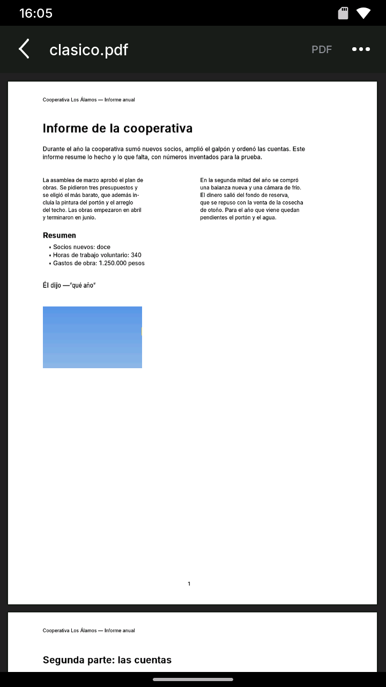

# Oficina (Office)

Reading and editing office documents on the board. Id `aos.oficina`.

Not a LibreOffice: read almost everything well, edit the common things, and
never break a file. Two rules hold for every format:

- **What the app does not understand is kept as it was when saving.** A
  document is a package of parts (or a file of blocks); the app rewrites only
  the part it edited, and inside that part only the elements it edited. The
  rest goes out byte for byte. When something cannot be kept (a CSV cannot
  hold a formula, an edited `.doc` is not possible), the app says so before
  saving, never after.
- **Tested with files made for the test**, by `tools/make_samples.py`, and
  checked after saving by `tools/check_saved.py` (well-formed XML in every
  part, every relationship pointing at a part that exists, untouched parts
  identical, the values written where they belong). Never with anyone's
  documents.

This file is the plan, by phases, and then what is built. How to try all
of it on the board before a release, with every test file:
[PRUEBAS-PLACA.md](PRUEBAS-PLACA.md).

---

## 1. The formats

What is worth reading and what is worth editing, beyond the ones asked for,
with what the app would do with each one and the code it takes. "Own" means
written for the app; the line counts are estimates.

### What the system already has

| What | Where | Use here |
|---|---|---|
| Inflate | miniz's `tinfl` (MIT), `apps/emulador/third/` | every ZIP-based format, gzip, PDF's FlateDecode |
| ZIP reading | `apps/emulador/main/em_zip.c` (central directory, stored and deflated) | the pattern for `of_zip.c`, which also writes |
| Deflate | `apps/dibujo/main/dib_png.c` (LZ77 with hash chains, fixed Huffman codes) | writing the parts the app rewrites |
| A rich-text editor | `apps/notas/main/nt_editor.c`, `nt_doc.c` (blocks, one style word per byte, undo, clipboard) | the base of the document editor (phase 2) |
| A Spanish keyboard of its own | `apps/notas/main/nt_kb.c` | the text editor's keyboard |
| JPEG, PNG and BMP | `aos_hal_image_decode` (path, offset, size), and the hardware JPEG (`aos_hal_jpeg_*`) | pictures inside documents: a stored ZIP entry is decoded in place by its offset, a deflated one is inflated to the cache first |
| Fonts | Inter Medium 14 to 64 px, `aos_mono_18/22` | the interface and the text; bold and italic for documents come in the app's pack, as Notas does |
| Modules | `aos_hal_module_open/_sym/_close` | the big or separately licensed parts (below) |

There is no FreeType in the firmware: a page drawn with its own fonts needs
a font reader in the app (phase 7 wrote its own: `of_pdffont.c`).

### Libraries considered

| Library | Licence | Size | For | Verdict |
|---|---|---|---|---|
| miniz `tinfl` | MIT | 700 lines | inflate | **in**, the Emulador's copy, prefixed |
| Dibujo's deflate | MIT (P4OS) | 150 lines | deflate | **in**, prefixed |
| yxml | MIT | 1 000 lines | XML | not needed: the app needs byte offsets of every element to splice, so its own pull tokenizer (300 lines) is simpler |
| md4c | MIT | 6 500 lines | Markdown to blocks | **phase 3**, for the rendered view (CommonMark and GitHub tables) |
| stb_truetype | MIT or public domain | 5 000 lines | TrueType and OpenType-CFF glyphs | not taken in phase 7: it says itself it does no range checking ("do not use this on untrusted font files"), and a PDF's fonts are exactly that; it has no Type 1 either. Own reader, every offset checked (`of_pdffont.c`, 1 300 lines) |
| nanosvg + nanosvgrast | zlib | 3 000 lines | SVG pictures, and an anti-aliased path filler | not taken for PDF's paths: PDF needs both winding rules, clipping and strokes with dashes, so the filler is own (`of_pdfdraw.c`); SVG in documents, later |
| pdfio (Michael Sweet) | Apache-2.0 | 10 000 lines, needs zlib | PDF objects, xref, encryption | not taken: the own parser (of_pdf.c, 1 000 lines) with miniz's inflate already here, and own MD5, RC4, AES and SHA-2 (of_crypt.c, 400 lines) |
| MuPDF | AGPL-3.0 | several MB | PDF, EPUB, XPS | no: too big for the card's RAM budget and its licence would make the whole app AGPL |
| libxls | BSD-2 | 3 000 lines | `.xls` | an own BIFF8 reader is the same size and shares the CFB reader with `.doc` |
| antiword, wvWare | GPL-2.0 | big | `.doc` | no: an own piece-table reader is 400 lines |
| xz-embedded | 0BSD | 3 000 lines | `.xz` | maybe, for `.tar.xz`; low demand |
| LZMA SDK | public domain | big | `.7z` | no, unless asked |
| libyaml, tomlc99 | MIT | 10 000, 2 500 lines | YAML and TOML trees | no: a tree view needs only the indentation and the keys; own reading (500 lines for both) |
| gifdec | public domain | 600 lines | GIF pictures in HTML and EPUB | maybe, phase 3 |

Nothing in the plan is GPL. The plan had the PDF page renderer (phase 7) as
a module, `oficina_pdf.so`, loaded when a page is drawn. It went into the
app instead: a module sees only the firmware's symbols, and the renderer
leans on the app's PDF parser, decryption, inflate and font tables, so a
module would carry a second copy of all of it (about twice its size); in
the app it is 72 KB.

### Format by format

| Format | Read | Edit | Convert | Code | Phase |
|---|---|---|---|---|---|
| `.txt`, `.log`, `.ini`, `.conf`, `.cfg` | yes | yes | to `.docx`/`.odt` (2) | own editor; UTF-8, UTF-16 with BOM, Latin-1 / Windows-1252; LF, CRLF, CR kept | 1 |
| Big logs (MB) | yes, without loading them | no | | the file indexed by lines in a background pass and read a window at a time; follow mode (`tail -f`) | 1 |
| Source code (`.c`, `.h`, `.py`, `.js`, `.lua`, `.sh`, `.css`...) | highlighted | yes | | own lexer table per language family (C-like, Python, shell, Lua, CSS): 400 lines | 1 |
| `.json` | highlighted, tree | yes (text) | | own tokenizer; tree view in phase 3 | 1 / 3 |
| `.xml`, `.html` source, `.svg` source | highlighted, tree | yes (text) | | the app's XML tokenizer | 1 / 3 |
| `.yaml`, `.toml` | highlighted, tree | yes (text) | | own | 1 / 3 |
| `.md` | source highlighted; rendered view | yes (source) | to `.html`, `.docx` | md4c for the view | 1 / 3 |
| `.csv`, `.tsv` | grid | yes | to `.xlsx`, `.ods` | own; delimiter, quoting, encoding and decimal comma detected, and kept when saving | 1 |
| `.xlsx`, `.xlsm`, `.xltx` | grid, every sheet | values, formulas, number formats, column widths, sort | to `.ods`, `.csv`, PDF (4) | own: sheets, shared strings, styles' number formats, shared formulas, merged cells, frozen panes. Saving rewrites the edited sheets' `sheetData` (and `cols`), adds number formats to `styles.xml` only when one was chosen, drops `calcChain.xml` when formulas changed and asks the reader to recalculate. Macros (`vbaProject.bin`) travel untouched | 1 |
| `.ods`, `.fods` | grid | as `.xlsx` | to `.xlsx`, `.csv` | own: `content.xml`, repeated rows and cells split only where edited, `of:` formulas translated both ways | 1 |
| `.docx`, `.dotx` | paragraphs, headings, bold, italic, underline, colours, lists, tables, pictures | text and its common formatting, table cells | to `.odt`, PDF (4), `.txt`, `.md` | own: `document.xml` read into blocks and runs, each run keeping its original `rPr` bytes; saving rewrites only the edited paragraphs | 2 |
| `.odt`, `.fodt` | as `.docx` | as `.docx` | to `.docx`, PDF | own, the same model; automatic styles resolved to the same attributes | 2 |
| `.rtf` | yes | no (save as `.docx`/`.odt`) | to `.docx` | own: control words, groups, fonts, colours, `\uN`, pictures in `\pict` (PNG/JPEG): 600 lines | 3 |
| `.html`, `.htm` | rendered as a document | no (source yes) | to `.docx` | own HTML reader into the phase 2 blocks (reader mode: headings, paragraphs, lists, tables, pictures; no CSS layout) | 3 |
| `.epub` | chapters, contents, pictures, the page kept | no | | ZIP + OPF spine + nav/NCX + the HTML reader | 3 |
| `.fb2` | yes | no | | XML, the same blocks | 3 |
| `.eml`, `.mht` | headers, text or HTML part, attachments listed and saved | no | | own MIME (quoted-printable, base64, charsets) | 3 |
| `.vcf` (vCard 2.1-4.0) | contacts as cards | yes (fields) | to `.csv` | own: folding, escapes, `QUOTED-PRINTABLE`, the photo (base64 JPEG) | 3 |
| `.ics` (iCalendar) | events by day, with time zones as written | basic (title, time, place) | | own: VEVENT, VTODO, RRULE shown as text | 3 |
| `.zip`, `.cbz`, `.jar` | the list, open an entry with the app that takes it, extract | no | | `of_zip.c` | 3 |
| `.tar`, `.tar.gz`, `.tgz`, `.gz` | list, open, extract | no | | own (ustar, GNU long names, pax) + tinfl | 3 |
| Apple Pages, Numbers, Keynote | the preview picture they carry; text of Pages and Numbers' cells as a second step | no | | the file is a ZIP (or a folder on the card) with `preview.jpg` (or `QuickLook/Thumbnail.jpg`, `QuickLook/Preview.pdf` in the old ones): showing it is nearly free. The content is `Index/*.iwa`: Snappy-framed protobuf, no schema needed to pull the strings out (own Snappy, 150 lines, and a protobuf walk) | 3 / 6 |
| `.pdf` | text reflowed to the screen first; the pages drawn later | no | to `.txt` | own: objects, xref tables and streams, object streams, Flate and the other filters, `ToUnicode`, the standard encodings, RC4 and AES (done in phase 4) | 4, 7 |
| PDF writing | | | from documents and sheets | own, small: the 14 standard fonts need no embedding (WinAnsi covers Spanish and German), their widths in a table; JPEG pictures go in as they are (DCTDecode) | 4 |
| `.pptx`, `.odp`, `.ppsx` | each slide: its boxes of text and pictures at their place, the notes | text of a box (phase 6, later) | to PDF | own: slide XML, layout and master placeholders for position | 5 |
| `.doc` (Word 97-2003) | text, paragraphs, bold/italic if cheap | no (save as `.docx`) | to `.docx` | own: CFB container (300 lines), the piece table and the character runs (500) | 6 |
| `.xls` (Excel 97-2003) | values and cached formula results, every sheet | no (save as `.xlsx`) | to `.xlsx` | own: CFB + BIFF8 (SST, LABELSST, NUMBER, RK, MULRK, FORMULA, BOUNDSHEET, XF, FORMAT): 700 lines | 6 |
| `.ppt` | text of each slide | no | | CFB + the PowerPoint records' text atoms | 6 |
| Pictures inside documents | JPEG, PNG, BMP (HAL); GIF (gifdec); SVG (nanosvg, 7); EMF/WMF as a placeholder with their size | | | | 2, 3, 7 |
| Password-protected Office files | detected (CFB with `EncryptedPackage`) and said | | | | 1 |
| `.xlsb`, `.numbers` cells, `.key` slides, `.xps`, `.sqlite` | later, if asked | | | | - |

### Converting

The point of the models is that converting comes almost free:

- **Spreadsheets:** one model (`of_sheet.c`) and three writers, so `.csv`
  to `.xlsx`, `.xlsx` to `.ods` and back are "Save as". A CSV saved from a
  sheet with formulas keeps the values and the app says so.
- **Documents (2):** one block model and two writers (`.docx`, `.odt`),
  plus plain text and Markdown. RTF, HTML, `.doc` and Markdown read into the
  same blocks and can be saved as `.docx`/`.odt`.
- **PDF (4):** a small writer with the standard fonts lays out documents and
  sheets; a document with pictures takes its JPEGs as they are.

### Order, by what pays most

1. **Text and spreadsheets** - the base everything else uses: the shell
   (files, recent, new), the ZIP reader and writer, the XML tokenizer, the
   text editor and the grid with formulas, CSV, XLSX and ODS. Source
   highlighting and big logs come with the text editor because they are
   cheap there.
2. **Documents**: `.docx` and `.odt`, with Notas' editor as the base. The
   block model, the renderer and the two writers.
3. **The cheap readers on top of phase 2**: RTF, HTML, EPUB, FB2, Markdown
   rendered, EML; vCard and iCalendar; ZIP and TAR; the JSON/XML/YAML/TOML
   tree; the preview of Apple's files.
4. **PDF text** (reflowed) and **PDF writing** (export).
5. **Slides**: `.pptx` and `.odp`.
6. **The old binaries**: `.doc`, `.xls`, `.ppt` (one CFB reader for the
   three); the text inside Pages and Numbers.
7. **PDF pages drawn** with their own fonts and paths (done: own font
   reader for TrueType, CFF and Type 1, own filler, the system's JPEG; the
   fonts a file names and does not carry, with the firmware's Inter).

---

## 2. What is built

### Phase 1: text and spreadsheets (done, 2026-11-22)

**The shell** (`oficina.c`): Recent and Files, any folder of the card
(`/sdcard/documentos` by default, made on first use), a long press on a file
to rename, duplicate, delete it or take it off the recent list, "+" for a new
xlsx, ods, csv, txt or md, dark or light background. Leaving a document with
changes asks to save them; if the system closes the app meanwhile (the fifth
app opened), they go to a copy beside the file, "<name> (sin guardar)".
Formats of later phases say so instead of opening.

**Spreadsheets** (`of_sheetview.c` over the formats core):

- the grid, drawn by the app: frozen panes as the file has them, merged
  cells, the file's fills, font colours, bold, underline, alignment, column
  widths and row heights, text that runs over empty cells, `###` for a number
  that does not fit, negative numbers in red where the format says `[Red]`;
- one finger scrolls with momentum, a tap selects, a second tap or a double
  tap edits, a long press and a drag select a range, a tap on a letter or a
  number selects the column or the row, dragging a letter's edge resizes the
  column, two fingers zoom (six steps, remembered);
- the formula bar: the cell's name (tap: go to a cell) and its content as
  typed (`15%`, `01/12/2026`, `=SUM(D2:D9)`); while a formula is typed, a
  tapped cell or a dragged range goes in as its reference; a number cell
  opens the keyboard on its numbers' page;
- the selection's sum and average under the grid; sheets as tabs;
- the menu: save, save a copy as xlsx/ods/csv, number format (twelve, with
  an example each), sort ascending or descending (the block around the cell,
  its first row taken as titles), filter by the selected value, fit column
  width, freeze panes, copy/cut/paste (tab-separated, formulas move with the
  cells when pasted from the app), clear, go to a cell, find, the list of
  functions, rename a sheet (not yet for xlsx);
- undo and redo (200 steps), a USB or Bluetooth keyboard: arrows and Shift,
  Enter/Tab move after typing, typing replaces the cell, Delete clears, Esc,
  Ctrl+Z/Y/C/X/V/S/F/A, Ctrl+arrows to the data's edge;
- landscape: the same, with thinner bars.

**Formulas** (`of_formula.c`): 63 functions (SUM, AVERAGE, MIN, MAX,
COUNT, COUNTA, COUNTBLANK, PRODUCT, MEDIAN, SUMIF, COUNTIF, AVERAGEIF,
SUMPRODUCT, ROUND, ROUNDUP, ROUNDDOWN, TRUNC, INT, ABS, SIGN, MOD, POWER,
SQRT, PI, IF, AND, OR, NOT, IFERROR, IFNA, ISBLANK, ISNUMBER, ISTEXT, ISERROR,
ISNA, CONCATENATE, CONCAT, LEN, LEFT, RIGHT, MID, UPPER, LOWER, TRIM, REPT,
SUBSTITUTE, FIND, SEARCH, VALUE, TEXT, VLOOKUP, HLOOKUP, INDEX, MATCH, TODAY,
NOW, DATE, YEAR, MONTH, DAY, WEEKDAY, TRUE, FALSE), with their Spanish and
German names accepted when typed (SUMA, BUSCARV, SUMME, SVERWEIS...), `;` as
the separator with the decimal comma, references across sheets, whole columns
and rows, shared formulas expanded. A formula with a function the app does
not have shows and keeps the value the file cached. Recalculation uses an
explicit stack, not recursion (a chain of thousands of rows would overflow
the LVGL task's stack); a cycle shows `#CIRC!`.

**Number formats** (`of_numfmt.c`): Excel's format codes (sections, literals,
`[$€-...]`, grouping, scaling, percent, scientific, dates and times with
month and day names in Spanish or English) and ODF's data styles translated
to them; the decimal mark follows the interface language.

**The formats** (in `of.h`, built also on the Mac by `tools/host_test.c`):

| File | What it does when saving into the same format |
|---|---|
| `of_xlsx.c` | every part copied with its compressed bytes; the changed sheets rewritten inside `<sheetData>` only, untouched rows and cells byte for byte, new strings inline; `<cols>` and `<dimension>` brought up to date; `styles.xml` only when a format was chosen (the new `xf` a copy of the cell's old one); `calcChain.xml` dropped with its two mentions and `fullCalcOnLoad` set |
| `of_ods.c` | only `content.xml`, walked again: unchanged tables as they were, runs of repeated rows and cells split only where a cell changed, a rewritten cell keeping its style, spans and comment |
| `of_csv.c` | the separator, quoting, encoding (UTF-8, BOM, Windows-1252), line ends, and each untouched field as the file wrote it (`350.000,00`, `VERDADERO`) |
| `of_text.c` | UTF-8 with or without BOM, UTF-16 with BOM, Windows-1252; LF, CRLF, CR; the final line end |

Saving into another format builds a new package: one cell format per number
format in use (xlsx), one data style per number format (ods).

**Text** (`of_textview.c`): a gap buffer with a line index, drawn by the app
(only the lines in sight), so a 4 MB log scrolls lightly; line numbers,
wrapping (off for code and logs, and past 2 MB), Inter or mono, pinch zoom,
colours for C-like languages, Python and shell, JSON, XML/HTML/SVG, INI and
TOML, YAML, Markdown and logs (levels in colour), selection, undo, find and
replace, go to line, the encoding and line ends switchable from the menu.

**The portal** (`web/oficina.js`): the documents folder and its subfolders,
upload by picking or dropping with progress, download, delete, new folder, a
quick look at a CSV as a table or at a text file, the documents opened last.

### Checking it

```
cc -DOF_HOST -I apps/oficina/main apps/oficina/tools/host_test.c \
   apps/oficina/main/of_{util,deflate,tinfl,zip,xml,sheet,formula,numfmt,csv,xlsx,ods,text}.c -o /tmp/host_test
python3 apps/oficina/tools/make_samples.py /tmp/docs            # or --en for the English set
/tmp/host_test edit /tmp/docs/ventas.xlsx /tmp/out.xlsx 'B2=5000' 'Resumen!B2=7'
python3 apps/oficina/tools/check_saved.py /tmp/docs/ventas.xlsx /tmp/out.xlsx B2 D2 D11
```

What was checked on 2026-11-22 (there is no LibreOffice on this Mac: the
saved files were checked with `check_saved.py`, which reads them the way a
spreadsheet program does, and the app read them back):

- XLSX edited (a value, a formula, a member of a shared formula group, a new
  string with `&` and `<`, another sheet): comments, drawing, picture,
  theme, styles, shared strings, docProps and the untouched rows identical;
  the dependent formulas recalculated across sheets; array formula and
  unknown function kept with their cached values;
- ODS edited inside repeated rows and cells, a cell with a comment and
  `<text:s/>`, a new cell far down, the other sheet: only `content.xml`
  changed, `mimetype` first and stored;
- CSV in Windows-1252 with `;`, CRLF, quotes and `VERDADERO`: identical but
  the edited lines;
- conversions csv→xlsx, xlsx→ods, ods→xlsx, with dates, percentages and
  currencies keeping their formats;
- sorting a block with formulas; saving from the app in the simulator.

### Phase 2: documents (done, 2026-11-22)

**The model** (`of_doc.h`, `of_doc.c`): the paragraphs in reading order,
those of the body and those of table cells alike (each says its cell), each
UTF-8 text with a run style per byte (as Notes' blocks) and what it is: a
heading level, a list (bullet or number, level), its alignment. What the app
does not model travels inside a paragraph as an object, a U+FFFC with the
original XML: pictures (shown), footnote references (their number, raised),
fields (their text), bookmarks, comment marks, page breaks. A paragraph with
something the app cannot keep while editing (tracked changes, content
controls, math, a nested table, an index) is shown with a mark at its side
and locked.

**Reading** (`of_docx.c`, `of_odt.c`): docx through its relationships, with
styles.xml (paragraph and character styles and their parents, headings by
name or outline level, the default size) and numbering.xml; odt with its
automatic and named styles, list styles and nested lists, spans within spans,
`text:s`, frames, notes and fields; flat `.fodt` too.

**Saving into the same file** rewrites only the edited paragraphs, spliced
into the original `word/document.xml` or `content.xml`; every other part of
the package goes out with its compressed bytes:

- docx: an edited paragraph keeps its `<w:p>` attributes (a new one drops the
  `w14` ids, which must be unique) and its `<w:pPr>`; each run its original
  `<w:rPr>`, or that one with only the changed properties replaced, the
  children put back in the order the schema wants (Word refuses them out of
  order). A section break (`sectPr` in a paragraph) moves with the paragraph
  that keeps the section's end;
- odt: an edited paragraph's text goes inside its original spans, and what
  the person changed in one more span with an automatic style that says only
  that (`OF_T1`...), added to `office:automatic-styles`; a list item that is
  one paragraph is part of it, so a split one makes a new item and a merged
  one takes its item along.

Saving into the other format (docx to odt and back) or to plain text builds a
new package from the model: headings, lists, tables, bold, italic, colours;
pictures and what the app does not understand stay in the original.

**The screen** (`of_docview.c`): the page laid out by the app, the runs in
their size and style with the pack's Inter (`of_fonts.c`, from Notes:
regular, bold, italic and bold italic in five sizes; without the pack, bold
is drawn twice and italic upright), lines on a common baseline, headings,
bullets and numbers, alignment, tables with their grid and column widths,
pictures decoded by the HAL the first time they are in sight (a stored one
straight from the document, a deflated one through a temporary file) and
scaled to their box, footnote numbers raised, highlights, underline and
strikethrough, links in blue. A paragraph's lines are kept until it changes.

Editing: a tap places the caret and brings the keyboard, a double tap
selects a word, a long press and a drag select; typing, Enter (a new
paragraph like this one; after a heading, body text), Backspace and Delete
joining paragraphs within the body or a cell; the bar over the keyboard
(bold, italic, underline, strikethrough, for the selection or for what is
typed next; the paragraph style: body text and three headings; the
alignment); undo and redo (copies of the paragraphs an edit touched); copy
and paste as text (a line per paragraph); find; bigger and smaller text and
two fingers; information (paragraphs, words, characters); save a copy as
docx, odt or txt. A USB or Bluetooth keyboard: arrows with Shift, Home, End,
Delete, Tab, Ctrl+B/I/U/Z/Y/C/X/V/A/S/F/G. Lying down the page is a column
in the middle.

### Checking phase 2

```
python3 apps/oficina/tools/make_samples.py /tmp/docs        # informe.docx, carta.odt (and --en)
/tmp/host_test docdump /tmp/docs/informe.docx
/tmp/host_test docedit /tmp/docs/informe.docx /tmp/out.docx 'ins:1:-1: más' 'bold:24:0:6' 'split:5:6' 'merge:22' 'head:25:2' 'align:0:1'
python3 apps/oficina/tools/check_saved.py /tmp/docs/informe.docx /tmp/out.docx
textutil -convert txt -stdout /tmp/out.docx                  # macOS reads it as Word would
```

Checked on 2026-11-22 with the invented `informe.docx` and `carta.odt`
(styles, numbering, a table, a picture, a footnote, a field, a bookmark, a
comment, a hyperlink, a section break, header and footer, `w14` ids, one
paragraph with tracked changes): editing text, bold and italic, splitting and
joining paragraphs (lists included), headings and alignment changed only the
main part; the other parts identical; the locked paragraph byte for byte;
macOS's `textutil` reads every saved file; docx to odt, odt to docx and to
text. In the simulator: typing, bold for the next letters, saving from the
"unsaved changes" sheet.

### Build, install, pack

```
tools/build_apps.sh oficina                      # oficina.so, 544 KB, 230 symbols
python3 apps/oficina/tools/pack_fonts.py         # build/oficina_p4.pak, 877 KB (--sim: a copy in sim/sim_fs/apps)
tools/install_apps.sh p4os.local oficina         # the .so, the pack and the page; restarts the board
tools/install_lang.sh p4os.local en              # and de
sh apps/oficina/tools/samples_all.sh /tmp/docs   # every invented test file of the seven phases (55)
```

`oficina_p4.pak` is needed (`"need": true`): Inter 4.1 (SIL OFL 1.1), four
styles in 20, 24, 28, 36 and 48 px, made with lv_font_conv.

### Phase 3: the readers (done, 2026-11-22)

Every format below reads into the same document model (`of_doc_t`, built
through a small builder in `of_import.c`) and shows on the document screen,
**read only**: no keyboard, no format bar, no undo; selecting, copying,
finding, the contents ("Índice": the headings, to jump to), zoom and
"Guardar una copia como" docx, odt or txt, which then opens the copy to be
edited. Tapping a link shows where it goes. The top bar says what the file
was read from.

| Format | File | What is read |
|---|---|---|
| HTML, XHTML | `of_import.c` | reader mode: headings, paragraphs, lists (nested, numbered), tables (colspan, a table in a cell goes in its text), bold, italics, underline, strikethrough, sub- and superscript, code, `<mark>`, colours from `style` and `<font>`, links, pictures (files beside it, `data:` URIs), `<pre>`, quotes indented, `<hr>`, the entities in use and the page's charset (UTF-8 or Latin-1). Scripts, styles and `<head>` skipped; no CSS layout |
| EPUB 2 and 3 | `of_import.c` | `container.xml` → the OPF → the spine, chapter after chapter through the HTML reader, a page break between them; title and author on top; pictures read from inside the book |
| Mail (.eml, .mht) | `of_import.c` | subject, from, to, copy, date (RFC 2047 words decoded); MIME parts nested; the HTML body if there is one, else the text one (quoted-printable, base64, the charset); quoted lines in italics; attachments listed with their sizes |
| FB2 | `of_import.c` | the book's title, sections and their titles, paragraphs, poems and epigraphs, emphasis, strong, strikethrough, sub/sup, empty lines, pictures (`<binary>` base64, written to the cache) |
| RTF | `of_rtf.c` | groups and control words: bold, italics, underline, strikethrough, sizes, colours (`colortbl`), highlight, sub/sup; alignment; headings from the stylesheet or `\outlinelevel`; `\'hh` (code page 1252) and `\uN` with its fallback; line, tab, page; tables (`\intbl`, `\cell`, `\row`); HYPERLINK fields; PNG and JPEG pictures (hex or `\bin`); footnotes in place, small and grey; the numbers of lists from `\listtext`. Font tables, headers, footers, list tables, info skipped |
| Markdown | `of_text2.c` | an own renderer (md4c was the plan; 400 lines did it): ATX and setext headings, emphasis, strong, strikethrough, code spans, links and autolinks, pictures beside the file, bullet, numbered and task lists (nesting by the indents seen), quotes, rules, fenced and indented code, pipe tables, hard breaks, a few entities. Opens rendered; "Editar como texto" in the menu |
| vCard 2.1 to 4.0 | `of_text2.c` | a heading per contact; organisation, title, phones, emails, addresses, web, birthday, nickname, note, with their kind (mobile, work, home); folded lines, quoted-printable, the embedded photo |
| iCalendar | `of_text2.c` | events and tasks in date order, a heading per month; when (same day: one date), due, where, repeats (daily... yearly), notes; the calendar's name |
| JSON, XML, YAML, TOML | `of_text2.c` | the tree: a line per value, indented by depth, keys in bold, values coloured by kind; `{3}` and `[12]` after containers; JSON lines too; an error says where. Up to 5 000 lines. These open in the text editor; "Ver como árbol" in its menu |
| PNG, JPEG, BMP | `of_import.c` | the picture alone, the page's width, its size in pixels below |
| Pages, Numbers, Keynote | `of_import.c` | the preview picture the file carries (`preview.jpg`, `QuickLook/Thumbnail.jpg`), also from a package copied as a folder; the content itself is Apple's IWA (protobuf + Snappy), not read |
| ZIP, CBZ, TAR, TAR.GZ, TGZ, GZ | `of_archive.c` | shown in Files as a folder: its folders, its files with sizes; tapping one takes it to the cache and opens it; a long press extracts it next to the archive; "Extraer todo en una carpeta" in the ⋯ menu. ZIP up to 64 MB (read whole); TAR walked on the card; TAR.GZ inflated whole (up to 64 MB); ustar prefixes, GNU long names, pax paths; names in DOS code pages converted; encrypted ZIP entries marked and not extracted; `..` in names refused |

Saving a copy as docx or odt (from these, and between docx and odt) now
carries the pictures (into `word/media/` with their relationships, or
`Pictures/` with the manifest), the hyperlinks that are URLs, page breaks,
indents and list levels.

From the text editor, "Ver con formato" (Markdown, HTML, contacts,
calendars) or "Ver como árbol" (data files); from a read-only document,
"Editar como texto".

### Checking phase 3

```
cc -DOF_HOST -I apps/oficina/main apps/oficina/tools/host_test.c \
   apps/oficina/main/of_{util,deflate,tinfl,zip,xml,sheet,formula,numfmt,csv,xlsx,ods,text,doc,docx,odt,import,rtf,text2,archive,crypt,pdf,pdftext,pdfw,slides,pptx,odp,cfb,doc97,xls,ppt,iwa}.c -o /tmp/host_test
python3 apps/oficina/tools/samples_read.py /tmp/r                # (and --en) every reader's sample, invented
/tmp/host_test read /tmp/r/receta.rtf                            # the paragraphs read, with styles, links, pictures
/tmp/host_test read /tmp/r/cuentos.epub /tmp/out.odt             # and a copy saved
/tmp/host_test arc /tmp/r/copia.tar.gz /tmp/x                    # the entries, extracted
```

Checked on 2026-11-22 with the invented samples (Spanish and English), under
AddressSanitizer: every reader, and a docx and an odt copy of each, 52 files
whose XML parts all parse and that macOS's `textutil` reads; the copies read
back with their pictures, links and tables; ZIP, TAR (a 120-character
name), TAR.GZ, GZ and CBZ listed and extracted byte for byte. In the
simulator, portrait and landscape: HTML, EPUB, mail, FB2, Markdown (contents
sheet, a docx copy saved and opened for editing), contacts, calendar, YAML
and XML trees from the text editor, a picture, a Pages preview, a ZIP's
folder and an entry opened from it. Phases 1 and 2 checked again.

### Phase 4: PDF, read and written (done, 2026-11-22)

**Reading** (`of_pdf.c`, `of_pdftext.c`, `of_crypt.c`): the text of a PDF,
reflowed to the screen, on the read-only document screen of phase 3.

- The file: objects, cross-reference tables and streams, `/Prev` chains and
  hybrid files, object streams; Flate (tolerant: a cut stream gives what it
  has), LZW, ASCII85, ASCIIHex, RunLength, the PNG and TIFF predictors; a
  wrong `/Length` cut at its `endstream`; a damaged table rebuilt from the
  objects themselves.
- Encryption, the standard handler: RC4 40 to 128 bits (revisions 2 and 3),
  AES-128 (4), AES-256 (5 and 6), with the user or the owner password.
  Most protected PDFs open without asking (empty user password); otherwise
  the app asks for it. The firmware gives apps no crypto, so MD5, RC4, AES
  and SHA-256/384/512 are the app's own (checked against hashlib and the
  FIPS-197 vectors).
- Text: the content streams with their graphics and text states, form
  XObjects, `/Rotate` (and pages whose text runs sideways are read turned);
  fonts' ToUnicode maps, simple encodings (WinAnsi, MacRoman, Standard,
  PDFDoc, `/Differences` with the glyph names), Type0 with UCS-2 CMaps,
  Type3 matrices; widths from `/Widths` and `/W`, or the standard fonts'
  own; ligatures split, symbol-font bullets as bullets.
- Layout: glyphs to runs, runs to lines, lines to segments; two columns
  found (prose on both sides, the gutter) and read one after the other;
  table rows kept on one line with their cells apart; paragraphs by size,
  the document's usual line spacing, indent and short last lines; headings
  by size (and short bold lines); hyphens at line ends joined; lines that
  repeat at the top or the bottom of the pages and page numbers dropped;
  fixed-width text (code, logs) line by line with its indent; bold, italics,
  colours, super- and subscript kept. A page scanned with an OCR layer shows
  its text; a scan without one, its pictures.
- Pictures: JPEG as it is, grey, RGB, CMYK and indexed samples (1 to 8
  bits) written as PNG, into the cache, in their place in the text.
- Up to 2 000 pages; 1 225 pages of text read in half a second on the Mac.

**Writing** (`of_pdfw.c`): "Guardar una copia como" → PDF from a document
(and from what phase 3 reads), "Guardar una copia como" → PDF from a
spreadsheet (every sheet as tables; landscape when wide; wide sheets in
groups of columns), "Exportar a PDF" from the text editor (Courier, the
indent kept). A4, the standard fonts in WinAnsi (no embedding), headings,
bold, italics, underline, strikethrough, colours, highlight, sizes, super-
and subscript, alignment and justification (`Tw`), list labels, indents,
tables with borders and rows kept whole, pictures (JPEG as it is, PNG with
its predictor, alpha as a soft mask), page breaks, links as annotations,
page numbers, the title. Words go out with their spaces so copy and search
work in any reader.

### Checking phase 4

```
python3 apps/oficina/tools/samples_pdf.py /tmp/pdfs --external    # hand-made PDFs, and cairo, Quartz, tesseract ones
/tmp/host_test read /tmp/pdfs/clasico.pdf                         # the document read
OF_PDF_PW=1234 /tmp/host_test read /tmp/pdfs/clave_aes.pdf
/tmp/host_test pdf /tmp/docs/informe.docx /tmp/informe.pdf         # written; .xlsx, .md, .txt too
swiftc -O apps/oficina/tools/pdfkit_text.swift -o /tmp/pdfkit_text && /tmp/pdfkit_text /tmp/informe.pdf
```

Checked on 2026-11-22: the hand-made samples (classic and stream xref,
object streams, LZW and ASCII85, a Type0 font with ToUnicode, /Differences,
two columns, running heads, a rotated page, a broken table, RC4, AES-128 and
AES-256 with user and owner passwords) open in macOS's PDFKit, so they are
right, and the app reads them all; PDFs made by cairo (pango-view,
rsvg-convert), by Quartz (cupsfilter) and by tesseract (a scan with its OCR
text) too. The app's own PDFs (a docx, an xlsx, HTML, Python, a 4 MB log of
1 225 pages) read back in PDFKit with their words and spaces, and in the app
with headings, lists, tables, pictures and indents; `sips` drew them to
check the pages. In the simulator: reading, the password asked, a copy as
PDF from a docx. Phases 1 to 3 checked again.

### Phase 5: presentations (done, 2026-11-22)

`.pptx`, `.ppsx`, `.potx`, `.pptm` and `.odp`, `.otp` read into a deck
(`of_slides.c`, `of_pptx.c`, `of_odp.c`; a small XML tree in `of_slides.c`
for walking up and down) where every shape is resolved when read: its
place and size in points, fill and outline as colours, its text with each
run's size, weight and colour worked out. The view draws that, nothing
left to inherit.

- PowerPoint: slide size and order from `presentation.xml`; each slide's
  layout and master and the master's theme; placeholders placed by the
  layout's or the master's (matched by idx, then by type); text styles by
  level from the paragraph, the shape's list style, the placeholders' list
  styles, the master's title, body or other style and the default text
  style; theme colours through the master's colour map with `lumMod`,
  `lumOff`, `tint` and `shade`; shape fills, outlines and font colours from
  the theme's style references; `normAutofit` font scale; bullets
  (characters, Wingdings and Symbol as bullets, auto-numbers), margins and
  indents, spacing; groups flattened with their child offsets; tables with
  spans, merges, cell fills and the table style's first row and bands
  roughly; pictures and picture fills; connectors as lines; charts,
  SmartArt and objects as labelled boxes; backgrounds (solid, gradient's
  first colour, picture, theme reference) from the slide, the layout or the
  master; the master's and layout's own shapes under the slide's unless
  `showMasterSp="0"`; hidden slides; hyperlinks; speaker notes.
- Impress: the pages and their master pages (size from the page layout,
  the master's shapes drawn under, its placeholders only frames); frames,
  rectangles, ellipses, custom shapes by type, lines, groups, pictures,
  tables; presentation styles by class and outline level, paragraph and
  span styles with their parents; list styles' bullets, numbers and
  indents; graphic styles' fills, strokes, padding and vertical alignment;
  the drawing page's background; speaker notes; hidden pages.
- The screen (`of_slideview.c`): the slides one under another at the
  screen's width (lying down, as tall as fits), numbered, hidden ones
  dimmed; speaker notes under each when asked; a tap on a slide presents
  from it, alone on black (a tap on the right or a swipe left for the
  next, on the left for the one before, back to leave; hidden slides
  skipped; turning the board keeps the slide). Pictures decoded at their
  box's size when they come into sight and let go when far.
- Copies: PDF, a page of the slide's size for each slide, drawn as on the
  screen (fills and outlines, ellipses, rounded boxes, triangles,
  diamonds, arrows, lines, pictures, tables, text in its box with its
  anchor, bullets and numbers); and the deck's text as docx, odt or txt (a
  heading per slide, its boxes in reading order, tables, pictures, notes).

Read only: editing a box's text is not done (it would splice the slide
part as phase 2 does with documents; left for later).

### Checking phase 5

```
python3 apps/oficina/tools/samples_slides.py /tmp/sl              # charla.pptx, charla.odp (and --en)
/tmp/host_test deck /tmp/sl/charla.pptx                          # every shape: place, fill, text runs
/tmp/host_test deck /tmp/sl/charla.odp /tmp/charla.pdf           # and a copy: .pdf, .docx, .odt, .txt
```

Checked on 2026-11-22 with the invented decks (Spanish and English), under
AddressSanitizer: both read with layouts, master band, theme colours, three
levels of bullets, a picture with a caption and a link, theme-styled
shapes, a connector, a group with child offsets, a table, a hidden chart
slide, a slide background, notes; PDF, docx, odt and txt copies (macOS's
PDFKit and `textutil` read them; the pages drawn by PDFKit look like the
slides); macOS's Quick Look renders the pptx's first slide with the same
background colour the app works out. In the simulator: the column of slides
for both, presenting and stepping, turned sideways, notes, a PDF copy.

### Phase 6: the old binaries, and iWork's text (done, 2026-11-22)

One compound file (OLE2) reader (`of_cfb.c`: 512 and 4096-byte sectors,
the FAT through the DIFAT chain, the directory, the mini stream; every
chain walked with a step limit) under three readers. Office 95 and older,
and encrypted files, are said so.

- Word 97-2003 (`.doc`, `.dot`; `of_doc97.c`): the piece table (8-bit
  Windows-1252 and UTF-16 pieces), character and paragraph properties
  from the FKP pages and their sprms (bold, italics, underline,
  strikethrough, colour by index or RGB, size, super- and subscript,
  hidden text; alignment, table cells and rows, list items, outline
  levels), headings by the style sheet's built-in identifiers (any
  language), or by size when the writer kept no styles; fields show their
  result (HYPERLINK as a link); footnotes at the end. Read only, saved as
  a copy (docx, odt, txt, pdf).
- Excel 97-2003 (`.xls`; `of_xls.c`): BIFF8. Shared strings (CONTINUE
  records and their repeated width flag), number formats, fonts, cell
  formats with the palette (bold, italics, underline, colour, solid fill,
  alignment), 1904 dates, hidden sheets; numbers, RK, MULRK, strings,
  booleans, errors, formulas' last results (not the formulas), column
  widths, row heights, hidden rows and columns, merged cells, frozen
  panes. Opens in the grid and is edited like any book; "Guardar" offers a
  copy as xlsx or ods (or csv, pdf).
- PowerPoint 97-2003 (`.ppt`, `.pps`; `of_ppt.c`): the current user, the
  chain of edits and their persist directories (slides in their real
  order), the slide size, and each slide's drawing: anchors, groups and
  their coordinates, shape types, fill and line colours, pictures from the
  BLIP store (JPEG, PNG, DIB as BMP) written to the cache, text of the
  shapes or of the slide list with paragraph runs (level, bullet,
  alignment) and character runs (bold, italics, underline, size, colour),
  hidden slides, speaker notes. Shown on the slides screen of phase 5.
- Pages, Numbers and Keynote (`of_iwa.c`): their text under the preview
  picture. IWA is Snappy-compressed protobuf; no schema is needed:
  every archive says its messages' types and lengths; text storages (type
  2001) keep their text in field 3 and tables' string lists (6005) their
  strings in their entries. Pages: the document's text; Keynote: each
  slide file's (in the package's order, not the show's); Numbers: the
  strings of its tables, as a list. Formatting and places are not read.

### Checking phase 6

```
textutil -convert doc -output /tmp/old/receta.doc /tmp/r/receta.rtf   # macOS writes Word 97
python3 apps/oficina/tools/samples_old.py /tmp/old                   # cuentas.xls, charla.ppt, folleto.pages... (and --en)
/tmp/host_test docdump /tmp/old/receta.doc
/tmp/host_test dump /tmp/old/cuentas.xls
/tmp/host_test deck /tmp/old/charla.ppt /tmp/charla.pdf
/tmp/host_test read /tmp/old/folleto.pages
```

Checked on 2026-11-22: three `.doc` written by macOS's `textutil` (from the
RTF, HTML and docx samples: formatting, lists, tables, a link, a title);
the invented `.xls` (two sheets, one hidden; a string across a CONTINUE;
dates, currency, percent; formulas' results; merged cells; frozen rows), a
copy of it saved as xlsx; the invented `.ppt` (slide list and drawings,
groups, a picture, notes, a hidden slide); invented Pages, Numbers and
Keynote packages. Under AddressSanitizer with phases 1 to 5 again; in the
simulator, the four kinds opened. The `.xls` and `.ppt` samples are hand
made (no tool on the Mac writes them), so a file from real Office may
show what they do not cover.

### Phase 7: PDF pages drawn (done, 2026-11-22)



The pages as they are printed, beside the reflowed text. A PDF opens the
way the last one was seen: "Ver las páginas como se imprimen" in the
reflowed text's menu, "Ver el texto acomodado" in the pages' menu.

- **The screen** (`of_pdfview.c`): the pages in a column at the screen's
  width, lying down too; a drag scrolls with momentum, two fingers or a
  double tap zoom up to four times, the page's number shows while it
  moves, the menu goes to a page, back to the width, and says the size.
  The pages are drawn in the system's worker (`aos_hal_worker_start`),
  never in LVGL's task: the whole page while it is 2.6 million pixels or
  less, else the part in sight and half a screen around; four pictures
  are kept (the pages around the one in sight are drawn ahead), and while
  a new zoom is drawn the picture there is shows scaled.
- **The painter** (`of_pdfdraw.c`, no LVGL): the content stream with its
  graphics state; paths flattened and filled with anti-aliasing (five rows
  of samples a pixel, each crossed exactly; rectangles exactly; rules
  never thinner than a pixel), nonzero and even-odd; strokes as polygons
  with caps, joins, miter limit and dashes; clipping by rectangles and by
  any path (a coverage mask); alpha from ExtGState. Colour: Gray, RGB,
  CMYK, ICCBased by its components, CalGray/CalRGB, Lab, Indexed,
  Separation and DeviceN through their functions (types 0, 2, 3 and 4, a
  small PostScript calculator). Shadings axial, radial and
  function-based, by `sh` and as patterns; tiling patterns, coloured and
  uncoloured (the cell drawn once at the size it shows). Pictures: samples
  of 1 to 16 bits in any colour space, Decode arrays, JPEG through the
  system's decoder (straight from the file when it is there as it is),
  stencil masks in the fill colour, soft masks, /Mask images and colour
  keys, inline pictures, shrunk while read to what they cover; enlarged a
  little, smoothed, a lot (icons, dots), as squares. Text in its render
  modes (fill, stroke, both, invisible), with rise, scaling and turned;
  Type 3 fonts run their glyphs' streams; form XObjects with their boxes;
  annotations' appearances (with their states). A picture the app cannot
  read (JPEG 2000, JBIG2, fax) is a grey box.
- **The fonts** (`of_pdffont.c`): TrueType (simple and composite glyphs,
  cmaps 0, 4, 6 and 12; symbolic fonts through (3,0) at F0xx, CID fonts
  through CIDToGIDMap), CFF bare, CID-keyed (FDArray, FDSelect) or inside
  OpenType (Type 2 charstrings: subroutines, hints skipped, flex, seac as
  an accent), Type 1 (PFB or not, binary or hex eexec, Subrs,
  CharStrings, flex through the othersubrs, seac). Codes to glyphs as the
  format says: /Differences' names, the named encodings by Unicode, the
  font's own encoding, the ToUnicode text last; embedded Encoding CMaps
  (cidrange, cidchar). Glyphs are cached by size and quarter pixel. Every
  offset read from a font is checked against its length. The fonts a file
  names and does not carry (the standard 14, and any other) are drawn
  with the firmware's Inter, taken out of LVGL's fonts on LVGL's side when
  the screen opens, squeezed to the widths the file gives, a pixel bolder
  for bold, slanted for italics.

The reader of phase 4 got two fixes on the way: a damaged file that made
the reader rebuild its table freed objects still in use (now kept until
the file closes), and numbers out of range from a file became integers
without a check.

### Checking phase 7

```
python3 apps/oficina/tools/samples_draw.py /tmp/dr    # dibujo.pdf, imagenes.pdf, fuentes.pdf (fontTools; Pillow for the JPEG)
/tmp/host_test render /tmp/dr/fuentes.pdf 1 1.2 /tmp/fuentes.png       # a page to PNG; compare with PDFKit's
OF_PLAIN=1 python3 apps/oficina/tools/samples_draw.py /tmp/fz          # streams not compressed: to change bytes in them
```

Checked on 2026-11-22: the three new samples and every PDF of phases 4 to
6 (the invented ones, the ones from cupsfilter, pango-view, rsvg-convert
and tesseract, and the app's own exports) drawn on the Mac and compared
with PDFKit's drawing of them (fuentes.pdf comes out better than PDFKit
where a glyph is missing from the font); 1 310 pages under
AddressSanitizer, and 600 copies of the samples with bytes changed in
their streams (fonts, contents, pictures), drawn and read, without a
fault. In the simulator: a PDF switched to pages and back, one opening in
pages the next time, scrolling three pages, a double tap and a pinch,
lying down. On the Mac a full page takes 10 to 50 ms; on the board it is
not measured yet.

### Left over

From phase 7: mesh shadings (types 4 to 7) are not drawn, nor soft masks
of groups, blend modes or knockout groups (painted as normal); hidden
layers (optional content) are drawn; text modes that clip (4 to 7) do not
clip; JPEG 2000, JBIG2 and fax pictures are grey boxes, and a CMYK JPEG
is what the system's decoder makes of it; the fonts a file does not carry
are all Inter (no serif, no monospaced); in the pages, links are not
followed and the text cannot be selected or searched (the reflowed view
does that); the board's speed is not measured.

Left over from phase 4: PDF links and the outline (bookmarks) are not used
yet (the contents come from the headings found); text in other scripts
(CJK, Arabic) depends on the board's fonts; tables are cells in a line, not
a table; a PDF written by the app has the standard fonts only, so letters
outside WinAnsi go out as "?". From phase 3: going back from "Ver como árbol" returns to the files, not to
the text editor; an HTML file taken out of an archive loses the pictures
beside it in the archive; links inside an EPUB (notes, the table of
contents) are not followed; RTF in code pages other than 1252; bigger ZIPs
(the central directory read from the card). From phases 1 and 2: renaming,
adding and deleting sheets of an xlsx; inserting and deleting rows and
columns; number formats in an existing ods; creating lists in a document;
tables added or resized in a document; the board's own measurements.
