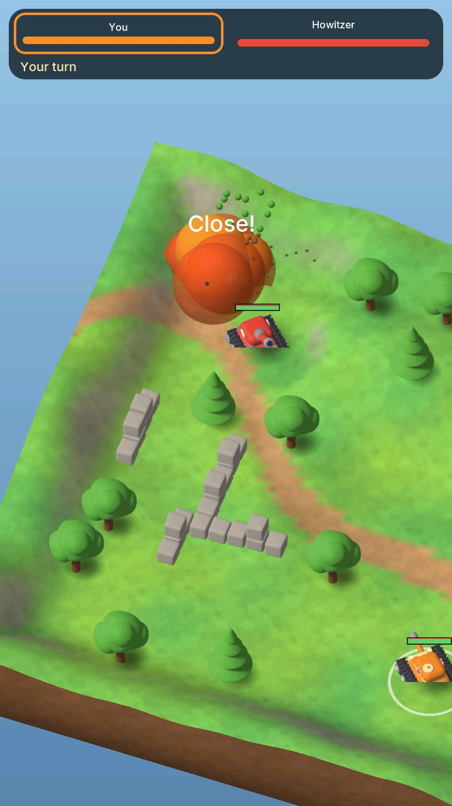

# Tanques

Turn-based battles of chubby toy tanks, in Monster Hop's style. Drive from
above, aim from the turret, fire; between battles, the hangar. Six tanks,
twenty weapons, twelve story missions in five places, and free battles of up
to four tanks against the board or two people passing it round.



```bash
# the art (Blender 3.3, headless: ~20 minutes on the M2), then the pack
B=/Applications/Blender.app/Contents/MacOS/Blender
(cd apps/tanques/tools/blender && $B -b -P tanques_art.py)   # -> build/art (every set)
python3 apps/tanques/tools/pack.py                          # -> build/tanques_p4.pak (34 MB)

# in the simulator
mkdir -p sim/sim_fs/apps && cp apps/tanques/build/tanques_p4.pak sim/sim_fs/apps/
cmake -S sim -B sim/build-tanques -DCMAKE_BUILD_TYPE=Release -DP4OS_SIM_APPS="hello_app;tanques"
cmake --build sim/build-tanques -j8
cd sim && P4_SIM_SCRIPT="wait 1500; open demo.tanques" ./build-tanques/p4os_sim

# the .so for the card
tools/build_apps.sh tanques                 # apps/tanques/build/tanques.so (112 KB)
```

On the card both go in `/apps`. Neither is in git. The pack may travel in
parts (`tanques_p4.pak`, `.pak.1`...): the game reads across them.

## The turn

1. **Drive** (the battle view, from above). The tiles show where the action
   points reach: blue where every weapon is still affordable after the
   drive, yellow where only the cheapest is, orange where no shot is left.
   Touch a tile and the tank drives there; drag to look around. Uphill
   costs more; the steep, stones, trees and tanks are in the way; a mine
   stops the drive with a bang. Driving can go in stretches.
2. **Aim** ("Apuntar"): the gunner's view from the turret, facing the
   nearest enemy. Drag sideways to turn, up and down to raise the barrel,
   pick one of the weapons the tank carries (each with its AP and, for the
   strong ones, its uses per battle) and fire. Lobbed weapons show their
   whole arc and the ring where they land; straight ones a stretch that
   grows with the weapon's level (and shrinks on Hard and in fog). Wind
   pushes the shells: its arrow and strength are on the top bar.
3. The flight, the blast, the crater and the damage are watched from
   above. A tank that did not drive may fire a second time, at twice the
   AP ("Terminar" ends the turn instead); after that, or when the AP left
   cannot pay for any shot, the next tank plays. The last team standing
   wins.

Back (the system's gesture) leaves the gunner's view, or asks whether to
leave the battle.

## Tanks, upgrades, paint

| Tank | | HP | Armour | AP | m/AP | Weapons | Price |
| --- | --- | --- | --- | --- | --- | --- | --- |
| Bombo | the all-rounder | 100 | 5% | 10 | 1.6 | 3 | free |
| Pulga | light and quick | 70 | 0 | 10 | 2.3 | 2 | 800 |
| Mamut | heavy, twin guns | 160 | 20% | 9 | 1.1 | 4 | 1800 |
| Obús | artillery: lobbed shots +20% | 90 | 5% | 10 | 1.3 | 3 | 1200 |
| Avispa | missiles: guided and laser +25% | 85 | 0 | 11 | 1.9 | 3 | 1400 |
| Topo | engineer: drill +25%, repair x1.5, four mines | 110 | 10% | 10 | 1.5 | 3 | 1000 |

Each has four upgrades of four levels (`tq_data.c`, `tq_stats`): armour
(+12% HP and +4% armour a level), engine (climbs cheaper and steeper),
speed (+10% metres an AP) and energy (+1 AP a turn). Paint: two colours of
twelve and one of twelve emblems in a colour of its own, drawn on the
turret's badges (a fifth plane of the sprites says where in the badge each
pixel is, so any emblem lands on any tank).

## The twenty weapons

Cannon, mortar, guided missile, cluster (splits at the top), laser (straight,
cuts trees on its way), napalm (fire for two rounds), mines (three, four for
the Topo), EMP (no damage, half the AP lost), shield (stops 40), repair (+30),
smoke (shots from or into it go astray, and no guide there), bouncer, driller
(digs in, blows up below), air strike (five bombs along the line), sniper,
shotgun (five pellets), earthquake (sinks and raises the ground), teleport,
wall (three stones) and the big bomb. Each has three upgrade levels (+15%
damage and +7% radius a level). `tools/bench.c` fires each once at a Mamut
and prints what it did.

## Story and free battles

Twelve missions (pradera, desierto, nieve, ruinas, volcán) with one to three
rivals, the board's tanks upgraded by the mission's difficulty; each opens
when the one before is won, and earns one to three stars by the health left.
The free battle picks the place, the size (28, 32, 36 or 44 m; the
biggest takes two rivals at most, for the board's memory), one to three
rivals, the difficulty (how far off the board's aim is: 3.5, 2 or 0.9
degrees), the weather (clear, wind, storm, fog) and one or two players.
Coins: the mission's reward or the free battle's, half the damage done and
40 a tank knocked out.

Every map is made from its seed: hills, a path, the biome's own (dunes,
a frozen lake, streets and squares, a volcano and lava), trees and walls
(houses in the ruins), the tanks round the middle on flattened ground.

## The 3D: what was measured and what was chosen

| | how |
| --- | --- |
| the ground | a height map (a vertex every 0.5 m) drawn by the app in both views, its colours lit per vertex (the sun, the hills' shadows, the hollows) with a grain texture. A crater lowers heights and lights again only what it changed |
| the battle view | the fixed orthographic camera of the sprites (yaw 20, looking down 55 degrees, 32 px a metre): the whole map is drawn once into a picture with its depth, at half that scale (the ground is smooth; 2.3 MB instead of 9.3 for the biggest map), and a frame is a window of it doubled, with the sprites over it at full size, each pixel tested against that depth |
| tanks, trees, stones | Blender sprites (`tools/blender/tanques_art.py`, built by code): hull and turret apart, 32 yaws each, from above and from 8 degrees for the first person; shade, coverage, region and depth planes; the app paints the regions |
| the first person | drawn whole every frame at half the screen each way (the ground's triangles, the things scaled by distance, the turret and barrel rendered for that tank's gunner) and doubled |

**Measured on the board** (2026-11-23, the user playing, portrait):

| | per frame |
| --- | --- |
| battle view, camera still: only the boxes round what moves (~60-80 kpx) | 12-33 ms: ~30 fps |
| battle view, camera gliding: whole frames | 70-136 ms: 8-14 fps |
| first person, the PPA doubling it into the panel | 36-77 ms: 13-28 fps while dragging |
| a free battle of two tanks, 32-36 m | 9.9-10.9 MB of PSRAM (16.5 free when the app opens) |

Before the boxes and the PPA every battle-view frame was whole (115-148 ms)
and the first person 96-194 ms (half of it doubling on the CPU). The rest
of this section is what the 3D's road was chosen with, before the board.

`tools/bench.c` runs the same code on the Mac next to Visor 3D's
rasteriser, whose times on the board are known (mila_hd: 105 ms on one
core; mila, 16 000 triangles at 288 x 512: ~35 ms on two): one board core is
~60-75 Mac cores' worth of this work, two ~30. **The board column is that
ratio, not a measurement**; what is bound by PSRAM (copies, the doubling) is
estimated from its bandwidth.

| | Mac (one core) | board, expected |
| --- | --- | --- |
| battle view, a frame (window + ~50 sprites) | 0.3-0.5 ms | ~25-35 ms (most of it the 1.8 MB window copy) |
| ... with the reach tiles and the path | 0.6-0.9 ms | +15-25 ms (redrawn only when something changes) |
| the whole map into the world picture | 6-9 ms | ~0.5 s, once a battle |
| a mortar's crater drawn again | 3-4 ms | ~0.2-0.3 s |
| first person, a frame (~10 000 triangles) | 1.3-2.6 ms | ~50-80 ms on two cores: 12-20 fps while aiming |
| the tank as real-time triangles instead (3 100 / 9 900 / 39 800) | 0.2-2 ms | 13-120 ms per tank on one core |

So: sprites for everything with a shape, triangles only for the ground.
LVGL pushes the canvas on top of that (a full frame through its own flush),
not measured here. The log says on the board, every 3 s while something
moves:

```
tanques: battle view 24.8 fps 720x1280, render 31 ms (world again 0), 44 things
tanques: first person 13.0 fps 720x1280, render 70 ms (ground 52, doubling 15), 10266 triangles
```

### Memory (PSRAM, counted by `tq_malloc`)

The pack holds all six tanks; a battle loads only its tanks (the gunner's
view only for the people's), the hangar one turntable at a time. Measured in
the simulator:

| | |
| --- | --- |
| two screen frames, the world picture (36 m, half size) and depth, the first person's | ~7 MB |
| a tank seen by the board (above, and far for the first person, at 24 px a metre) | ~1.5 MB |
| a person's tank, with its gunner's view | ~2.4 MB |
| a biome's scenery | ~0.3 MB |
| **a free battle of four different tanks** | **14.0 MB** |

The board had 16.8 MB of PSRAM free when the app opened (2026-11-23, with
the 0.32 firmware): the world picture went to half size for that (it was
20.8 MB with it whole).

## Files

| File | What |
| --- | --- |
| `main/tanques.c` | life cycle, the worker, frames, touch, the joystick in the menus |
| `main/tq_battle.c` | a battle: the turn's states, cameras, HUD, the joystick |
| `main/tq_menu.c` | the title, the story, the free battle, the results |
| `main/tq_hangar.c` | the hangar |
| `main/tq_game.c` | the map's things, reach and paths, shells and each weapon, the board's tanks |
| `main/tq_data.c` | tanks, upgrades, weapons, paints, emblems, missions, the save |
| `main/tq_terrain.c` | the height map per biome, its light, craters |
| `main/tq_scene.c` | the views: battle, first person, the hangar's turntable |
| `main/tq_gfx.c` | triangles, sprites, puffs, the doubling |
| `main/tq_art.c` | the pack, read by groups |
| `main/tq_view.h` | the cameras (the Blender script has the same numbers) |
| `tools/blender/tanques_art.py` | every model and render |
| `tools/pack.py` | the pack, and contact sheets of the renders |
| `tools/bench.c` | the renderers on the Mac, the calibration, the weapons' test |

## Joystick

| | |
| --- | --- |
| driving | the d-pad or the stick moves a cursor (the path shows), A drives there, START or R aims |
| aiming | left/right turn, up/down raise, L/R change weapon, A fires, B back to driving |
| menus, hangar | the d-pad walks the buttons, A presses, B goes back, L/R change the hangar's tank |

## Simulator switches

`TQ_SCREEN=story|free|hangar`, `TQ_COINS=n`, `TQ_START=1|2` straight into
a free battle (against the board, two players) with `TQ_RIVALS`, `TQ_BIOME`,
`TQ_WEATHER`, `TQ_SEED`; `TQ_AIM=1` then into the gunner's view;
`TQ_AUTO=1` the board plays all.

## The save

`tanques.sav` in the data folder: coins, the tanks owned with their
upgrades, weapons and paint, the weapons owned and their levels, the
story's stars, the free battle's last settings.

## Pending

- Measure on the board: the log lines above, upright and lying down, and
  PSRAM free in a four-tank battle.
- Sound beyond the system's beep.
- The PPA for the first person's doubling, and the frames straight to the
  panel instead of through LVGL's canvas, if the board asks for it.
