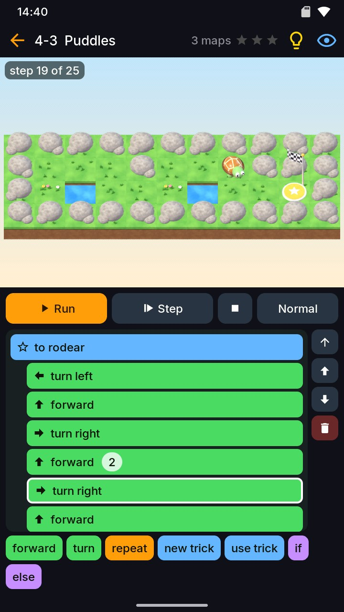

# Tortuga

A game that teaches programming the way LOGO did: on every level a turtle, a
map and its goal, and the program that takes it there. It is written with
blocks (touched, no keyboard), in the game's own Logo (Spanish or English
words), or in Lua; the blocks can be seen as Logo, Lua or Python. Nine worlds
teach one idea each: a sequence, repeat, procedures, questions with sensors,
while, variables, parameters, and drawing on a sheet as in LOGO. The design
is [DESIGN.md](DESIGN.md).



```bash
# the art (Blender 3.3, about a minute) and the pack
/Applications/Blender.app/Contents/MacOS/Blender -b -P apps/tortuga/tools/blender/board.py
/Applications/Blender.app/Contents/MacOS/Blender -b -P apps/tortuga/tools/blender/turtle.py
python3 apps/tortuga/tools/pack_p4.py              # apps/tortuga/build/tortuga_p4.pak, 0.9 MB

# the levels: checked, then built into the app
apps/tortuga/tools/check_levels.sh                 # C core and model, Logo, Lua and Python
python3 apps/tortuga/tools/gen_levels.py           # main/tg_levels_data.c

# the simulator
mkdir -p sim/sim_fs/apps && cp apps/tortuga/build/tortuga_p4.pak sim/sim_fs/apps/
cmake -S sim -B sim/build-tortuga -DP4OS_SIM_APPS="hello_app;tortuga" && cmake --build sim/build-tortuga -j8

# the board: apps/tortuga/build/tortuga.so, and the pack to /apps on the card
tools/build_apps.sh tortuga
```

## How it is made

| | |
|---|---|
| `main/tg_core.h`, `tg_world.c`, `tg_logo.c` | The rules, without LVGL: the levels (`levels/*.tl`), the board and the sheet, the trace of what the turtle did, and Logo (parser, interpreter, pieces, and the tree written back as Logo, Lua or Python). |
| `main/tg_lua.c` | Lua 5.4.8 (`lua/`, the Lua app's tree) as one unit with every function static, so it clashes with nothing; a fresh state per map, a count hook against programs that never end. |
| `main/tg_play.c` | A level: the program runs whole in a thread, on every map, and the trace is played on the board at a speed or a step at a time, with its line marked; the result explains what happened in plain words. |
| `main/tg_view.c`, `tg_gfx.c`, `tg_pak.c` | The board: Juegos de mesa's copy of Bastion's compositor, drawing toy-block tiles row by row from the back. On the sheet the finished strokes are painted into the background. |
| `main/tg_blocks.c`, `tg_edit.c` | The editors: a column of blocks kept as Logo (one block, one line), and a text editor with line numbers, auto-indent and a palette that writes what the level allows. |
| `tools/tg_ref.py` | The reference model in Python, which the C follows; `tools/tg_harness.c` runs the C core on the Mac. |
| `tools/blender/` | The turtle and the board modelled by code; `tools/compose.py` puts a sample together off the board. |

## Levels, and more of them

`levels/mundos.tl` holds the game's 47 levels. A level is data: the maps (a
program has to win on all of them), the orders it allows, its goal, the
pieces for three and two stars, hints and cards in three languages, and its
Logo solution, which `tools/check_levels.sh` runs in the C core and in the
model, also written as Lua and Python, in the easy and the hard mode.

Besides its own, the app reads every `.tl` in `apps/tortuga/` on the card and
the text of any `apps/tortuga_<x>_p4.pak` (entries named `levels...`): a pack
of the Store can bring new worlds or a story without a new app. Their worlds
are 10 and up, named with `@mundo`; `@carta` tells a level's chapter before
it is played. DESIGN.md, 3.4.

## Gamepad

START runs or stops, R steps, L changes the speed. In the blocks, up and down
choose a block, left and right a piece of the palette, A puts it and B
deletes. The menus go with the D-pad and A, B goes back.
