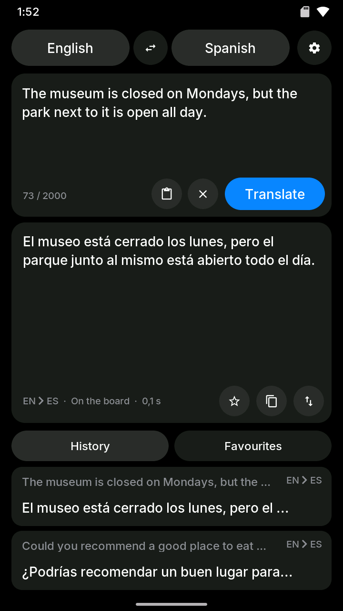
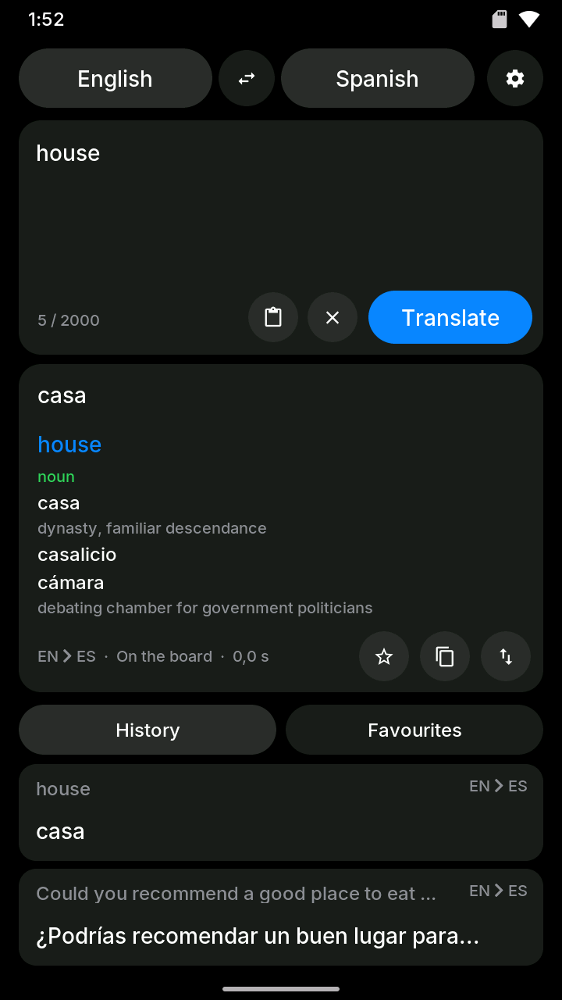
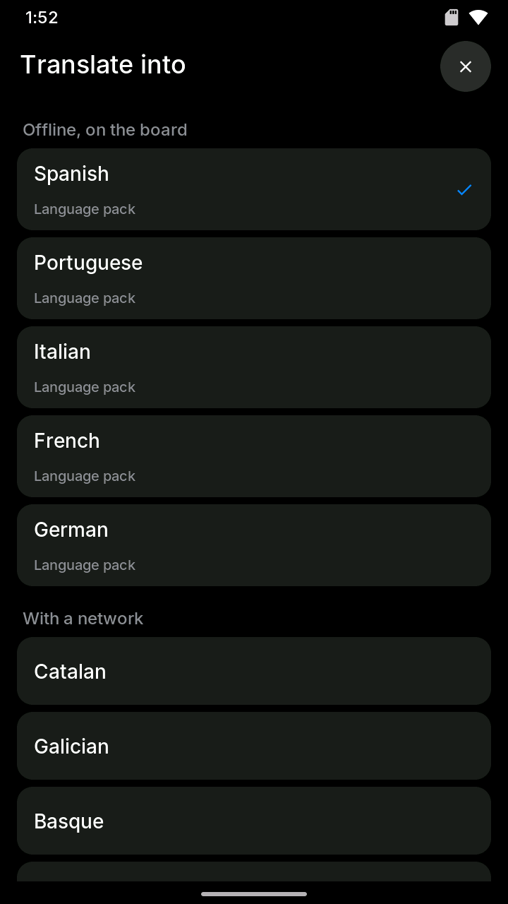
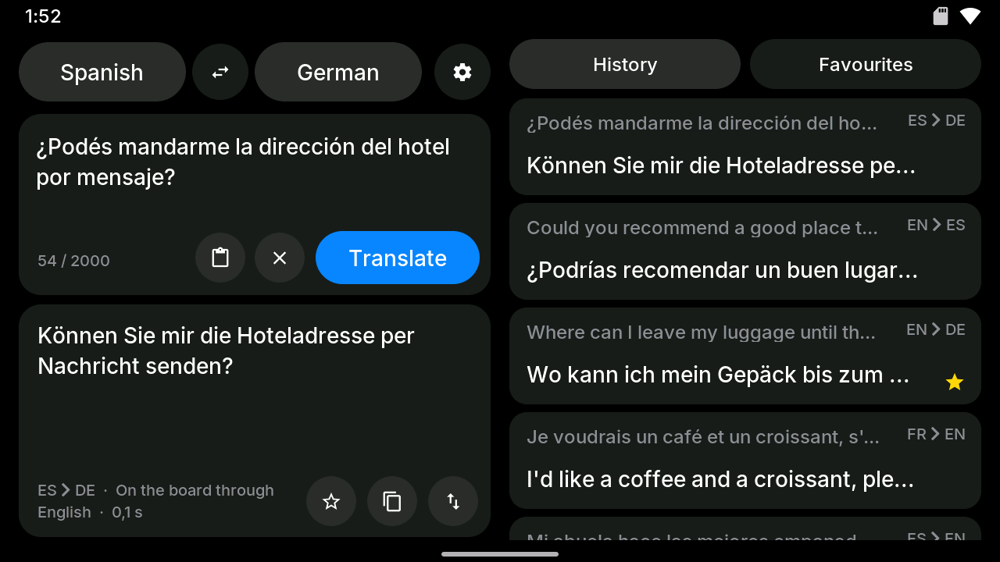

# Traductor (`aos.traductor`)

Text from one language to another, **offline on the board** with language
packs from the Store, or online with MyMemory or the user's own
LibreTranslate.

 




## What it does

- **Two languages** at the top, swapped with one tap; "Detect" as the
  source (the board recognises es, en, pt, it, fr, de, ca and nl by their
  common words, `td_detect.c`). The language sheet puts first what the
  board can do offline: a pack, through English (twice the time), or the
  dictionary alone.
- **The text** with the on-screen keyboard or a USB/Bluetooth one, up to
  2000 bytes, paste and clear. ✓ on the keyboard or Translate; Cancel while
  it works.
- **The translation** with its engine and time ("EN > ES · On the board ·
  1,2 s"), copy (the system clipboard), star, and use it as the new text
  the other way round. For a word or two, **the dictionary** of the pack
  underneath: the parts of speech, glosses and translations.
- **History and favourites** (100 lines; favourites are never pushed out):
  tap to bring one back, hold to delete. Lying down they sit on the right.
- **Settings:** the engine, the packs on the card with their size, clearing
  the history (two taps).
- **The portal's page** (`web/traductor.js`): the engine, the server's
  address and key, the e-mail for MyMemory, the packs on the card, the
  history with stars, copy, delete and a text download, and "keep no
  history".

### Engines

| | What | Limits |
|---|---|---|
| **On the board** | the language packs (below) | the pairs of the packs, and between two of their languages through English |
| **Own server** | LibreTranslate (`POST /translate`, `api_key` if it wants one) | whatever the server has |
| **Online** | MyMemory, keyless (`GET /get?q=&langpair=`) | 5000 characters a day, 50 000 with `de=` an e-mail; 500 bytes a request, so a long text goes in pieces |
| **Automatic** (default) | the board when the pair is in a pack, else the server if there is one, else MyMemory | |

MyMemory says nothing about the count until it is over (status 429,
`quotaFinished`, a "MYMEMORY WARNING" text), so the app counts what it sent
today (preferences `trad_mm_day`, `trad_mm_chars`) and shows it in
Settings. Text sent online may be kept by the service; the page says so.
Nothing is asked of any service when the app opens: only Translate does.

## Offline translation: what fits on the P4

The question: what can translate on two RISC-V cores at 360 MHz with a
single-precision FPU (a float multiply-add costs ~5 cycles, `docs/APPS-P4.md`),
with ~15-20 MB of PSRAM for an app and the card for the data.

### The options (2026-11-22)

| Option | Size per pair (one direction) | Licence (model / data) | Format, runtime | Fits? |
|---|---|---|---|---|
| **Bergamot "tiny"** (Mozilla Firefox Translations, v1.x) | **17.1 MB** int8 + 3.4-3.9 MB shortlist + 0.8 MB vocabulary; 16.9 M parameters | **MPL-2.0** ("The model files are distributed under the MPL 2.0 license", mozilla/translations) | Marian binary (intgemm8, the weights simply quantized and transposed), SentencePiece unigram, a lexical shortlist. Plain C: done here, ~900 lines | **Yes**: 11.3 MB in memory with the embedding table read from the card |
| Bergamot "base-memory" (the current releases) | 31.6 MB; 31.2 M parameters; 384 wide, 4 decoder layers | MPL-2.0 | same | No: ~23 MB without the embeddings |
| Bergamot "base" (en-ja, ja-en, zh, ko) | 44-59 MB; ja-en "tiny" 25.5 MB is not released | MPL-2.0 | same, 512 wide | No |
| OPUS-MT standard (Helsinki-NLP) | 78 M parameters, 312 MB fp32 (~78 MB int8) | CC-BY 4.0 (the HF cards say Apache-2.0) | Marian / HF | No |
| OPUS-MT *tiny* eng-spa, spa-eng (April 2026) | same shape as Bergamot tiny; 68.7 MB fp32 `.npz`, ~17 MB once in int8 | Apache-2.0 (the teacher saw CC-BY-NC-SA Tatoeba data) | Marian `.npz`: needs a converter to int8 | Would fit; slightly lower COMET (0.828 vs 0.851) - not used |
| Argos Translate (es_en, en_es) | 87-285 MB packages (CTranslate2) | MIT/CC0 software, OPUS-derived weights (CC-BY 4.0) | CTranslate2 (C++17, its own int8 kernels) + SentencePiece + Stanza | No |
| NLLB-200 distilled 600M / M2M100 418M | 2.5 GB / 1.9 GB | CC-BY-NC / MIT | | No |
| 4-bit Marian | ~8.5 MB a direction | | needs retraining to keep quality (research) | Later, maybe |
| **WikDict** (Wiktionary via DBnary) | es-en 21 952 words (1.7 MB here), en-es 67 225 + 53 314 other forms (6.6 MB) | **CC BY-SA 4.0** | StarDict; converted to sorted keys | **Yes** |
| FreeDict spa-eng | 4 502 words | GPL-2.0+ | TEI | Too small |
| Apertium en-es bilingual | 37 796 entries | GPL-2.0 | XML | Not used (GPL) |
| Tatoeba (a phrasebook) | ~144 000 es-en sentence pairs | CC-BY 2.0 FR, each sentence credited | | Later: the credit per sentence is heavy |

Sources: github.com/mozilla/translations (README, the model registry
`db/models.json`), Firefox's Remote Settings collection
`translations-models` (where the v1 "tiny" models still are; the old
github.com/mozilla/firefox-translations-models LFS objects are gone),
huggingface.co/Helsinki-NLP, github.com/argosopentech/argospm-index,
wikdict.com, freedict.org, tatoeba.org.

**Chosen:** Mozilla's tiny models, one pack a pair with English holding
both directions and WikDict's dictionaries.

### Measured, not estimated

`tools/bench_nmt.sh` builds the app's own engine (`main/td_nmt.c`,
`td_spm.c`, `td_pak.c`) for the Mac the way the board runs it: one thread,
`float` activations over the int8 weights, no BLAS, `-fno-vectorize
-fno-slp-vectorize`. It counts every multiply-add. Apple M2, es -> en,
embedding table read from the pack (`--card`), best of 3:

| Sentence | Pieces in / out | Shortlist | Multiply-adds | Mac | P4, 2 cores, estimated | **P4, 2 cores, measured** |
|---|---|---|---|---|---|---|
| El gato duerme. | 7 / 5 | 298 | 58 M | 45 ms | 0.40 s | **1.13 s** |
| ¿Dónde está la estación de tren más cercana? | 12 / 7 | 416 | 96 M | 45 ms | 0.67 s | **1.52 s** |
| Mañana vamos a ir al mercado a comprar frutas y verduras. | 17 / 19 | 574 | 156 M | 91 ms | 1.08 s | **2.71 s** |
| Si llueve el sábado, la fiesta de cumpleaños de mi hermana se hace en el salón del club y no en el parque. | 30 / 26 | 801 | 258 M | 143 ms | 1.79 s | **4.34 s** |

en -> es gives the same counts (65, 76, 138, 256 M for the same four in
English). The estimate was the multiply-adds at the 5 cycles a float
multiply-add costs on the P4 (esp-dsp's benchmarks and the RF app), 360 MHz,
halved for two cores.

**On the board** (2026-11-22, rev 1.3, firmware `v0.31.0-27-g2745195`, the
es <-> en pack on the card, each sentence twice from the portal's clipboard
and the app's own buttons; the second time is in the table, and the two
differ by under 1 %):

- **2.4 to 2.8 times the estimate.** The long sentence on one core takes
  6.63 s: 26 ns a multiply-add, 9 cycles and not 5. The weights are 9 MB in
  PSRAM and every matrix is walked whole for every token; the 5 cycles were
  measured on data that fits the cache.
- **Two cores give 1.53x** (6.63 s to 4.34 s), not the 1.75x of Visor 3D:
  both cores read the same PSRAM. The encoder gains more (3.93 s to 2.38 s)
  than the decoder (2.69 s to 1.96 s), whose steps are short.
- **int8 is slower, not faster:** 5.03 s on two cores and 7.94 s on one for
  the same sentence and the same translation. In plain C the quantized
  path only adds work; it is worth it only with the core's SIMD, which is
  not written. Float on two cores stays the default.
- **Loading a model:** 1.55 s for es -> en (11 064 KB) and 1.47 s for
  en -> es (10 813 KB), against the 1.3 s estimated. The first translation
  after opening the app is that much longer: 2.69 s for the short sentence.
- **en -> es:** 4.23 s for the long sentence in English (252 M), 1.03 s for
  "The cat sleeps." (54 M).
- **Memory:** the board opened the app with 14 273 KB of PSRAM free and had
  1 704 KB left with es -> en loaded (1 898 KB with en -> es): one
  direction at a time, the other is loaded when the languages are swapped.
  Closed, the app gave all of it back (14 268 KB), and the internal RAM did
  not move (205 KB). With a model loaded the portal cannot take a picture
  of the screen: the capture needs 1.8 MB.
- The translations are the Mac's: "If it rains on Saturday, my sister's
  birthday party is held in the clubroom and not in the park."; back,
  "Si llueve el sábado, la fiesta de cumpleaños de mi hermana se celebrará
  en el salón del club y no en el parque."

- **Through English** (es -> pt, with the pt <-> en pack beside the
  es <-> en one): the two legs' sum, plus both models loaded every time,
  since only one fits: `esen` 1.64 s, then `enpt` 1.52 s, on each
  translation and not only the first. "El gato duerme." 5.3 s (110 M,
  2.1 s of it computing), the market sentence 7.9 s (289 M), the long one
  11.2 s (481 M, 8.0 s computing), the same the second time. "Se chover no
  sábado, a festa de aniversário da minha irmã é realizada no clube e não
  no parque." The list of languages says it: "Pasando por el inglés, tarda
  el doble". All the memory back on closing here too.

So: **a second for a short sentence, four for a long one, plus a second
and a half the first time; through English, five to eleven seconds, three
of them loading**. `--int8`
(activations quantized with Marian's own multipliers, as Firefox runs
them) gives the same translations and is the way to the core's SIMD (16
int8 multiply-adds an instruction): that, and keeping the hot rows of the
decoder out of PSRAM's way, is where the time is.

Memory: 11.3 MB a direction (model 8.9, shortlist 1.8 as 16-bit ids,
vocabulary, the 32 000-byte candidate mask), 19.5 MB with the embedding
table in memory too (`TD_NMT_EMB_RAM`, not used). Two directions stay
loaded only while the PSRAM has 16 MB to spare.

Quality, by example (the real outputs, both directions):

- "¿Cuánto cuesta un boleto de ida y vuelta?" -> "How much does a
  round-trip ticket cost?"
- "I would like to book a table for two people at eight o'clock tonight."
  -> "Me gustaría reservar una mesa para dos personas a las ocho de esta
  noche."
- "¿A qué hora sale el próximo tren para la costa?" -> (through English)
  "A que horas sai o próximo trem para a costa?"
- Misses: "colectivo" -> "collective", "llegá un rato antes" -> "it's a
  while early", "run" alone -> "Corr--s de ejecución" (for one word the app
  prefers the dictionary when the model's answer looks broken), German
  agreement now and then ("das beste Empanadas"). Mozilla's own score for
  es-en tiny: COMET 0.851 on Flores (0.857 for base-memory).

## The packs

`traductor_<x>_en_p4.pak` in `/apps`, optional (`"need": false`), in parts
of 7.5 MB (`.pak`, `.pak.1` ...). Built with the tools, never in git:

```
python3 apps/traductor/tools/fetch_models.py es-en <models>    # ~44 MB, hash-checked
curl -O https://download.wikdict.com/dictionaries/stardict/wikdict-es-en.zip   # and en-es; unzip
python3 apps/traductor/tools/mkpack.py es-en --models <models> --dict <dicts>
cp traductor_es_en_p4.pak* sim/sim_fs/apps/
```

`<dicts>/es-en` and `<dicts>/en-es` are the unzipped StarDict folders.
`fetch_models.py --list` lists the pairs with a tiny model (some 40
languages, all to or from English).

| Pack | Size | Models | Dictionaries |
|---|---|---|---|
| `traductor_es_en_p4.pak` | 46.6 MB, 7 parts | es->en, en->es (one vocabulary) | es->en 21 587 words; en->es 58 950 + 50 040 forms |
| `traductor_pt_en_p4.pak` | 45.3 MB, 7 parts | pt->en, en->pt | 12 285; 50 087 + 43 081 |
| `traductor_it_en_p4.pak` | 46.5 MB, 7 parts | it->en, en->it | 26 510; 48 458 + 40 840 |
| `traductor_fr_en_p4.pak` | 59.7 MB, 8 parts | fr->en, en->fr | 118 890 + 31 110; 67 030 + 54 874 |
| `traductor_de_en_p4.pak` | 56.6 MB, 8 parts | de->en, en->de | 73 668 + 60 000; 64 837 + 55 160 |

The models alone are 38.3 MB a pair; the rest is the dictionaries.
WikDict's other forms (inflections) are capped at 60 000 a direction and
150 000 keys in all (German brings 1.2 million), since the app keeps 4
bytes a key in memory.

### Inside (`main/td_pak.h`, `tools/trpak.py`)

```
"TRPK" u16 version u16 count
count x entry (48 bytes): char name[24] u32 type u32 off u32 len u16 rows u16 cols f32 scale f32 scale_a
data, each entry 16-byte aligned
```

- `info`: `pair=es-en`, `nmt=esen,enes`, `dict=esen,enes`, `version=1`;
  `license`: the notices (MPL-2.0 for the models, CC BY-SA 4.0 for the
  dictionaries).
- `esen.e3.aq` ... one entry a tensor: int8 matrices as Marian keeps them
  (each output's inputs in a row) with 1/QuantMultB as `scale` and
  QuantMultA as `scale_a`; float vectors. `esen.emb` (32 000 x 256),
  `esen.ob`, `esen.lex` (u16 first, u32 nsrc, u32 offsets, u16 ids),
  `esen.spm` (u32 n, then f32 score, u8 type, u8 len, the piece; the second
  direction uses the first's when they are the same file).
- `esen.dic`: u32 n, u32 0, u32 key_off[n] sorted by key, records
  `key\0 u32 body_off`, bodies `head\0` + lines `pos\tgloss\ttranslations`.

The app lists the pairs by scanning `/apps` for `traductor_*_*_p4.pak` and
reading each one's `info` (`td_lang.c`), again when it comes back to the
front (a pack the Store brought meanwhile).

## How it works

- `td_nmt.c`: the transformer as Marian runs these models - embeddings x
  sqrt(256) plus sinusoids (sin half, cos half), 6 post-norm encoder layers
  (8 heads, ReLU feed-forward of 1536), a decoder of 2 layers whose
  self-attention is an SSRU (`f = sigmoid(Wf y + bf); c = f c + (1-f) W y`,
  so a step costs the same at the 40th word), cross-attention, tied output
  over the shortlist only (the first 50 pieces plus the 50 likeliest for
  each source piece), greedy like Firefox's beam of 1. Long texts are cut
  at sentence ends and lines. Checked first against a numpy prototype.
- `td_spm.c`: SentencePiece unigram without the library: Viterbi over the
  pieces (a hash of them), unknown characters as `<unk>`; whitespace
  normalization only (the models' `nmt_nfkc` changes nothing in typed
  Latin text).
- `td_job.c`: the worker runs the model (`aos_hal_worker_start_on`, core 0)
  and lends it both cores per matrix; the online engines go out from the
  UI's 100 ms timer through `aos_hal_http_*`. An HTTP error (400, 403,
  429) comes back FAILED with its positive code and its body: only negative
  codes are the network's. Spanish output gets its ¿ and ¡ back.
- `td_cfg.c`: `<data>/traductor/traductor.txt`, written by the app and the
  page (`engine`, `server`, `server_key`, `email`, `mymemory`, `history`);
  reloaded when its date changes. `td_hist.c`: `hist.txt` beside it.

## Testing

Only against the fake server, never the real services:

```
python3 apps/traductor/tools/fake_translate.py [--quota 120] [--key clave-de-prueba]
```

It answers as MyMemory (`/get`) and as LibreTranslate (`/translate`,
`/languages`, `/detect`) with made-up translations (`[en] ...`), and errors
on purpose: `error500`, `lento`/`slow` (8 s), `cuota`/`quota`, a daily
quota, a key. In the simulator MyMemory is already `http://127.0.0.1:8790`
(the default in an `AOS_SIM` build); for LibreTranslate, `server
http://127.0.0.1:8790` in `sim/sim_fs/data/traductor/traductor.txt` or on
the page. Tested in the simulator (`sim/build-traductor`, port 8147): the
four engines, the errors (no key, wrong key, the daily limit, no route), a
pack and five packs, the pivot es->pt and es->de, the dictionary, the
history and favourites both from the app and the page, upright and lying
down, the page dark, light and narrow.

The simulator's times are the Mac's (0.1 s); on the board see above.

## Not done yet

- **Measured on the board** (needs the user's go-ahead): the times above,
  PSRAM and card included, and whether int8 activations beat float there.
  For that, `nmt int8`, `nmt one-core` or both in `traductor.txt` (not on
  the page); each translation logs its pieces, multiply-adds, encoder,
  decoder and total time and which of the two it used:
  `local es>en: 17 pieces in, 19 out, 156 M multiply-adds, encoder .. ms,
  decoder .. ms, all .. ms (float, two cores)`.
- **The SIMD:** the P4's int8 multiply-accumulate (16 a cycle) through
  inline assembly or esp-nn would bring a long sentence well under a second.
- **Voice** (next phase): the mic (`aos_hal_mic_*`) records and a Whisper
  of the user's own on the network turns it into text; reading the
  translation aloud is for that same server. On the board alone, a small
  recogniser is research for later.
- **Image** (after voice): a picture from the card or the USB webcam
  (`aos_hal_uvc_*`) to the user's server for OCR (Tesseract) and back as
  text with its boxes, translated in place.
- **Japanese, Chinese, Korean:** Mozilla has them only as base models
  (44-59 MB, 512 wide); the engine runs the 256-wide tiny shape. A WikDict
  dictionary pack would work for words; online engines work today.
- **A phrasebook** from Tatoeba (CC-BY with the credit of each sentence).
- **Other pairs:** `fetch_models.py --list` shows ~40 more languages with a
  tiny model (nl, pl, ru, uk, cs, tr...); each is a pack away.
