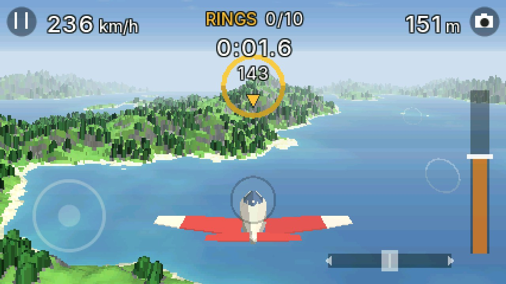

# Planeo (`apps/vuelo`, `demo.vuelo`)

A small plane over 3D worlds the board draws live: islands, canyons, snow,
a volcano and a city. Each world has three missions (rings against the
clock, a race against a rival plane, package deliveries); there is free
flight too, with any open world at any hour. Stars open the next worlds,
and each mission keeps its record. Lying down only.



No pack: every world is made from a seed when it is entered, and the plane
is made of triangles by code.

## How it draws

- **The world** (`vu_world.c`): a height map of 1024 x 1024 texels of 2 m
  that tiles (the flight never meets an edge), with five smaller levels for
  what is far away. A texel is 32 bits: the colour in RGB565, already lit
  by the sun of the world's hour (with the shadows the hills cast and a
  little darkness in the hollows), the height in sixteenths of a metre, and
  whether it is water. Trees and buildings are part of the heights. The
  map is kept in tiles of 8 x 8 texels, so the samples of one line of the
  renderer stay close in memory whichever way it looks.
- **The ground** (`vu_render.c`): columns in the "voxel space" way. Lines of
  equal depth are marched from near to far, all the columns at once, and
  each sample's height is drawn from where its column was left up to it.
  Fog, water that takes the sky's colour with distance and ripples near,
  and a darker colour where a sample rose a lot (cliffs, walls).
- **The sky**: a gradient, a cloud deck that is a ceiling at a fixed height
  (linear along each row), the sun's glow, the stars at night.
- **Looking up or down** moves the horizon. **The bank** turns the whole
  picture: the upright picture is drawn as big as the turned frame needs,
  and the output samples it.
- **Over it**: the rings and the columns of light (`vu_marks.c`), the plane
  and the rival (`vu_plane.c`: ~150 triangles, flat shaded, sorted, with a
  shadow on the ground and the propeller's blur), the instruments
  (`vu_hud.c`; the words rendered by LVGL into masks in the language of the
  moment, `vu_text.c`).
- **Both cores**: every pass is split in two with `aos_hal_worker_split`.
  The ground and the sky take half of the columns each, and the turn and
  everything drawn over it take half of the rows each.
- **On the panel**: the frame is small (426 x 240 at the normal quality).
  From LVGL's timer, the PPA scales it into the panel's free buffer and the
  app flips to it (`aos_hal_display_blit_into_fit` + `flip`), while the
  worker already draws the next. The menus are LVGL over a still frame in
  a canvas. The simulator has no panel to flip to, so its frames go
  through the canvas.

## Measured on the board

Measured on 2026-11-23, before the map's tiles, flying with the
autopilot. The log has a line every 5 s:

| Frame | fps | A frame on both cores |
| --- | --- | --- |
| 320 x 180 | 20-36 | |
| 426 x 240 | 37 straight, 17-34 turning (25-32 most of the time) | 27-59 ms; the PPA 12-14 ms beside it |
| 512 x 288 | 14-15 | 67-75 ms |
| 640 x 360 | 11-12 | 82-89 ms |

Again on 2026-11-24, with the map's tiles, the cheaper noise and fewer
far lines (367 instead of 461), in free flight with the autopilot:
426 x 240 at 26-34 fps (about 30), a frame 29-38 ms (the ground and sky
21-29), the PPA 12-13 ms beside it; a world made in 4.0 s (the heights
2.3). The drops with the heading are gone. What costs now is filling the
columns of the upright picture, which is in PSRAM and written down its
columns: each pixel is another cache line. The next step is to keep it
by columns.

The spread at 426 x 240 came from the heading: a line looking north or
south took every sample from another row of the map. The tiles are the
fix, still to be measured. Making a world took 5.3-6.6 s, before the
cheaper noise. PSRAM in flight is ~8 MB, with ~11.5 MB at the peak while
a world is made.

```
vuelo: 30.6 fps 426x240 (drawn 153, upright 144 kpx), frame 32.7 ms (ground+sky 24.7, turn+over 4.7, hud 2.4), present 12.6 ms, 214 k samples, 461 lines, ...
```

## Controls

- **Fingers**: a stick under the left thumb (where it lands), the throttle on
  the right edge, the pedals (the rudder: the nose sideways without banking)
  along the bottom right, pause and camera in the top corners.
- **Gamepad** (`aos_pad.h`): the left stick or the d-pad steers, A and B are
  the throttle, L and R the pedals (both together change the camera), START
  pauses. In the menus the d-pad walks the buttons, A presses, B goes back.
- **Keyboard**: the arrows steer, W and S are the throttle, A and D the
  pedals, C changes the camera, P pauses.
- The board's button pauses.

## Development

- In the simulator (`sim/build-vuelo`):
  - `VU_MISSION=0..14` goes straight into a mission;
  - `VU_FREE=<world*10+hour>` goes into a free flight;
  - `VU_AUTO=1` flies by itself (deliveries complete; rings sometimes
    need a second lap);
  - `VU_STARS=n` gives the first n missions three stars, not kept.
- On the board, a file `planeo_dev.txt` with the word `auto` in the app's
  data folder (`PUT /api/fs/put` from the portal) does the same, to measure
  without hands: free flight wanders, missions fly to the next target.
- `tools/bench.c`, compiled as its header says, makes every world on the
  Mac, flies it with the autopilot, saves pictures and times frames next to
  Visor 3D's rasteriser. Its times on the board are known, so the Mac's
  numbers can be turned into the board's (the same calibration as Tanques').
- The log line every 5 s also lists what LVGL redraws over the flipped
  frames, if anything. A user once saw two patches of the root's colour
  flicker, and they did not come back after reinstalling.
