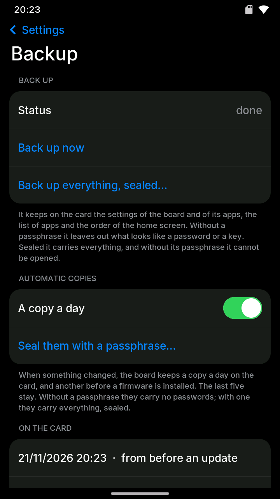
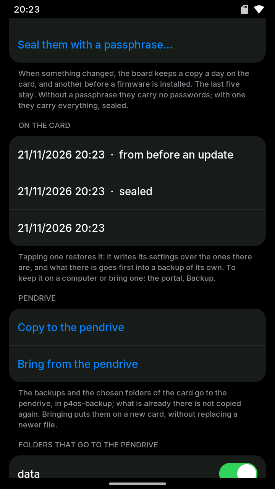

# Backups

What a board holds and cannot fetch again, in one file on the card: its
preferences (the system's and the apps', the networks, the accounts), the
list of the apps the Store installed with their extras, and the two small
files that say how the card is arranged (`menu.txt`, `modules.txt`). The
apps themselves are not copied: the Store brings them back from that list.

 

Since 0.31. `components/aos_backup`; the plan is
[docs/plan/RESPALDO.md](plan/RESPALDO.md), in Spanish.

## Making one

**Settings → Backup**, or the portal's **Backup** page. The file goes to
`/backups/p4os-<date>-<time>.p4bak`.

| | Without a passphrase | With one |
|---|---|---|
| The preferences | all but what looks like a credential | all of them |
| The file | plain: it can be opened and read | sealed: nothing of it reads without the passphrase |
| For | putting a board back as it was, typing the passwords again | moving everything, and anything that leaves the house |

- **What looks like a credential** is decided by the preference's name: a
  password, a token, a key, a code, the lock screen's, the portal's private
  keys, the SSH server's and the SSH client's. It is a best effort, and the
  screens say "what looks like": an app can keep a secret under a name this
  does not see. An app that keeps one names it with `pass`, `token`,
  `secret`, `key` or `priv`, or starts it with `sec_`
  ([APPS-P4.md](APPS-P4.md)). Before trusting a plain backup with a card
  that leaves the house, open it: it is text.
- **A sealed backup** is AES-256-GCM under a key derived from the
  passphrase (PBKDF2-HMAC-SHA256, 40 000 rounds, the number is in the
  file). The board asks for the passphrase twice. There is no way around a
  forgotten one. What stays readable in it: when and by which version it
  was made, the list of apps and the two files of the card. Every
  preference is inside.
- **How long:** on the author's board, with 427 preferences, a plain
  backup takes under half a second and a sealed one about four (the
  passphrase's 40 000 rounds). The files are 14 KB and 19 KB.
- **In neither:** what belongs to this very board and moment: the counts of
  failed starts, the crash dump's marks, the Bluetooth pairing (its keys
  are not preferences: pair again), the portal's open sessions.

## The copies it makes by itself

Without anybody asking, on the card:

- **One a day,** when a preference changed since the last copy. A day with
  nothing changed makes none.
- **One before a firmware is installed,** from the portal, from Settings →
  Update or with `tools/ota.sh`, on the same condition. It is made and
  waited for before the image is written: half a second.
- **The card keeps the last five** of these, and the last five made before
  a restore. The ones a person made stay until they are deleted.
- **Plain until you say otherwise.** They leave out what looks like a
  credential, as any backup without a passphrase. **Settings → Backup →
  Seal them with a passphrase…** (typed twice, at the board only) makes
  them carry everything, sealed, from then on. The board keeps the key the
  passphrase gave and its salt, not the passphrase; restoring one asks for
  it, as any sealed backup does. Taking the passphrase off makes them plain
  again.
- **Off** with the switch on that page.
- A board that never had the time makes none: a day is told by its date.

They are listed with the others, marked "the day's" or "from before an
update".

## A new board

A board whose flash was erased knows nothing. When its card has a backup,
it says so once, over the home screen, a few seconds after it starts: when
the backup was made, by which board and P4OS, how much it holds and whether
it asks for a passphrase. **See backups** opens Settings → Backup, where
restoring is two taps; **Not now** leaves it there for later.

"New" means: it knows no Wi-Fi network, it never answered this, and it
never made a backup itself.

## Restoring one

Tap a backup in Settings → Backup (twice), or **Restore** in the portal. A
sealed one asks for its passphrase.

1. The backup is read and, when sealed, opened: a wrong passphrase stops
   here, with nothing touched.
2. **What there is now is kept first**, in a backup of its own (`…-antes`,
   of the same kind and under the same passphrase), so a restore can be
   undone by restoring that one.
3. The backup's preferences are written over the ones there are. A
   preference that is not in the backup stays as it is; so a plain backup
   does not touch the passwords the board has.
4. `menu.txt` and `modules.txt` go back to the card.
5. **Restart.** Most preferences are read at startup. Nothing restarts by
   itself.
6. **The apps:** when the backup lists apps the card does not have, the
   screen offers to ask the Store for them, each with the extras it had.

A backup made by a newer P4OS than the one running is refused: update
first.

## Keeping it off the card

A backup on the card survives a bad update and an erased flash, and not a
lost card. The portal's Backup page downloads the file to a computer and
brings one back ("Bring a backup…"); it is also just a file under
`/backups`, for the USB's disk mode or the Files page.

A passphrase typed in the portal travels as the portal's traffic does: in
the clear unless HTTPS is on ([SECURITY.md](SECURITY.md)). It is not kept.

### To a pendrive, and back

With a pendrive on the USB host (Settings → USB → USB host), Settings →
Backup gets a **Pendrive** section:

- **Copy to the pendrive** puts in `p4os-backup/` on the drive the backups
  (`backups/`) and the chosen folders of the card (`card/<folder>/`), file
  by file. First it makes a backup of now, when something changed since the
  last one. A file the drive already has is not copied again, so a second
  run takes what changed.
- **Which folders:** every folder at the card's root that holds data, with
  a switch each. Not the ones the Store fetches again (`apps`, `web`,
  `lang`, `fonts`, `firmware`). `photos`, `music`, `videos`, `maps`,
  `recordings` and `roms` are off until you turn them on: they usually come
  from a computer and weigh gigabytes.
- **Bring from the pendrive** (two taps) is the way back: the backups and
  every folder of the drive onto the card. A file the card has newer is
  never replaced by the drive's older one. On a new card, a restore of the
  backup that came is then what puts the board as it was.
- A copy can be stopped; the file in hand is dropped, not left half
  written. The portal's Backup page has **Copy to the pendrive** too; the
  way back is asked for at the board.

### To a server of your own, by SFTP

A copy that leaves the house with nobody doing anything: once a week the
board sends its sealed backups to an SSH server you name: a NAS, a
Raspberry, any computer with `sshd`. **Only the sealed ones, ever**: there
is nothing to send until the automatic copies have a passphrase (above).

All of it is set at the board, in Settings → Backup → **A server of your
own (SFTP)**:

1. **Server:** `user@server`, or `user@server:port`. **Folder:**
   `p4os-backups` unless you say otherwise, from that user's home. The
   backups go to `<folder>/<the board's name>/`, so several boards can
   share a server.
2. **The board's key on the server.** The board logs in with a key, never
   with a password: nothing is asked for and nothing is kept. Its public
   line is in the portal's Backup page, with a button to copy it; it goes
   into `~/.ssh/authorized_keys` of that user on the server. It is the same
   key the SSH app uses, so a server that already knows the board needs
   nothing. **Make a new key**, at the bottom of the page (two taps),
   puts another in its place, for a key that was seen by who should not:
   the old one stops working, and the new line has to go to every server.
3. **Try the connection.** The board shows the key the server answered
   with (`ED25519 SHA256:…`, as `ssh-keygen -lf` prints it on the server)
   and whether it was let in. **Accept this key** (two taps) keeps it: from
   then on a server that shows another key gets nothing, not even the
   login.
4. **A copy a week,** and **Send now**. While the automatic copies have
   no passphrase the page says so beside the button, and so does a tap on
   it: nothing would go.

What goes is every sealed backup on the card that the server does not have
yet; first a copy of now, when something changed. A file goes up beside its
name and is renamed over it when whole. Nothing is deleted on the server:
at 19 KB a week it is a megabyte a year. Changing the server's address
forgets the key that was accepted.

Tried against a NAS running OpenSSH 10.2: the three sealed backups of the
card arrived byte for byte, with the board's key limited to SFTP.

On a server you can restrict that key to SFTP: put
`restrict,command="internal-sftp" ` before the line in `authorized_keys`,
and the key opens no shell. Or a `Match User` block in `sshd_config`
(`ForceCommand internal-sftp`, `ChrootDirectory`).

Two things a NAS can have in the way, both seen on one: the user's home is
not theirs to write, so `~/.ssh` has to be made by an administrator
(`sudo mkdir`, `sudo chown <user>`); and the folder for the backups, made
from the NAS's own screens, belongs to root: it has to be the user's
(`sudo chown <user> <folder>`), or the board is let in and then told no.

### From a computer, by itself

`tools/backup.sh` asks the board for a backup, downloads it and takes it
off the card again:

```sh
tools/backup.sh                           # p4os.local, into ./p4os-backups
tools/backup.sh 10.0.0.23 ~/Backups       # by address, into that folder
SEALED=1 tools/backup.sh                  # sealed: asks for the passphrase, twice
FOLDERS="notas redes" tools/backup.sh     # and those folders of the card
```

`FOLDERS` is for what a backup does not carry: what the apps wrote on the
card. Each file goes to `<folder>/card/…`, and one that is already there
with the same size and date is not fetched again. From cron, once a day, it
is a backup that leaves the house with no more work; `P4OS_TOKEN` is the
portal's token for a board that asks for its password.

## The file

One JSON object:

```json
{"p4bak": 1, "made": 1795295087, "seq": 0, "fw": "v0.31.0", "board": "p4os",
 "nprefs": 600, "left_out": 12,
 "prefs": [["i", "volume", 40], ["s", "tz", "ART3"]],
 "apps": [{"file": "bastion", "ver": "v0.30.0", "from": "https://…/p4os-store.ndjson", "packs": ["bastion_p4.pak"]}],
 "files": {"menu.txt": "…", "modules.txt": "…"}}
```

A sealed one has `"sealed": {"kdf": "pbkdf2-sha256", "iter": 40000, "salt",
"iv", "tag", "data"}` in the place of `"prefs"`: that same array, as text,
encrypted; the rest stays readable (when it was made, by which P4OS, how
many preferences, which apps).

`"why"` says who asked for it when it was not a person: `"restore"` (what
there was before one, with `"before": true`), `"daily"` or `"firmware"`.
The file's name says the same: `-antes`, `-auto`, `-fw`.

## From a script

| Call | What it does |
|---|---|
| `GET /api/backup` | whether a job is running, how the last one ended, the backups on the card, and `auto`: whether the board makes its own copies, whether they are sealed, the last day it looked |
| `POST /api/backup` | `{"pass": "…"}`: makes one now; without `pass`, a plain one |
| `POST /api/backup/restore` | `{"name": "…", "pass": "…"}` |
| `POST /api/backup/delete` | `{"name": "…"}` |
| `POST /api/backup/server` | `{"do": "look"}`: who answers at the server set at the board; `{"do": "send"}`: the sealed backups it lacks, now. `server` in the state has where it is, the key accepted, the last copy and `key_line`, the board's public key |
| `POST /api/backup/drive` | the backups and the chosen folders to the pendrive on the USB host; `drive`, `files` and `kbytes` in the state say whether there is one and how far the copy is |
| `GET /api/backup/apps?name=` | the apps that backup lists and the card lacks |
| `POST /api/backup/apps` | `{"name": "…"}`: asks the Store for them |
| `GET /api/fs/get?path=/backups/<name>&attachment=1` | the file itself |

## Tests

`tests/backup_host/run.sh` builds the service for the Mac, with a folder
for a card and a file for the preferences: 59 cases, among them a long
value with its line breaks, a restore onto another board and its undoing,
a wrong passphrase, a backup of a newer P4OS, the day's copy and the one
before a firmware, the five the card keeps, a copy sealed under the kept
key and opened on another board, the offer to a new board, the copy to a
pendrive and back onto a new card, and what goes to a server and when
nothing does (a make-believe server there). The SSH and SFTP client itself
is `tests/sshc_host/run.sh`, against the simulator's own SFTP server.

In the simulator: `P4_SIM_SSID=` starts a board that knows no network (the
offer of a backup on the card), `P4_SIM_PENDRIVE=1` gives it a pendrive
that is the folder `./sim_usb`, and `P4_SIM_SSH_PORT=<port>` with
`ssh_on=1` in its preferences makes it the SFTP server another simulator
sends its backups to.
