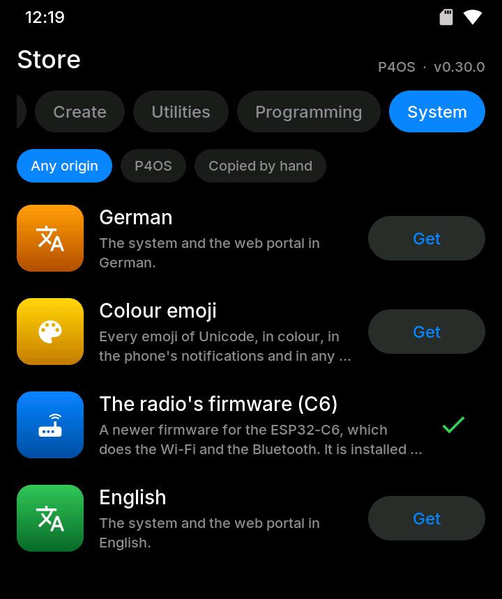
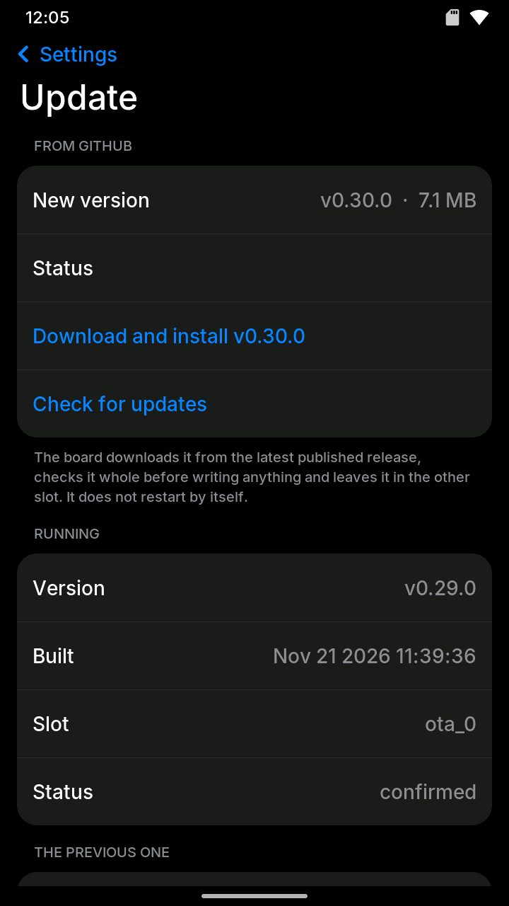

# Installing and updating P4OS

Three ways in, depending on where you start:

- [A new board, from nothing](#a-new-board-from-nothing): flash it once
  over USB, put a card in, and get the apps from the Store.
- [A board on 0.2x](#updating-a-board-from-02x): one more update the old
  way, and from then on the board updates itself.
- [Adding apps](#adding-apps): what the Store does, day to day.

Since 0.30.0 the apps and the games come from the board's own **Store**
([STORE.md](STORE.md)), and so does the next firmware. Copying `apps.zip`
to the card by hand still works, and is no longer the way.

Names of screens are given in English, as the board shows them with its
language set to English. The interface is written in Spanish (Tienda,
Ajustes, Redes), and German is complete too.

## A new board, from nothing

### What you need

- The **Waveshare ESP32-P4-WIFI6-Touch-LCD-5**.
- A **USB-C cable** and a computer, for the first flash only. Use the
  board's serial port, the one behind the CH340 chip: it shows up as
  `/dev/cu.wchusbserial…` on a Mac, `/dev/ttyUSB0` or `/dev/ttyACM0` on
  Linux, `COM…` on Windows. The other USB-C port is the OTG one and does
  not flash.
- A **microSD card formatted as FAT32**. exFAT is not read: a card of
  64 GB or more usually comes as exFAT and has to be formatted again. Any
  size does; every app in the Store is 17 MB together, and all the art
  packs another 150 MB.
- A **Wi-Fi network on 2.4 GHz** with a way out to the internet. The
  board's radio is an ESP32-C6.
- On the computer, Python and esptool: `pip install esptool`.

### 1. Which image

The ESP32-P4 comes in two kinds of silicon, and an image for one does not
boot on the other. With the board plugged in:

    esptool.py --chip esp32p4 chip_id

It prints the chip's revision. For `v1.x` the image is **`rev1_3`**, for
`v3.x` it is **`rev3_x`**. (esptool 5 is called `esptool`, without the
`.py`.)

### 2. Flash it

From the [latest release](https://github.com/charliejgallo/P4OS/releases/latest),
download `p4os-rev1_3-full.zip` (or `p4os-rev3_x-full.zip`) and unpack it.
It holds the bootloader, the partition table, the firmware and a
`flash_args` file that says where each one goes. From inside that folder:

    esptool.py --chip esp32p4 -p <port> -b 460800 write_flash @flash_args

It takes about a minute. The board restarts by itself and shows the home
screen with the built-in apps: Settings, Files, Photos, Music, Clock, the
Calculator, Network, the workshop's tools, and the Store.

This is the only time a cable is needed. If the board ever stops booting,
the same command brings it back; it does not touch the card.

### 3. The card

With the board off, push the microSD into its slot until it clicks, and
turn the board on. **An empty card is fine**: the board makes the folders
it needs. The card's symbol in the status bar says it was read.

Without a card the system runs, with its built-in apps, and the Store has
nowhere to put anything.

### 4. Wi-Fi, and the language

- **Settings → Networks → Wi-Fi**: pick the network and type its password.
  The clock sets itself from the network a few seconds later, and the
  Store needs it: a secure connection cannot be checked without the date.
- **Settings → Language**: Spanish, English or German. The system's own
  texts are inside the firmware; each app brings its own.

### 5. The Store

Open **Store** on the home screen. The first time it fetches the
catalogue, which takes a few seconds, and lists every app.

- The chips on top filter by kind: Games, Workshop, Network, Sound and
  picture, Create, Utilities, Programming.
- Tap an app for its page: what it is, pictures of it, what it needs and
  how much it weighs. **Get** installs it. Its icon appears on the home
  screen and it opens right away: no restart.
- A game with a lot of art brings it in packs. What it cannot start
  without comes with **Get**; the rest are **Extras** on its page (the
  worlds of Bastión, the tables of the pinball), each with its own button.

There is no "install everything": pick what you want. A card with every
app and every pack is about 170 MB.

### 6. The portal

The board serves a web page at **`http://p4os.local`** (Settings → About
shows the address, with a QR code for a phone): files, the log, the
firmware, and a **Store** page that does what the app does, from a
computer. Until you set a password, any device on a network the board
trusts can use it: see [SECURITY.md](SECURITY.md) before leaving it on a
network that is not yours.

### 7. The parts of the system

The Store's last chip, **System**, has what the system itself reads from
the card and is not an app. None is needed to use the board; each is one
**Get**.

| | What for |
|---|---|
| **English**, **German** | The **web portal** in that language, and the latest translations of the system. The board's own screens are translated without it |
| **Colour emoji** | Every emoji, in colour, in the phone's notifications ([EMOJI.md](EMOJI.md)). 16 MB; they show after a restart |
| **The radio's firmware (C6)** | A newer firmware for the ESP32-C6. Getting it leaves it on the card; **Settings → Update → Install on the C6** puts it in. The factory one works ([C6.md](C6.md)) |

  

## Updating a board from 0.2x

A board on 0.20 to 0.29 has no Store and cannot fetch its own firmware, so
the first step is the one you already know.

1. **The firmware, once more by hand.** Download `p4os-rev1_3.bin` (or
   `rev3_x`) from the release and upload it in the portal, **Firmware →
   "Choose the .bin…"**, then restart. (`tools/ota.sh p4os.local` from a
   checkout does the same.) It boots on trial and confirms itself after
   30 seconds; if it does not get there, the board goes back to the
   previous version by itself. The settings and the card stay.
2. **Nothing to copy to the card.** The apps that were there go on
   working: the app interface did not change.
3. **Let the Store take over what is there.** Open Store → **Installed**.
   The apps that were copied by hand say so, and a card on top offers
   **"Let the Store manage them"**: every app whose file is exactly the
   catalogue's gets a receipt, without touching it, and from then on the
   Store tells you when it has a newer one. The ones that are older stay
   as "Copied by hand" until you reinstall them from their page, which
   brings them up to date. Art packs already on the card are recognised
   and not downloaded again.
4. **From now on:** apps update from the Store, and the firmware from
   **Settings → Update** (below). `apps.zip`, `web.zip` and `lang.zip` are
   still attached to each release for a while, for whoever installs by
   hand; an app installed from the Store brings its own portal page and
   its own translations, and the portal's own texts, the emoji and the
   radio's firmware are under the Store's **System** chip. What is on the
   card already (an `emoji.pak` copied long ago) is taken over the same
   way, by its bytes.

Coming from a version **before 0.20**, flashing the full image by cable
once is recommended, as for a new board (step 2 above): the partition
table changed in 0.20.0, and a board that only ever updated over the air
still has the old one. It keeps the settings and the card.

## Adding apps

- **From the board:** Store, the app's page, **Get**. The bar on top shows
  the download; several can wait in line.
- **From a computer:** the portal's Store page lists the same catalogue
  with a search box, and installs to the board.
- **Updates:** a number on the Store's icon says how many apps have a
  newer version. The **Updates** chip lists them; **Update** on each
  replaces it while the board runs. What the app saved on the card stays.
- **Removing:** **Remove** on the app's page, tapped twice. It deletes the
  app, its packs, its portal page and its translations, and leaves what
  the app saved.
- **Apps from somewhere else:** Store → **Sources** adds another catalogue,
  somebody else's repository, after a warning that matters: an app runs
  with every permission of the system. And a single package, a `.p4app`
  file, installs from Files or from the portal. Both are in
  [STORE.md](STORE.md).

## Updating the firmware, from now on

**Settings → Update → From GitHub.** When the latest published release is
newer than what the board runs it says "New version" with its size.

1. **Download and install** fetches the image to the card, checks it whole
   against the size and the SHA-256 the catalogue gives, and only then
   writes it to the idle half of the flash. About a minute.
2. **Restart now**, tapped twice. Nothing restarts by itself.
3. The new version boots on trial and confirms itself after 30 seconds.
   A crash before that brings the previous one back, and "Go back to this
   version" on the same page does it by hand at any time.

The portal's **Firmware** page has the same buttons, and still takes a
`.bin` of your own.

  

