# Modules and sensors on the header

The 40-pin header at the back (J3) is where the bench's extra hardware goes.
This page is about the sensors P4OS reads by itself, how to wire and
declare them, what autodetect does, and how the simulator plays them; and
about the SPI API for the chips an app drives itself ([SPI](#spi)). The
catalogue of the 112 chips the service knows, what each one gives and what
it takes on its module line is [SENSORS.md](SENSORS.md).
The design of the header, its ports and `modules.txt` is in
[plan/EXPANSION.md](plan/EXPANSION.md).

Three places show what is connected:

- **The Módulos app.** It has three tabs:
  - **Header:** the 40 pins drawn as the connector is. Tap a pin to see its
    GPIO, flags, owner and port.
  - **Puertos:** the ports and modules of `modules.txt`, with an editor and
    a form to add a module.
  - **Sensores:** live readings, a chart of the one you pick, and the
    addresses that look like a sensor.
- **The portal's Expansión page** (`http://<name>.local/#expansion`) has
  the same things in a browser. The `modules.txt` editor there checks the
  file as you type.
- **The API:** `aos_sensor_count()`, `aos_sensor_at()`,
  `aos_sensor_value("bme280", "temp", &v)` and `aos_sensor_history()` in
  `components/aos_io/include/aos_sensors.h`. Any app can read the latest
  values without talking to the bus.

The Bus app is still the raw tool: it scans all 112 addresses, shows
registers and drives GPIO levels. Módulos is about what is there.

## Wiring

The default profile gives external sensors their own bus, `i2c.ext`, on
pins that sit together:

| Signal | GPIO | Physical pin |
|---|---|---|
| SDA | 21 | 15 |
| SCL | 22 | 17 |
| 3V3 | - | 18 |
| GND | - | 19 |

- **Pull-ups:** most breakout boards (GY-BME280, GY-302, the INA219 and
  ADS1115 boards) already have 4.7k or 10k pull-ups. The P4 also turns on
  its internal ones, but those are weak (~45k). With a bare chip, or long
  wires, add 4.7k from SDA and SCL to 3V3.
- **Only 3.3 V on the signals.** The header's 5 V pins (1 and 3) are live
  even with the board off. Power 5 V-only modules from there, but never
  pull SDA/SCL up to 5 V.
- **Why not the board's bus (`i2c.board`, GPIO7/8):** it is shared with the
  touch controller (0x14/0x5D), the ES8311 (0x18) and the ES7210 (0x40).
  0x40 is where an INA219 or HTU21 usually sits. A sensor that hangs that
  bus also takes the touch screen with it. You can declare a sensor there
  when you have to. P4OS never autodetects on it, and it refuses the
  board's own addresses.

## Suggested pins

The whole header, with the ports and these pins, is one drawing:

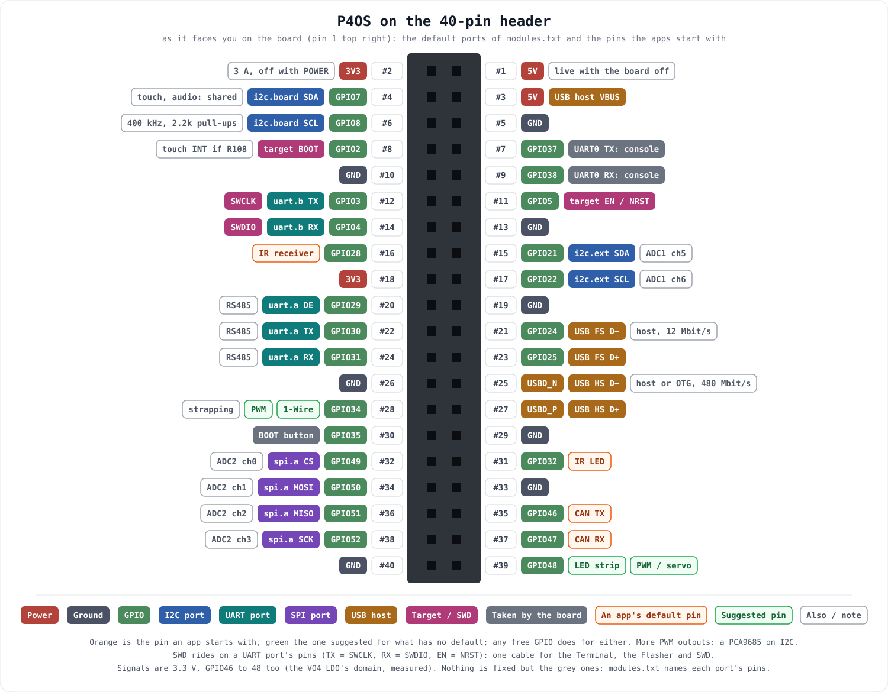

Infrared, CAN, 1-Wire, LED strips and PWM take any free GPIO. These are
the ones that leave every default port (`i2c.ext`, `uart.a`, `uart.b`,
`spi.a`) and the two USB host ports alone, and what the apps and the
drawings on this page use:

| For | GPIO (pin) | Who sets it | Beside it |
|---|---|---|---|
| Infrared receiver | 28 (16) | the Infrarrojo app starts there | 3V3 on pin 18 |
| Infrared LED | 32 (31) | the Infrarrojo app starts there | GND on pin 33 |
| CAN TX, RX | 46 (35), 47 (37) | the CAN app starts there | GND on pin 33 |
| 1-Wire | 34 (28) | Bus starts there; `port gpio.ow pin=34` | GND on pin 26 |
| A LED strip | 48 (39) | suggested in LED Strips | GND on pin 40, 5 V on pins 1 and 3 |
| One PWM output, a servo | 48 (39), then 34 (28) | suggested | |
| More PWM outputs | 46, 47 if CAN is not in use; or a PCA9685 on `i2c.ext` | suggested | |

GPIO34 is a strapping pin (the JTAG source). The chip looks at it at reset
only if the JTAG_SEL_ENABLE eFuse was burnt, which it is not out of the
box, and a pull-up there, as 1-Wire has, selects what is already the
default. GPIO46, 47 and 48 are fed by the VO4 LDO, the microSD's: 3.3 V
signals like the rest (3.25 V measured on GPIO48 on 2026-11-10 with the
card in; GPIO46 and 47 measured too), not a supply for anything.

## Supported sensors

The full list is [SENSORS.md](SENSORS.md): temperature and humidity,
pressure, air quality, light, motion and compass, voltage and current,
distance and presence, on I2C, SPI, 1-Wire, plain GPIOs and serial ports.
The table below is the first twelve, the ones measured on the board when
they came in (2026-10-15 to 10-18), with what each driver does.

| Chip | What it reads | Addresses | Identified by | Module line |
|---|---|---|---|---|
| BME280 | temperature, pressure, humidity | 0x76, 0x77 | chip id 0x60 at 0xD0 | `module bme280 i2c.ext addr=0x76` |
| BMP280 | temperature, pressure | 0x76, 0x77 | chip id 0x58 (0x56/0x57) | `module bmp280 i2c.ext addr=0x76` |
| SHT3x (SHT30/31/35) | temperature, humidity | 0x44, 0x45 | status read (0xF32D) with a valid CRC | `module sht31 i2c.ext addr=0x44` |
| SHT4x (SHT40/41/45) | temperature, humidity | 0x44, 0x45 | serial number read (0x89) with valid CRCs | `module sht4x i2c.ext addr=0x44` |
| AHT20 (AHT21/25) | temperature, humidity | 0x38 | status byte: calibrated, not busy | `module aht20 i2c.ext` |
| AHT10 | temperature, humidity | 0x38, 0x39 | as the AHT20, but its seventh byte is no CRC | `module aht10 i2c.ext` (found by itself since 0.20) |
| BH1750 (GY-302) | light, lux | 0x23, 0x5C | cannot be: a candidate | `module bh1750 i2c.ext addr=0x23` |
| INA219 | bus voltage, shunt voltage, current, power | 0x40 to 0x4F | power-on config 0x399F | `module ina219 i2c.ext addr=0x40 shunt=100` |
| INA226 | bus voltage, shunt voltage, current, power | 0x40 to 0x4F | manufacturer id 0x5449 ("TI") at 0xFE | `module ina226 i2c.ext addr=0x40 shunt=100` |
| ADS1115 | four single-ended voltages, A0 to A3 | 0x48 to 0x4B | threshold registers at 0x8000/0x7FFF | `module ads1115 i2c.ext addr=0x48 gain=4096` |
| MAX6675 (SPI) | a type K thermocouple, 0 to 1023.75 °C | its CS | cannot be: declared only | `module max6675 spi.a`, `module horno spi.a chip=max6675 cs=48` |
| DS18B20 (1-Wire; also DS18S20, DS1822, MAX31850) | temperature | its ROM, on a GPIO port | the bus is declared, its sensors found by a search | `port gpio.ow pin=34` and `module ds18b20 gpio.ow` |

### Units

Each value always has the same unit:

| Quantity | Unit |
|---|---|
| Temperature | °C |
| Humidity | %RH |
| Pressure | hPa |
| Light | lx |
| Voltage | V |
| Current | A |
| Power | W |

The UIs scale them for a bench: mV, mA and mW below 1. The value keys are:

| Chip | Keys |
|---|---|
| Temperature and humidity sensors | `temp`, `hum` |
| BME280/BMP280 pressure | `press` |
| BH1750 | `lux` |
| INA219/226 | `bus`, `current`, `power`, `shunt` |
| ADS1115 | `a0` .. `a3` |
| MAX6675 | `temp` |
| DS18B20 and its family | `temp` |

### What each driver does

- **BME280 / BMP280:**
  - At start: a soft reset, then it waits for the NVM copy and reads the
    calibration block (0x88..0xA1, plus 0xE1..0xE7 on the BME280).
  - Then it sets normal mode: temperature ×2, pressure ×16, humidity ×1,
    IIR filter 4, standby 500 ms.
  - The values go through Bosch's integer compensation (datasheet 8.2):
    32-bit for temperature and humidity, 64-bit for pressure.
  - A chip declared as one but answering as the other is read as what it
    says it is.
- **SHT3x:** a single shot at high repeatability without clock stretching
  (0x2400), a 16 ms wait, and 6 bytes whose two CRCs are checked.
- **SHT4x:** the same with 0xFD (high precision) and a 10 ms wait.
- **AHT20:**
  - If the calibration bit is off, it sends the init command (0xBE).
  - Each reading is a trigger (0xAC 0x33 0x00), an 80 ms wait, and 7 bytes
    with the CRC checked.
  - AHT10 has no CRC byte: the reads tell the two apart (two good CRCs in a
    row make it an AHT20, three bad an AHT10), so either is found by itself
    and named right, and one declared as the other finds out.
- **BH1750:** power on, then continuous high-resolution mode (1 lx, 120 ms).
  lux = raw / 1.2.
- **INA219 / INA226:**
  - The current comes from the shunt voltage over `shunt=` (milliohms,
    100 by default: the R100 on the usual boards). The calibration register
    is not used.
  - The INA219 keeps its power-on configuration: ±320 mV and 32 V ranges,
    12 bits. That is also what identifies it.
  - The INA226 gets averaging of 16.
  - Power is bus voltage × current.
  - Only the shunt voltage decides the current. With a 0.1 Ω shunt, the
    INA219's ±320 mV range gives ±3.2 A.
- **ADS1115:**
  - Each round is one single-shot conversion per input (AINx against GND,
    128 SPS, about 9 ms each).
  - `gain=` is the full scale in mV: 6144, 4096 (the default, so 3.3 V
    fits), 2048, 1024, 512 or 256.
  - Never put more than VDD + 0.3 V on an input, whatever the range.
- **MAX6675 (SPI, 2026-10-18):**
  - The only SPI chip the service reads. It is declared, never detected:
    an SPI chip cannot be asked what it is without a write it might take
    for a command.
  - Each round opens the port with the chip's own CS, reads 16 bits in mode
    0 at 1 MHz, and closes it. The CS is the module's `cs=`, else the
    port's; two thermocouples on the same wires each need their own CS.
    In the service's table, `addr` holds that CS's GPIO, and the UIs show
    it as "CS48".
  - A read stops the conversion under way and CS going up starts the next
    one (220 ms). A read a second never catches one half done.
  - D15 and D1 are always 0, D2 is set with the thermocouple open, and D14
    to D3 are the temperature in quarters of a degree. 0xFFFF is MISO's
    pull-up with nobody driving it: "No contesta" (`nack:spi`). An open
    thermocouple is the error `open`. A word with D15 or D1 set is another
    chip or a wrong SPI mode (`id:<word>`).
  - In the simulator: `P4_SIM_SPI_A="48=max6675"`, or `max6675:open`.

  
  

  On the board (2026-10-18): Bus's example read `03 89`, 28.25 °C; declared
  from Módulos it was read every second with no error, and a lighter at the
  tip took it from 26 to 63 °C in 15 s.
- **DS18B20 and its family on 1-Wire (2026-10-18):**
  - A bus is a GPIO port (`port gpio.ow pin=34`) with a module line on it
    (`module ds18b20 gpio.ow`). A GPIO port without one is never driven:
    the pin may hold a relay, and a reset pulse would click it.
  - Every sensor a search finds on the bus is read. Its name is the
    module's and the last six hex digits of its serial (`ds18b20_A1B2C3`),
    the same at every boot, so an app or a log can count on it.
  - `module heladera gpio.ow chip=ds18b20 rom=28-0123456789AB` gives one
    sensor a name. The ROM is written as Bus's 1-Wire tab shows it. A named
    sensor that is not on the bus says so ("No contesta en el bus 1-Wire").
  - Each round starts one conversion for the whole bus (skip ROM) before
    the I2C and SPI reads, and reads every sensor (match ROM, CRC checked)
    at the end of the round, 750 ms later. The bus is open for that long,
    so Bus's 1-Wire tab on the same pin finds it taken, and the other way
    round.
  - The search runs at start, every 5 s while someone looks, and every
    minute otherwise; a sensor unplugged goes from the list unless
    `modules.txt` names it.
  - **Módulos > Agregar > DS18B20:** pick a GPIO port, or a free pin, and
    the form writes both lines.
  - In the simulator, `P4_SIM_ONEWIRE` (two sensors by default).

## Declaring a module

A line in `modules.txt` (the card's root) looks like this:

```
module <name> <port> [chip=<chip>] [addr=0x..] [shunt=<mΩ>] [gain=<mV>]
```

- **The name** is the chip (`bme280`, `sht31`, `ina219`...). It can also be
  anything you like, with `chip=` saying what the part is:
  `module banco i2c.ext chip=ina219 addr=0x40 shunt=10`.
- **A name with a suffix**, like `bme280_2` or `ina219-fuente`, also means
  that chip. That is how two of the same kind get different names.
- **`addr=`** is only needed when the address is not the usual one.

On an SPI port, `cs=` is the chip select when it is not the port's own:
`module caldera spi.a chip=max6675 cs=48`.

A declared sensor is read whatever autodetect thinks. If it does not answer,
it shows the reason:

- no answer at that address;
- a bad CRC;
- another chip at that address (with the id it gave);
- the pins are someone else's;
- the board has one of its own chips there;
- on SPI, MISO stayed high (nobody there), or the thermocouple is open.

The value names come from the module name: `aos_sensor_value("banco",
"current", &a)`.

To edit `modules.txt`:

- **In the app:** Módulos > Puertos. **Editar** opens the file. It is
  checked on every keystroke, and Save stays off until it would load.
  **Agregar** builds a line from chips: chip, port, address (or CS for an
  SPI chip), shunt or range.
- **In the portal:** the Expansión page, with the same checks and form.
- **Anything else** that writes the file (Archivos, `PUT /api/fs/put`) is
  also fine. The portal reloads `modules.txt` whenever it is written.

`aos_modules_check()` (`components/aos_io/aos_modules.c`) goes further
than `aos_io_validate()`.

- **Errors:** a duplicate port name is refused. `aos_io_load()` would have
  rejected that file and fallen back to the default profile.
- **Warnings, which still save:**
  - a GPIO in two ports;
  - a module on a port that is not declared;
  - a sensor module on a port that is not I2C.

## Autodetect

The sensor service (`aos_sensors.c`) is a thread that does one round a
second:

1. **It merges** the sensors `modules.txt` declares with the ones
   autodetect found. There is one slot per port and address, 32 at
   most, each with up to 12 values.
2. **For each I2C port with something to do,** it opens the port as
   "Sensores" (claiming SDA and SCL), probes if a probe is due, reads every
   sensor on it, and **closes it again**. The port is held for a few
   milliseconds a second, so the Bus app can scan or dump registers on the
   same port between rounds.
3. **If someone else holds the pins,** for example the Bus app's GPIO tab
   driving GPIO21, the round skips that port quietly. The sensors show "los
   pines los tiene Bus".

### When it probes

- Every 5 s while somebody is looking: the app open, or the portal page.
- Every 60 s otherwise.
- At once after **Buscar de nuevo** or a save of `modules.txt`.
- Never on `i2c.board`.

### How it decides

It probes only the addresses some driver uses, and at each one it tries the
drivers in the table's order: those that prove themselves with a plain
register read first, those that need a command next, weak signatures last
([SENSORS.md](SENSORS.md#what-autodetect-never-does)).

- **A chip that proves what it is gets read without being declared.** The
  proof is in the "Identified by" column above: an id register, a
  power-on register value only that chip has, or an answer with a valid
  CRC.
- **Proving never configures anything.** It reads registers and sends only
  the read-only commands a chip answers with its id or a CRC: the SHT
  status and serial number, and the AHT status.
- **A device that answers but proves nothing becomes a candidate.** The UIs
  ask "¿Es un BH1750?" and offer a button that adds the `module` line.
  - The BH1750 is always a candidate: it has no id, and a PCF8574 at 0x23
    looks the same.
  - So is an INA219 whose configuration someone changed, an HTU21 at 0x40,
    or a TMP102 at 0x48.
- **A detected sensor that stops answering at the next probe is dropped.**
  A declared one stays, with its error.
- **After a failed read, a chip is started again on the next round,** in
  case it lost power.

### The service at boot

It starts at boot only if `modules.txt` declares a sensor
(`aos_sensors_autostart()`, from the apps' service tick). Otherwise it
starts the first time something asks: the app, the portal, or an
`aos_sensor_*` call.

## In the simulator

`sim/sensors_sim.c` plays the sensors on every I2C port except
`i2c.board`. Each one speaks its chip's real protocol:

- **Register chips** have a register pointer: BME280, INA and ADS1115.
- **SHT3x and SHT4x** take 16-bit and 8-bit commands with CRC-8 answers.
- **Measurement times are real.** Reading an SHT or AHT too early gets a
  NACK or the busy bit, and an ADS1115 conversion takes 1/SPS.
- **Power-on values are real:** the INA219's 0x399F, the ADS1115's
  thresholds, the BME280's chip id and a calibration block.
- **The readings drift slowly:**
  - the room warms and cools over three minutes;
  - a board on the INA219 draws 120 mA with radio bursts to 300 mA every
    8 s;
  - a pot on ADS1115 A1 sweeps;
  - a hand covers the BH1750 now and then.

The BME280's calibration is Bosch's datasheet example. Its raw ADC values
come from inverting the datasheet's floating-point formulas (8.1) by
bisection. The driver's integer formulas are therefore checked against an
independent implementation: with `P4_SIM_SENSORS_FIXED=1` (no drift, no
noise) the driver reads exactly 25,00 °C, 1006,53 hPa and 50,0 %.

| Variable | Meaning |
|---|---|
| `P4_SIM_SENSORS` unset or `1` | The bench set: `bme280@0x76 sht31@0x44 bh1750@0x23 ina219@0x40 ads1115@0x48`. |
| `P4_SIM_SENSORS=0` | None. `i2c.ext` goes back to the plain register blobs at `P4_SIM_I2C_EXT` (0x76, 0x44). |
| `P4_SIM_SENSORS=bmp280@0x77,sht4x,aht20,ina226@0x41` | Any set. The names are `bme280`, `bmp280`, `sht31`/`sht3x`, `sht4x`, `aht20`, `bh1750`, `ina219`, `ina226` and `ads1115`. The address defaults to the usual one, and there is one device per address. |
| `P4_SIM_SENSORS_FIXED=1` | Constant values, for checking a driver's arithmetic. |

The emulated devices win over the register blobs of `io_sim.c` at their
addresses. The Bus app's register view then shows them too. An SHT31 gives
nothing to a register read, as the real one would.

## SPI

`spi.a` is SCK 52 (pin 38), MOSI 50 (pin 34), MISO 51 (pin 36) and CS 49
(pin 32), with 3V3 on pin 1/17 and GND on pin 40. The port line takes a
`cs=` now, and the default profile has one:

```
port spi.a sck=52 mosi=50 miso=51 cs=49 freq=1000000
module lora spi.a cs=48 rst=46 busy=47      # a second chip on the same wires
```

`miso=` and `cs=` are optional (a display has no MISO; an app can drive its
own CS). `freq=` is the default clock of the port's devices.

### The API (`components/aos_io/include/aos_io.h`)

```c
aos_io_spi_cfg_t c = { .clock_hz = 1000000, .mode = 0 };   /* or NULL: all defaults */
aos_io_spi_t *s = aos_io_spi_open("spi.a", "mi_app", &c);
uint8_t cmd = 0x9F, id[3];
aos_io_spi_write_read(s, &cmd, 1, id, 3);                   /* EF 40 18: a W25Q128 */
aos_io_spi_close(s);
```

| Call | Does |
|---|---|
| `aos_io_spi_open(port, owner, cfg)` | Claims SCK/MOSI/MISO and the CS for `owner`, brings the host up. NULL if the port is not in `modules.txt` or not SPI, a pin is someone else's (the log says whose), the CS is not a usable pin, or no host is left. |
| `aos_io_spi_xfer(s, tx, rx, n, timeout_ms)` | Full duplex, **one CS assertion** however long. `tx` NULL sends 0xFF; `rx` NULL drops what comes in. `timeout_ms` bounds the wait for the wires when another handle on the port is mid-transfer. |
| `aos_io_spi_write_read(s, w, wn, r, rn)` | `wn` bytes out, then `rn` in (sending 0xFF), in one assertion: a register read. |
| `aos_io_spi_set_clock(s, hz)` / `aos_io_spi_clock(s)` | A new clock / what the hardware makes. |
| `aos_io_spi_cs_gpio(s)`, `aos_io_spi_desc(s)` | The CS in use; `"spi.a CS49 1 MHz mode 0"`. |
| `aos_io_spi_close(s)` | Releases the CS, and the wires with the last handle on the port. |
| `aos_io_module_gpio(module, key)` | A GPIO from a module line (`rst`, `busy`, `dio1`...), checked against the header. |

The config: `clock_hz` (0 = the port's `freq=`, else 1 MHz; held between
10 kHz and 40 MHz), `mode` 0-3 (CPOL << 1 | CPHA), `lsb_first`, and `cs`:
`AOS_IO_SPI_CS_PORT` (0, the default: the port's `cs=`, or the `cs=` of
`cfg.module` when that is set), `AOS_IO_SPI_CS_NONE` (-1: no CS, the app
drives one with `aos_io_gpio_*`) or any usable GPIO of the header.

The same owner may open one port several times, one handle per chip; a
different owner is refused while the port is open.

### On the board (`aos_io_p4.c`)

- **Host:** GPSPI2, then GPSPI3 for a second port. Nothing else uses them:
  the panel is MIPI-DSI, the C6 is on SDIO, the PPP link on a UART.
- **Pins:** through the GPIO matrix (the header's GPIOs are not the hosts'
  IO_MUX pins). The clock is held to 40 MHz; the driver rounds to what its
  divider makes, and `aos_io_spi_desc()` shows that. MISO gets the internal
  pull-up, so nothing connected reads 0xFF.
- **DMA:** `SPI_DMA_CH_AUTO`, through two bounce buffers of 2 KB each in
  internal DMA RAM, cache-line aligned, made when the port's bus comes up
  and freed with it. That is 4 KB of internal RAM while a port is open.
  It is not PSRAM because GPSPI DMA from PSRAM shares bandwidth with the
  panel's framebuffers, and the IDF says it then drops bytes silently.
  Longer transfers go in 2 KB pieces with CS held low between them
  (`SPI_TRANS_CS_KEEP_ACTIVE`). The driver still copies an RX buffer
  whose length is not a whole number of cache lines. The pieces are cut so
  only the last bytes (under 64) take that path.
- **Polling:** a piece that keeps the bus busy for under 100 µs is polled.
  Longer ones go through the interrupt and the task sleeps.

### In the simulator (`sim/io_sim.c`)

`P4_SIM_SPI_A` (`P4_SIM_<PORT>`, as the UARTs) says what is on the wires:

| Value | What answers |
|---|---|
| unset | `49=w25q128,48=max31855,47=mcp3008`: a chip per CS GPIO |
| `49=max31855,48=w25q128` | your own map |
| `mcp3008` | that chip on any CS, and with none |
| `loop` | MOSI wired to MISO: the jumper from pin 34 to pin 36 |
| `none` | nothing: 0xFF |

- **`w25q128`**
  - IDs: `9F` → `EF 40 18`, `90` → `EF 17`, `AB` → `17`, `4B` → a
    unique id.
  - Commands: `05`/`35` status, `03`/`0B` read, `06`/`04` write enable,
    `02` page program, `20`/`D8`/`C7` erase.
  - Only the first 64 KB are kept. They start with a line of text.
- **`max31855`:** a K junction near 24 °C that drifts, and the chip near
  26 °C. Use `max31855:open` for an open probe.
- **`mcp3008`:** emulated bit by bit after the start bit, with VREF at
  3.3 V. The channels:
  - ch0: a slow sine
  - ch1: mid-scale
  - ch2: a 30 s ramp
  - ch3: ground
  - ch4: 3V3
  - ch5: a light sensor
  - ch6 and ch7: floating

With no CS, the chip is the one whose CS GPIO the app holds low. The chips
also act like real ones:

- A mode they do not speak shifts the reply by one bit.
- A clock above their maximum flips the odd bit.
- LSB-first reverses each byte on the wire.

### The Bus app's SPI tab

You pick the port, clock, mode, CS and bit order. The CS list is the
port's, those of its modules, or none. Then:

- **Bytes:** type them on a hex keypad. **Enviar** shows TX, RX and the
  ASCII of RX.
- **Examples:** these fill the bytes, set mode 0 at 1 MHz and send:
  - "Memoria flash: leer ID (9F)": the maker and size.
  - "MAX31855: temperatura": both temperatures, or the fault.
  - "MAX6675: temperatura": two bytes, the thermocouple's temperature, or
    that it is open.
  - "MCP3008: canal N": the count and the volts. The CH chip changes N.
  - "Lazo": 16 bytes that must come back. **Try this first on the board:**
    a jumper from pin 34 to pin 36.
- **Errors:**
  - All 0xFF or all 0x00 is read as nobody there.
  - When the port cannot open, it says why: the port is not in
    `modules.txt`, or "GPIO50 lo tiene Bus".

The tab claims pins as `Bus SPI`, not `Bus`. A pin the GPIO tab holds is
then refused, not taken over.

## Ethernet (a W5500 on `spi.a`, since 0.26.0)

A "W5500 Lite" module (HW-884, 3.3 V only, about 200 mA) on the SPI port
gives the board a wired network. It is optional and off until it is
switched on: Settings, Redes, Ethernet, or the portal's "Wi-Fi y Ethernet"
page.

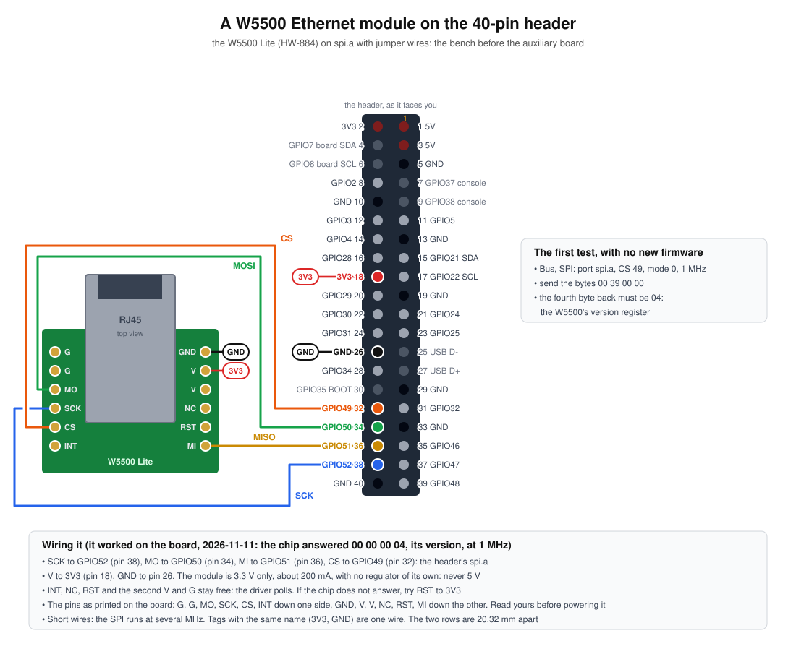

| Module | Header | GPIO |
|---|---|---|
| V (either) | pin 18, 3V3 | |
| G / GND | pin 33 or 40 | |
| SCK | pin 38 | 52 |
| MO (MOSI) | pin 34 | 50 |
| MI (MISO) | pin 36 | 51 |
| CS | pin 32 | 49 |
| RST, INT, NC | not connected | |

- **No interrupt pin:** the driver polls every 10 ms (`aos_eth_p4.c`, over
  `aos_io_spi_*`: ESP-IDF's W5500 driver with a custom SPI layer, so the
  port stays the pin arbiter's, owner "Ethernet").
- **The clock** is 8 MHz by default and chosen in the same page, up to
  40 MHz. With loose wires on the bench it ran clean at 40 MHz; a download
  went from 0.5 MB/s at 8 MHz to 0.89 MB/s at 40 MHz.
- **Sharing the port.** A sensor declared on `spi.a` shares it with
  Ethernet, each with its own CS. An app that opens the port (Bus, EEPROM)
  pauses Ethernet, which the screen says, and Ethernet comes back eight
  seconds after the last one closes it. Nothing an app does on SPI is
  refused because Ethernet is on.
- **Which network is used:** the wire when it has a link and an address,
  then the Wi-Fi, then the USB cable. Both can be up; the portal answers
  on either.
- **Trust:** a wired network opens the portal without a password only
  after "La red por cable: de confianza" is switched on at the board
  (`docs/SECURITY.md`).
- **In the simulator:** `P4_SIM_ETH=1` (a cable and an address) or
  `P4_SIM_ETH=nolink`.
- **A tester for the port it is plugged into** (not in a release yet): Red,
  the Cable tab. The link, what the DHCP server gave, which switch and
  which of its ports this is when the switch says so (LLDP or CDP), a test
  of the gateway, a name and the internet, and the board's interfaces. For
  apps of the card: `aos_eth_dhcp()`, `aos_eth_listen()` and
  `aos_eth_neighbor()` in `aos_eth.h`, `aos_hal_netif_list()` in
  `aos_hal.h`. In the simulator the switch is made up
  (`P4_SIM_ETH=cdp`, `=quiet`).
- **Finding a device of unknown address** (not in a release yet): Red, the
  Equipo tab. Plugged straight into the board's Ethernet, a device shows
  with the address and the name it gave as it started (ARP, DHCP, mDNS,
  NetBIOS, SSDP, WS-Discovery), and a sweep by ARP of the networks devices
  come set to finds the one that says nothing. For apps of the card:
  `aos_eth_stations()` and `aos_eth_arp_ask()`. In the simulator,
  `P4_SIM_ETH=device` is a cable straight to a made-up camera. A tap on a
  device opens it: everything it said, a ping, and "Ponerme en su red",
  which gives the wire an address next to the device's
  (`aos_eth_bench()`); "Repartir direcciones" makes the board a DHCP
  server for whatever is plugged in. In both the Wi-Fi stays the board's
  way out, and a restart undoes them.

`docs/plan/ETHERNET.md` (Spanish) has the phases, everything measured and
what is next.

## 1-Wire

`aos_io_ow_*` opens a 1-Wire bus on any usable GPIO of the header, with an
owner like every other port. On the board it is Espressif's `onewire_bus`
over the RMT, one TX and one RX channel a bus: the slots are timed by the
peripheral, not by a loop with interrupts off.

- **The bus:** `aos_io_ow_reset()` (a presence pulse), `aos_io_ow_search()`
  (the 64-bit ROM ids, family code in the low byte), and raw writes and
  reads. `aos_io_ow_family()` names the codes (0x28 DS18B20, 0x10 DS18S20,
  0x22 DS1822, 0x3B MAX31850, ...).
- **The DS18B20 family:** `aos_io_ds18b20_convert_all()` starts every sensor
  at once (skip ROM) and says how long to wait (750 ms at 12 bits).
  `aos_io_ds18b20_read()` reads one, checks the scratchpad's CRC and gives
  degrees and the resolution. `aos_io_ds18b20_set_bits()` changes the
  resolution and keeps it in the sensor's EEPROM. 85.0 straight after power
  up is the part's reset value, not a reading.
- **Wiring:** GND, data to the pin, VDD to 3V3 (pin 18), and 4.7 kΩ between
  data and 3V3. The internal pull-up is enough for one sensor on a short
  cable.
- **Bus, 1-Wire tab:** pick the pin, search, and every sensor is read once a
  second in a thread of its own, with its resolution.
- **The simulator:** `P4_SIM_ONEWIRE` says what hangs off any pin opened as
  a bus. Unset, two DS18B20s: one near 23 °C, one that warms and cools over
  a minute. `none` for nothing, or a number for that many.

## LED strips

`aos_io_strip_*` sends an addressable strip on any usable GPIO: the
single-wire kind (WS2812B and the WS2813/WS2815/WS2811 at 800 kHz, the
WS2811 at 400 kHz, SK6812, SK6812 RGBW), with the colour order. The RMT
sends it from a frame in PSRAM, refilled by its ISR; there is no DMA,
because its buffer would be internal RAM.

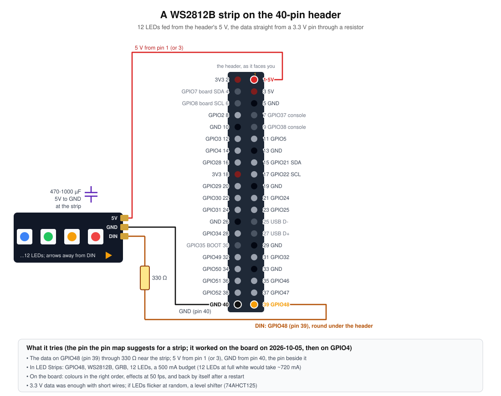

The drawing is on GPIO48, the pin suggested for a strip since the pin map
of 2026-11-10; the test below was on GPIO4, which is `uart.b`'s RX.

Tried on the board on 2026-10-05: a strip of 12 WS2812B on GPIO4, its data
straight from the 3.3 V pin with no level shifter, powered from the
header's 5 V. Red, green and blue came out as asked with the GRB order,
the effects ran at 50 fps, and the strip came back by itself after a
restart.

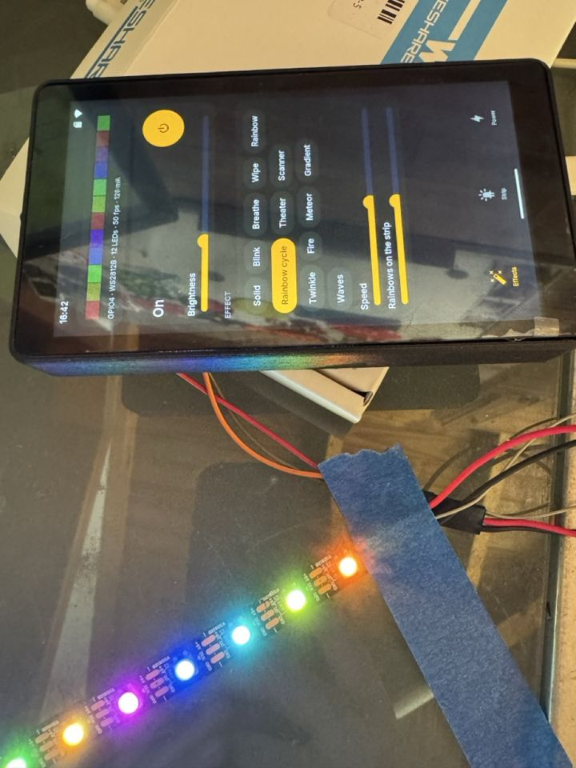

The **LED Strips** app does not drive the strip itself. A service,
`aos_leds.c`, does, and keeps going with any app in front:

- **The effects:** 13 of them, at up to 50 fps.
- **The limiter:** the current estimate is WLED's (a LED draws its mA at
  full white, shared by its channels, linearly with each one), and the
  frame is dimmed to stay within the supply's budget.
- **Kept across restarts:** the configuration lives in the preferences, and
  a strip left on comes back at boot.

Fire is Mark Kriegsman's Fire2012 algorithm, as FastLED and WLED have it,
written again here.

## PWM, an analog level, infrared and CAN

Since 0.9.2, for the workshop apps (0.10). The API is in `aos_io.h`, the shared
part in `components/aos_io/aos_io_signal.c`, the board's in
`aos_io_signal_p4.c` and the simulator's in `sim/io_signal_sim.c`. Each
one takes any usable GPIO of the header and claims it, like the rest.

| What | Hardware | Limits |
|---|---|---|
| `aos_io_pwm_*` | the LEDC, from the 40 MHz crystal | seven channels (the eighth is the backlight), three frequencies at once; 1 Hz to 20 MHz, 20 bits of duty up to 38 Hz, 15 at 1 kHz, 1 at 20 MHz; servo pulse in microseconds; hardware fades |
| `aos_io_dac_*` | the sigma-delta modulator, 1 MHz | the P4 has no DAC: 1 kOhm and 1 uF to ground give 0-3.3 V with a few mV of ripple, 256 steps, eight channels; not for audio |
| `aos_io_ir_*` | the RMT, 1 us a tick | in: a demodulating receiver (TSOP38238, VS1838B), up to 1024 marks and spaces a frame, two buffers so the next frame lands while one is read; out: an IR LED through a transistor, the carrier settable (38 kHz, 33 % by default, or none) |
| `aos_io_can_*` | the TWAI controllers, classic CAN 2.0 | 25 kbit/s to 1 Mbit/s; normal, listen only, and a self test that needs no transceiver (one pin for TX and RX); a queue of 64 received frames with time stamps |

### PCA9685: sixteen more PWM outputs over I2C (2026-10-19)

The "16 servos" module. Declared as a module on an I2C port:

```
module servos i2c.ext chip=pca9685 addr=0x40 [freq=50] [osc=25000000] [od=1] [invert=1]
```

- **The API** is `aos_io_pca_*` in `aos_io.h` (`components/aos_io/aos_pca9685.c`):
  open by the module's name, a frequency for the chip, and a duty or a
  servo pulse in microseconds for each of its sixteen outputs, 12 bits.
- **One frequency a chip,** 24 Hz to 1526 Hz: the prescaler is the chip's,
  not the output's. The PWM app keeps it at 50 Hz while a servo is on the
  chip and tells a channel that asks for another one.
- **The oscillator** is "25 MHz", but many clones run a few percent fast:
  measure an output and set `osc=` to correct the servo pulses.
- **Power:** VCC to 3V3 (the logic), V+ to the servos' own supply, never
  the board's 3V3. OE has a pull-down on the module: leave it.
- **The PWM app** offers its outputs after the header's pins, in the pin
  sheet and on the portal's page: a channel can be a header pin or
  "servos 3". PWM, servo and LED modes; no analog level.
- **It is not a sensor.** The sensor service tells it apart by its
  registers at power-on (SUBADR1..3 and ALLCALLADR read E2 E4 E8 E0), never
  offers it as a candidate, and Bus names it. Opened, it stops answering
  the all-call address 0x70, where a TCA9548A may sit.
- **An I2C port is shared** since then: the app holds the chip open while
  the sensor service goes on reading the other chips of the same bus. The
  pins are claimed once, by whoever opened the port first; a pin held as a
  plain GPIO still keeps the port from opening.
- **In the simulator:** `P4_SIM_SENSORS="pca9685@0x40"`, and the log says
  what each output does ("PCA9685 0x40 ch3: 7.5% at 50 Hz (1500 us high)").

On the board (2026-10-20): five servos on outputs 0-4, V+ from a separate
5 V supply. From the PWM app, each moved alone to 1000 and 2000 us and back,
then all five in a sine wave (4 s, 1000-2000 us, 0.8 s apart), smooth; the
sensor service went on reading the same I2C port meanwhile.

<a href="media/pca9685-servos.mp4"></a>


**Wiring for a bench test of PWM:** two LEDs at two frequencies, a servo
at 50 Hz on its own 5 V, and the analog level through its RC filter, with
a meter on it. The drawing uses the pins the pin map of 2026-11-10 leaves
free (GPIO34, 46, 47 and 48); the test below was the same circuit on
GPIO28, 29, 30 and 32, as the photo shows.

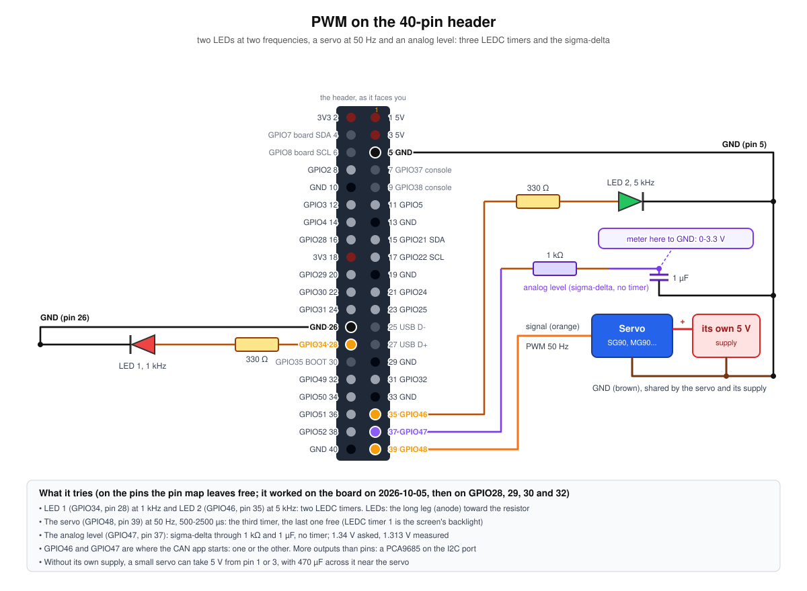

Tried on the board on 2026-10-05 on a breadboard, all four channels at
once from the PWM app:

| Channel | Asked | What the hardware gives |
|---|---|---|
| LED 1, GPIO28 | 1 kHz, a sine pattern | 998 Hz, 15 bits |
| LED 2, GPIO29 | 5 kHz, breathing | 5000 Hz, 12 bits |
| Servo, GPIO32 | 50 Hz, 500-2500 us | 50 Hz, 19 bits; both ends and the sweep |
| Analog, GPIO30 | 104/255 = 1.34 V | 1.313 V on a meter (-27 mV, 2 %), steady but for a few mV of breadboard noise |

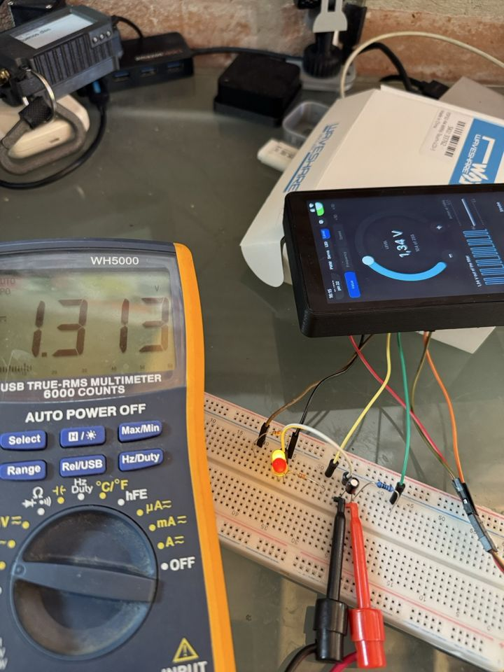

**Wiring for a bench test of infrared:** a demodulating receiver on
GPIO28 (not GPIO21/22, which the I2C service scans by itself) and an IR
LED on GPIO32, driven through an NPN transistor from 5 V. Those are the
pins the Infrarrojo app starts with.

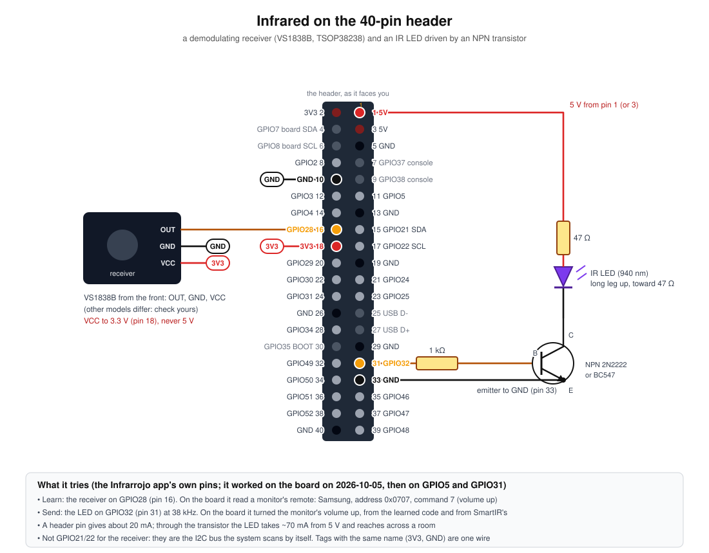

Tried on the board on 2026-10-05 with the Infrarrojo app, the same
circuit on other pins (receiver on GPIO5, the LED's transistor on
GPIO31): a monitor's remote
learned as Samsung, address 0x0707, command 7, sent back, and the monitor
turned its volume up; "volume up" from SmartIR's code library worked too.

**A pin let go** (an output closed) rests at its off level through the
weak pull: down, or up for an inverted PWM output. `gpio_reset_pin()`
alone leaves the pull-up on, and a servo whose channel was switched off
moved by itself on a line held weakly high.

**On a real CAN bus** a 3.3 V transceiver goes between the pins and
CANH/CANL (SN65HVD230 and kin): the header's pins are not 5 V tolerant.
The bench's bus is the P4 and an ESP32 DevKit, each with its own
SN65HVD230, on a twisted pair:

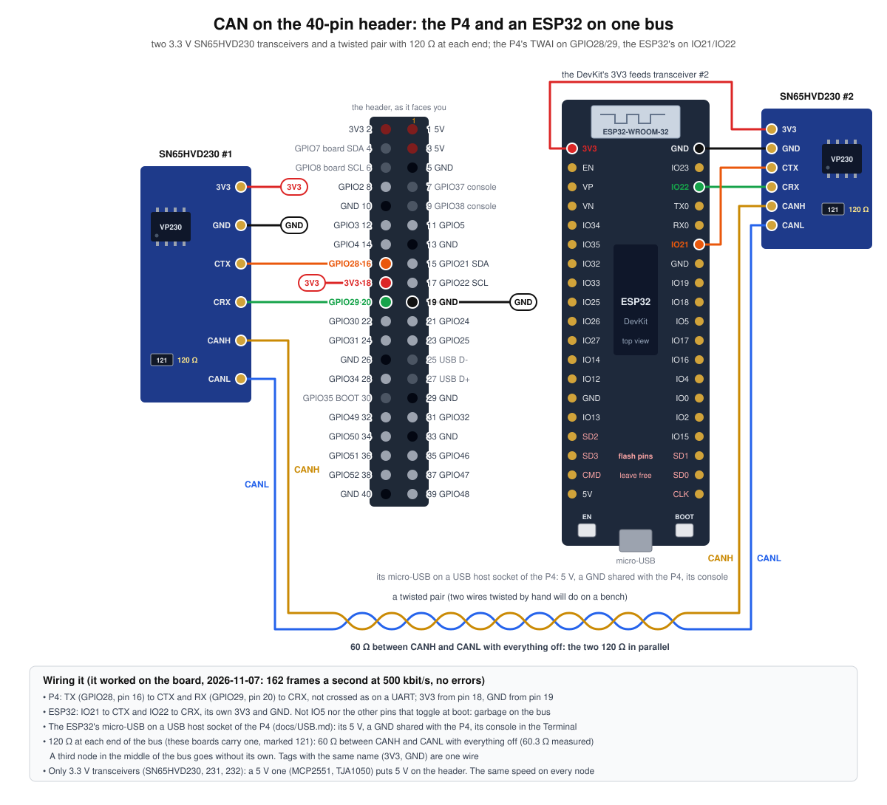

Wired as drawn on 2026-11-07: 60.3 Ω between CANH and CANL with
everything off, the two boards' 120 Ω (the SMD marked 121) in parallel.
The same day the ESP32 car of `tools/can_test` and the CAN app talked at
500 kbit/s: about 162 frames a second, no errors in 25000 frames
(apps/can/README.md, with photos). On the way:

- **The P4 alone on the bus, in Normal,** goes error passive (TEC 128) and
  stays there, retrying: nobody acknowledges, and the standard stops the
  count for a passive node with only ACK errors. Seen on the board.
- **Self test with TX and RX on two pins** (28 and 29) sends each bit
  through the transceiver and back without needing an ACK: the test for
  the four wires and the transceiver. Here two of the wires were wrong;
  every frame was then a bit error, which goes bus off in Normal too.
- **The ESP32 with the P4 in Solo escucha** got no ACK in 10753 tries and
  went bus off, not passive: its few bit and stuff errors do not add up
  to that, so the classic ESP32 may count ACK errors past 128. Not looked
  into further.

**The clock of the LEDC.** All its timers share one clock, and the
backlight's (set up by the BSP) is the crystal. Asking for the 80 MHz PLL
failed on the board with "timer clock conflict", so PWM runs from 40 MHz.

**Trying them without an app:** `POST /api/expansion/selftest?gpio=28`
opens each on a free pin with nothing wired and says what happened: PWM
(frequency and bits at 1 kHz and 50 Hz, a fade, a servo pulse), the
analog level, an IR frame out (NEC, 68 ms), and CAN in its self test
(frames sent and heard back). With `&gpio2=` and a jumper between the two
pins, the IR frame also comes back in. On the board, on 2026-10-05: all
of it worked on GPIO28 and GPIO32.

**In the simulator** PWM and the analog level keep the board's limits and
numbers. What an IR output sends reaches every IR input, and a NEC remote
in the room presses a key every 6 s (`P4_SIM_IR_REMOTE=0` stops it). All
the CAN nodes share a bus with a car on it (engine speed 0x0C0, vehicle
speed 0x1A0, temperatures 0x3E8, a J1939-style 0x18FEF100;
`P4_SIM_CAN_TRAFFIC=0` takes it off), and a node in the self test hears
only itself. The car answers OBD-II too, mode 01, as two units: the engine
on 7E8 (18DAF110 with 29-bit ids) with some twenty PIDs, the gearbox on
7E9 (18DAF118) with 01 and 0D; the CAN app's OBD tab scans it.

**EEPROMs** have no API of their own: they are I2C, SPI or GPIO. A 24LC
on the header's I2C bus:

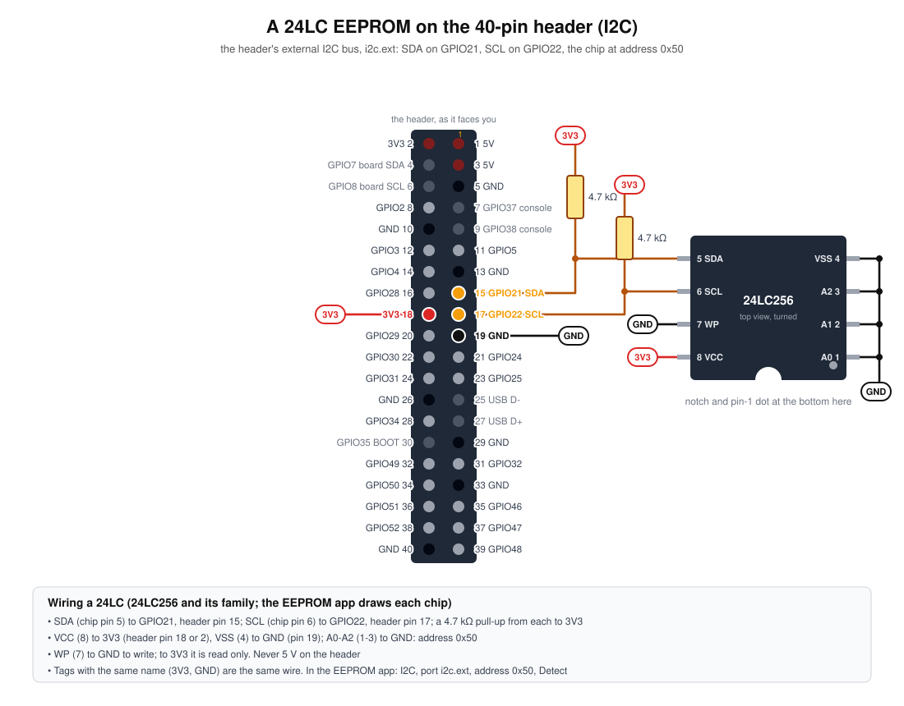

Tried on the board on 2026-10-05 with a 24LC256 wired as drawn, from the
EEPROM app: found at 0x50, its size measured by writing (it wraps at
32 KB), read whole and kept as a version, edited in the hex view, written
and verified, compared, put back to the version read first and read again.
Every version's CRC32 and MD5 match the file when checked on a computer:
the first read and the restored one are both 1B43EABD (all FF), the edited
one 39CE0FF3 both times it was written.

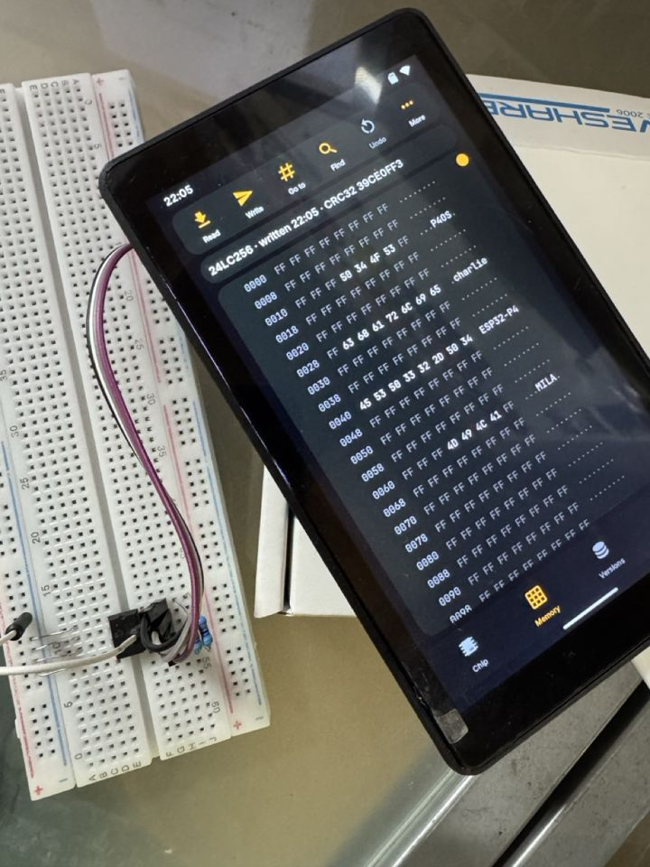

The simulator emulates the three families (`sim/eeprom_sim.c`): 24xx on I2C
(`P4_SIM_EEPROM`, a 24LC256 at 0x50 by default), 25xx on SPI (a 25LC640 on
CS GPIO46) and a 93xx clocked on GPIOs (`P4_SIM_93C`).

## RS485

Since 2026-11-08. RS485 is a UART with a transceiver: `aos_io_uart_open`
with `rs485 = true` on a port that has a `de=` pin puts the UART in
half-duplex RS485 mode, and the UART raises DE itself while it transmits
(`uart.a` in the default profile: TX 30, RX 31, DE 29). A port without DE
works with an automatic transceiver (no DE pin), and `usb0`/`usb1` with a
USB-RS485 adapter on the USB host. On the board an RS485 port hands its
bytes over 3 character times after the line goes quiet (the driver's
default is 10), which is what lets an app split Modbus frames and time
answers close to the wire.

**The transceiver has to be a 3.3 V one** (MAX3485, SP3485, THVD1420, a
3.3 V "TTL to RS485" module): the common MAX485 is a 5 V part and, fed from
5 V, puts 5 V on the header's RX. DE and /RE tied together go to the DE
pin. 120 Ω at the two ends of the bus only.

The bench's bus is the P4 and an ESP32 DevKit, each with an automatic
"RS485 to TTL" module (TXD, RXD, VCC, GND, a 120 Ω on board; no DE) fed
from 3.3 V, on a twisted pair (`tools/rs485_test`, which plays a Modbus
slave or master):

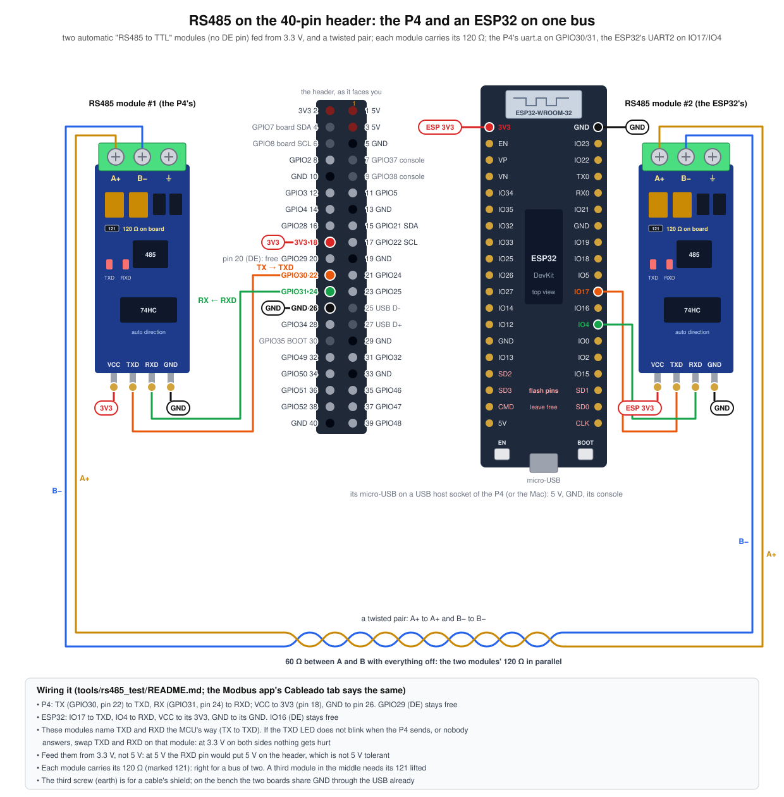

The apps: **Modbus** (`apps/modbus`: master, slave with faults on demand,
and a monitor that listens without driving the line) and **Equipos**
(`apps/equipos`: the Riden and the DOMCOM gateway). DMX512 and the rest of
what RS485 carries: `docs/plan/RS485.md`.

**On the board** (2026-11-09, `apps/modbus/README.md` "On the board"):
the P4 and the ESP32 with two automatic modules talked at 9600 8N1 for
thousands of requests with no error but those played on purpose, both
ways (the P4 as master and as slave) and with the P4 listening as
monitor. Two things learnt: the modules need nothing but TX, RX, 3.3 V and
GND, TXD to TX as named; and a UART does not drop a byte with a parity
error, so a slave answers with a good CRC whatever the parity: the speed
can be found by trying, the format cannot without counting parity errors.

**The line's errors** (2026-11-09): `aos_io_uart_errors(u, &e, clear)`
counts, since the port opened or the last clear, the bytes with a bad
parity, the bytes with a bad stop bit (framing), the BREAKs and the bytes
lost to a full buffer, from the UART driver's event queue (drained on every
read; ~450 bytes of internal RAM an open UART, the driver's own
xQueueCreate). A byte with an error still reaches `aos_io_uart_read`. The
Modbus app's Buscar velocidad uses it to tell the format, and its monitor
to count bad bytes. In the simulator `P4_SIM_UART_A_FORMAT=8E1` says what
format the far end talks, and a different one counts errors as a UART
would.

**In the simulator** a pty stands for the bus: `tools/fake_modbus.py`
plays slaves, a master, or a busy bus on one, and `P4_SIM_UART_A=<pty>`
puts it on `uart.a`. `P4_SIM_UART_A=/dev/cu.usbserial-…` puts a real
USB-RS485 adapter there instead, so the simulator talks to the ESP32 too.

## DMX512

Since 2026-11-09. `aos_io_dmx_*` (`aos_io.h`) puts DMX on a UART port of
`modules.txt` through an RS485 transceiver: 250000 baud 8N2, a BREAK, a
MAB, a start code and up to 512 slots. The shared part is
`components/aos_io/aos_io_dmx.c` (it claims the port's TX, RX and DE for
the owner and keeps the universe), the board's `aos_io_dmx_p4.c`, the
simulator's `sim/io_dmx_sim.c`.

- **Sending:** ESP-IDF's UART driver and a task that, every period (25 ms
  by default), waits for the last packet to be out, holds TX low for the
  BREAK by inverting the line, lets it go for the MAB, and queues the
  start code and the slots. DE stays high while it is open: DMX goes one
  way. Slots, BREAK (88-2000 µs), MAB (8-1000 µs), period and start code
  are settable.
- **Receiving:** not the driver, whose ring buffer would hand the last bytes
  of one packet (still in the FIFO when the BREAK is detected) to the next.
  An interrupt of its own takes every byte as it comes (FIFO threshold 1:
  about 22700 interrupts a second at full rate, a few per cent of a core)
  and closes the packet at each BREAK, dropping the BREAK's own NUL. It
  then times the BREAK and the MAB on the RX pin: the BREAK is detected
  about 10 bit times (40 µs) after it starts, so its length is that plus
  the time until the line rises, and the MAB the time until it falls
  again; the polling gives up after 3 ms. Not IRAM: while the flash is
  busy a packet or two may come out short and count as bad.
- **What a reader gets:** the last whole packet (start code and slots) and
  the stats: packets, bad ones (framing error or too long), other start
  codes, short BREAK/MAB, the rate, the BREAK and MAB as measured, the age
  of the last packet.
- **In the simulator** one bus for all: what an app sends, a receiver
  gets; with nobody sending, a console plays a show (`apps/dmx/README.md`).
- **RDM** (2026-11-09): `aos_io_dmx_rdm(d, req, len, out, max, timeout_ms)`
  on a port open to send. The sending task takes the request between two
  DMX packets: BREAK and MAB as for DMX, the bytes, the wait for the last
  stop bit; then DE goes low (when the port has one), what the RX pin
  picked up is thrown away and the answer is read from the driver (in SEND
  it has the RX pin too, with its pull-up): the first byte within the
  timeout (2 ms by the standard, 3 by default), the rest until 2 ms of
  silence. A normal answer's BREAK arrives as zero bytes, dropped; a
  discovery answer has no BREAK. Call it from a thread: it waits up to a
  DMX period plus the answer. In the simulator two make-believe fixtures
  answer (the bench ESP32's responder, `tools/rs485_test/esp32/main/
  rdm_resp.c`).

The app is **DMX** (`apps/dmx`); the bench's ESP32 plays a console and a
light with a pixel strip (`tools/rs485_test`). **On the board** on
2026-11-09, with the automatic modules of the Modbus bench: 40 packets a
second both ways, 512 slots, no bad packet, the BREAK measured as sent
(176-177 µs) on both sides. The MAB comes out longer than asked (16 µs
asked, 33-50 µs on the wire: the time until the UART's first start bit),
which the standard allows.

## Not done yet

- **Relays** (a Phase 6 extra): not in this round.
## What the board confirmed, and what is left

Everything here started against the emulation; on the board since:

- **Opening a port every round** works: the sensor service opened and
  closed `i2c.ext` once a second for 17 hours with Datalog logging and no
  error, and Bus gets in between rounds. Since 0.20 a port is shared: an
  app can hold it (a PCA9685) while the service reads.
- **Devices per port:** 48 now (`DEVS` in `aos_io_p4.c`), with the least
  used ones evicted; the old 8 were too few for autodetect.
- **Real chips** read right, each recognised as what it is: a BME280,
  BME688, AHT10 (told from an AHT20 by its CRC byte), SGP30, INA219,
  TSL2561, TCS34725 and ADS1115, a PCF8574A and a PCF8591 declared, and a
  PCA9685 named for what it is. The PCF8591 needed 100 kHz: every chip is
  read at its own speed now.

Left to try on the board: the sensors on plain pins and on serial ports
(DHT22, HC-SR04, HX711, MH-Z19, PMS5003...), the MPU-9250 with its compass,
and a bus with nothing on it and only the internal pull-ups (probes should
NACK fast).
