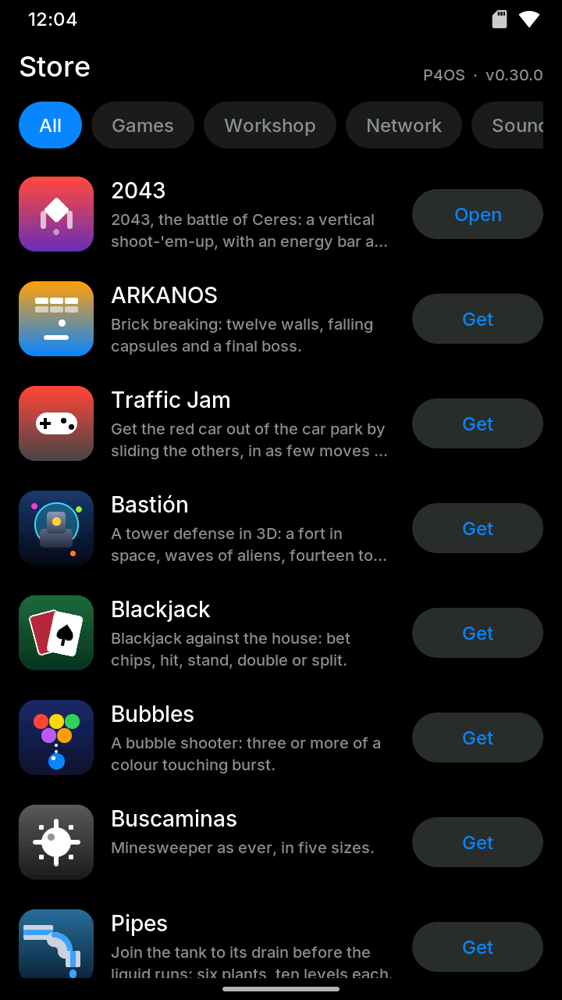
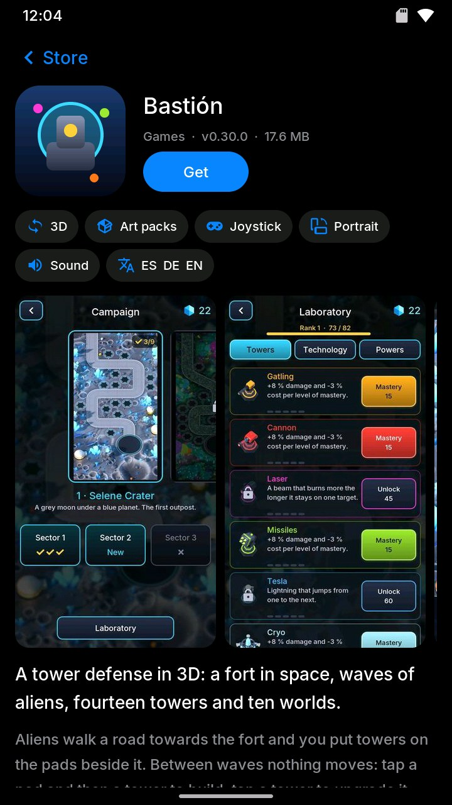
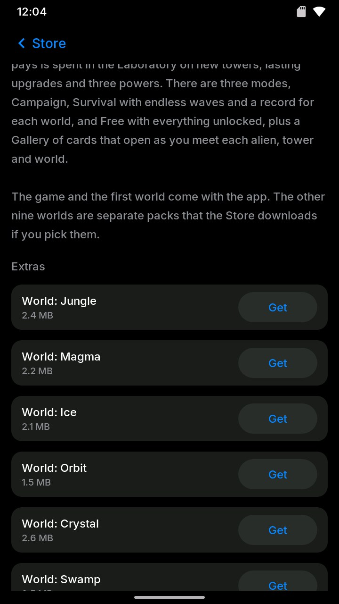
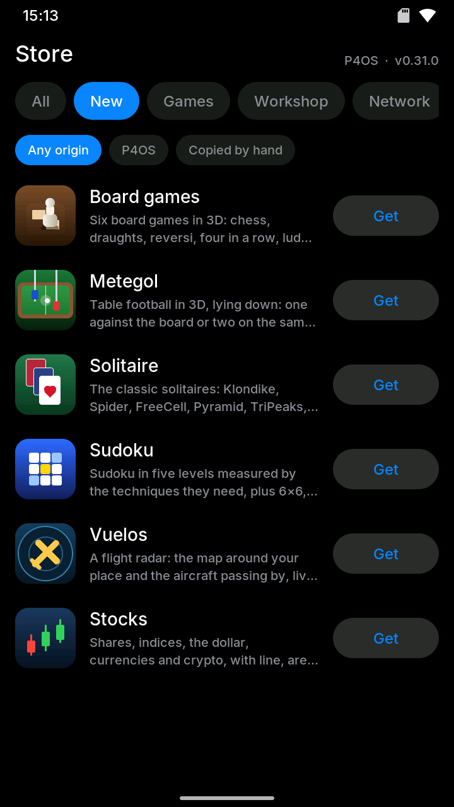
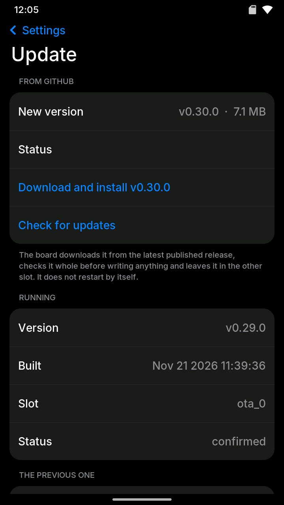
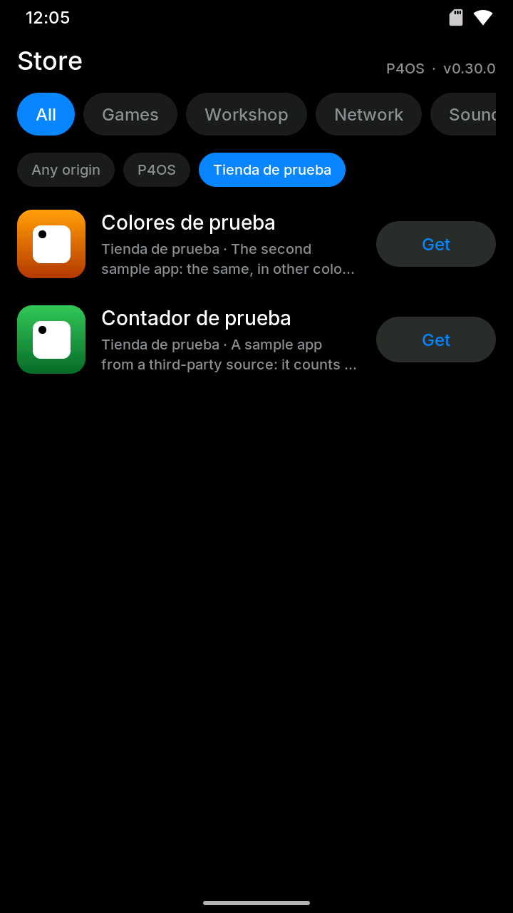
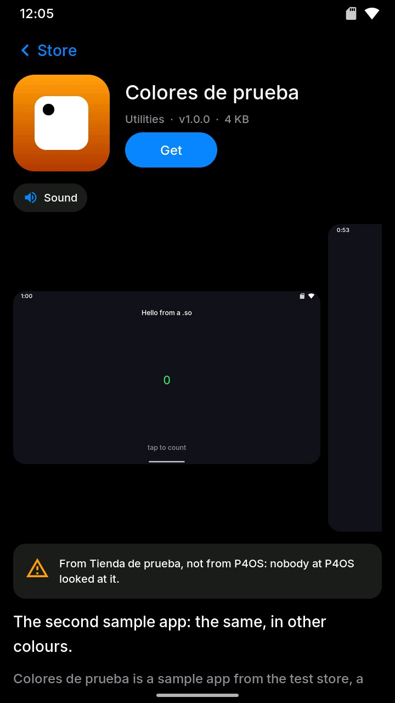
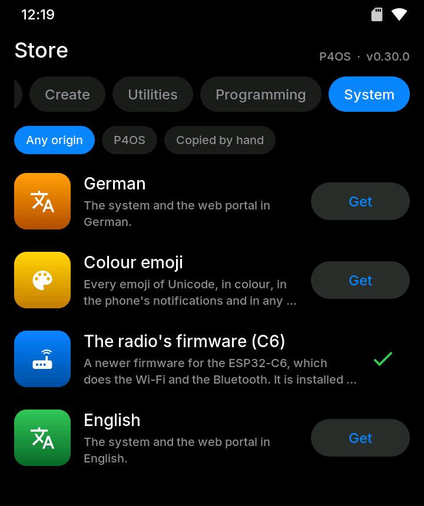

# The Store

Since 0.30.0 P4OS gets its apps by itself. The **Store** (Tienda, in the
interface's own Spanish) reads a catalogue published with each release on
GitHub, lists what there is, and installs, updates and removes apps on the
card: the app, its art packs, its page in the web portal and its
translations. It also offers the system's next firmware, and it can read
other people's catalogues beside the official one.

[INSTALL.md](INSTALL.md) is the step by step for a new board and for one
coming from 0.2x. This is what the Store is and does, and what a catalogue
is made of.

<p align="center">
  
  
  
</p>

## Using it

**The list.** One row an app: its icon, a line about it, and a button that
says what would happen: **Get**, **Update**, **Open**. The chips on top
are the kinds of app (Games, Workshop, Network, Sound and picture, Create,
Utilities, Programming), **Updates** when there are any, **New**,
**Installed**, and **Sources**.

**New** are the apps of the newest release that brought any: they stay
there until a later release brings others, and in the whole list each says
"New" before its line until it is installed. The portal's Store page has
the same filter.

<p>
  
</p>

**An app's page.** Its size (with the packs it cannot start without), its
version, and a row of tags worked out from its code: 3D, Art packs,
Joystick, Portrait or Landscape when it lives only one way, Sound, Uses the
network, Bluetooth, Page in the portal, the languages it speaks, and what
it needs that a board may not have (the 40-pin header, a USB device).
Three or four pictures that slide sideways, the description, what you have
to bring yourself when that is the case (a WAD for Doom, ROMs for the
emulator), and the **Extras**.

**Packs.** The art of a big game is not in its package: it comes in packs,
files of the release, some of them in parts. What the app cannot start
without is downloaded with it. The rest are extras, each with its own
**Get**: the nine other worlds of Bastión, five of the pinball's tables.
A pack whose bytes are already on the card is recognised by its size and
its SHA-256 and not downloaded again.

**Installing** downloads the package to a folder of its own, checks it,
and only then moves its files into place and loads the app: its icon is on
the home screen at once, with no restart. A bar on top shows how far it
is, and the jobs asked for meanwhile wait in line. A download that is cut goes on from
where it was, also after the board restarted.

**Updating.** The Store looks at the catalogue when it is opened, and the
number on its icon is how many installed apps have a newer package.
**Update** takes the old code out and puts the new one in while the board
runs. Whatever the app saved on the card stays, and so do the extras
already installed.

**Removing** asks for a second tap. It deletes what the package and its
packs brought, by the receipt written when it was installed, and leaves
what the app saved.

**The portal** has the same in its **Store** page, at `http://p4os.local`:
the catalogue with a search box, a filter by kind and by origin, the
pictures, install, remove and open, and a button to hand in a `.p4app`.

## What is already on the card

A card that had its apps copied by hand, from `apps.zip` or from a build,
is not a problem, and the Store does not touch it without being asked.

- An app of the catalogue whose `.so` is on the card with no receipt shows
  as **Copied by hand**. "Let the Store manage them", on top of
  **Installed**, writes a receipt for each one whose file is byte for byte
  the catalogue's; the app is not changed. One that differs (a build of
  your own, an older version) stays as it is until it is reinstalled from
  its page, or until **Replace them with the Store's**, under that button
  (two taps), does it for all of them in one job: the catalogue's package
  over each, what the apps saved left alone, the packs the card has not
  downloaded again, and the extras that were copied with them kept as
  theirs when they are the catalogue's (since 0.32.0).
- A `.so` that no catalogue lists (a build of your own, an app that is not
  published) is listed too, by its file's name, as copied by hand. The
  Store knows nothing else about it and offers nothing to do with it.
- A package handed in as a file shows as a **Loose package**, and is
  removed like any other.

When there is more than the official catalogue to tell apart, a second
row of chips filters **by origin**: any, each source by its name, loose
packages, copied by hand.

## The system's firmware

The official catalogue also says which firmware its release brings, an
image for each kind of board. **Settings → Update → From GitHub** shows it
when it is newer than the one running.

- **Download and install** fetches the image to the card (about 7 MB),
  checks it whole against the size and the SHA-256 the catalogue gives,
  and only then writes it to the idle half of the flash. On the board:
  16 s to download, 12 s to erase the slot and 29 s to write it.
- **Restart now** is a tap of yours, twice. Nothing installs or restarts
  by itself.
- The new image boots **on trial**: it is confirmed after 30 seconds up,
  and a crash before that brings the previous one back. "Go back to this
  version", on the same page, does it by hand.
- An app that needs a newer P4OS says so on its page, with a button that
  leads here.

Only the first source, the official one, can offer firmware; a line
saying so in anybody else's catalogue is not read. "Newer" follows the
version the firmware was built with: a release is newer than its own test
tags (`v0.30.0` after `v0.30.0-tienda.2`) and not than a build made some
commits after it. The firmware is not signed, on purpose
([SECURITY.md](SECURITY.md)): the update is as trustworthy as the release
it comes from.

<p align="center">
  
</p>

## Other people's apps

A **source** is the address of a catalogue. The official one is always the
first, and up to five more can be added: somebody else's repository on
GitHub, or any `https://` address that serves the same files.

**Read this before adding one.** An app is native code with every
permission of the system: it reads and writes the card, sees the saved
passwords, and uses the network and the pins. There is no sandbox and
nobody at P4OS looked at what another source publishes. Adding a source is
trusting whoever runs it, as much as you trust this project.

- **Sources are added at the board only**, in Store → Sources → "Add a
  source". Type `user/repository` (its latest release) or a whole address.
  The board fetches the catalogue first and shows who the source says it
  is and how many apps it lists, and then the warning above, to accept or
  not. Nothing over the network can add a source.
- **The portal can propose one**: the address waits on the Sources screen
  of the board, where somebody looks at it and decides.
- **A source cannot replace what another one lists.** An app whose file or
  id is already in a source before it is left out, and the Sources screen
  says how many were. The official source is first, so nothing takes the
  place of its apps; between two others, the one added first wins.
- **Its apps say whose they are**, in the list and on their page.
- **Taking a source off** asks whether its apps go too. The ones that stay
  become loose packages: installed, and no longer updated.
- **The list of sources lives in the board's preferences**, not on the
  card: a card from somewhere else brings no sources with it.

<p align="center">
  
  
</p>

**A single package.** A `.p4app` file installs by the same steps as one
from a catalogue: opened from the Files app (the card or a pendrive), or
chosen on the portal's Store page ("Install a .p4app…"). It may not be an app that a source
offers or installed.

**Developer mode** (Store → Sources, a switch at the board) is for whoever
writes apps. It accepts `http://` sources on a network the board trusts,
and lets the portal put another catalogue in the place of the official
one, a test server's. Off, everything is back to the official catalogue.

## What it checks, and what it does not

Before a package's files reach their place:

- **It is the package that was published:** its size and SHA-256 are the
  catalogue's. A pack too, part by part.
- **It writes only where a package may:** `apps/<file>.so`, the modules
  it loads itself in a folder of `apps/`, a page in `web/`, translations
  in `lang/<code>/`.
  Nothing else, nothing with `..`, and nothing that a package installed
  before owns.
- **This firmware can run it:** the app interface's number is the same,
  the firmware is at least the one the catalogue asks for, and every
  function the `.so` calls is one this firmware lends, checked against the
  file without loading it.
- **A refused package changes nothing:** the card stays as it was.

After that, the loader watches the first time the code runs: an app that
makes the board fall twice in a row while it loads is **set aside** (its
file renamed), the board starts without it, and the Store says so on its
page. Reinstalling is the way back.

What none of this is: a review of what the code does. The checks make
sure the app is the one its source published and that it can run; whether
it is honest is a matter of who published it.

Failures are said in the board's language, with the line for the log
under it: no network, not on the server, the board has no time yet (a
secure connection cannot be checked without the date), the card is full,
not the package that was published, it needs a newer P4OS.

## The parts of the system

Three things the system reads from the card are not apps, and used to be
files to copy. They are in the Store's **System** chip:

| | Where it goes | |
|---|---|---|
| **English**, **German** | `lang/<code>/_sistema.lang`, `_portal.lang` | The web portal in that language (it is only read from the card), and the latest translations of the system, which the firmware also carries |
| **Colour emoji** | `fonts/emoji.pak` | 4012 emoji, 16 MB. They show after a restart |
| **The radio's firmware (C6)** | `firmware/c6.bin` | Getting it only leaves the file there: Settings → Update → "Install on the C6" puts it in the C6 |

A part of the system has no package. It is a list of files, each one a
file of a release with its size and its SHA-256 and the place on the card
it goes to; each is downloaded, checked and moved into place.

- **Only the official source can offer them**, and only into those three
  places. A line saying so in another catalogue is not read.
- **What is on the card already is not downloaded again.** A file copied
  by hand shows as such; **Get** hashes it once, and when it is the
  catalogue's it only writes the receipt.
- **They are not removed from the Store:** nothing says who else uses
  them.
- **The emoji pack is open while the board runs**, and FAT cannot replace
  an open file. A newer pack is left beside it and takes its place at the
  next start, before anything opens it.

<p align="center">
  
</p>

## What it does not bring yet

- **No reviews, counts or accounts:** there is no server behind it, only
  files in a release.
- **Publishing from outside this repository** has no kit yet: building an
  app needs this tree and its firmware's symbol table.

## A catalogue, for whoever publishes one

A source is three kinds of file, laid out as GitHub lays out a release.

**`p4os-store.ndjson`**, at `…/releases/latest/download/`. One JSON object
a line. The first is the source's own:

```json
{"schema":1,
 "source":{"name":"P4OS","by":"…","url":"https://github.com/…","about":{"es":"…","en":"…"}},
 "cats":[{"id":"juegos","name":{"es":"Juegos","en":"Games"}}],
 "release":"v0.30.0",
 "base":"https://github.com/<owner>/<repo>/releases/download/",
 "fw":{"ver":"v0.30.0","images":{"rev1_3":{"url":"v0.30.0/p4os-rev1_3.bin","size":7062112,"sha256":"…"}}}}
```

`base` is where every other address of the catalogue starts from. `fw` is
read from the official source only. `"news":"v0.32.0"`, when it is there,
is the newest release that brought an app: the apps whose line says
`"first":"v0.32.0"` are the store's **New** ones. `tools/gen_store.py`
writes both from `--previous`: an app the previous catalogue did not list
is first seen in the release being made, and keeps that from then on. A
first catalogue, with no previous one, has nothing new. Then a line for
each app:

```json
{"id":"demo.bastion","file":"bastion","name":{"es":"Bastión","en":"Bastión"},
 "about":{"es":"…","en":"…"},"desc":{"es":"…","en":"…"},"cat":"juegos",
 "ver":"v0.30.0","abi":100,"fw_min":"0.29.0",
 "pkg":{"url":"v0.30.0/bastion.p4app","size":155952,"sha256":"…","so_sha256":"…","installed":154861},
 "packs":[{"file":"bastion_p4.pak","need":true,"size":15858105,
           "parts":[{"url":"v0.30.0/bastion_p4.pak","size":7500000,"sha256":"…"},
                   {"url":"v0.30.0/bastion_p4.pak.1","size":7500000,"sha256":"…"},
                   {"url":"v0.30.0/bastion_p4.pak.2","size":858105,"sha256":"…"}]},
          {"file":"bastion_selva_p4.pak","need":false,"name":{"es":"Mundo: Selva","en":"World: Jungle"},"size":2550488,"parts":[…]}],
 "shots":[{"url":"v0.30.0/bastion-1-61724615.jpg","w":320,"h":560}],
 "icon":"<the app's icon, base64>","colors":["1B3A6E","070A18"],
 "feat":["3d","packs","pad","sound","portrait"],"langs":["es","de","en"],
 "license":"Apache-2.0","src":"https://github.com/…/tree/main/apps/bastion"}
```

- A package and every part of a pack **must** give their size and SHA-256:
  one that does not is not installed.
- `ver` is the release the package first appeared in. A package whose
  bytes did not change keeps its version and its address from one release
  to the next, so nobody downloads it again.
- A catalogue is 1 MB at most and a picture 512 KB; a download that goes
  past either is cut. A picture is a baseline JPEG (not progressive) with
  both sides a multiple of 16 pixels.
- A catalogue of a `schema` this firmware does not know is not read, and
  the one it had stays.
- A part of the system is a line with `"sys": true`, no package, and its
  files: `"files":[{"path":"fonts/emoji.pak","url":"v0.28.0/emoji.pak","size":16203453,"sha256":"…"}]`.
  In this repository they are listed in `store/system.json`.

**`<file>.p4app`**, the package: a zip **without compression** whose
paths are the card's, plus a `p4app.json` that says what it is.

```
p4app.json                {"schema":1,"file":"bastion","id":"demo.bastion","name":{…},"abi":100,"fw_min":"0.29.0","files":[{"path","size","sha256"}…]}
apps/bastion.so
apps/bastion/<module>.so  what the app loads itself
web/<page>.js             its page in the portal
lang/en/<id>.lang         its translations
```

It is made the same from the same files, byte for byte, so its SHA-256 is
its identity. Packs and pictures are not inside: they are files of the
release beside it.

**In this repository** all of it comes from what each app says of itself
in `apps/<app>/store.json` ([APPS-P4.md](APPS-P4.md), "In the store") and
from the build:

    python3 tools/gen_store.py check                        # every store.json, as the CI checks them
    python3 tools/gen_store.py build --release v0.31.0 --out out/store
    python3 tools/gen_store.py fw --catalog out/store/p4os-store.ndjson p4os-rev1_3.bin p4os-rev3_x.bin

The CI runs them on every tag and attaches the result to the release. The
board reads the catalogue of the latest **published** release, so a draft
or a pre-release reaches nobody.

**To try a source** without publishing anything:

    python3 tools/store_sample.py --out build/store-sample --base http://<this machine>:18392/prueba/apps/releases/download/
    python3 tools/fake_github.py --dir build/store-sample/release --port 18392 --repo prueba/apps --bind <this machine>

The first builds four small apps that are nobody's and lays out their
catalogue and a loose package; the second serves them as GitHub would,
redirects and all. With developer mode on, the board adds
`http://<this machine>:18392/prueba/apps/releases/latest/download/p4os-store.ndjson`.
`tools/store_cli.py` is the same store in Python, to install from a
catalogue onto a card or a simulator's folder: it is the reference the
firmware's service is tested against (`tests/store_fw_host`, 70 cases).

## From a script

The portal's calls, under the rules of [SECURITY.md](SECURITY.md):

| Call | What it does |
|---|---|
| `GET /api/store` | the state: the sources, every app with its state and origin, the job in hand, how the last one ended, the firmware on offer |
| `GET /api/store/catalog` | the catalogue's text, every source's in turn |
| `POST /api/store/refresh` | fetch the catalogues again |
| `POST /api/store/install` | `{"file":"bastion","packs":"need"}`; packs is `need`, `all`, `none`, or extras by name |
| `POST /api/store/remove` | `{"file":"bastion"}` |
| `POST /api/store/adopt` | a receipt for what was copied by hand and is the catalogue's |
| `POST /api/store/replace` | every app copied by hand that is not the catalogue's, installed over from its source, in one job |
| `POST /api/store/sideload` | the body is a `.p4app`; or `?path=/x.p4app` for one on the card |
| `POST /api/store/propose` | `{"url":"user/repository"}`: left for the board to accept |
| `POST /api/store/firmware` | download the offered firmware and write it to the other slot; `POST /api/ota/restart` runs it |
| `POST /api/store/cancel` | stop the job in hand and drop the queue |

Sources and developer mode are not there: they are changed at the board.

## Measured on the board

| | |
|---|---|
| Download speed, from GitHub over TLS | 0.38 MB/s |
| The catalogue of 58 apps, with descriptions (185 KB), refreshed over the local network | 2.6 s |
| A small app installed from GitHub | 4.0 s |
| Checking a `.so` against the firmware's functions, without loading it | 10 ms |
| Taking an app's code out and putting the new one in | 0.2 s |
| A restart in the middle of a download | it went on from where it was; 459 KB were fetched again |
| The firmware, 7.06 MB: download, erase, write | 16 s, 12 s, 29 s |
| Free internal RAM with the Store in the firmware, 30 s after starting | 209.7 KB |

The plan it was built from, with everything that was measured on the way,
is [docs/plan/TIENDA.md](plan/TIENDA.md), in Spanish.
