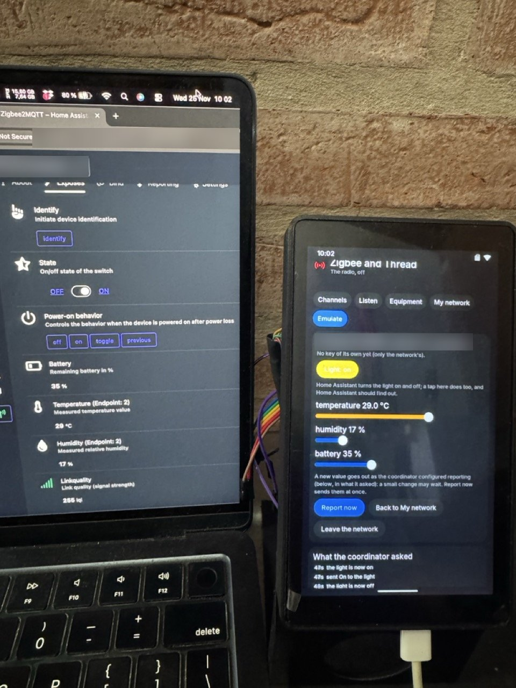

# Notas de la release 0.34.0 (borrador)

Las notas de la release `v0.34.0`, todavía sin publicar: falta lo de
"Cómo se hace", abajo, desde el punto 3. El texto entre las rayas, en inglés como las demás, es el
que va a GitHub. **Lo más importante, por pedido del usuario: que el paso a
paso para actualizar el firmware de la radio (el C6) quede clarísimo.**

---

P4OS 0.34.0 for the [Waveshare ESP32-P4-WIFI6-Touch-LCD-5](https://www.waveshare.com/esp32-p4-wifi6-touch-lcd-5.htm). **The board becomes a Zigbee hub, and the home screen gets drawn icons.** [CHANGELOG.md](https://github.com/charliejgallo/P4OS/blob/v0.34.0/CHANGELOG.md) has every change.

## ⚠️ Updating: this time the radio's firmware too

Zigbee needs **a new firmware in the board's ESP32-C6**, the chip that does the Wi-Fi and the Bluetooth: **3.0.9-154.15**. Without it everything works as before **except the Zigbee app**. It installs from the board itself, **no cable, no computer**, in four steps and in this order:

**1. The board's firmware first.**
Settings → Update → **From GitHub** → 0.34.0. It downloads, is checked, and is written to the other slot; a tap restarts into it. (As every release since 0.31.)

**2. Get the radio's firmware from the Store.**
Store → **System** → **The radio's firmware (C6)** → **Get** (1.5 MB). This only leaves the file on the card (`/firmware/c6.bin`); nothing changes yet.

**3. Install it in the C6.**
Settings → **Update** → **Install on the C6**. What happens, so nothing is a surprise:
- The board checks the file is an image for the ESP32-C6 before sending a byte.
- For **about 15 seconds there is no Wi-Fi** (the C6 is busy receiving it): the portal and the phone lose the board for a moment. That is expected.
- The C6 writes it into its other slot and checks it. **If the power goes or anything fails halfway, the C6 goes on with the firmware it had**: nothing is lost, and you can try again.
- At the end **the board restarts by itself** and is back on the network in about 30 seconds.
- **Do not unplug it while it says it is installing.**

**4. Check it took.**
Open the **Zigbee** app. Under its title it says **"The radio, idle"** (or what the radio is doing), not the orange notice "The radio does not answer: the C6 needs its new firmware". On the web portal, the Zigbee page shows the same in its **Radio** row.

Then, optional, in Store → **System**:
- **Zigbee radio makers** (1.3 MB) and **Tuya devices for Zigbee** (190 KB): the Zigbee app names who made a device's radio, and what 1,400 Tuya devices are and what their values mean ("temperature 21.5 °C" instead of "dp 1: 215").
- **3D toy icons** and **Line icons**: the new icons (below).

Good to know:
- **⚠️ If you also run other firmware on this board** (bmorcelli's Launcher, Arduino sketches, Espressif demos built on esp_hosted 2.x): after this step **they find no Wi-Fi**. A host older than esp_hosted 3 cannot talk to a 3.x C6 (Espressif's migration guide), and P4OS's C6 firmware is 3.0.9. P4OS itself is fine with either. The way back, from P4OS, with no cable: put a 2.x C6 image at the card's `/firmware/c6.bin` and Install on the C6 again (you lose the Zigbee radio). Details: [docs/C6.md, "Other firmware on the board"](https://github.com/charliejgallo/P4OS/blob/main/docs/C6.md#other-firmware-on-the-board), and [issue #2](https://github.com/charliejgallo/P4OS/issues/2).
- **No partition changes, nothing to grow.** The new C6 image (1,495,424 bytes) fits the slots the board leaves the factory with (1.5 MB).
- **The order matters:** the board's firmware first, then the radio's.
- **If something went really wrong** (the board never comes back on the network after step 3, which did not happen in our tests): the C6 can be flashed by cable through its own port, J7: [docs/C6.md](https://github.com/charliejgallo/P4OS/blob/v0.34.0/docs/C6.md), "Recovery".
- **From 0.2x:** as [0.30.0's notes](https://github.com/charliejgallo/P4OS/releases/tag/v0.30.0) say. **A new board:** [docs/INSTALL.md](https://github.com/charliejgallo/P4OS/blob/main/docs/INSTALL.md).

## Zigbee: the board as a hub, a test bench and a fake device

The **Zigbee** app (system) now has five tabs: Channels, Listen and Devices as before, and two new ones.

- **My network.** The board forms its own Zigbee network, with the C6 as its radio, and devices join it: sensors, relays, dimmers, plugs, IR blasters. Each one shows what it is, what it measures and what it reports, named where the board knows the cluster and raw where it does not, so **almost any device can be tried**. Outputs switch with a tap, dimmers have a slider, covers, thermostats, locks and fans their controls, Tuya devices their datapoints. A device can have a name of your own. The list is kept: one that is off shows as "no news" until it speaks.
  - **"Add Zigbee 3.0"** for devices that blink and never finish joining with the plain button (a Tuya IR blaster needed it).
  - **Tuya IR blasters** (TS1201, "Zosung"): learn a code from any remote, keep it with a name, send it with a tap.
- **Emulate.** The board joins **someone else's Zigbee network** (Home Assistant's, through ZHA or Zigbee2MQTT) **posing as a device**: a light, and a temperature, humidity and battery sensor. You see whether the coordinator reads it and drives it, and **every request it makes, in words**. "Back to My network" brings the board's own network back as it was. Tried against Zigbee2MQTT with a Sonoff ZBDongle-E: interviewed, bound, reporting, the light driven both ways.
- **The Infrarrojo app** can send and learn **through a Zigbee IR blaster** instead of the board's LED: its remotes, its air conditioners and SmartIR's whole code library go out through the blaster.
- **The web portal's Zigbee page** has My network and Emulate too, to drive your devices from a phone.

## Drawn icons, in two styles

The home screen, the dock, the folders, the Store and the portal can show **drawn icons** instead of the circle with a symbol: **3D toy** (made in Blender) and **Line** (two colours on a dark tile), 103 apps each, as System parts in the Store. Choose in Settings → Wallpaper → Icons; **"The usual ones" goes back** to the old ones, and an app a pack does not know keeps its usual icon. With a pack on the card and none chosen, the board uses it.

**They cost games nothing:** while a full-screen game runs, the home screen lets go of its icons and the apps waiting in the background close, and the home screen is made again when the game closes. Measured: Planeo opens with 15.8 MB of PSRAM free with the toy icons, against 16.1 MB with the usual ones.

## What else is new

- **The boot hang after an OTA, fixed:** the microSD and the C6 share the P4's one SDMMC controller; a restart in the middle of a card write left the card stuck ("no card, no Wi-Fi"). The card is unmounted before any restart and runs at 20 MHz.
- A row of the portal with a long value wraps on a phone instead of overlapping its label.

## Tried on the board

- **Zigbee, My network:** a door sensor, a water leak sensor, a PIR, a temperature and humidity sensor, a two-relay Tuya module, our own dimmer (DOMCOM) and a Tuya IR blaster, joined, read and driven; the network back by itself after every restart.
- **IR through the blaster:** a TV's code learned, kept and sent (~0.5 s); a command of SmartIR's library sent from Infrarrojo; learning through the blaster from Infrarrojo.
- **Emulate:** against Zigbee2MQTT (ember): joined, interviewed, the light both ways, the values, back after a restart, and Back to My network with the board's 7 devices.
- **The portal's Zigbee page** from a phone.
- **The icons:** the toy pack on the board, and Planeo with it.

Not tried yet: emulating against ZHA, a Tuya TS0601 device (the datapoints' names), the Line icons on the board. The `rev3_x` image: the author's board is rev 1.3.

## The files

As before, a `.p4app` for each app. New System parts: the radio's firmware `c6.bin` (3.0.9-154.15), `zigbee_oui.bin`, `zigbee_tuya.txt`, `juguete.pak` and `linea.pak`, uploaded to [v0.33.0](https://github.com/charliejgallo/P4OS/releases/tag/v0.33.0), where the Store fetches them from, and travelling with this release too. The Translator's language packs stay in [v0.31.0](https://github.com/charliejgallo/P4OS/releases/tag/v0.31.0).

---

## Cómo se hace (lo que falta, en orden)

1. **El pack "línea"**: que el usuario apruebe la tanda de prueba, que la
   sesión de íconos haga las 103 apps y su `linea.pak`.
2. **Hecho el 2026-11-25, con permiso del usuario:** los cinco archivos
   subidos a `v0.33.0` y comparados después con los locales por SHA-256
   (iguales); `gen_store.py packs --tag v0.33.0` movió exactamente esos
   cinco (`c6.bin` de `v0.29.0` a `v0.33.0`, a propósito, y los otros
   cuatro nuevos). Lo que decía el plan:
   **Los archivos de las partes del sistema, a la última release publicada
   (`v0.33.0`)**, con permiso del usuario (es publicar):
   - `c6.bin`: el de `c6/build/p4os_c6.bin` (3.0.9-154.15, 1.495.424
     bytes). **Esta vez `c6.bin` sí se mueve** a `v0.33.0` en
     `store/packs.json`: es el firmware nuevo de la radio. (En las
     releases anteriores se dejaba en `v0.29.0` porque el CI lo
     recompilaba igual.)
   - `zigbee_oui.bin` (`python3 tools/zigbee/gen_oui.py ~/Downloads/oui.csv
     build/zigbee/zigbee_oui.bin`, el CSV bajado a mano del IEEE) y
     `zigbee_tuya.txt` (`build/zigbee/zigbee_tuya.txt`).
   - `juguete.pak` y `linea.pak` (de `tools/icons/out/`).
   - Después `python3 tools/gen_store.py packs --tag v0.33.0`, y **mirar
     el diff de `store/packs.json`** antes de commitear: tienen que entrar
     esos seis y nada más tiene que moverse.
3. `CHANGELOG.md`, `main` y su CI; revisar el catálogo de ese CI (las
   partes del sistema nuevas, `sys-c6` apuntando a `v0.33.0`).
4. El tag `v0.34.0`, su CI (el borrador), la revisión archivo por archivo
   contra el catálogo (como en la 0.33.0), estas notas, y **publicar
   cuando el usuario lo diga**.
5. Después de publicar, en la placa del usuario: Ajustes, Actualización
   desde GitHub; y probar los pasos 2 a 4 de arriba tal cual (su C6 ya
   tiene 154.15, así que la Tienda no debería ofrecerle nada: confirmar
   que no lo ofrece como actualización de más).

## Cómo se hizo (2026-11-25)

- Los cinco archivos subidos a `v0.33.0` (la última publicada), comparados
  por SHA-256 con los locales, y anotados con `gen_store.py packs --tag
  v0.33.0` (`c6.bin` se movió a propósito; nada más).
- `main` en `da4ab480` y su CI, todo verde; su catálogo con las 11 partes
  del sistema.
- El tag `v0.34.0` y su CI: borrador con 77 archivos. Los **455 archivos**
  que nombra el catálogo, buscados en su release con su tamaño, sin un
  error (11 en `v0.34.0`, 117 en `v0.33.0`, 4 en `v0.32.1`, 16 en
  `v0.32.0`, 65 en `v0.31.0`, 214 en `v0.30.0`, 13 en `v0.29.0`, 15 en
  `v0.28.0`); las cinco partes nuevas con el SHA-256 de lo subido; las dos
  imágenes dicen `v0.34.0`. Las notas de arriba, cargadas en el borrador.
- Falta: **publicarla, cuando el usuario lo diga.**

- **2026-11-26:** a las notas publicadas se les sumó, a pedido del
  usuario, el aviso del issue #2 (el Launcher y los firmwares con
  esp_hosted 2.x se quedan sin Wi-Fi con el C6 en 3.0.9, y cómo volver).
