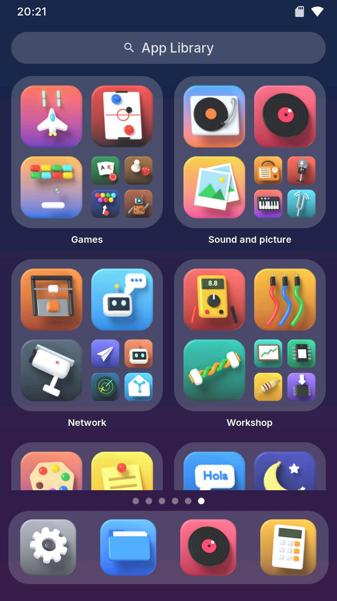
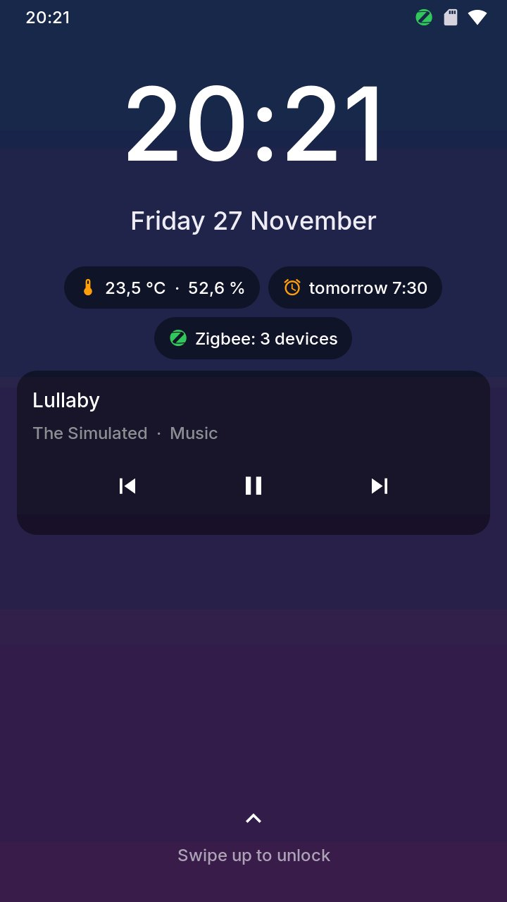

# Notas de la release 0.35.0

Las notas de la release `v0.35.0`, publicada el 2026-11-27 (tag en
`aea80651`). El texto entre las
rayas, en inglés como las demás, es el que va a GitHub. Publicar lo decide
el usuario.

---

P4OS 0.35.0 for the [Waveshare ESP32-P4-WIFI6-Touch-LCD-5](https://www.waveshare.com/esp32-p4-wifi6-touch-lcd-5.htm). **Eight new apps, a Telegram bot of your own, the phone as a gamepad, and an App Library.** [CHANGELOG.md](https://github.com/charliejgallo/P4OS/blob/v0.35.0/CHANGELOG.md) has every change.

 

## Updating

- **The board's firmware:** Settings → Update → **From GitHub** → 0.35.0, as every release since 0.31. Nothing else to do first: no radio firmware this time.
- **The new apps:** Store → **New**. Several need this firmware (the Store says so).
- **The icon packs** (3D toy and Line, now 112 apps) and **the languages** come as updates of the System parts in the Store.
- **From 0.2x:** as [0.30.0's notes](https://github.com/charliejgallo/P4OS/releases/tag/v0.30.0) say. **A new board:** [docs/INSTALL.md](https://github.com/charliejgallo/P4OS/blob/main/docs/INSTALL.md).

## New apps

- **Grabador** (Surveillance): a USB webcam as a security camera. It records H.264 to the card with the board's hardware encoder when something moves, from a few seconds before, with zones, hours and a space limit; tells the Telegram bot; and is an IP camera over RTSP for Frigate, VLC or Cámaras.
- **Visión** (Vision): a USB webcam that sees, on the board itself: faces, people, 80 kinds of thing, hands and their gestures, QR and barcodes.
- **Malla**: a Meshtastic client over USB, TCP or Bluetooth (with the node's PIN): chats, nodes, the map, telemetry. GPL-3.0.
- **Mensajes**: Telegram with your own account, MTProto written in C, no server in the middle.
- **Correo**: mail over IMAP and SMTP, several accounts set up by themselves, a unified inbox.
- **Cielo**: tonight's sky from where the board is.
- **Marcador** (Scorekeeper): seven scorekeepers drawn and sounding like the real thing — matches on green baize for truco, beans on a wooden table, a mechanical tally counter, a stadium scoreboard, a flip card, an abacus, a chalkboard.
- **Botonera** (Soundboard): big buttons for the card's sounds, several at once, with a portal page to play them from the phone.

## The board's Telegram bot

A bot of your own (@BotFather) through which the board answers in a chat: its state, a screenshot, the Zigbee devices with buttons, the IR codes. And **rules**: send a message or a screenshot, switch a device or send an IR code when a door opens, at an hour, at boot or when a notification arrives. Only chats linked with a code the board shows can use it. Set up in the Bot app or the portal's Bot page. [docs/BOT.md](https://github.com/charliejgallo/P4OS/blob/v0.35.0/docs/BOT.md).

## The system

- **The App Library**, the home screen's last page: every app in the Store's categories.
- **Widgets on the lock screen**: the next alarm, the sensors, the Zigbee network (Settings → Lock screen).
- **The phone as a gamepad**: the portal's new Pad page is a stick and buttons, and the board reads it as one more player, so a phone is the second player of the two-player games.
- **The status bar** shows the Zigbee radio (a colour per mode) and the bot.
- **Video plays MP4** (H.264), and Files opens videos in it.
- **Infrarrojo finds which remote** a device takes, trying several buttons at once.
- **Bluetooth pairing with a PIN** for the apps' devices (Meshtastic nodes).
- **The portal shows the icon pack's icons**, and the boot screen has a mark.
- Fixes: the home screen's badges no longer lose their top; Tanques has a way back to its title; Cielo no longer hangs the board; Tortuga leaves no bits of the turtle behind.

---

## Cómo se hace (el orden de `docs/plan/TIENDA.md`)

1. Los packs nuevos a la última publicada: hecho el 2026-11-27 (`v0.34.2`:
   Cielo, los tres de Visión, `juguete.pak` y `linea.pak` con 112 apps),
   comparados por SHA-256, anotados en `store/packs.json` (`c6.bin` se dejó
   en `v0.33.0`) y en `CARRIED_PACKS`.
2. `main` y su CI; revisar su catálogo (las apps nuevas, Cielo y Visión con
   sus packs, las partes del sistema).
3. Tag `v0.35.0` y su CI (borrador).
4. Hecho el 2026-11-27: el CI del tag pasó (borrador con 124 archivos); los
   194 paquetes y packs que nombra el catálogo, cada uno en su release
   (25 en `v0.35.0`, 6 en `v0.34.2`, 1 en `v0.34.1`, 4 en `v0.32.1`, 74 en
   `v0.33.0`, 41 en `v0.31.0`, 15 en `v0.30.0`, 13 en `v0.29.0`, 15 en
   `v0.28.0`), con su tamaño y su SHA-256, sin un error; las 306 capturas
   están; las dos imágenes dicen `v0.35.0`. El catálogo: 85 apps (8 nuevas
   en "Nuevas") y 11 partes del sistema.
5. Estas notas en el borrador, y publicada con el OK del usuario el
   2026-11-27; `releases/latest` sirve el catálogo de `v0.35.0`.
