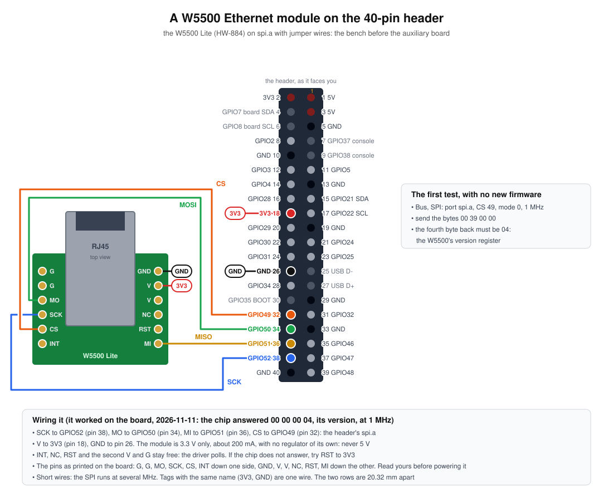
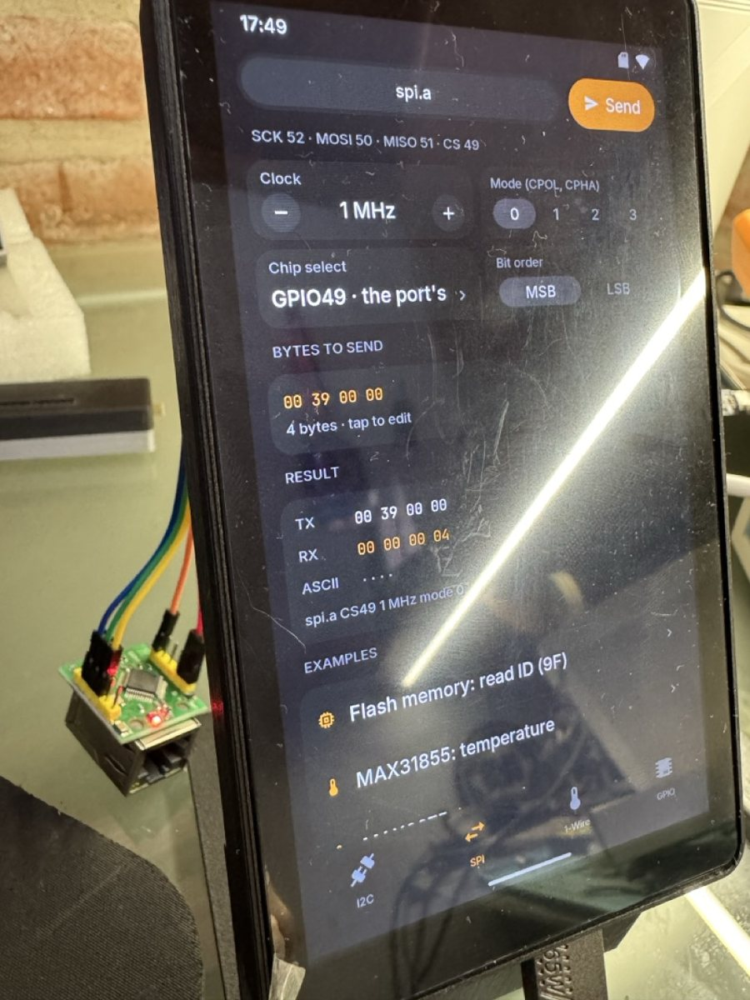
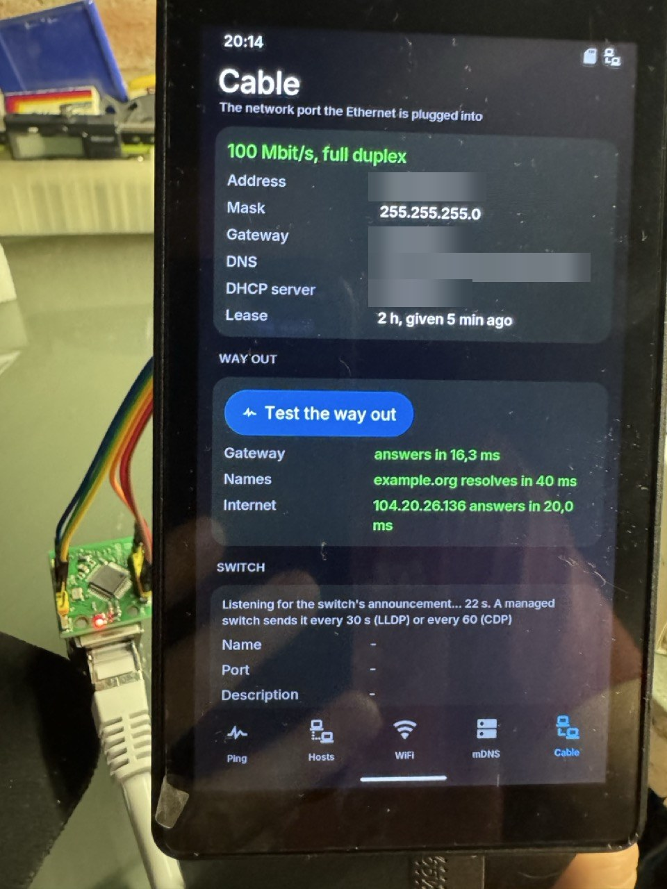

# P4OS — Ethernet por cable

La placa no trae Ethernet. Se le suma con un módulo W5500 por SPI en el
header de 40 pines: hoy con cables, después en la placa auxiliar
([PCB.md](PCB.md)). Como el módulo puede no estar, **Ethernet viene apagado
y se prende desde Ajustes**; nada del sistema lo da por supuesto.

**Estado (2026-11-11): fases 0, 1 y 2 cumplidas en la placa.** El módulo,
cableado al header como en el dibujo, contesta por SPI, y con el firmware
de la rama `ethernet` la placa negocia el enlace, toma dirección por DHCP y
sirve el portal por el cable (abajo, "Lo medido"). La convivencia (fase
2) también: el cable cuenta como red, la placa arranca y sigue sin Wi-Fi,
una app que abre el SPI lo pausa y vuelve solo, y la red por cable se
confía con un interruptor. De la interfaz (fase 3) está escrito y visto
en el simulador: Ajustes, **Redes** (por dónde sale la placa y cada
conexión) y **Ethernet** (el interruptor, el estado, el reloj del SPI, la
confianza), el ícono del cable en la barra, y el aviso en Bus antes de
pausarlo. En la placa: instalado, Ethernet arriba y el ícono del cable en
la barra (visto en una captura de su pantalla); el usuario recorrió Redes,
Ethernet y el aviso de Bus en la placa y se ven bien. **El portal** tiene
a Ethernet en su página "Wi-Fi y Ethernet" (estado, prender y apagar, el
reloj; la confianza no, que se cambia sólo en la placa) y **la app EEPROM**
avisa, donde se elige el puerto, que usarlo pausa a Ethernet: los dos
vistos en el simulador e instalados en la placa (la página nueva es la
que sirve; falta que el usuario la recorra).

**Corrida larga, empezada el 2026-11-11 a las 20:07** con este firmware:
Ethernet a 20 MHz, un enlace desde el arranque, 197 915 bytes de RAM
interna libres a los 42 s.

**Leída el 2026-11-12 a las 09:10, 13 h 3 min después: pasó.** Encendida
46 971 s sin reinicios; el enlace arriba 46 968 s, o sea desde el
arranque, y **levantado una sola vez** (`links` 1): no se cayó en toda la
noche. 100 Mbit/s dúplex completo, sin error y sin pausa. En el registro,
de Ethernet sólo están las líneas del arranque; ningún error de red, del
SPI ni del vigilante. La placa siguió con lo suyo mientras tanto (avisos
de las impresoras, Bluetooth). RAM interna libre: 193 311 bytes, 4 604
menos que a los 42 s, y lo mismo en dos lecturas separadas por 47 s; con
una sola lectura de base tan temprana no se sabe si es algo que se pidió
una vez (el audio de los avisos se abrió después) o una pérdida lenta: a
ese ritmo serían unos 350 bytes por hora. Otra lectura más tarde lo dice.
**Lo dijo: a las 23 h 40 min encendida seguían libres los mismos 193 311
bytes.** No es una pérdida: fue algo que se pidió una vez.

Visto de paso, y no es de Ethernet: el registro tiene 772 veces "1-wire:
reset bus failed: no devices found", una por minuto, de Sensores leyendo
un bus 1-Wire sin nada conectado. Tapa el resto del registro: conviene
avisarlo una vez.

**En `main` desde el 2026-11-12** (0.26.0): la rama `ethernet` se unió
después de esa corrida. Lo que sigue (fase 4 en adelante) va en `main`
como el resto del firmware.

**Fase 4 empezada y primera herramienta de la fase 5, 2026-11-12, en la
rama `ethernet` (sin instalar en la placa):** la pestaña **Cable** de Red,
el probador de boca. Visto en el simulador con un switch de ejemplo; en la
placa falta todo, y en particular lo que sólo ella puede decir: si el
W5500 con el filtro de direcciones apagado entrega las tramas de LLDP y
CDP, y lo que dice un switch de verdad. Abajo, "El probador de boca".

## El módulo

Un "W5500 Lite" (también "Mini W5500", HW-884), visto en las fotos del
usuario:

- 28,5 × 23,5 mm, con el RJ45 (HanRun HR961160C, con transformador)
  sobresaliendo por un extremo.
- Dos filas de seis pines a 2,54 mm, una en cada lado largo. Serigrafía de
  una fila, desde el frente del RJ45 hacia atrás: **G, G, MO, SCK, CS,
  INT**. La otra, según la página del módulo: **GND, V, V, NC, RST, MI**.
- Sólo 3,3 V, sin regulador, unos 200 mA.
- **Las dos filas están a 20,32 mm** (0,8 pulgadas): en el protoboard del
  usuario caen en las columnas C e I, ocho pasos de 2,54. Es lo que ya
  tenían los zócalos de la placa auxiliar (`ETH_ROWS` en
  `hw/aux-board/place.py`).
- **Falta medir:** a cuánto del borde trasero empieza la primera pata, para
  saber cuánto sobresale el módulo de la placa auxiliar; y confirmar en la
  serigrafía el orden de la fila de V y MI antes de darle tensión.

## Cableado de banco

Al puerto `spi.a` del header, con cables cortos (el SPI va a varios MHz).
El dibujo es `docs/img/bench-w5500.svg` (lo arma `tools/bench_diagrams.py`):

| Módulo | Header | GPIO |
|---|---|---|
| V (cualquiera de los dos) | pin 18, 3V3 | — |
| G / GND | pin 33 o 40, GND | — |
| SCK | pin 38 | 52 |
| MO (MOSI) | pin 34 | 50 |
| MI (MISO) | pin 36 | 51 |
| CS | pin 32 | 49 |
| RST, INT, NC | sin conectar | — |

RST queda en alto por el propio módulo: contestó con RST al aire. INT no
se usa: el driver sondea.

## Decisiones de diseño

- **Apagado por defecto.** Se prende en Ajustes; la preferencia sobrevive a
  los reinicios. Con Ethernet prendido y sin módulo, el sistema lo dice
  ("no contesta en spi.a") y sigue: no reintenta para siempre ni traba el
  arranque.
- **Dónde está el chip lo dice `modules.txt`**, como todo en el header:
  `module w5500 spi.a` (y `cs=`, `int=`, `rst=` si no son los del puerto).
  Sin esa línea, Ajustes ofrece agregarla.
- **El puerto SPI es del árbitro de pines.** El driver abre `spi.a` con
  dueño "Ethernet" por el servicio `aos_io_spi_*`: Bus y Módulos lo ven
  tomado, y otra app no lo pisa. El driver de la IDF (`esp_eth`, W5500)
  acepta un SPI ajeno (`custom_spi_driver`), así que no abre el bus por su
  cuenta.
- **Sin pin de interrupción.** El driver sondea (`poll_period_ms`); el pin
  que ahorra vale más que la latencia. Si algún día sobra un pin, `int=`.
- **Cuál es la conexión activa:** la que tiene enlace e IP, por prioridad
  **Ethernet, Wi-Fi, USB**. Es la ruta por defecto de lwIP (`route_prio`:
  el Wi-Fi tiene 100, el USB 5; Ethernet va con 150, no los 50 que trae por
  defecto la IDF). Sacar el cable devuelve la salida al Wi-Fi sin tocar
  nada. Las dos pueden estar arriba a la vez: el portal contesta por
  cualquiera.
- **Ajustes pasa de "Wi-Fi" a "Redes"**: una página con cada interfaz
  (Wi-Fi, Ethernet, el cable USB, la red propia), su estado, su IP y cuál
  es la salida a internet; el Wi-Fi conserva adentro todo lo que tiene hoy.
  Un ícono en la barra de estado cuando la salida es el cable.
- **"Hay red" deja de querer decir "hay Wi-Fi".** Hoy `aos_hal_net_state()`
  es el Wi-Fi, y el vigilante de `main.c` reinicia tras 60 s sin él. Con el
  cable arriba no tiene que reiniciar, y lo que pregunta si hay red (SNTP,
  las apps, el portal) tiene que oír que sí.
- **Sin puente ni NAT entre el cable y el Wi-Fi** salvo que una app lo pida
  (más abajo): por defecto son dos redes que no se ven a través de la
  placa.
- **La MAC** sale de la del chip (eFuse), con otro último byte que el
  Wi-Fi: el W5500 no trae una propia.
- **Seguridad del portal** ([SECURITY.md](../SECURITY.md)): las "redes de
  confianza" se definen hoy pensando en el Wi-Fi. Una red por cable entra
  con la misma regla (su subred, de confianza o no); se revisa en la fase 3
  y se cambia sólo en la placa, como todo ahí.
- **PSRAM primero:** la pila de la tarea del driver y sus buffers van a
  PSRAM; lo que la IDF exija en RAM interna (los buffers DMA del SPI ya son
  del servicio) se anota en `docs/MEMORY.md` con su medida.

## Fases

| Fase | Qué | Cómo se sabe que está |
|---|---|---|
| **0. El chip contesta** ✅ 2026-11-11 | Cablear al header. Sin firmware nuevo: en Bus, SPI, `spi.a`, CS 49, modo 0, 1 MHz, mandar `00 39 00 00` | El cuarto byte de la respuesta es `04` (el registro de versión del W5500): **devolvió `00 00 00 04`** |
| **1. Enlace** ✅ 2026-11-11 | `aos_eth_p4.c` (en `aos_io`): el driver sobre `aos_io_spi`, sondeando, detrás de una preferencia; DHCP; todo al registro. `sdkconfig`: `ETH_USE_SPI_ETHERNET`, `ETH_SPI_ETHERNET_W5500` | La placa toma IP por el cable y contesta ping. Medir: velocidad a 8, 20 y 33 MHz de SPI con los cables del banco, RAM interna que cuesta, CPU |
| **2. Convivencia** ✅ 2026-11-11, salvo lo anotado | Ruta por defecto, el vigilante de red, mDNS y SNTP por el cable, sacar y poner el cable, arrancar sin Wi-Fi, arrancar sin módulo | El portal, la OTA y SSH andan por cable con el Wi-Fi apagado; sacar el cable no reinicia ni cuelga; 12 h prendida sin perder el enlace |
| **3. Interfaz** ✅ 2026-11-11 | Ajustes → Redes; ícono en la barra; `GET/POST /api/eth` y la página Red del portal; IP fija optativa; el módulo en Módulos | Se prende, se apaga y se ve el estado sin tocar un archivo; en el simulador, un Ethernet falso (`P4_SIM_ETH=1`, o `nolink` para el módulo sin cable) |
| **4. Para las apps**, empezada 2026-11-12 | Las apps ya usan sockets y no cambian. Lo nuevo: lista de interfaces con su estado para las herramientas de red (`aos_hal_netif_*`), elegir por cuál sale un socket, modo promiscuo y tramas crudas para las de diagnóstico | Red (la app) muestra las dos interfaces; Modbus TCP, Art-Net y SSH probados por cable. **Hecho:** la lista de interfaces (`aos_hal_netif_list`), los datos del DHCP (`aos_eth_dhcp`) y la escucha del anuncio del switch (`aos_eth_listen`, `aos_eth_neighbor`), exportados a las apps de la tarjeta. **Falta:** elegir por cuál interfaz sale un socket, y las tramas crudas para una app (hoy el firmware sólo guarda el anuncio) |
| **5. Apps de taller** | Las de abajo, de a una. La 1, el probador de boca, probada en la placa salvo el switch (2026-11-12); la 2, encontrar un equipo, en el simulador (2026-11-12) | Cada una con su prueba en el banco |
| **6. Placa auxiliar** | Los zócalos del módulo con sus medidas reales; ver si conviene el chip integrado en la PCBA | El módulo entra en la placa impresa de prueba |

Cada fase termina con lo medido anotado acá y en `PRUEBAS-PLACA.md`.

## Lo medido

**Fase 1, 2026-11-11**, con el módulo en cables Dupont de unos 15 cm y un
cable de red a un switch doméstico. Las descargas se midieron desde una Mac
que está ella misma por Wi-Fi, así que son un piso, no el techo del cable.

- **Enlace:** 100 Mbit/s, dúplex completo, a los 2 s de arrancar el driver;
  dirección por DHCP 1,0 a 1,6 s después. El driver arranca solo al
  reiniciar con la preferencia puesta.
- **El portal por el cable** contesta en la dirección del cable con el
  Wi-Fi también conectado (las dos en la misma subred).
- **Ping** desde la Mac por Wi-Fi: 5 ms de mínimo, 23 de promedio; al Wi-Fi
  de la placa, 7 y 36. El sondeo cada 10 ms entra en esos números.
- **Descarga de un archivo de 3,2 MB de la tarjeta** (`/api/fs/get`), dos
  veces por reloj, todas con el mismo MD5:

  | Reloj del SPI pedido | El que hace el hardware | Descarga |
  |---|---|---|
  | 8 MHz | 8 MHz | 0,49 a 0,52 MB/s |
  | 20 MHz | 20 MHz | 0,72 a 0,75 MB/s |
  | 33 MHz | 34,3 MHz | 0,68 a 0,87 MB/s |
  | 40 MHz | 40 MHz | 0,88 a 0,89 MB/s |

  El mismo archivo por el Wi-Fi de la placa, ese día: 0,24 a 0,25 MB/s.
  Con cables sueltos anduvo sin errores hasta los 40 MHz, el tope del
  servicio SPI. Subir de 8 a 40 MHz no llega a duplicar: el reloj no es lo
  único que frena (el sondeo cada 10 ms, la tarjeta, el servidor HTTP).
  **Queda por medir:** con la Mac por cable, con el sondeo más corto, y la
  subida.
- **RAM:** prenderlo cuesta 12,7 KB de RAM interna (211 503 a 198 779
  bytes libres) y 3,6 KB de PSRAM. Parte es la pila de la tarea de
  recepción (4 KB) y los dos buffers DMA del puerto SPI; falta ver qué del
  resto se puede pasar a PSRAM.

**Fase 2, 2026-11-11**, con el firmware de la rama y el mismo banco:

- **El cable es la red.** Con el Wi-Fi conectado a la vez, la dirección que
  informa el sistema (`aos_hal_net_ip`, `/api/info`) es la del cable, que
  llegó a los 6 s del arranque; el Wi-Fi, a los 10 s.
- **Wi-Fi apagado en la placa:** sigue contestando por el cable, con su
  hora; `p4os.local` se resuelve a la dirección del cable; la del Wi-Fi deja
  de contestar. Ping de 9 a 26 ms, sin pérdidas.
- **Arranque sin Wi-Fi** (RESET con el Wi-Fi apagado): vuelve por el cable
  con la misma dirección, contesta el ping y el nombre; 80 pings en 80 s sin
  perder ninguno, o sea que no reinició pasado el primer minuto.
- **El portal, en ese arranque, manda a HTTPS y pide la contraseña** (302 y
  después 401). No es una falla: las redes de confianza se reconocen por el
  nombre del Wi-Fi (`aos_access_is_trusted(aos_hal_net_ssid())`), y una red
  por cable no tiene nombre, así que la placa se cree fuera de casa. Es lo
  seguro por defecto. **Falta decidir cómo se le da confianza a una red por
  cable** (abajo, en las preguntas abiertas); se cambia sólo en la placa.
- **Sacar y poner el cable de red** (18 s afuera): el enlace cae, la red
  pasa a ser la del Wi-Fi en el mismo instante, y al enchufarlo negocia otra
  vez a 100 Mbit/s, toma la misma dirección 1 s después y vuelve a anunciar
  el nombre por el cable. Sin reinicio.
- **No probado:** el caso que el cambio protege en el vigilante de red, que
  es el Wi-Fi habilitado sin poder conectar con el cable puesto (habría que
  apagar el router); y 12 h seguidas.

**Lo que apareció de paso, y no es de Ethernet:** la preferencia del reloj
no se guardaba porque **el almacén de preferencias de la placa (NVS, 24 KB)
está lleno**: 630 entradas usadas de 756 y ninguna disponible; 422 claves
en `p4os`, la mayoría de las apps (84 de Monster Hop, 30 de Turbo, 26 y 19
de Modbus, 24 de Mila...). Con el almacén así no se guarda ningún cambio de
ninguna preferencia, tampoco las del sistema (`boot_bad` falla en cada
arranque). **Arreglado ese mismo día, en `main`:** las preferencias pasaron
a un almacén propio de 256 KB (`docs/BUILDING.md`, "The preferences are in
`prefs`"); en la placa se movieron las 422 claves y la del reloj quedó
guardada tras un reinicio.

## La interfaz trabada, 2026-11-12

La misma corrida, leída a las 19:47 con 23 h 40 min encendida: **el cable
tenía enlace y no pasaba nada por él.** Lo que dice el registro:

- A las 14 h de encendida (hacia las 10:04 y las 10:26, con el usuario
  trabajando en el banco) el enlace cayó dos veces y volvió a los 2 s; la
  segunda vez tomó dirección por DHCP sin problema.
- Nueve horas justas después de esa última dirección (32 400 s), la
  dirección se perdió con el enlace arriba. La concesión de esa red dura
  2 h (lo mostró después la pestaña Cable) y se renueva a la hora: 32 400 s
  son siete renovaciones de una hora que anduvieron y una concesión de dos
  horas que venció sin renovarse. O sea que **la última renovación buena
  fue hacia las 17:27 y la de las 18:27 ya no tuvo respuesta**: en esa hora
  la interfaz dejó de pasar tramas, sin un solo aviso. (La primera lectura
  de esto supuso una concesión de 9 h y un corte entre las 10:26 y las
  14:56: estaba mal.)
- A las 19:34 el enlace cayó y volvió otra vez, y el DHCP tampoco contestó.
- El Wi-Fi de la placa anduvo todo el tiempo, y al reiniciar la placa el
  cable tomó dirección en 1,6 s: el servidor DHCP estaba y contestaba.

**No se sabe por qué.** Lo que encaja: el W5500 guarda su configuración en
registros que se borran si su alimentación tiembla (cables sueltos en un
protoboard, una mano cerca), y ni él ni el driver de la IDF avisan: el
enlace vuelve solo y el driver sigue sondeando un chip sin zócalo abierto.
No se pudo comprobar: el reinicio borró el estado. El usuario confirmó
después que a todas esas horas estuvo trabajando en el escritorio al lado
de la placa y que los cables pudieron moverse: apoya la explicación, no la
prueba.

**Lo que se hizo: un vigilante en el driver** (`watch_thread` en
`aos_eth_p4.c`). Cada 5 s, con Ethernet andando, lo arranca de nuevo si el
chip ya no tiene la dirección MAC que se le dio (lo reiniciaron), si el
estado de su zócalo no es el que tenía con tráfico, si la dirección se
perdió con el enlace arriba, o si hay enlace y dirección y no entró una
trama en cinco minutos (una vez por silencio: un cable con un solo equipo
callado no es una falla). Arrancar de nuevo cuesta dos o tres segundos de
red. `/api/eth` dice cuántas tramas entraron (`rx`) y cuántas veces lo
arrancó el vigilante (`restarts`), para que la próxima vez haya con qué
mirar.

**En la placa, 2026-11-12 por la noche:** instalado. El vigilante lee el
chip: a los 8 s del arranque anotó el estado del zócalo, `0x42` (MACRAW,
el que tiene que ser), y en el primer minuto y medio entraron 360 tramas
sin que arrancara nada de nuevo. **Sin probar:** que el vigilante actúe. Si al arrancarlo de nuevo el chip
no contesta (sacaron el módulo, sigue sin alimentación), el vigilante
insiste cada 15 s mientras Ethernet esté prendido: venía andando, así que
se lo espera de vuelta. No es lo que pasa al arrancar sin módulo, donde
avisa y no insiste. No hay cómo reiniciar el chip desde
afuera con el cableado de hoy (RST está al aire); en la placa auxiliar RST
sale a una tira y se va a poder.

## El probador de boca (Red, pestaña Cable)

Una pestaña más de Red, no una app de la tarjeta: necesita las tramas que
llegan al chip, y eso es del firmware. Muestra, de la boca a la que está
enchufado el Ethernet:

- **El enlace:** velocidad y dúplex, o por qué no hay (apagado, sin
  módulo, sin cable, en pausa por una app).
- **Lo que dio el DHCP:** dirección, máscara, puerta de enlace, DNS, el
  servidor y la concesión con su edad. El servidor y la concesión salen del
  registro que lwIP guarda del intercambio; los DNS son los de la pila, una
  sola lista para todas las interfaces: con el Wi-Fi arriba a la vez son los
  del último DHCP que contestó.
- **El switch y la boca:** nombre, boca, descripción de la boca, VLAN sin
  etiqueta, si la boca da PoE, modelo y dirección de gestión, leídos del
  anuncio que el switch manda solo (LLDP cada 30 s; CDP de Cisco cada 60).
  Un switch no gestionable no dice nada, y la pantalla lo dice a los 75 s.
- **La salida**, al tocar "Probar la salida": tres pings a la puerta de
  enlace, resolver un nombre de prueba, y tres pings a lo que resolvió (o a
  `1.1.1.1` si no resolvió, para distinguir un DNS caído de una línea
  caída). Los nombres son tres (`example.com`, `.org`, `.net`) y alcanza con
  uno: en la placa del usuario, la primera prueba dio "example.com no
  resuelve" con todo lo demás andando, y era cierto: el DNS de su proveedor
  contesta "no existe" para ese nombre solo (desde la Mac, igual). Una
  herramienta que da la alarma por un nombre no sirve. Sale por la interfaz que la placa esté usando: el cable si está
  arriba.
- **Las interfaces** que tiene la placa, cada una con su dirección, y cuál
  es la salida.

Cómo escucha al switch: los anuncios van a direcciones de grupo que el
W5500 no deja pasar con su filtro prendido (el driver de la IDF dice que
con filtro sólo entran las multidifusiones de IP). Mientras la pestaña está
abierta, el firmware apaga el filtro (`ETH_CMD_S_PROMISCUOUS`): el chip
entrega todo lo que llega a la boca, y una función propia en la entrada
(`eth_input`, antes de lwIP) guarda el anuncio, descarta lo que es para
otra estación y deja pasar el resto. Se apaga sola a los 5 s de que nadie
la pida. La trama se guarda entera (1,5 KB, en PSRAM) y se lee recién
cuando alguien pregunta, fuera de la tarea de recepción, que tiene 4 KB de
pila. El lector (`aos_eth_announce.c`) no le cree nada a la trama: pasó
tres millones de tramas rotas bajo el sanitizador de direcciones sin una
falla.

En el simulador: `P4_SIM_ETH=1` trae un switch de ejemplo que se anuncia
por LLDP a los 3 s (`cdp`: por CDP; `quiet`: uno que no dice nada), con
tramas de verdad armadas ahí y leídas por el mismo código que en la placa.
La prueba de salida del simulador no sale a la red: sus respuestas son de
ejemplo.

*La pestaña en la placa, en inglés, con la prueba de salida hecha. Las
direcciones de la red del usuario están tapadas en la foto.*

**El aviso del switch que no se anuncia** también se vio en la placa: a los
256 s decía "this switch does not announce itself", que es lo esperado en
una red sin switch gestionable.

**En la placa, 2026-11-12:** el enlace, la dirección, la máscara, la puerta
de enlace, los DNS, el servidor DHCP y la concesión se ven y son los de la
red; la prueba de salida anda (puerta de enlace y `1.1.1.1` contestan). La
prueba de nombres, ya con los tres, dio "example.org resuelve en 40 ms". La
escucha del switch quedó "escuchando": el usuario no tiene un switch
gestionable, así que **sigue sin saberse si el W5500 entrega los anuncios**
ni cómo se lee uno de verdad. Falta también saber si conviene dejar la
escucha prendida más tiempo o bajar el sondeo mientras escucha.

## Encontrar un equipo (Red, pestaña Equipo)

La segunda herramienta: una cámara, un PLC, un router o una pasarela de
dirección desconocida, enchufado directo al Ethernet de la placa. Escrita y
vista en el simulador el 2026-11-12; **en la placa falta todo**.

- **Escuchar.** Un equipo se delata al arrancar: pide dirección por DHCP
  con su nombre y lo que dice ser, anuncia por ARP la dirección en la que
  queda, busca a sus vecinos por mDNS, SSDP o NetBIOS, una cámara saluda
  por WS-Discovery (ONVIF). Todo eso va para todos, así que alcanza con
  escuchar. La pestaña lista cada estación oída con su MAC, la dirección
  que dijo tener, el nombre que dio, por qué protocolos habló, la
  dirección que le pidió al DHCP y lo que dice ser.
- **Preguntar.** Para el que no dice nada: "Buscar en redes de fábrica"
  pregunta por ARP por las 254 direcciones de 21 redes /24 con las que
  suelen venir los equipos (192.168.0 a .4, .8, .10, .11, .31, .50, .68,
  .88, .100, .123, .178, .254; 10.0.0, 10.0.1, 10.1.1, 10.10.10;
  172.16.0): 5334 preguntas en un cuarto de minuto. El que tiene la
  dirección contesta aunque la placa esté en otra red, o en ninguna (se
  pregunta sin dirección de origen, como hace una estación antes de tomar
  una). Inunda el cable de preguntas: es para un equipo enchufado directo,
  y la pantalla lo dice.

De quién es una dirección: la MAC de origen de una trama es siempre de la
estación, pero la IP de origen de un paquete ruteado es de alguien lejano.
Por eso la dirección se toma del ARP, que habla por el que lo manda, y de
los paquetes IP dirigidos a todos (difusión o multidifusión), que ningún
router reenvía.

En el firmware: con la escucha prendida, la entrada guarda en un anillo en
PSRAM (24 tramas, sus primeros 600 bytes) lo que va para todos y las
respuestas ARP a la placa; `aos_eth_stations()` las pasa a una tabla de 24
estaciones cuando alguien pregunta, fuera de la tarea de recepción
(`aos_eth_stations.c`, que tampoco le cree nada a la trama: cuatro millones
de tramas rotas bajo el sanitizador, sin una falla). `aos_eth_arp_ask()`
manda la pregunta, una trama cruda de 60 bytes. Las dos están exportadas a
las apps de la tarjeta.

En el simulador: `P4_SIM_ETH=device` es un cable directo a una cámara de
ejemplo, sin red ni DHCP: pide dirección, no se la dan, queda en
192.168.1.64, lo anuncia y saluda por WS-Discovery, y contesta cuando se
pregunta por esa dirección. Con `P4_SIM_ETH=1` hablan el router, una PC
(por NetBIOS) y una impresora (por mDNS) de la red de ejemplo.

**En la placa, 2026-11-12:** el usuario la probó en su red y anda (lista a
los que hablan). Pidió que al tocar un equipo se abra con más datos: hecho
ese día, abajo.

**El detalle de un equipo.** Un toque en uno de la lista lo abre: su
dirección, la MAC (y si es privada, elegida por el equipo y no por su
fabricante), el nombre, lo que dice ser, si contestó al ARP, hace cuánto se
lo oyó y cuántas tramas; cada cosa que dijo explicada en una línea (qué es
ARP, mDNS, SSDP, NetBIOS, WS-Discovery...), con la dirección que le pidió
al DHCP y dónde está su descripción UPnP; y las acciones: **Ping** y
**Ponerme en su red**.

**La red de banco** (`aos_eth_bench`, fase 5, herramienta 3, empezada). El
cable deja de ser un cliente más de la red de la casa y pasa a ser para el
equipo enchufado:

- **Ponerme en su red:** la placa toma una dirección fija al lado de la
  del equipo (su red, host 200; 201 si el equipo es el 200), sin cliente
  DHCP. Sirve para llegarle desde la placa: ping, y las apps que hablan
  con equipos (Cámaras, Modbus TCP, Impresoras).
- **Repartir direcciones:** la placa es `192.168.77.1` y da direcciones
  por DHCP (el servidor de la IDF, el mismo de la red propia del Wi-Fi) a
  lo que se enchufe.
- En las dos el cable **no es la salida** de la placa (prioridad de ruta 3,
  debajo de todo): sigue el Wi-Fi. La placa no cuenta ese cable como "la
  red" y no anuncia mDNS ahí. **No se guarda:** al reiniciar, el cable
  vuelve a ser cliente.
- **Seguridad:** lo que entra por la dirección de banco se juzga con el
  interruptor de confianza de la red por cable, apagado salvo que se
  prenda en la placa. Sin eso, `aos_access_ip_trusted` no reconocía esa
  dirección y la juzgaba con la confianza del Wi-Fi, como si el equipo
  enchufado estuviera en casa. `docs/SECURITY.md`.

Visto en el simulador (la cámara de ejemplo, el detalle, ponerse en su
red, volver). **En la placa falta todo lo de la red de banco**: que el
cable levante con dirección fija, que el servidor DHCP entregue, y que el
Wi-Fi siga siendo la salida.

**Los servicios de banco** (2026-11-12, `nt_bench_*` en `aos_nettools.c`),
tres servidores UDP chicos que se prenden desde la pestaña Equipo:

- **TFTP** le da a un equipo los archivos de la carpeta `banco` de la
  tarjeta: así toma un firmware un router, una cámara o una placa desde su
  cargador de arranque. Sólo lectura, de a un archivo, por nombre pelado
  (sin carpetas ni `..`); bloques de 512, reintenta seis veces; las
  opciones del pedido se dejan pasar.
- **NTP** le da la hora de la placa, sin internet. Si la placa no tiene la
  hora puesta lo dice (estrato 0, "no sincronizado") y nadie se la toma.
- **Syslog** recibe lo que el equipo registra hacia la red y muestra las
  últimas líneas, limpias.

Atienden **sólo en la dirección del cable**, nunca por el Wi-Fi, y se
apagan al cerrar Red o si el cable cambia de dirección.

Probados en el simulador contra clientes de verdad en la misma máquina (ahí
atienden en 127.0.0.1, puertos 6969, 1123 y 5514): `curl` bajó por TFTP un
archivo de 300 KB idéntico al original y uno de 1024 bytes justos (el caso
del último bloque vacío), recibió "no existe" para uno que no estaba y
"acceso" para `../`; la respuesta NTP volvió con la hora al segundo y el
sello del cliente devuelto; tres líneas de syslog llegaron y se ven en la
pantalla. **En la placa falta todo**: los puertos reales (69, 123, 514)
atados a la dirección del cable, y un equipo de verdad pidiendo.

**Compartir la conexión** (herramienta 4 del plan, la mitad: 2026-11-12).
"Compartir el Wi-Fi" en la tarjeta Red de banco: la placa reparte
direcciones en el cable como antes y además le da salida a internet a lo
que se enchufe, por su Wi-Fi, con traducción de direcciones (NAT). Para un
equipo sin Wi-Fi propio.

- En el firmware: lwIP se compila con reenvío y NAT
  (`CONFIG_LWIP_IP_FORWARD`, `CONFIG_LWIP_IPV4_NAPT`), que antes no tenía.
  Dejado a su suerte, lwIP pasaría paquetes entre todas las redes de la
  placa (el Wi-Fi de la casa, el cable, el USB, la red propia). **No lo
  hace:** antes de reenviar nada lwIP le pregunta a P4OS
  (`aos_ip4_canforward`, enganchado con `aos_lwip_hooks.h`), que dice que
  no salvo que se esté compartiendo y el paquete venga de la red
  compartida o sea una respuesta para ella. Con la función apagada la placa
  no reenvía nada, como antes.
- `aos_hal_net_share_on()` prende el NAT en la interfaz de la red
  compartida y hace que su servidor DHCP ofrezca los DNS que usa la placa.
- **Lo que hay que saber:** el equipo enchufado llega a internet y también
  a los demás equipos de la red de la casa, como cualquiera que esté en ese
  Wi-Fi. La pantalla lo dice.
- **Sin probar en nada:** el simulador no tiene pila de red propia, así
  que esto sólo se puede ver en la placa: que el equipo enchufado reciba
  dirección y DNS, que navegue, y cuánta RAM cuestan las tablas del NAT.

**La otra mitad: la red propia sale por el cable** (2026-11-12). Ajustes,
Redes, Wi-Fi, "Compartir la salida", debajo del punto de acceso. Los que se
unen a la red Wi-Fi de la placa salen por donde sale la placa: el cable, o
el Wi-Fi de la casa si está conectada. Un punto de acceso de emergencia
donde hay un cable y no hay Wi-Fi.

- Es el mismo NAT y la misma regla de reenvío, con la red propia como la
  red compartida (`aos_hal_net_ap_share_set()`, preferencia `ap_share`).
  Apagado hasta que alguien lo prende en la placa; no está en el portal; se
  conserva al reiniciar, como el punto de acceso.
- **Una traducción a la vez.** `aos_net_p4.c` decide a quién se comparte
  (`share_apply`): primero la red que pidió alguien ("Compartir el Wi-Fi"
  del banco), si no la red propia cuando está levantada y con el
  interruptor puesto. Cuando lo del banco termina, la red propia recupera
  su turno sola. Ajustes dice cuál de las tres cosas pasa: comparte, espera
  al banco, o la placa no tiene por dónde salir.
- El servidor DHCP de la red compartida ofrece el DNS de la salida, y se le
  vuelve a decir cuando la salida aparece después (se enchufó el cable con
  la red propia ya prendida). Sólo entonces: decírselo lo reinicia.
- **Lo que hay que saber:** con esto prendido, la contraseña de la red
  propia es lo único entre un extraño y las redes en las que está la placa.
  La pantalla lo dice, y `docs/SECURITY.md` también.
- **Sin probar en la placa:** nada de esto corrió en la placa todavía. En
  el simulador sólo se ve el interruptor y lo que dice la pantalla. Falta:
  que un teléfono unido a la red propia reciba DNS y navegue por el cable,
  que siga andando al sacar y poner el cable, y el turno con "Compartir el
  Wi-Fi".

**El fabricante y los puertos, en el detalle de un equipo** (2026-11-12).

- **Fabricante:** los tres primeros bytes de la MAC, buscados en el
  registro de la IEEE si está en la tarjeta como `/redes/oui.txt`, el mismo
  archivo que usan los barridos del portal (el `oui.txt` de la IEEE tal
  cual, o líneas `AA:BB:CC<tab>Nombre`). Son megas de texto: lo lee un hilo
  aparte (`nt_maker_ask`), una vez por prefijo. Sin el archivo, la fila
  dice dónde ponerlo; una MAC privada (elegida por el equipo) no se busca.
- **Puertos 1-1024:** el mismo escaneo de Hosts (`nt_ports_start`), sobre
  la dirección que dijo el equipo. La placa tiene que poder llegarle: en la
  misma red, o después de "Ponerme en su red".
- Probado en el simulador con el equipo inventado (`P4_SIM_ETH=device`,
  que ahora tiene una MAC del rango reservado para documentación): con el
  archivo dice el fabricante, sin el archivo dice dónde ponerlo. El botón
  de puertos no se apretó: escanearía una dirección de verdad. **En la
  placa falta todo.**

**Lo que sigue:** recibir archivos por TFTP (respaldos), y que los
servicios puedan seguir con Red cerrada.

## Mirar el tráfico (Red, pestaña Cable, sección Tráfico)

La herramienta 6 del plan, 2026-11-12. "Capturar a la tarjeta" guarda cada
trama que llega a la boca en un archivo pcap en la carpeta de barridos
(`/redes`), que se baja con el explorador del portal y se abre con
Wireshark, y mientras tanto cuenta y avisa:

- **Cuenta:** tramas para todos (ahora por segundo y en el peor segundo),
  y cuántas son ARP, DHCP, IPv4 e IPv6.
- **Avisa** de lo que una red no tiene que tener: **dos servidores DHCP**
  contestando (y cuáles), **una dirección reclamada por dos equipos** (y
  sus MAC), y **una tormenta de difusión** (300 o más tramas para todos por
  segundo, tres segundos seguidos).
- En un switch llega lo que va para todos y para la placa; para verlo todo
  hace falta un puerto espejo. Lo que manda la placa no queda en el
  archivo.

En el firmware: con la captura prendida el chip entrega todo (igual que al
escuchar al switch). La tarea de recepción sólo copia la trama a una de
128 casillas en PSRAM (190 KB, pedidos la primera vez); un hilo con la pila
en PSRAM las saca, las cuenta y las escribe, porque la tarjeta es lenta y
se traba. Lo que no entra se cuenta como perdido y se dice. Para a los
16 MB, o a los 5 s de que nadie pregunte cómo va (o sea, al salir de la
pestaña). El lector (`aos_eth_watch.c`) pasó cuatro millones de tramas
rotas bajo el sanitizador sin una falla.

En el simulador: la captura escribe un pcap de verdad con tráfico de
ejemplo; `P4_SIM_ETH=storm` es una red con todo mal a la vez. Probado así:
los tres avisos aparecieron, y `tcpdump` leyó el archivo (4045 tramas, las
dos respuestas DHCP decodificadas).

**En la placa, 2026-11-12:** el usuario la dejó capturando 8 min 53 s en la
red de su casa. 4540 tramas, 914 KB, **ninguna perdida**, sin avisos. El
archivo, bajado por el portal y leído registro por registro: cabecera
correcta, 4540 registros (los que contó la placa), ni un byte de más, 532 s
de punta a punta, la trama más larga de 1465 bytes; unas 3 tramas por
segundo para todos. La RAM interna no se movió y el vigilante no actuó.
De paso contesta la duda del probador de boca: **con el filtro apagado el
W5500 entrega también las tramas de grupo que no son IP** (la mitad de lo
capturado no era ni ARP ni IP), así que los anuncios LLDP y CDP de un
switch tendrían que llegar. Falta la otra punta: una red cargada, para
saber a cuántas tramas por segundo empieza a perder.

## Medir un enlace: el cable contra el Wi-Fi (Red, pestaña Cable)

La herramienta 7 del plan, 2026-11-12. Dos medidas, para decidir si un
equipo necesita cable:

- **Comparar:** diez pings a la puerta de enlace por el cable y diez por
  el Wi-Fi, uno al lado del otro: media, mínimo, máximo y perdidos. Cada
  tanda sale desde la dirección de su interfaz; con el socket atado a una
  dirección, la pila de la IDF elige la interfaz por el origen
  (`ip4_route_src_hook`), que es lo que hace que el del Wi-Fi no salga por
  el cable aunque el cable sea la ruta por defecto. Es lo que faltaba de la
  fase 4 ("elegir por cuál interfaz sale un socket"), resuelto sin API
  nueva: atar el socket a la dirección de la interfaz.
- **Medir velocidad:** la placa escucha en el puerto 5001 y cuenta lo que
  le mandan. Desde una computadora, `iperf -c <dirección>` (iperf 2, no
  iperf3) mide el camino de la computadora a la placa, y la dirección
  elegida dice por cuál interfaz: la del cable o la del Wi-Fi. La pantalla
  guarda la última medida de cada una.

El receptor es un socket crudo que no puede pedir contraseña: toma una
conexión sólo si llegó por una red donde el portal abre sin contraseña (la
misma regla que el puente del Programador), y avisa a quién rechazó.

En el simulador: la comparación es de ejemplo (no tiene interfaces de
verdad); el receptor sí es de verdad, en 127.0.0.1, y midió lo mismo que
vio el emisor. **En la placa falta todo**, y sobre todo lo que sólo ella
dice: que el ping atado a la dirección del Wi-Fi salga de verdad por el
Wi-Fi con el cable arriba.

**En la placa, 2026-11-12** (el usuario, con la Mac por Wi-Fi: no tiene
placa de red por cable):

- **Comparar anda, y los dos salen por donde tienen que salir.** Por el
  cable 10,2 ms de media (de 8,92 a 10,3), por el Wi-Fi 26,2 ms (de 4,56 a
  117), ninguno perdido de diez. Son distintos, así que el ping atado a la
  dirección del Wi-Fi sale por el Wi-Fi con el cable arriba.
- **Lo que dice ese número del cable:** 10 ms clavados no es la red, es la
  placa. El driver le pregunta al chip cada 10 ms si llegó algo (`POLL_MS`,
  no hay pata de interrupción), y eso es lo que tarda en enterarse de la
  respuesta. El mejor ping del Wi-Fi (4,56 ms) le gana al mejor del cable.
- **Medir velocidad anda** (la regla de acceso dejó pasar a la Mac): **por
  el cable 1,5 Mbit/s** (2,0 MB en 11 s), por el Wi-Fi 3,1 Mbit/s (4,0 MB
  en 11 s), los dos con la Mac por Wi-Fi. Recibir por el cable es lento, y
  lo más probable es el mismo sondeo: entre una pregunta y la siguiente la
  computadora puede mandar una ventana TCP entera (23 KB) y el chip guarda
  16 KB, así que se pierden tramas y TCP frena. No está medido: es lo que
  cierra con los números. Bajar una página del portal por el cable había
  dado de 4 a 7 Mbit/s: mandar no tiene ese problema.

**El sondeo a 2 ms, 2026-11-12 por la noche:** cambiado (`POLL_MS`) e
instalado; el registro dice "polled every 2 ms", el vigilante lee el chip
como antes y la RAM interna no se movió. Medido desde la Mac, que está por
Wi-Fi, no se distingue: 150 pings a la dirección del cable dieron mediana
24,9 ms antes y 20,9 después, con el mismo ruido del Wi-Fi de la Mac en los
dos. Bajar un archivo de 892 KB del portal por el cable da 0,62 a
0,68 MB/s, lo de antes: mandar no dependía del sondeo. **Falta lo que lo
decide:** repetir "Comparar" en la placa (el ping del cable tendría que
bajar de 10 ms a 2 o 3) y `iperf` hacia la dirección del cable.

**Las dio el usuario, dos veces, y fueron peores, no mejores:** por el
cable 63,3 ms de media (de 10,1 a 150) y 38,6 (de 8,33 a 94,7); por el
Wi-Fi 62,5 y 85,6; recibiendo por el cable 1,1 y 0,9 Mbit/s. **La
explicación del sondeo estaba mal**, o no era lo principal: con el chip
consultado cada 2 ms el mejor ping del cable siguió en 8 a 10 ms. Por qué
empeoró todo, el Wi-Fi también, no se sabe.

**Lo que se encontró leyendo el driver de la IDF.** Cada trama, entre o
salga, termina con una orden al chip (un registro que el chip borra cuando
la tomó). El driver escribe la orden, mira el registro una vez y, si
todavía no está borrado, **duerme 10 ms** antes de volver a mirar
(`w5500_send_command`). Si el chip tarda apenas más que una lectura SPI en
tomar la orden de "ya leí esta trama", cada trama recibida llega 10 ms
tarde y entran cien por segundo como mucho: un ping de 10 ms y 1,2 Mbit/s
con tramas enteras, que es lo que se midió. Mandar no lo sufre igual: 4 a
7 Mbit/s.

**Lo que se hizo:** la espera se hace en nuestra capa SPI (`spi_write` en
`aos_eth_p4.c`): después de escribir una orden mira el registro cada pocos
microsegundos hasta que se borra, y el driver lo encuentra borrado.
`/api/eth` dice cuántas órdenes hubo, cuántas no estaban tomadas a la
primera mirada y cuántas miradas llevó la peor (`cmds`, `cmds_waited`,
`cmd_looks_max`): si la hipótesis es cierta, casi todas esperaron.
**Compilado, sin instalar ni probar.** El sondeo quedó en 2 ms; si con
esto el Wi-Fi sigue peor que al principio, vuelve a 10.

**Instalado, y los contadores dicen que tampoco era eso:** de 3579 órdenes
al chip, ninguna estaba sin tomar a la primera mirada (`cmds_waited` 0, la
peor llevó una sola). El driver nunca durmió esos 10 ms. Segunda
explicación equivocada.

**Lo que queda en pie, y lo que no.**

- El ping de la placa a la puerta de enlace por el cable, con el sondeo en
  10 ms, da 10 ms clavados: eso sí es el sondeo (el ping sale 200 ms
  después de la respuesta anterior, o sea en fase con las preguntas al
  chip, y la respuesta espera un período entero). No dice nada de la red.
- "Recibir por el cable es lento" **no está establecido.** Las medidas de
  velocidad se hicieron con la Mac por Wi-Fi: todo lo que mandó pasó
  primero por su Wi-Fi, y esa noche los pings de la Mac a la placa iban de
  5 a 140 ms. 1,5 Mbit/s por el cable y 3,1 por el Wi-Fi pueden ser, los
  dos, el Wi-Fi de la Mac.
- Si 2 ms es mejor o peor que 10 **no se pudo saber**: las corridas de
  antes y después se hicieron en condiciones distintas (el Wi-Fi también
  dio dos o tres veces peor en las de después), y tres muestras de 150
  pings desde la Mac dieron medianas de 24,9, 20,9 y 6,6 ms sin que el
  último cambio hiciera nada.

**Cómo queda:** el código vuelve a lo conocido, sondeo cada 10 ms y sin la
espera propia ni sus contadores, que no servían. **Lo que hace falta para
decidirlo bien** es una computadora por cable del otro lado (el usuario va
a comprar un adaptador USB): ahí se miden la latencia y la velocidad del
cable sin Wi-Fi en el medio, con 10 y con 2 ms.

**Lo que sigue de acá:** esas medidas con la computadora por cable; y, en
la placa auxiliar, llevar la pata INT del módulo a un GPIO, que hoy sale a
una tira suelta.

**Falta de esta herramienta:** que la placa sea la que manda (cliente
iperf hacia un servidor), y medir también de la placa hacia afuera.

## El vigía y Wake-on-LAN (Red, pestaña Vigía)

La herramienta 8 del plan, la última, 2026-11-12. Una lista de los equipos
del taller, y de cada uno si está prendido. Anda con el cable o con el
Wi-Fi solo.

- **La lista** es un archivo de texto en la tarjeta, `/redes/vigia.txt`,
  una línea por equipo: nombre, dirección o nombre de red, MAC y puerto,
  separados por tabuladores. Hasta 16. Se edita desde la pantalla o a mano
  desde el portal.
- **Mirar:** cada diez segundos, mientras la pestaña está abierta, un ping
  a cada uno (o un intento de conexión a un puerto TCP, si se lo agregó
  como `equipo:puerto`): prendido con su tiempo, o sin respuesta y hace
  cuánto.
- **Agregar:** por su dirección o su nombre, o con el botón **Vigilar** del
  detalle de un equipo en Hosts o en Equipo, que trae también su nombre y
  su MAC.
- **Despertar:** el paquete mágico de Wake-on-LAN (seis bytes FF y la MAC
  dieciséis veces, UDP al puerto 9) a la difusión de cada red en la que
  está la placa, tres veces. Hace falta la MAC, que se aprende sola de la
  tabla ARP la primera vez que el equipo contesta en la misma red, y se
  guarda en el archivo; y que el equipo tenga Wake-on-LAN habilitado.

En el simulador: los estados son de ejemplo y no se manda nada a la red;
probados la lista, quitar, el botón de despertar cuando hay MAC y el equipo
no responde, y el alta desde Equipo, que dejó en el archivo el nombre, la
dirección y la MAC de la cámara de ejemplo. **En la placa, 2026-11-12:** el
usuario lo probó y anda.

De paso, en la pestaña Equipo la lista de equipos quedaba en vertical
debajo de las tarjetas de banco: ahora va arriba de ellas; y un toque en el
renglón de la dirección de un equipo no lo abría (lo tapaba una caja): ya
lo abre.

## Qué gana el taller con un cable de red

Ordenadas por lo que más resuelve en un banco. Varias necesitan la fase 4.

1. **Probador de boca y de cable.** Enchufar y ver: hay enlace o no, a qué
   velocidad y dúplex negoció, qué ofrece el DHCP (servidor, máscara,
   puerta de enlace, DNS, cuánto dura), si se llega a la puerta de enlace y
   a internet, y **a qué switch y a qué boca está enchufado** (LLDP y CDP,
   que los switches administrables anuncian solos). Es lo que hace un
   probador de red de mano.
2. **Encontrar un equipo de IP desconocida.** Una cámara, un PLC o un
   router enchufado directo a la placa: escuchar lo que dice al arrancar
   (ARP, DHCP, mDNS, SSDP, ONVIF) y probar las subredes de fábrica más
   comunes, hasta dar con su IP y su MAC (y el fabricante por la MAC).
3. **Red de banco.** La placa como servidor DHCP de un equipo enchufado
   directo, con **TFTP** para darle un firmware, NTP para darle la hora sin
   internet, y un receptor de syslog para leer lo que dice. Se junta con el
   Programador ([PROGRAMADOR.md](PROGRAMADOR.md), F7, U-Boot por consola):
   la consola por `uart.b` y el firmware por el cable, que es como se
   recupera un router o una cámara.
4. **Compartir la conexión** (NAT de lwIP), en los dos sentidos: dar
   internet por cable a un equipo sin Wi-Fi usando el Wi-Fi de la placa, o
   levantar la red Wi-Fi propia de la placa con salida por el cable (un
   punto de acceso de emergencia en el taller).
5. **Lo que ya existe, por cable.** Modbus TCP y su pasarela a RS485,
   Art-Net y sACN en DMX y Luces, las cámaras, SSH, el puente serie del
   Programador: todo eso anda hoy por Wi-Fi y con el cable deja de depender
   de la señal. Una pasarela Modbus o un nodo Art-Net fijos en un tablero
   quieren cable.
6. **Mirar el tráfico.** Capturar a un `.pcap` en la tarjeta lo que llega a
   la boca (con un puerto espejo en el switch, todo), con contadores:
   broadcast por segundo, dos servidores DHCP en la misma red, dos equipos
   con la misma IP, una tormenta. Un solo puerto no se pone en el medio de
   un cable: ve lo que el switch le manda.
7. **Medir un enlace.** Un servidor y un cliente de iperf, y la comparación
   lado a lado del cable contra el Wi-Fi desde el mismo lugar (latencia,
   pérdida, velocidad): sirve para decidir si un equipo necesita cable.
8. **Wake-on-LAN** y un vigía: lista de equipos del taller con ping o
   puerto, quién está prendido, despertarlos.

Con el Wi-Fi solo, sin cable, ya salen la 7 (parte), la 8 y la mitad de la
2 (lo que se anuncia por mDNS y SSDP): se pueden adelantar.

**Límites que conviene saber:** el W5500 por SPI da del orden de 10 a
20 Mbit/s, no 100; es un solo puerto; no entrega ni toma PoE; y el modo
promiscuo ve sólo lo que llega a esa boca.

## La confianza en la red por cable

**Decidido por el usuario (2026-11-11): un interruptor en la placa.** En
Ajustes, Portal web, "La red por cable: de confianza", apagado de fábrica
y visible sólo con Ethernet prendido. Apagado, lo que entra por el cable se
trata como una red ajena (portal cerrado o con contraseña, HTTPS, sin
anunciar el nombre); prendido, como un Wi-Fi de confianza.

Al escribirlo apareció un agujero que había abierto la fase 2: como "hay
red" pasó a incluir al cable, con el Wi-Fi en una red de confianza **todo lo
que entraba por el cable se tomaba también por de confianza**, fuera la red
que fuera (y con el Wi-Fi recién apagado, por el nombre de la última red).
Ahora cada conexión se juzga por la interfaz por la que entró
(`aos_access_ip_trusted`): la del cable por su interruptor, las demás por
el nombre del Wi-Fi. Lo usan el portal, SSH y el puente serie del
Programador. `docs/SECURITY.md` tiene la tabla.

**En la placa (2026-11-11),** con el Wi-Fi en una red de confianza, el
cable en la misma red y el interruptor apagado: el portal contesta por la
dirección del Wi-Fi (200) y por la del cable manda a HTTPS (302), que es la
red ajena; el nombre `p4os.local` se anuncia sólo por el Wi-Fi y se resuelve
a esa dirección. Con el interruptor prendido en la placa, sin reiniciar: el
portal contesta también por la dirección del cable (200) y el nombre pasa
a anunciarse por las dos.

## El puerto SPI, compartido o no

Pedido del usuario (2026-11-11): que quede claro qué pasa con `spi.a`
cuando Ethernet está prendido, y avisar o apagar Ethernet si otra cosa lo
necesita.

**Lo que hace hoy el código:** Ethernet abre `spi.a` con dueño "Ethernet"
y el árbitro de pines le da los tres hilos a él solo. Mientras está
prendido, **nadie más puede abrir `spi.a`**: Bus (pestaña SPI), la app
EEPROM y el servicio de sensores (una termocupla MAX6675 o MAX31855
declarada ahí) reciben "GPIO52 lo tiene Ethernet". Cambiar el reloj en Bus
no puede afectar a Ethernet porque Bus ni llega a abrir el puerto; y aunque
lo abriera, cada dispositivo SPI tiene su propio reloj: el de uno no cambia
el del otro. Lo que sí pasaría al compartir es otra cosa: mientras otro
dispositivo usa los hilos, Ethernet espera, y una transferencia larga o
lenta (leer entera una memoria flash a 1 MHz) lo deja sin atender varios
segundos.

**Decidido por el usuario (2026-11-11): que Ethernet no le saque el SPI al
banco.** Una EEPROM, una radio LoRa, un lector RC522 o Bus tienen que
poder usar el puerto como siempre. Quedó así, y está escrito:

- **Los sensores comparten.** El servicio de sensores abre su chip en el
  mismo puerto con Ethernet andando (otro chip select, su propio reloj, unos
  bytes por ronda). Los hilos son del que llegó primero y pasan al otro
  cuando ese se va.
- **Una app se lleva el puerto entero.** Cuando Bus, EEPROM o cualquier app
  abre el puerto, **Ethernet se pone en pausa** mientras lo tenga, y vuelve
  solo cuando el puerto queda libre. La pantalla lo dice las dos veces
  ("Ethernet en pausa: spi.a lo usa Bus SPI", "Ethernet volvió") y
  `GET /api/eth` lo informa (`paused`, `paused_by`).
- Mientras dura la pausa la salida a internet vuelve al Wi-Fi, si lo hay.

**En la placa (2026-11-11):** con Ethernet arriba, varios envíos seguidos
desde Bus (pestaña SPI, `00 39 00 00`) contestaron `04`; Ethernet se pausó
una vez, con su aviso, y volvió 8 s después del último envío: enlace a los
2 s, dirección 1 s más tarde. La primera versión volvía al instante: Bus
abre el puerto sólo durante cada envío, la pausa duraba 4 ms y la red se
cortaba 3 s por envío, con el aviso de pausa tapado por el de vuelta. Por
eso espera a que nadie pida el puerto durante 8 s (`RESUME_MS`).

Lo que falta: que Bus y EEPROM avisen **antes** de
abrir el puerto, no sólo cuando ya pausaron (fase 3, con la interfaz);
probar los sensores compartiendo el puerto (hace falta una termocupla); y,
para una app que quiera convivir con Ethernet sin pausarlo (una radio que
escucha todo el día), una forma de pedir el puerto compartido.

## Preguntas abiertas

- ¿"Redes" reemplaza a "Wi-Fi" en la lista de Ajustes, o Ethernet es una
  fila aparte? (Acá se propone lo primero.)
- ¿La IP fija entra en la fase 3 o se deja para cuando alguien la pida?
- ¿Qué pasa con la red propia (el punto de acceso) cuando la salida es el
  cable: sigue igual, o pasa a compartir la conexión por sí sola?
