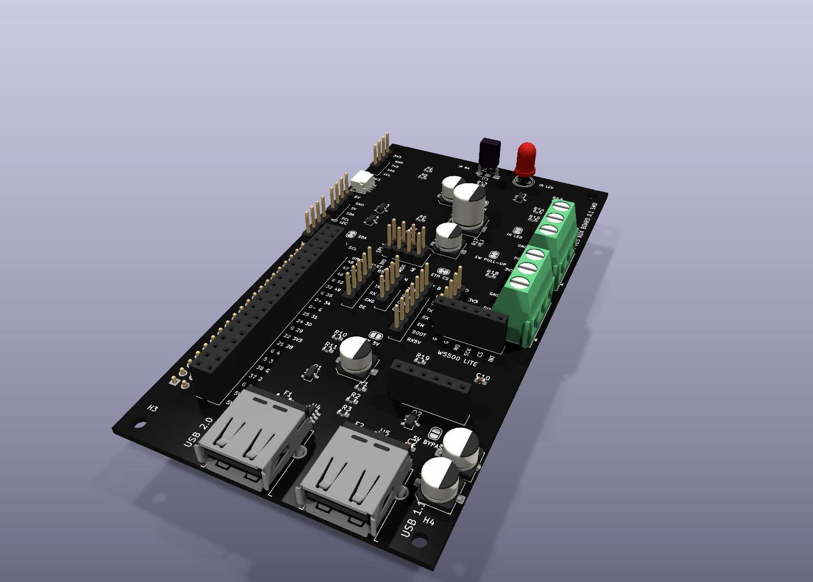
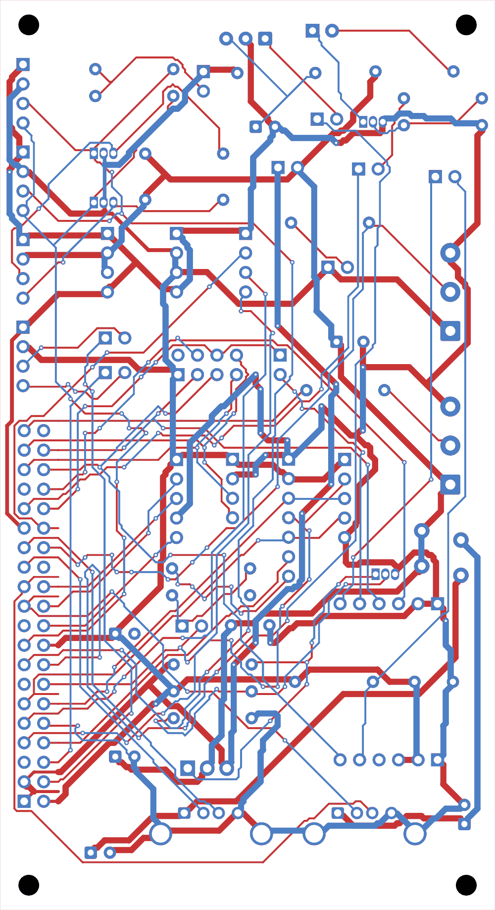

# The auxiliary board for the 40-pin header

A board that plugs onto the header and takes each port of P4OS to a
connector with a name. The plan, the blocks and the two variants are in
[docs/plan/PCB.md](../../docs/plan/PCB.md) (Spanish); the pin map it follows
is [docs/img/pinout.svg](../../docs/img/pinout.svg).

**Where it stands (2026-11-12): a first schematic of both variants, a first
placement of their parts, the first tracks and a trial of the routing that
joined everything but four ground pads; nothing built. The outline
printed in plastic (`fit-test-th-print.svg`) was tried on the P4: the four
holes and the header fit.** Every part
value and footprint is a first choice to review against its datasheet.

- **th**, for a soldering iron: axial resistors, TO-92 transistors, every
  bridge a 2.54 mm jumper. The board is two layers, ordered bare.
- **smd**, for assembly at the factory: 0603 passives, SOT-23 transistors,
  solder bridges, a Qwiic socket and ESD protection on the USB lines. Its
  connectors are the same through-hole ones, soldered by hand afterwards.

RS485 and CAN are not on the board in either: their modules plug onto pin
headers (the automatic "RS485 to TTL" one on 3V3, TX, RX, GND; an
SN65HVD230 on 3V3, GND, CTX, CRX). Ethernet is a "W5500 Lite" module
(HW-884) on two sockets of six.

**There is no second 2x20 socket with the forty pins again** (taken out on
2026-11-11: nothing used it). In its place three headers of four pins:
switched 5 V and ground, 3.3 V and ground, and the three GPIO that no
other connector of the board carries, 35 (a strapping pin) and 37 and 38
(the console's UART). They stand above the 2x20, between the I2C headers
and the SPI one; beside the 2x20 there are only two bulk capacitors, the
5 V one next to its switch. The silkscreen names the header's forty pins
beside their solder joints.

**Supplies and ground are not to be routed thin:** 0.8 mm at least to the
5 V and 3.3 V headers and wherever it fits, 0.5 mm only through a passage
that takes no more. The ground planes join each ground pin by four spokes
of 0.8 mm.

## The Ethernet module's place

The module that answered on the bench (`docs/plan/ETHERNET.md`) has its
pins and its chip on one face and the RJ45 on the other, so on its sockets
it lies chip down with the RJ45 on top, its mouth to the board's right
edge. The silkscreen draws where it lies.

- The two rows are 20.32 mm apart (`ETH_ROWS` in `place.py`), measured.
- Pin 1 of each socket (G and GND) is the pin nearest the RJ45's mouth,
  as on the module. The row G, G, MO, SCK, CS, INT is the upper one.
- The first pin is 7.5 mm from the module's edge on the RJ45 side
  (`ETH_PIN1`), behind the module's two mounting holes: with it the
  module's edge is on the board's and the RJ45 sticks out past it. Found
  with the printed plate on 2026-11-12: the first guess, 2.5 mm read off
  photographs, left the sockets 5 mm too far out. **Tried again that
  evening on a second plate, with the module on it: its pins go into the
  two rows, the RJ45 comes out at the edge and the module's board does not
  stick out past the plate.**
- Under the module there are 8.5 mm (the sockets' height): a resistor, a
  small capacitor or SMD parts fit, a pin header or an electrolytic do
  not. `place.py` refuses a tall part there.

| File | What it is |
|---|---|
| `gen.py` | the board as a list: its parts and the net on each pin, for the two variants |
| `kisch.py` | writes a KiCad schematic from that list, with KiCad's own symbols |
| `aux-board-th.kicad_sch`, `aux-board-smd.kicad_sch` | the schematics, generated: open them in KiCad 10 |
| `place.py` | puts those parts on a board with the P4's outline and holes, with their nets and the silkscreen; it runs under KiCad's Python |
| `aux-board-th.kicad_pcb`, `aux-board-smd.kicad_pcb` | those boards, generated: drafts to look at and to move, with the first tracks (below) |
| `paper-th.svg` | the through-hole board's front at its real size, outline, lettering and pads: printed on paper at 100 %, it is laid on the P4 and the parts are stood on it |
| `autoroute.py` | a trial router: routes the generated board to show where it is hard ("A trial of the routing", below) |
| `fit-test-th.svg`, `fit-test-th-print.svg` | the through-hole board's outline with every hole, 1 unit = 1 mm: a slicer extrudes it into a plate to try the fit on the P4. The second has each hole 0.4 mm wider, for a printer that closes small holes |

| Through-hole | SMD |
|---|---|
|  |  |

*The drafts as KiCad renders them, black as they would be ordered. The
board is the size of the P4's own and sits on its four holes. The
silkscreen names every connector, every pin and every bridge; where each
part goes is a first guess. `place.py` refuses a placement where two parts
overlap or one leaves the board (the USB sockets overhang on purpose).*

## The tracks so far

`place.py` lays what needs no choice, and lays it again every time it runs:

- **A fan-out of the 2x20 header on the front:** every pin that is not
  ground leaves to a column just right of the header, the inner row
  straight and the outer row through the gap above its own row (0.25 mm,
  0.4 mm for 5 V and 3.3 V).
- **Under the header, the back takes no track and no via** (a KiCad rule
  area): the ground pins reach the back plane by the strip each side of
  the two rows.
- **A ground plane on each face.** The files keep the planes unfilled
  (filled, each file is more than twice the size): KiCad fills them with B.

It then asks KiCad for its design rule check on a copy with the planes
filled, and prints what is left:

    routed: 47 track segments and two ground planes; still to join: 118 connections
    design rules: silk_edge_clearance x4, track_dangling x32

Ground is joined everywhere by the planes; 118 connections of the other
53 nets are still to route (128 on the SMD variant). The four silkscreen
warnings are the USB sockets' outlines, which overhang the edge on
purpose, and the 32 dangling tracks are the fan-out, which goes nowhere
yet.

**The boards are generated, so a track drawn by hand in KiCad is lost the
next time `place.py` runs.** While parts are still moving, tracks go in
the script; routing by hand starts once the placement is frozen, and from
then on `place.py` is not run again.

## A trial of the routing (2026-11-12)

`autoroute.py` routes the generated board by itself, to find where the
placement is hard before anyone routes it for real. It runs under KiCad's
Python in about half a minute and writes `trial-th.kicad_pcb` or
`trial-smd.kicad_pcb`, which are not kept in git: open them in KiCad to
look.

    <KiCad's python3> hw/aux-board/autoroute.py th



It is a plain maze router on a 0.3175 mm grid that starts on the header's
pin 1: 0.25 mm tracks, 0.8 mm for the supplies and for ground (0.5 mm,
then 0.25 mm, where 0.8 finds no room; it says where), 0.6 mm vias,
KiCad's default 0.2 mm clearance, ground last. A net with no way takes off the
nets in its way and they are routed again after it. Its tracks pass
KiCad's rules and are not pretty: **the trial boards are not for
manufacture.**

What it found:

- **The board routes on two layers.** Every signal and supply net was
  joined on both variants, with no clearance error. It took 136 vias (th)
  and 196 (smd) and about 3.6 m of track, which a person will better by
  far.
- **The 2x20 header is the tight spot.** A pin of its outer row has one
  way out, the gap between two pins of the inner row, and a track of
  another net through that gap shuts it in. In every run, most of the
  connections the router could not make started on a pin of the header.
  The fan-out and the clear back underneath, both in `place.py` now, give
  each pin its way out; even so the router needed its rip-up and several
  settings to join everything.
- **Ground does not take care of itself.** With tracks on both faces the
  planes are cut into pieces: on the through-hole trial three ground pads
  (on C11, J14 and R11) were reached by no plane and no track, and four on
  the SMD one. The real routing has to keep the back mostly whole, or tie
  the pieces with vias and short tracks.
- **The supplies fit at 0.8 mm almost everywhere.** On the through-hole
  board every stretch of 5 V, switched 5 V and the two USB sockets' 5 V
  went at 0.8 mm, and 3.3 V all but two (one of them to a pin of the
  3.3 V header, at 0.5 mm). On the SMD one the stretches to the USB
  sockets' protection chips went thinner, one at 0.25 mm: their pads are
  0.95 mm apart.
- **The band between the header and the pin headers in the middle** is
  where the tracks crowd; the top and the right of the board are almost
  empty. The three small headers stood in that band at first, twelve
  holes in the way; with them moved above the 2x20 the router joined
  everything at its first setting, where before it needed its fifth.
- **Not tried by it:** the two USB pairs as pairs. The router treats D+
  and D- as two wires; the USB 2.0 pair (pins 25 and 27 to J3) wants to be
  routed first, by hand, together and with no via.

The same board gives the same result: the router takes pads by reference
and pin, not in the order KiCad saved them. It tries up to six settings of
what a via and the back cost, and keeps the first that joins everything.

```
python3 hw/aux-board/gen.py --check
```

writes the schematic and asks KiCad (`kicad-cli`) for its ERC and its
netlist, and compares each netlist with the list: 73 parts (th) or 75
(smd), the same 54 nets, no violation, none different.

The schematic has no wires: each pin carries a label with its net's name,
and pins with the same name are joined. Change the list and generate again
rather than editing the `.kicad_sch` by hand, until the layout starts.

A KiCad that was never opened has no library tables yet, and its ERC warns
about that for every part; the check leaves those warnings out. Opening
KiCad once and accepting the default libraries makes them go away.
