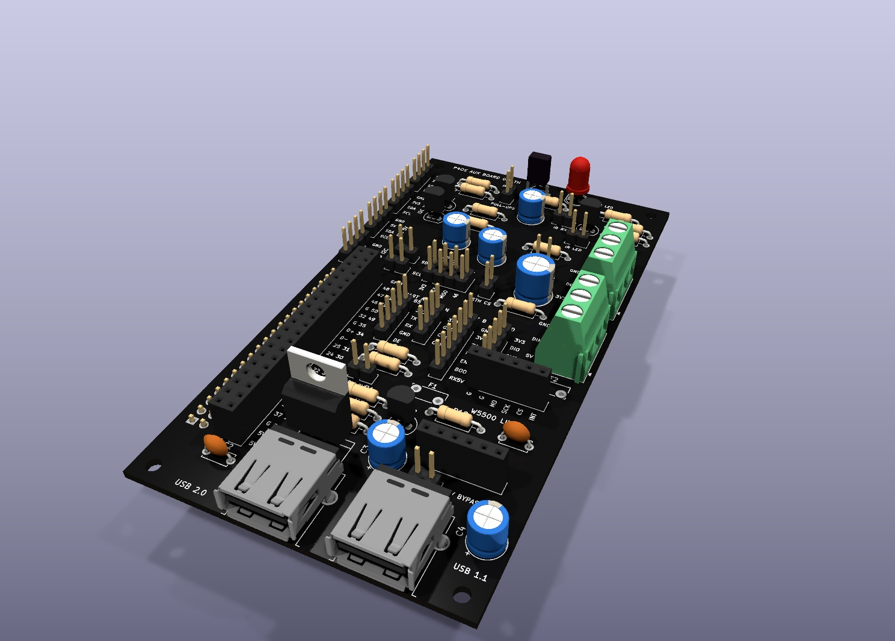

# The auxiliary board for the 40-pin header

A board that plugs onto the header and takes each port of P4OS to a
connector with a name. The plan, the blocks and the two variants are in
[docs/plan/PCB.md](../../docs/plan/PCB.md) (Spanish); the pin map it follows
is [docs/img/pinout.svg](../../docs/img/pinout.svg).

**Where it stands (2026-11-10): a first schematic of both variants and a
first placement of their parts, nothing routed, nothing built.** Every part
value and footprint is a first choice to review against its datasheet.

- **th**, for a soldering iron: axial resistors, TO-92 transistors, every
  bridge a 2.54 mm jumper. The board is two layers, ordered bare.
- **smd**, for assembly at the factory: 0603 passives, SOT-23 transistors,
  solder bridges, a Qwiic socket and ESD protection on the USB lines. Its
  connectors are the same through-hole ones, soldered by hand afterwards.

RS485 and CAN are not on the board in either: their modules plug onto pin
headers (the automatic "RS485 to TTL" one on 3V3, TX, RX, GND; an
SN65HVD230 on 3V3, GND, CTX, CRX). Ethernet is a "W5500 Lite" module
(HW-884) on two sockets of six, 20.32 mm apart as measured on the module
(`ETH_ROWS` in `place.py`).

| File | What it is |
|---|---|
| `gen.py` | the board as a list: its parts and the net on each pin, for the two variants |
| `kisch.py` | writes a KiCad schematic from that list, with KiCad's own symbols |
| `aux-board-th.kicad_sch`, `aux-board-smd.kicad_sch` | the schematics, generated: open them in KiCad 10 |
| `place.py` | puts those parts on a board with the P4's outline and holes, with their nets and the silkscreen; it runs under KiCad's Python |
| `aux-board-th.kicad_pcb`, `aux-board-smd.kicad_pcb` | those boards, generated: drafts to look at and to move, with no tracks |
| `fit-test-th.svg`, `fit-test-th-print.svg` | the through-hole board's outline with every hole, 1 unit = 1 mm: a slicer extrudes it into a plate to try the fit on the P4. The second has each hole 0.4 mm wider, for a printer that closes small holes |

| Through-hole | SMD |
|---|---|
|  |  |

*The drafts as KiCad renders them, black as they would be ordered. The
board is the size of the P4's own and sits on its four holes. The
silkscreen names every connector, every pin and every bridge; where each
part goes is a first guess. `place.py` refuses a placement where two parts
overlap or one leaves the board (the USB sockets overhang on purpose).*

```
python3 hw/aux-board/gen.py --check
```

writes the schematic and asks KiCad (`kicad-cli`) for its ERC and its
netlist, and compares each netlist with the list: 71 parts (th) or 73
(smd), the same 54 nets, no violation, none different.

The schematic has no wires: each pin carries a label with its net's name,
and pins with the same name are joined. Change the list and generate again
rather than editing the `.kicad_sch` by hand, until the layout starts.

A KiCad that was never opened has no library tables yet, and its ERC warns
about that for every part; the check leaves those warnings out. Opening
KiCad once and accepting the default libraries makes them go away.
