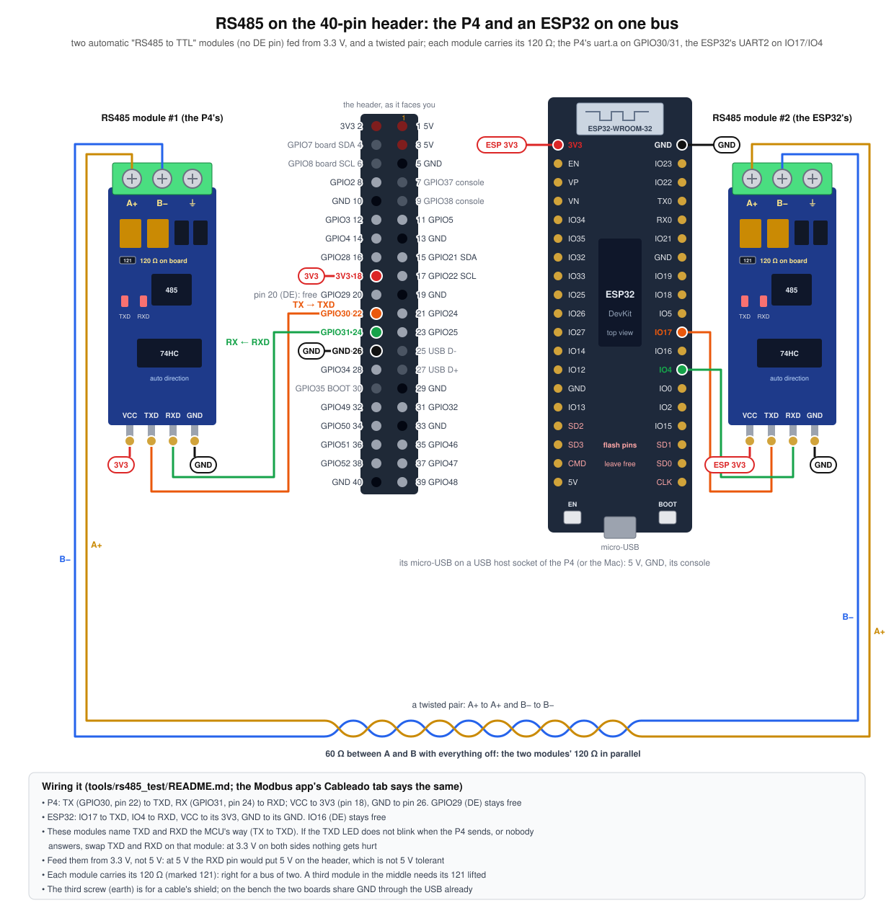

# A second node for trying RS485

What goes on the other end of the bus to try the Modbus app on a real
RS485 line (apps/modbus, `docs/MODULES.md` "RS485"), wired as in
`docs/img/bench-rs485.svg`: the P4 and an ESP32 DevKit, each with an
automatic RS485 module fed from 3.3 V, on a twisted pair with 120 Ω at each
end.

## The transceivers

The bench's are two automatic **"RS485 to TTL"** modules: four pins (VCC,
TXD, RXD, GND), a green terminal block (A+, B−, and earth for a cable's
shield), an 8-pin transceiver, a 74HC-type chip that switches the direction
on the data by itself (so **no DE pin**), TXD and RXD LEDs, fuses and TVS
diodes, and a **120 Ω already across A and B** (the SMD marked 121). With
one module at each end of a two-node bus that is the termination done:
about 60 Ω between A and B with everything off.

| | P4 (`uart.a`) | ESP32 DevKit (UART2) |
|---|---|---|
| TXD | GPIO30, pin 22 (TX) | IO17 |
| RXD | GPIO31, pin 24 (RX) | IO4 |
| VCC | 3V3, pin 18 | 3V3 |
| GND | pin 26 | GND |
| DE | GPIO29, pin 20: free | IO16: free |

- **Feed them from 3.3 V**, not 5 V: at 5 V the RXD pin would put 5 V on the
  header, which is not 5 V tolerant.
- **TXD and RXD** are named the microcontroller's way on these boards (TX to
  TXD). If the TXD LED does not blink when the P4 sends, or nobody answers,
  swap the two wires on that module: with 3.3 V on both sides nothing gets
  hurt.
- **A+ to A+, B− to B−**, on a twisted pair. Some makers label A and B the
  other way round; if nobody answers, swap them, it breaks nothing.
- A third module in the middle of the bus would need its 121 lifted.
- The DE pins stay free: the P4's UART still drives GPIO29 and the ESP32
  IO16, which does nothing with an automatic module. A module with a DE
  pin (MAX3485, SP3485) takes DE and /RE tied together on those pins
  instead, and works with the same firmware and the same app.

## esp32

An ESP-IDF project for an ESP32 (the 38-pin DevKit of the bench) that plays
a Modbus RTU slave or master on the bus.

    cd tools/rs485_test/esp32
    idf.py set-target esp32 && idf.py build

It loads like `tools/usb_test/hola_esp32` (its README): from the Mac with
`idf.py flash monitor`, or with the ESP32 on a USB host socket of the P4,
`build/flasher_args.json` and the three bins it names go to a folder under
`/firmware` on the card, keeping those paths, and the Programmer writes it.
The console is UART0 at 115200, so the Terminal on `usb0` shows it.

It starts as a **slave**, unit 1, 9600 8N1. The BOOT button, or `r` on the
console, switches it to **master** and back; speed, format, unit and role
are kept across resets.

### As a slave: a made-up drive

What the P4's Maestro tab talks to. A variable-speed drive, so the values
mean something and move:

| Table | Address | What |
|---|---|---|
| holding | 0 | speed setpoint, rpm (1450) |
| | 1, 2 | acceleration and deceleration ramps, 0.1 s |
| | 3 | current limit, 0.1 A |
| | 4 | top speed, rpm |
| | 9 | "firmware" 0x0102 |
| input | 0 | speed, rpm, following the setpoint along the ramp |
| | 1 | current, 0.1 A |
| | 2 | DC bus, V |
| | 3 | temperature, 0.1 °C, warming with the load |
| | 4, 5 | running hours and minutes |
| coils | 0 | run |
| | 1 | reverse |
| | 2 | reset the counters (goes back to 0 by itself) |
| | 3 | relay 1 (also lights IO5) |
| discrete | 0-3 | running, at speed, in current limit, hot |

Holding and input go to 99, coils and discrete to 63; past that it answers
exception 02, a count it does not take exception 03, a function it does not
know exception 01. It also answers 08 (echo), 17 (report slave id:
"ESP32-VFD") and 43/14 (device identification).

**From the P4:** Maestro, unit 1, `03 Holding` from 0, 10: Enviar. Then
`05 Coil` 0 ON (run) and `04 Input` live: the speed climbs to 1450 along the
ramp, the current and the temperature follow. "Buscar unidades" finds unit
1; "Buscar velocidad" finds 9600 8N1 (change the ESP32's with `b` and `f`
and look again).

**Faults**, with `x`: none, silent, slow (400 ms, past the app's 300 ms
default), broken CRC, busy (exception 06). Each shows in the Maestro's
counts and in the Traffic tab as what it is.

### As a master

What the P4's Esclavo tab answers. Every 500 ms it reads holding 0-9,
input 0-7 and coils 0-15 of its unit; every third round it writes holding 0
and flips a coil; every tenth it writes holding 10-12 with FC 16, and prints
its counts: answered, exceptions, no answer, bad CRC, wrong answers, the
average and the longest delay. Each fault the Esclavo tab plays (Mudo,
Lento, CRC malo, Ocupado, Falla) shows on this side as what a real master
would see.

### Both ends listening: the Monitor

With the ESP32 as master and something else as slave (a meter, a drive, a
second ESP32), the P4's Monitor tab listens without driving the line and
shows each unit's questions, answers, silences and delays. Without a third
node, the ESP32 as master and nobody answering is already a monitor test:
every request counts as unanswered.

### The console

    r  role: slave <-> master (or the BOOT button)
    b  next speed (9600 19200 38400 57600 115200 4800 2400)
    f  next format (8N1 8E1 8O1 8N2)
    u  next unit (1..5)
    x  slave: next fault (none, silent, slow, broken CRC, busy)
    q  quiet: stop / start printing every frame
    s  the master's counts, now
    h  the list

Every frame is printed both ways in hex, with the time since the last one.
